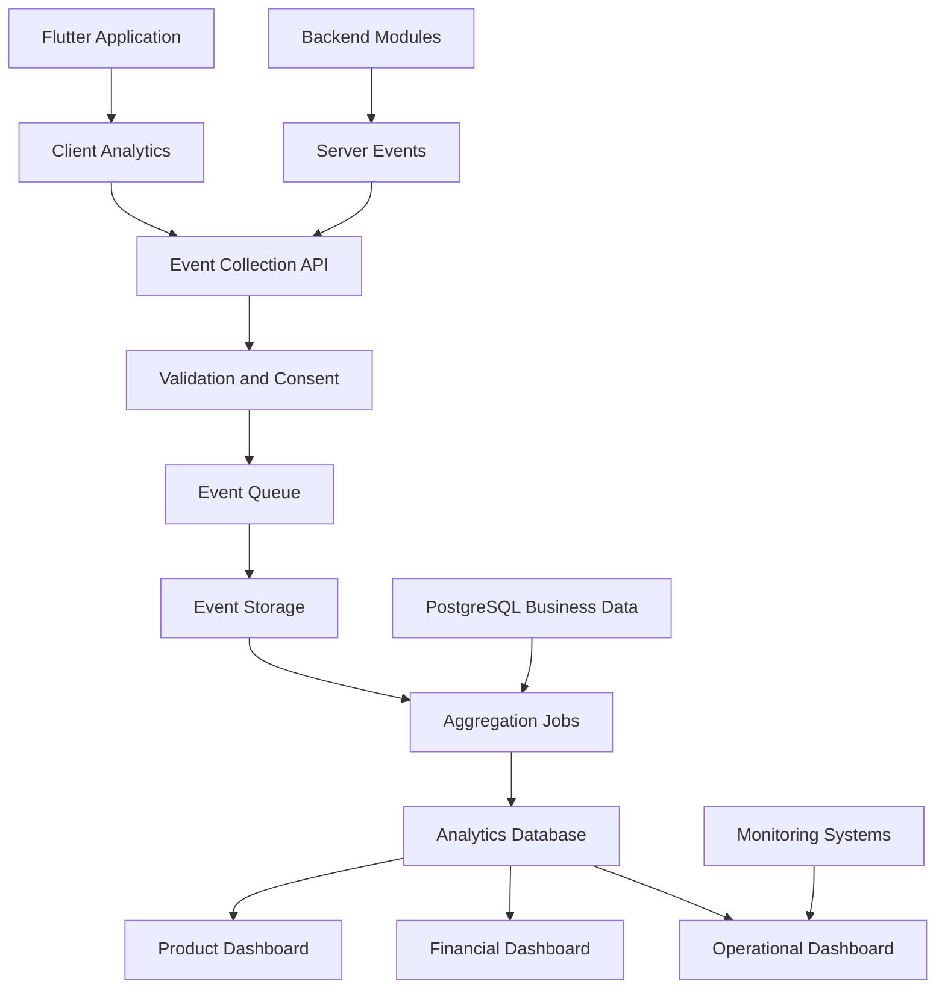

# ANALYTICS_AND_METRICS.md

# Analitik, Ürün Metrikleri ve Performans Ölçüm Mimarisi

**Proje:** AI Destekli Fal ve Sosyal Etkileşim Platformu  
**Dosya:** `ANALYTICS_AND_METRICS.md`  
**Sürüm:** 1.0.0  
**Durum:** Teknik ve ürün analitiği taslağı  
**Öncelik:** P1 — Temel ölçüm altyapısı MVP kapsamında kurulmalıdır.

---

## 1. Amaç

Bu doküman, platformdaki kullanıcı davranışlarının, ürün performansının, finansal süreçlerin ve teknik altyapının nasıl ölçüleceğini tanımlar.

Platform birden fazla ürün modülünden oluşmaktadır:

- AI Fal Merkezi
- Falcılar Ligi
- Sosyal ağ
- Topluluklar
- Flört ve eşleşme
- Mesajlaşma
- Abonelik ve kredi sistemi
- Bildirimler

Her modülün kendi başarı metrikleri bulunacaktır. Bununla birlikte bütün modüller ortak analitik standartlarını kullanmalıdır.

### 1.1. Temel hedefler

1. Kullanıcı edinme ve aktivasyonu ölçmek.
2. Kullanıcıların hangi özellikleri kullandığını anlamak.
3. Kullanıcı tutundurma oranlarını takip etmek.
4. Gelir ve maliyetleri analiz etmek.
5. AI işlem performansını ölçmek.
6. Falcılar Ligi ticari performansını izlemek.
7. Sosyal etkileşim ve eşleşme kalitesini değerlendirmek.
8. Teknik hataları ve performans sorunlarını tespit etmek.
9. Ürün kararlarını ölçülebilir verilere dayandırmak.
10. Gizlilik ve veri minimizasyonu ilkelerine uymak.

**Temel prensip:** Ölçülemeyen bir özellik hakkında güvenilir ürün kararı vermek zordur. Ancak yalnızca ölçülebiliyor olması, her kullanıcı davranışının kaydedilmesini haklı çıkarmaz.

---

## 2. Analitik Mimarisi

Önerilen başlangıç mimarisi:



### 2.1. Veri kaynakları

| Kaynak | Veri türü |
|---|---|
| Flutter | Ekran ve etkileşim olayları |
| Backend | İşlem sonuçları ve sistem olayları |
| PostgreSQL | Kalıcı iş verileri |
| AI Worker | Model performansı ve maliyetler |
| Payment Module | Finansal işlemler |
| Notification Module | Bildirim teslimatları |
| Moderation Module | Güvenlik ve moderasyon verileri |
| Monitoring | Teknik performans |

### 2.2. Kaynak doğruluğu

İş açısından kritik olayların doğruluk kaynağı backend olmalıdır.

Örneğin:

- Başarılı ödeme.
- Tamamlanan sipariş.
- Harcanan kredi.
- Oluşturulan eşleşme.
- Tamamlanan AI işlemi.

Bu olaylar yalnızca Flutter tarafından gönderilen analitik eventlerine dayanarak hesaplanmamalıdır.

---

## 3. Önerilen Teknoloji Seti

| Alan | Öneri | Durum |
|---|---|---|
| Mobil analitik | Firebase Analytics veya PostHog | TBD |
| Ürün analitiği | PostHog veya alternatif | TBD |
| Backend event sistemi | Merkezi event collector | Önerildi |
| İş veritabanı | PostgreSQL | Önerildi |
| Event kuyruğu | Mevcut backend queue altyapısı | Önerildi |
| Dashboard | Metabase veya Grafana | TBD |
| Teknik monitoring | Prometheus / Grafana | Önerildi |
| Error tracking | Sentry | Önerildi |
| Veri ambarı | İlerleyen aşamada değerlendirilecek | TBD |

İlk aşamada birden fazla analitik sağlayıcısı kullanmak zorunlu değildir.

Tek bir ürün analitiği aracı, PostgreSQL raporları ve teknik monitoring altyapısı MVP için yeterli olabilir.

---

## 4. Event Tracking Standardı

Bütün analitik olayları ortak bir isimlendirme ve veri sözleşmesi kullanmalıdır.

### 4.1. İsimlendirme

Önerilen format:

`module.object.action`

Örnekler:

- `auth.user.registered`
- `fortune.request.created`
- `fortune.result.viewed`
- `social.post.created`
- `marketplace.order.completed`
- `dating.match.created`

Event isimleri geçmiş verilerin karşılaştırılabilmesi için kararlı tutulmalıdır.

### 4.2. Ortak event şeması

```json
{
  "event_id": "event-uuid",
  "event_name": "fortune.result.viewed",
  "event_version": 1,
  "user_id": "internal-user-uuid",
  "session_id": "session-uuid",
  "timestamp": "2026-11-06T11:00:00Z",
  "platform": "android",
  "app_version": "1.0.0",
  "properties": {
    "fortune_type": "coffee",
    "source": "notification"
  }
}
```

### 4.3. Zorunlu alanlar

- `event_id`
- `event_name`
- `event_version`
- `timestamp`
- `platform`
- `properties`

`user_id` ve `session_id` yalnızca ilgili olayda gerekli ve izinli olduğunda bulunmalıdır.

### 4.4. Veri güvenliği

Analitik eventleri içerisinde aşağıdaki bilgiler varsayılan olarak bulunmamalıdır:

- Parolalar.
- Access veya refresh tokenlar.
- Özel mesaj içerikleri.
- Ham fal görselleri.
- Ham fal yorumları.
- Ödeme kartı bilgileri.
- Açık adres veya kesin GPS koordinatları.
- Kullanıcının hassas kişisel tercihleri.
- Kimlik doğrulama belgeleri.

---

## 5. Temel Ürün Metrikleri

### 5.1. Aktif kullanıcılar

**DAU — Daily Active Users**

Bir gün içerisinde en az bir anlamlı etkinlik gerçekleştiren benzersiz kullanıcı sayısı.

**WAU — Weekly Active Users**

Yedi günlük dönemde aktif olan benzersiz kullanıcı sayısı.

**MAU — Monthly Active Users**

Otuz günlük dönemde aktif olan benzersiz kullanıcı sayısı.

Anlamlı etkinlik tanımı merkezi olarak belirlenmelidir. Arka plan bildirimleri veya otomatik token yenilemeleri aktif kullanım sayılmamalıdır.

### 5.2. DAU/MAU oranı

\[
Stickiness=\frac{DAU}{MAU}\times100
\]

Bu oran, günlük aktif kullanıcıların aylık aktif kullanıcı tabanına göre büyüklüğünü gösterir.

Farklı kullanım sıklığına sahip ürünlerde tek başına başarı ölçütü değildir.

### 5.3. Kullanıcı aktivasyonu

Aktivasyon, kullanıcının platformun temel değerini ilk kez deneyimlemesi olarak tanımlanmalıdır.

Örnek aktivasyon olayları:

- İlk AI fal sonucunu görüntüleme.
- İlk sosyal gönderiyi oluşturma.
- İlk topluluğa katılma.
- İlk yorumcu hizmetini satın alma.

Modül bazlı aktivasyon ayrı ölçülmelidir.

---

## 6. Kullanıcı Edinme Metrikleri

| Metrik | Açıklama |
|---|---|
| New Registrations | Yeni kayıtlar |
| Registration Conversion | Kayıt dönüşüm oranı |
| Acquisition Source | Kullanıcı edinme kanalı |
| CAC | Müşteri edinme maliyeti |
| Cost per Registration | Kayıt başına maliyet |
| Activation Rate | Aktive olan kullanıcı oranı |

### 6.1. Kayıt dönüşümü

\[
RegistrationConversion=
\frac{CompletedRegistrations}{RegistrationStarts}\times100
\]

### 6.2. Edinme maliyeti

\[
CAC=\frac{AcquisitionCosts}{AcquiredCustomers}
\]

Burada müşteri tanımı açıkça belirlenmelidir. Kayıt olan kullanıcı ile ödeme yapan müşteri aynı metrik değildir.

---

## 7. Kullanıcı Tutundurma

Retention, kullanıcıların belirli bir zaman sonra platforma geri dönme oranını ölçer.

### 7.1. Cohort analizi

Kullanıcılar kayıt tarihlerine göre gruplandırılır.

Örnek:

| Cohort | D1 | D7 | D30 |
|---|---:|---:|---:|
| Hafta 1 | %42 | %25 | %12 |
| Hafta 2 | %45 | %27 | %14 |
| Hafta 3 | %40 | %24 | %11 |

Bu değerler yalnızca örnek veridir.

### 7.2. Retention formülü

\[
Retention_{D7}=
\frac{UsersActiveOnDay7}{CohortUsers}\times100
\]

Gün tanımları ve saat dilimi bütün raporlarda tutarlı olmalıdır.

### 7.3. Modül bazlı retention

- AI fal kullanıcılarının geri dönüşü.
- Sosyal ağ kullanıcılarının geri dönüşü.
- Topluluk kullanıcılarının geri dönüşü.
- Falcılar Ligi müşterilerinin tekrar satın alması.
- Flört modülü kullanıcılarının geri dönüşü.

---

## 8. AI Fal Merkezi Analitiği

### 8.1. Takip edilecek olaylar

| Event | Açıklama |
|---|---|
| `fortune.flow.started` | Fal oluşturma akışı başladı |
| `fortune.image.uploaded` | Görsel yükleme tamamlandı |
| `fortune.request.created` | Fal talebi oluşturuldu |
| `fortune.processing.started` | AI işlemi başladı |
| `fortune.processing.completed` | AI işlemi tamamlandı |
| `fortune.processing.failed` | AI işlemi başarısız |
| `fortune.result.viewed` | Fal sonucu görüntülendi |
| `fortune.result.shared` | Fal sonucu paylaşıldı |

### 8.2. Temel metrikler

- Günlük fal talebi.
- Fal türüne göre kullanım.
- Tamamlanma oranı.
- Hata oranı.
- Ortalama işlem süresi.
- Sonuç görüntüleme oranı.
- Tekrar fal oluşturma oranı.
- Fal başına AI maliyeti.
- Fal başına gelir.

### 8.3. Tamamlanma oranı

\[
CompletionRate=
\frac{CompletedFortunes}{CreatedFortuneRequests}\times100
\]

Belirli bir dönemde oluşturulan taleplerin sonuçları, tamamlanma gecikmeleri dikkate alınarak hesaplanmalıdır.

---

## 9. AI Maliyet Analitiği

AI işlemleri doğrudan değişken maliyet oluşturur.

Bu nedenle maliyet ölçümü ürün analitiğinden ayrı olarak da takip edilmelidir.

### 9.1. AI işlem kaydı

Önerilen tablo: `ai_usage_records`

| Alan | Açıklama |
|---|---|
| id | İşlem kaydı |
| user_id | Kullanıcı referansı |
| fortune_id | Fal referansı |
| provider | AI sağlayıcısı |
| model | Model |
| prompt_version | Prompt sürümü |
| input_tokens | Giriş token sayısı |
| output_tokens | Çıkış token sayısı |
| estimated_cost | Tahmini maliyet |
| actual_cost | Doğrulanmış maliyet, varsa |
| currency | Para birimi |
| latency_ms | İşlem süresi |
| status | İşlem sonucu |
| created_at | İşlem zamanı |

### 9.2. Maliyet formülü

\[
TotalAICost=\sum_{i=1}^{n}Cost_i
\]

### 9.3. Fal başına ortalama maliyet

\[
AverageCostPerFortune=
\frac{TotalAICost}{CompletedFortunes}
\]

### 9.4. Maliyet kontrolü

- Kullanıcı başına kullanım limiti.
- Model bazlı maliyet karşılaştırması.
- Gereksiz tekrar denemelerin tespiti.
- Prompt optimizasyonu.
- İşlem başına maliyet alarmı.
- Günlük ve aylık harcama limiti.

### 9.5. Önemli ayrım

AI sağlayıcısının tahmini token maliyeti, toplam hizmet maliyetinin tamamı değildir.

Depolama, worker, ağ, ödeme ve diğer altyapı maliyetleri de kârlılık hesaplamalarında değerlendirilmelidir.

---

## 10. Sosyal Ağ Analitiği

### 10.1. Olaylar

- `social.post.created`
- `social.post.viewed`
- `social.post.liked`
- `social.post.commented`
- `social.post.shared`
- `social.user.followed`
- `social.post.saved`

### 10.2. Metrikler

| Metrik | Açıklama |
|---|---|
| Posts Created | Oluşturulan gönderiler |
| Active Creators | İçerik üreten kullanıcılar |
| Engagement Rate | Etkileşim oranı |
| Comments per Post | Gönderi başına yorum |
| Shares per Post | Gönderi başına paylaşım |
| Creator Retention | İçerik üreticisi tutundurma |

### 10.3. Etkileşim oranı

Örnek tanım:

\[
EngagementRate=
\frac{Likes+Comments+Shares}{PostImpressions}\times100
\]

Bu formülde aynı kullanıcının birden fazla etkileşimi bulunabileceğinden oran %100'ü aşabilir.

Etkileşim oranı raporlarında kullanılan tanım açıkça belirtilmelidir.

---

## 11. Topluluk Analitiği

Takip edilecek olaylar:

- `community.joined`
- `community.left`
- `community.topic.created`
- `community.reply.created`
- `community.topic.viewed`

### 11.1. Metrikler

- Aktif topluluk sayısı.
- Topluluk başına aktif üye.
- Yeni konu sayısı.
- Konu başına yanıt.
- Topluluk katılım oranı.
- Tekrar katılım.
- Moderasyon rapor oranı.

Topluluk büyüklüğü tek başına kalite göstergesi değildir.

---

## 12. Flört ve Eşleşme Analitiği

Flört modülü analitiği özellikle veri minimizasyonuna dikkat etmelidir.

### 12.1. Takip edilecek olaylar

- `dating.module.activated`
- `dating.profile.completed`
- `dating.recommendation.shown`
- `dating.profile.liked`
- `dating.profile.passed`
- `dating.match.created`
- `dating.conversation.started`
- `dating.module.deactivated`

### 12.2. Temel metrikler

| Metrik | Açıklama |
|---|---|
| Dating Activation Rate | Flört modülüne katılım |
| Profile Completion Rate | Profil tamamlama |
| Like Rate | Öneri başına beğeni |
| Mutual Match Rate | Karşılıklı eşleşme |
| Conversation Start Rate | Eşleşme sonrası sohbet başlatma |
| Reply Rate | İlk mesaja yanıt |
| Block Rate | Engelleme oranı |
| Report Rate | Şikâyet oranı |

### 12.3. Eşleşme oranı

Örnek tanım:

\[
MutualMatchRate=
\frac{MutualMatches}{EligibleLikes}\times100
\]

Bir eşleşme iki tarafın beğenisini içerebildiği için pay ve paydanın veri modeline göre kesin tanımlanması gerekir.

### 12.4. Fal sinyallerinin etkisi

A/B testleriyle aşağıdakiler karşılaştırılabilir:

- Fal sinyali kullanılmayan öneriler.
- İsteğe bağlı fal sinyali kullanılan öneriler.

Başarı yalnızca eşleşme sayısına göre değil, sohbet başlangıcı, karşılıklı yanıt ve güvenlik metriklerine göre değerlendirilmelidir.

### 12.5. Gizlilik

Ham flört tercihleri, özel mesajlar ve fal metinleri analitik dashboardlara aktarılmamalıdır.

Küçük kullanıcı gruplarını tanımlanabilir hale getirebilecek kırılımlar sınırlandırılmalıdır.

---

## 13. Mesajlaşma Analitiği

Mesajlaşma metrikleri mesaj içeriği olmadan hesaplanmalıdır.

### 13.1. Olaylar

- `chat.conversation.created`
- `chat.message.sent`
- `chat.message.delivered`
- `chat.message.read`
- `chat.connection.failed`

### 13.2. Metrikler

- Günlük aktif konuşma.
- Mesaj gönderim başarısı.
- Mesaj teslim gecikmesi.
- WebSocket bağlantı başarısı.
- Yeniden bağlanma sayısı.
- Mesajlaşma hataları.

Mesaj içerikleri ürün analitiği amacıyla kaydedilmemelidir.

---

## 14. Falcılar Ligi Analitiği

Falcılar Ligi, platformun ticari modüllerinden biridir.

### 14.1. Olaylar

- `marketplace.service.viewed`
- `marketplace.order.created`
- `marketplace.payment.completed`
- `marketplace.order.accepted`
- `marketplace.order.delivered`
- `marketplace.order.completed`
- `marketplace.order.cancelled`
- `marketplace.review.created`
- `marketplace.refund.completed`

### 14.2. Temel metrikler

| Metrik | Açıklama |
|---|---|
| GMV | Brüt işlem hacmi |
| Net GMV | İadeler sonrası işlem hacmi |
| Platform Revenue | Platform geliri |
| Take Rate | Platform gelirinin işlem hacmine oranı |
| Order Conversion | Hizmetten siparişe dönüşüm |
| Order Completion Rate | Tamamlanan sipariş oranı |
| Refund Rate | İade oranı |
| Repeat Purchase Rate | Tekrar satın alma |
| Active Tellers | Aktif yorumcular |
| Average Order Value | Ortalama sipariş tutarı |

### 14.3. GMV

\[
GMV=\sum OrderGrossAmount
\]

GMV, platformun kendi geliri değildir.

### 14.4. Take Rate

\[
TakeRate=
\frac{PlatformMarketplaceRevenue}{GMV}\times100
\]

Pay ve payda aynı dönem, para birimi ve muhasebe politikasına göre hesaplanmalıdır.

### 14.5. Sipariş dönüşümü

\[
OrderConversion=
\frac{CustomersWhoOrdered}{UniqueServiceViewers}\times100
\]

Tekil kullanıcı bazlı dönüşüm ile görüntüleme başına dönüşüm ayrı metriklerdir.

---

## 15. Ödeme ve Abonelik Analitiği

### 15.1. Metrikler

- Başlatılan ödeme.
- Başarılı ödeme.
- Başarısız ödeme.
- Ödeme başarı oranı.
- Abonelik dönüşümü.
- Aktif abonelik.
- Abonelik iptal oranı.
- Yenileme başarısı.
- Kredi satın alma.
- Kredi tüketimi.
- İade oranı.

### 15.2. Payment Success Rate

\[
PaymentSuccessRate=
\frac{SuccessfulPaymentAttempts}{TotalPaymentAttempts}\times100
\]

Tekrarlanan teknik denemeler ile ayrı müşteri ödeme girişimleri farklı analiz edilmelidir.

### 15.3. MRR

Aylık yinelenen gelir, aktif aboneliklerin normalize edilmiş aylık gelir toplamıdır.

Tek seferlik kredi satışları MRR içerisine eklenmemelidir.

### 15.4. ARPU

\[
ARPU=\frac{Revenue}{ActiveUsers}
\]

Hesaplamada kullanılan gelir dönemi ile aktif kullanıcı dönemi aynı olmalıdır.

---

## 16. Dönüşüm Hunileri

Funnel analizi, kullanıcıların hangi adımda süreçten ayrıldığını gösterir.

### 16.1. AI fal hunisi

1. Fal ekranı açıldı.
2. Fal türü seçildi.
3. Gerekli bilgiler tamamlandı.
4. Fal talebi oluşturuldu.
5. Fal tamamlandı.
6. Sonuç görüntülendi.

### 16.2. Falcılar Ligi hunisi

1. Pazaryeri açıldı.
2. Hizmet görüntülendi.
3. Sipariş başlatıldı.
4. Ödeme başlatıldı.
5. Ödeme başarılı oldu.
6. Sipariş tamamlandı.

### 16.3. Flört hunisi

1. Flört modülü etkinleştirildi.
2. Profil tamamlandı.
3. Öneri görüntülendi.
4. Beğeni gönderildi.
5. Eşleşme gerçekleşti.
6. Sohbet başlatıldı.

### 16.4. Funnel kuralları

- Adımların sırası tanımlanmalıdır.
- Dönüşüm penceresi belirlenmelidir.
- Tekil kullanıcı ve olay sayısı ayrılmalıdır.
- Kullanıcı gizlilik tercihleri dikkate alınmalıdır.

---

## 17. North Star Metric

Platformun tek bir temel başarı metriği olması faydalı olabilir.

Ancak platform birden fazla bağımsız modüle sahip olduğu için tek metrik tüm ürün değerini doğru temsil etmeyebilir.

### 17.1. Önerilen yaklaşım

Platform düzeyinde:

**Weekly Meaningfully Engaged Users**

Yedi gün içerisinde en az bir temel ürün değerini deneyimleyen benzersiz kullanıcılar.

Örnek değer olayları:

- Fal sonucu görüntüleme.
- Anlamlı sosyal etkileşim.
- Topluluk katılımı.
- Tamamlanan hizmet deneyimi.
- Karşılıklı sohbet etkileşimi.

### 17.2. Koruyucu metrikler

North Star Metric tek başına optimize edilmemelidir.

Beraberinde:

- Kullanıcı şikâyet oranı.
- Teknik hata oranı.
- AI maliyeti.
- İade oranı.
- Kullanıcı tutundurma.
- Gizlilik ihlali göstergeleri.

takip edilmelidir.

---

## 18. Analitik Veri Modeli

Önerilen temel tablolar:

### 18.1. Analytics Events

`analytics_events`

- id
- event_name
- event_version
- user_id
- session_id
- timestamp
- platform
- app_version
- properties
- created_at

### 18.2. Daily Metrics

`analytics_daily_metrics`

- id
- metric_date
- metric_name
- dimension_key
- dimension_value
- metric_value
- calculated_at

### 18.3. AI Usage Records

`ai_usage_records`

- id
- user_id
- fortune_id
- provider
- model
- input_tokens
- output_tokens
- estimated_cost
- actual_cost
- latency_ms
- status
- created_at

### 18.4. Experiment Assignments

`experiment_assignments`

- id
- experiment_id
- subject_id
- variant
- assigned_at

### 18.5. Event Schema Registry

`analytics_event_schemas`

- id
- event_name
- event_version
- schema_definition
- status
- created_at

---

## 19. Veri Toplama ve İşleme

### 19.1. Flutter tarafı

Flutter uygulaması yalnızca gerekli kullanıcı etkileşimlerini takip etmelidir.

Önerilen soyutlama:

```dart
abstract class AnalyticsService {
  Future<void> track(
    String eventName,
    Map<String, Object?> properties,
  );

  Future<void> setUserId(String? userId);
}
```

Bu arayüz sayesinde analitik sağlayıcısı değiştirilebilir.

### 19.2. Backend tarafı

Backend, iş açısından kritik olayları kendi işlem akışından üretmelidir.

Örnek:

```python
analytics.track(
    event_name="fortune.processing.completed",
    user_id=user_id,
    properties={
        "fortune_type": fortune_type,
        "model": model_name,
        "latency_ms": latency_ms,
    },
)
```

Bu örnek mantıksal kullanım gösterimidir. Gerçek uygulamada analitik gönderimi kritik transaction'ları bekletmemeli, güvenilir event aktarımı kullanılmalıdır.

### 19.3. Event doğrulama

- Event adı kayıtlı olmalıdır.
- Şema versiyonu doğrulanmalıdır.
- Gerekli alanlar bulunmalıdır.
- Veri tipleri uygun olmalıdır.
- Yasaklı kişisel veriler filtrelenmelidir.
- Yinelenen eventler kontrol edilmelidir.

---

## 20. Event İşleme Güvenilirliği

Analitik sistemde aşağıdaki sorunlar beklenmelidir:

- Aynı eventin iki kez gönderilmesi.
- Mobil cihazın çevrimdışı olması.
- Geç gelen eventler.
- Kullanıcı saatinin yanlış olması.
- Queue gecikmesi.
- Event şemasının değişmesi.

### 20.1. Önlemler

- Benzersiz `event_id`.
- Event deduplication.
- Sunucu alım zamanı.
- Event oluşum zamanı.
- Şema versiyonlama.
- Kontrollü retry.
- Veri kalitesi kontrolleri.

### 20.2. Eventual consistency

Analitik dashboardların gerçek zamanlı finansal işlem sistemleriyle birebir aynı anda güncellenmesi zorunlu değildir.

Ancak veri gecikmesi izlenmeli ve raporlarda son güncelleme zamanı gösterilmelidir.

---

## 21. Dashboard Tasarımı

### 21.1. Executive Dashboard

Yönetim için:

- DAU / WAU / MAU.
- Yeni kullanıcılar.
- Aktivasyon oranı.
- D7 / D30 retention.
- Toplam gelir.
- AI maliyeti.
- Falcılar Ligi GMV.
- Ödeme başarı oranı.
- Kritik hata sayısı.

### 21.2. Product Dashboard

Ürün ekibi için:

- Ekran kullanım oranları.
- Modül bazlı aktivasyon.
- Funnel dönüşümleri.
- Kullanıcı tutundurma.
- A/B test sonuçları.
- Bildirim performansı.

### 21.3. AI Operations Dashboard

- Günlük fal sayısı.
- Model bazlı kullanım.
- Ortalama işlem süresi.
- Başarı oranı.
- Hata nedenleri.
- AI maliyeti.
- Fal başına maliyet.

### 21.4. Marketplace Dashboard

- GMV.
- Platform komisyon geliri.
- Sipariş sayısı.
- Aktif yorumcu.
- İade oranı.
- Ortalama teslim süresi.
- Yorumcu performansı.

### 21.5. Safety Dashboard

- Açık moderasyon vakaları.
- Rapor oranı.
- İnceleme süresi.
- Tekrarlanan ihlaller.
- İtiraz sonucu değişen kararlar.

---

## 22. A/B Testing Altyapısı

A/B testleri, ürün değişikliklerinin etkisini ölçmek için kullanılacaktır.

### 22.1. Test örnekleri

- Fal sonucu ekranı tasarımı.
- Ücretsiz fal limiti.
- Falcılar Ligi sıralaması.
- Flört öneri algoritması.
- Bildirim metinleri.
- Sosyal akış sıralaması.

### 22.2. Deney yapısı

Her deney:

- Benzersiz deney kimliği.
- Hipotez.
- Kontrol grubu.
- Deney grubu.
- Birincil başarı metriği.
- Koruyucu metrikler.
- Başlangıç ve bitiş koşulları.

içermelidir.

### 22.3. Örnek deney

**Hipotez:** Fal sonucu ekranındaki paylaşım seçeneğinin daha görünür olması, fal paylaşım oranını artırır.

Kontrol: Mevcut ekran.

Deney: Yeni paylaşım alanı.

Birincil metrik: Fal sonucu görüntüleyen kullanıcı başına paylaşım oranı.

Koruyucu metrik: Ekrandan çıkış oranı.

### 22.4. Deney güvenliği

Güvenlik, gizlilik veya zorunlu yasal haklar A/B testleriyle azaltılmamalıdır.

---

## 23. Teknik Monitoring

Ürün analitiği ve sistem monitoring'i farklı sorumluluklara sahiptir.

### 23.1. Backend metrikleri

- Request count.
- Error rate.
- Response latency.
- Database latency.
- Queue length.
- Worker failures.
- CPU / memory kullanımı.

### 23.2. Flutter metrikleri

- Crash-free users.
- Crash-free sessions.
- App startup time.
- Screen rendering performance.
- API failure rate.

### 23.3. Realtime metrikleri

- Aktif WebSocket bağlantıları.
- Yeniden bağlantı oranı.
- Mesaj gönderim gecikmesi.
- Mesaj teslim başarısı.

---

## 24. Alarm ve Uyarı Sistemi

Kritik metriklerde olağan dışı değişiklikler tespit edildiğinde teknik ekibe uyarı gönderilmelidir.

### 24.1. Örnek alarm senaryoları

| Durum | Örnek aksiyon |
|---|---|
| API hata oranı yükseldi | Teknik ekibe uyarı |
| AI maliyeti beklenmedik arttı | Harcama kontrolü |
| Ödeme başarı oranı düştü | Payment incelemesi |
| Worker kuyruğu büyüdü | Worker kapasite kontrolü |
| Fal tamamlanma oranı düştü | AI servis incelemesi |
| Crash oranı arttı | Mobil sürüm incelemesi |

Alarm eşikleri sistemin gerçek trafik seviyesine göre belirlenmelidir.

---

## 25. Gizlilik ve Veri Koruma

Analitik sistemi `SECURITY_AND_PRIVACY.md` ile uyumlu olmalıdır.

### 25.1. Veri minimizasyonu

Yalnızca tanımlanmış ölçüm amacı için gerekli bilgiler toplanmalıdır.

### 25.2. Kimlik ayrıştırma

Mümkün olduğunda analitik sistemde doğrudan kişisel kimlik bilgileri yerine iç sistem kimlikleri kullanılmalıdır.

### 25.3. Rıza ve hukuki dayanak

Analitik sağlayıcısı, cihaz tanımlayıcıları, çerezler ve benzeri teknolojilerin kullanımı ilgili mevzuat çerçevesinde değerlendirilmelidir.

Zorunlu hizmet ölçümleri ile pazarlama veya davranışsal analizler ayrı amaçlarla ele alınmalıdır.

### 25.4. Saklama süreleri

Ham eventlerin saklama süresi ile toplulaştırılmış raporların saklama süresi farklı olabilir.

Süreler:

- Veri işleme amacı.
- Hukuki yükümlülükler.
- Güvenlik gereksinimleri.
- Analiz ihtiyacı.

dikkate alınarak belirlenmelidir.

### 25.5. Kullanıcı hakları

Uygulanabilir veri koruma hakları kapsamında erişim, silme ve diğer taleplerin analitik veri akışlarında da karşılanması planlanmalıdır.

---

## 26. Analitik Yetkilendirme

Her yönetici tüm analitik verilere erişememelidir.

### 26.1. Roller

| Rol | Erişim |
|---|---|
| Product Analyst | Ürün metrikleri |
| AI Operations | AI kullanım ve maliyetleri |
| Finance | Finansal raporlar |
| Moderator | Güvenlik metrikleri |
| Administrator | Yetkilendirilmiş genel raporlar |

### 26.2. Kontroller

- Role-based access control.
- Veri alanı bazlı kısıtlamalar.
- Hassas raporlarda toplulaştırma.
- Audit logging.
- Dışa aktarma yetkileri.

---

## 27. Analitik Veri Kalitesi

Yanlış veri, yanlış ürün kararlarına neden olabilir.

### 27.1. Kontroller

- Event şema doğrulaması.
- Eksik event tespiti.
- Yinelenen event kontrolü.
- Beklenmedik değer kontrolü.
- Backend-finansal kayıt mutabakatı.
- Veri gecikmesi ölçümü.
- Dashboard hesaplama testleri.

### 27.2. Finansal doğruluk

Finansal raporlar yalnızca analitik eventlerinden hesaplanmamalıdır.

Ödeme, iade, komisyon ve payout raporları doğrulanmış finansal kayıtlarla mutabık olmalıdır.

---

## 28. Performans ve Ölçeklenebilirlik

### 28.1. MVP

- Merkezi event toplama.
- Temel event şemaları.
- PostgreSQL tabanlı raporlar.
- Günlük aggregation jobs.
- Temel dashboardlar.

### 28.2. Büyüme aşaması

- Ayrı analitik veritabanı.
- Batch processing.
- Gelişmiş event queue.
- Veri ambarı.
- Daha ayrıntılı cohort analizleri.

### 28.3. Büyük ölçek

İhtiyaç oluştuğunda:

- Columnar analytics database.
- Streaming analytics.
- Feature store.
- Gelişmiş deney altyapısı.
- Tahminleme modelleri.

değerlendirilebilir.

İlk sürümde bu altyapıların tamamını kurmak gerekli değildir.

---

## 29. Test Stratejisi

### 29.1. Unit Tests

- Event validation.
- Metrik formülleri.
- Retention hesaplamaları.
- Funnel hesaplamaları.
- Deduplication.
- Veri filtreleme.

### 29.2. Integration Tests

- Flutter analytics adapter.
- Backend event collector.
- Queue.
- PostgreSQL.
- Dashboard sorguları.
- Finansal veri mutabakatı.

### 29.3. End-to-End Tests

- Kullanıcı kayıt olur.
- İlk falını oluşturur.
- Fal sonucu görüntülenir.
- İlgili eventler oluşur.
- Eventler işlenir.
- Dashboard güncellenir.
- Kullanıcı iznini değiştirir.
- Veri toplama davranışı yeni tercihe uyar.

---

## 30. MVP Metrik Öncelikleri

İlk sürümde aşağıdaki metriklerin kurulması önerilir.

| Metrik | Öncelik |
|---|---|
| DAU / WAU / MAU | P1 |
| Yeni kayıtlar | P1 |
| Aktivasyon oranı | P1 |
| D1 / D7 retention | P1 |
| Fal talep sayısı | P1 |
| Fal tamamlanma oranı | P1 |
| AI işlem maliyeti | P1 |
| Ödeme başarı oranı | P1 |
| Toplam gelir | P1 |
| API hata oranı | P1 |
| Mobil crash oranı | P1 |
| Marketplace GMV | Modül yayına çıktığında |
| Eşleşme oranı | Modül yayına çıktığında |
| Sosyal etkileşim oranı | Modül yayına çıktığında |
| A/B test altyapısı | P2 |

---

## 31. Açık Teknik Kararlar

| Konu | Durum |
|---|---|
| Ürün analitiği sağlayıcısı | TBD |
| Event collector | Önerildi |
| Dashboard aracı | TBD |
| Ham event saklama süresi | TBD |
| Veri ambarı | Gelecek aşama |
| North Star Metric | İlk öneri hazır |
| Aktivasyon tanımı | Modül bazında kesinleştirilecek |
| Retention zaman penceresi | Standartlaştırılacak |
| AI maliyet muhasebesi | Provider bazlı tasarlanacak |
| Finansal rapor doğruluk kaynağı | Payment kayıtları |
| A/B testing aracı | TBD |
| Analitik rıza modeli | Hukuki inceleme gerekli |

---

## 32. Kabul Kriterleri

- [ ] Event isimlendirme standardı oluşturuldu.
- [ ] Event şemaları versiyonlanıyor.
- [ ] Flutter analitik katmanı merkezi.
- [ ] Backend kritik iş olaylarını üretiyor.
- [ ] Yinelenen eventler kontrol ediliyor.
- [ ] DAU / WAU / MAU hesaplanıyor.
- [ ] Kullanıcı aktivasyonu ölçülüyor.
- [ ] Retention raporları oluşturuluyor.
- [ ] AI fal kullanım metrikleri izleniyor.
- [ ] AI maliyetleri takip ediliyor.
- [ ] Ödeme ve gelir raporları oluşturuluyor.
- [ ] Teknik monitoring çalışıyor.
- [ ] Kritik hata alarmları tanımlanıyor.
- [ ] Analitik veriler yetki kontrollü erişiliyor.
- [ ] Hassas kullanıcı verileri eventlerden filtreleniyor.
- [ ] Dashboardlar veri kaynağı ve güncelleme zamanı gösteriyor.
- [ ] Finansal raporlar doğrulanmış kayıtlarla mutabık.

---

## 33. İlişkili Dokümanlar

- `PROJECT_OVERVIEW.md`
- `APP_FEATURES.md`
- `PRD.md`
- `API_SPECIFICATION.md`
- `DATABASE_SCHEMA.md`
- `SYSTEM_ARCHITECTURE.md`
- `BACKEND_ARCHITECTURE.md`
- `FLUTTER_ARCHITECTURE.md`
- `AI_SYSTEM_DESIGN.md`
- `PAYMENT_AND_MONETIZATION.md`
- `FORTUNE_TELLER_MARKETPLACE.md`
- `MATCHING_ALGORITHM.md`
- `CHAT_AND_REALTIME.md`
- `NOTIFICATION_SYSTEM.md`
- `CONTENT_MODERATION.md`
- `SECURITY_AND_PRIVACY.md`
- `LEGAL_AND_COMPLIANCE.md`

---

## 34. Sonuç

Analitik altyapısı, platformun ürün geliştirme ve ticari kararlarının temel veri kaynağı olacaktır.

Sistemin yalnızca kullanıcı sayısını değil; kullanıcıların hangi değeri deneyimlediğini, hangi modüllerin sürdürülebilir olduğunu, AI maliyetlerinin nasıl değiştiğini ve platform güvenliğinin nasıl etkilendiğini ölçmesi gerekir.

**Temel mimari kararı:** Kritik iş metrikleri backend kaynaklı doğrulanmış olaylardan ve iş kayıtlarından hesaplanmalı; mobil analitik kullanıcı etkileşimlerini ölçmek için kullanılmalıdır.

**Doküman durumu:** Teknik ve ürün analitiği taslağı.

**Not:** Analitik sağlayıcısı, veri saklama süreleri, rıza modeli ve dashboard araçları geliştirme öncesinde kesinleştirilmelidir.