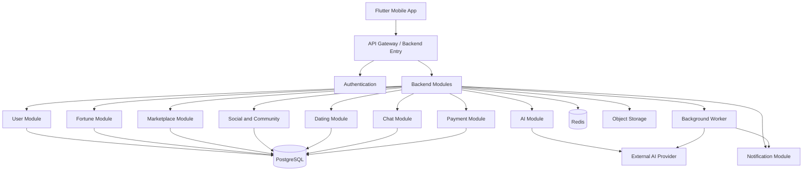
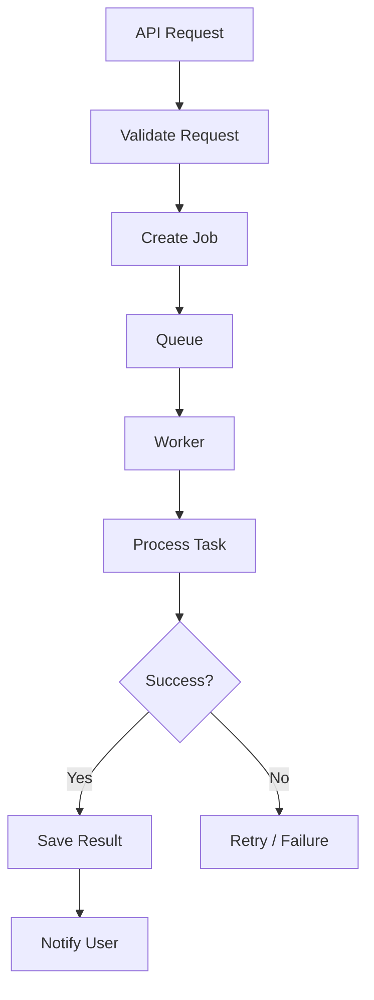

# BACKEND_ARCHITECTURE.md

# Backend Sistem Mimarisi

**Proje:** AI Destekli Fal ve Sosyal Etkileşim Platformu  
**Dosya:** `BACKEND_ARCHITECTURE.md`  
**Sürüm:** 1.0.0  
**Durum:** Teknik mimari taslağı  
**Öncelikli mimari yaklaşım:** Modular Monolith

---

## 1. Amaç

Bu doküman, platformun backend altyapısının nasıl tasarlanacağını, geliştirileceğini ve yönetileceğini tanımlar.

Backend sisteminin temel sorumlulukları:

- Kullanıcı hesaplarını yönetmek.
- Kimlik doğrulama ve yetkilendirme sağlamak.
- AI fal işlemlerini yürütmek.
- Falcılar Ligi siparişlerini yönetmek.
- Sosyal ağ ve topluluk işlemlerini gerçekleştirmek.
- Flört ve eşleşme algoritmalarını çalıştırmak.
- Mesajlaşma ve bildirimleri yönetmek.
- Ödeme ve abonelik işlemlerini yürütmek.
- Yönetim ve moderasyon işlemlerini sağlamak.
- Sistem güvenliğini ve veri bütünlüğünü korumak.

Backend, Flutter uygulamasının kullandığı merkezi iş mantığı katmanıdır.

Mobil uygulama doğrudan veritabanına veya AI sağlayıcılarına erişmemelidir.

---

## 2. Mimari Yaklaşım

### 2.1. Önerilen mimari: Modular Monolith

İlk aşamada mikroservis mimarisi yerine **Modular Monolith** önerilmektedir.

Bu yaklaşımda tüm backend tek bir ana uygulama olarak çalışır ancak içerisindeki iş alanları bağımsız modüllere ayrılır.

Örneğin:

- Auth Module
- User Module
- Fortune Module
- AI Module
- Marketplace Module
- Social Module
- Community Module
- Dating Module
- Chat Module
- Payment Module
- Notification Module
- Moderation Module

Her modül kendi iş kurallarına ve veri erişim sorumluluklarına sahip olur.

### 2.2. Neden Modular Monolith?

İlk aşamada mikroservis kullanmak aşağıdaki maliyetleri artırabilir:

- Dağıtık sistem yönetimi
- Servisler arası iletişim
- Dağıtık transaction yönetimi
- Monitoring ve loglama karmaşıklığı
- Deployment süreçleri
- Altyapı maliyetleri

Modular Monolith ile başlangıçta daha az operasyonel karmaşıklıkla ilerlenebilir.

İlerleyen aşamada yoğun trafik alan veya bağımsız ölçeklendirme ihtiyacı doğuran modüller ayrı servislere dönüştürülebilir.

### 2.3. Mimari prensipler

1. Her modül belirli bir iş alanından sorumludur.
2. Modüller birbirlerinin veritabanı tablolarına doğrudan müdahale etmemelidir.
3. Modüller arası iletişim tanımlı servis arayüzleri üzerinden yürütülmelidir.
4. Kritik işlemler transaction güvenliğiyle gerçekleştirilmelidir.
5. Uzun süren işlemler arka plan görevlerine taşınmalıdır.
6. API katmanı iş mantığını doğrudan taşımamalıdır.
7. Güvenlik kontrolleri sunucu tarafında uygulanmalıdır.

---

## 3. Önerilen Teknoloji Seti

| Alan | Önerilen teknoloji | Durum |
|---|---|---|
| Backend dili | Python | Önerildi |
| Backend framework | FastAPI | Önerildi |
| API standardı | REST API | Belirlendi |
| Ana veritabanı | PostgreSQL | Önerildi |
| Cache | Redis | Önerildi |
| Background jobs | Celery | Önerildi |
| Message broker | Redis veya RabbitMQ | TBD |
| Realtime | WebSocket | Önerildi |
| Dosya depolama | S3 uyumlu object storage | Önerildi |
| ORM | SQLAlchemy | Önerildi |
| Migration | Alembic | Önerildi |
| Validation | Pydantic | Önerildi |
| API dokümantasyonu | OpenAPI / Swagger | Önerildi |
| Container | Docker | Önerildi |
| Reverse proxy | Nginx veya uygun gateway | TBD |
| Monitoring | Prometheus / Grafana | Önerildi |
| Error tracking | Sentry | Önerildi |

Bu teknoloji seti başlangıç önerisidir. Kesin seçimler teknik prototip ve maliyet değerlendirmesinden sonra yapılacaktır.

---

## 4. Genel Sistem Mimarisi



Bu şema mantıksal bileşenleri gösterir. İlk sürümde modüllerin ayrı sunucularda çalışması zorunlu değildir.

---

## 5. Backend Klasör Yapısı

Önerilen proje yapısı:

```text
backend/
│
├── app/
│   ├── main.py
│   ├── bootstrap.py
│   ├── config/
│   │   ├── settings.py
│   │   ├── database.py
│   │   ├── redis.py
│   │   └── logging.py
│   │
│   ├── core/
│   │   ├── security/
│   │   ├── authentication/
│   │   ├── authorization/
│   │   ├── exceptions/
│   │   ├── middleware/
│   │   ├── pagination/
│   │   └── utils/
│   │
│   ├── modules/
│   │   ├── auth/
│   │   ├── users/
│   │   ├── profiles/
│   │   ├── fortune/
│   │   ├── ai/
│   │   ├── marketplace/
│   │   ├── payments/
│   │   ├── social/
│   │   ├── communities/
│   │   ├── dating/
│   │   ├── chat/
│   │   ├── notifications/
│   │   ├── moderation/
│   │   ├── search/
│   │   └── admin/
│   │
│   ├── integrations/
│   │   ├── ai_providers/
│   │   ├── payment_providers/
│   │   ├── storage/
│   │   └── push_notifications/
│   │
│   ├── workers/
│   │   ├── tasks/
│   │   └── scheduler/
│   │
│   └── shared/
│       ├── schemas/
│       ├── enums/
│       └── contracts/
│
├── migrations/
├── tests/
├── scripts/
├── Dockerfile
├── docker-compose.yml
├── alembic.ini
├── pyproject.toml
└── README.md
```

### 5.1. Modül içi standart

Her modül mümkün olduğunca aşağıdaki yapıyı kullanmalıdır:

```text
fortune/
├── router.py
├── schemas.py
├── models.py
├── repository.py
├── service.py
├── dependencies.py
├── exceptions.py
└── tests/
```

Dosya ayrımı modülün karmaşıklığına göre genişletilebilir.

---

## 6. Modül Sorumlulukları

### 6.1. Authentication Module

Sorumlulukları:

- Kullanıcı kayıt işlemleri.
- Giriş ve çıkış.
- Token oluşturma ve yenileme.
- Parola sıfırlama.
- E-posta veya telefon doğrulama.
- Aktif oturum yönetimi.
- Hesap güvenliği.

Authentication, diğer modüllerin kullanabileceği merkezi kimlik doğrulama mekanizmasını sağlar.

### 6.2. User Module

- Kullanıcı bilgileri.
- Profil yönetimi.
- Kullanıcı tercihleri.
- Hesap durumu.
- Kullanıcı ayarları.
- Hesap silme süreçleri.

### 6.3. Fortune Module

- Fal türleri.
- Fal oluşturma.
- Fal görseli ve giriş verileri.
- Fal geçmişi.
- Fal sonuçları.
- Fal paylaşımı.
- Fal işlem durumları.

AI yorumlama işleminin kendisi AI Module üzerinden yürütülür.

### 6.4. AI Module

- AI sağlayıcı entegrasyonu.
- Prompt yönetimi.
- Fal türüne göre model seçimi.
- Girdi hazırlama.
- Çıktı doğrulama.
- Güvenlik kontrolleri.
- Token ve maliyet takibi.
- Hata ve tekrar deneme yönetimi.

AI sağlayıcı anahtarları yalnızca backend ortamında tutulmalıdır.

### 6.5. Marketplace Module

Falcılar Ligi iş mantığını yönetir.

- Yorumcu profilleri.
- Yorumcu başvuruları.
- Hizmet tanımları.
- Hizmet fiyatları.
- Sipariş oluşturma.
- Sipariş kabul ve teslim işlemleri.
- Değerlendirme sistemi.
- Komisyon hesaplaması.

### 6.6. Social Module

- Gönderi oluşturma.
- Gönderi düzenleme.
- Beğeni.
- Yorum.
- Takip ilişkileri.
- Kaydetme.
- Akış oluşturma.
- Gönderi görünürlüğü.

### 6.7. Community Module

- Topluluk oluşturma.
- Üyelik yönetimi.
- Konu ve yorum işlemleri.
- Moderatör yetkileri.
- Topluluk kuralları.
- İçerik sabitleme ve kaldırma.

### 6.8. Dating Module

- Flört modülü katılımı.
- Kullanıcı tercihleri.
- Keşif havuzu.
- Uyum sinyalleri.
- Beğeni ve geçme.
- Karşılıklı eşleşme.
- Eşleşme yönetimi.

### 6.9. Chat Module

- Konuşma oluşturma.
- Katılımcı kontrolü.
- Mesaj gönderme.
- Mesaj geçmişi.
- Okundu bilgisi.
- Realtime olayları.
- Engelleme ve raporlama entegrasyonu.

### 6.10. Payment Module

- Ödeme başlatma.
- Ödeme sağlayıcısı entegrasyonu.
- Webhook doğrulama.
- Abonelik yönetimi.
- AI kredi bakiyesi.
- İade işlemleri.
- Komisyon ve kazanç kayıtları.

### 6.11. Notification Module

- Bildirim oluşturma.
- Bildirim listeleme.
- Okundu bilgisi.
- Push notification gönderimi.
- Kullanıcı bildirim tercihleri.

### 6.12. Moderation Module

- İçerik raporları.
- Kullanıcı şikâyetleri.
- Moderasyon kararları.
- Hesap kısıtlama.
- İçerik kaldırma.
- İtiraz süreçleri.

---

## 7. API Katmanı

API, Flutter uygulaması ile backend arasındaki iletişimi sağlar.

### 7.1. Genel standartlar

- REST API
- JSON veri formatı
- `/api/v1/` sürümleme
- Merkezi hata formatı
- Pagination
- Rate limiting
- Authentication middleware
- Request validation

### 7.2. Endpoint grupları

| Grup | Prefix |
|---|---|
| Auth | `/api/v1/auth` |
| Users | `/api/v1/users` |
| Profiles | `/api/v1/profiles` |
| Fortune | `/api/v1/fortunes` |
| AI | `/api/v1/ai` |
| Marketplace | `/api/v1/marketplace` |
| Payments | `/api/v1/payments` |
| Social | `/api/v1/social` |
| Communities | `/api/v1/communities` |
| Dating | `/api/v1/dating` |
| Chat | `/api/v1/chat` |
| Notifications | `/api/v1/notifications` |
| Moderation | `/api/v1/moderation` |
| Admin | `/api/v1/admin` |

Endpoint ayrıntıları `API_SPECIFICATION.md` içerisinde tanımlanır.

---

## 8. Veritabanı Mimarisi

Ana ilişkisel veritabanı olarak PostgreSQL önerilmektedir.

### 8.1. Temel prensipler

- İlişkisel veri bütünlüğü korunmalıdır.
- Foreign key kullanılmalıdır.
- Kritik alanlarda unique constraint uygulanmalıdır.
- Para değerleri floating point yerine uygun decimal/numeric türlerinde tutulmalıdır.
- Tarihler UTC olarak saklanmalı, kullanıcıya yerel saat diliminde gösterilmelidir.
- Migration sistemi kullanılmalıdır.
- Silme işlemleri veri ilişkilerine göre tasarlanmalıdır.

### 8.2. Veri erişimi

Her modül kendi repository katmanı üzerinden veri erişimi sağlar.

Bir modül başka modülün tablolarını gelişigüzel güncellememelidir.

Örneğin Payment Module, Marketplace siparişini doğrudan değiştirmek yerine Marketplace Module tarafından tanımlanmış bir işlem arayüzünü kullanmalıdır.

Ayrıntılı tablo ve ilişki yapısı `DATABASE_SCHEMA.md` dosyasında tanımlanacaktır.

---

## 9. Background Jobs

Bazı işlemler kullanıcı isteği sırasında tamamlanmak zorunda değildir.

Bu işlemler arka plan görevleri olarak çalıştırılmalıdır.

### 9.1. Arka plan işlem örnekleri

- AI fal yorumlama.
- Push notification gönderimi.
- E-posta gönderimi.
- Görsel işleme.
- Büyük veri dışa aktarma.
- Günlük istatistik hesaplama.
- Zaman aşımına uğramış sipariş kontrolü.
- Abonelik yenileme kontrolü.
- Moderasyon taramaları.

### 9.2. İşlem akışı



### 9.3. Task güvenliği

- Görevler idempotent tasarlanmalıdır.
- Tekrarlanan görevler veri tutarsızlığı oluşturmamalıdır.
- Retry sayısı sınırlandırılmalıdır.
- Başarısız görevler takip edilebilir olmalıdır.
- Hassas veriler görev payload'larına gereksiz yere eklenmemelidir.

---

## 10. AI İşlem Altyapısı

AI işlemleri backend üzerinden yürütülür.

### 10.1. Örnek fal iş akışı

1. Kullanıcı fal talebi oluşturur.
2. Backend kullanıcı yetkisini doğrular.
3. Kullanıcının kredi veya kullanım hakkı kontrol edilir.
4. Fal kaydı oluşturulur.
5. İşlem kuyruğa gönderilir.
6. Worker gerekli görsel ve metin verilerini hazırlar.
7. AI sağlayıcısı çağrılır.
8. AI sonucu doğrulanır.
9. Fal sonucu veritabanına kaydedilir.
10. Kullanıcıya bildirim gönderilir.

### 10.2. AI sağlayıcı soyutlaması

AI sağlayıcısına doğrudan bağımlı bir mimari kurulmayacaktır.

Önerilen arayüz:

```python
from typing import Protocol

class AIProvider(Protocol):
    async def generate(
        self,
        prompt: str,
        model: str,
    ) -> dict:
        ...
```

Farklı sağlayıcılar bu arayüzü uygulayabilir.

### 10.3. Sağlayıcı değiştirme

- Sağlayıcı adapter katmanı kullanılmalıdır.
- Prompt versiyonları takip edilmelidir.
- Model seçimi merkezi yapılandırmadan yapılmalıdır.
- Sağlayıcı hatalarında kontrollü fallback değerlendirilebilir.
- Maliyet ve kullanım istatistikleri kaydedilmelidir.

Ayrıntılı tasarım `AI_SYSTEM_DESIGN.md` içerisindedir.

---

## 11. Cache ve Redis

Redis aşağıdaki amaçlarla kullanılabilir:

- Sık erişilen veriler.
- Rate limit sayaçları.
- Geçici oturum verileri.
- Kuyruk altyapısı.
- Realtime bağlantı koordinasyonu.
- Kısa süreli işlem kilitleri.

### 11.1. Cache prensipleri

- Cache kalıcı veri kaynağı değildir.
- Hassas veriler gereksiz yere cache'e alınmamalıdır.
- TTL belirlenmelidir.
- Veri güncellendiğinde cache invalidation yapılmalıdır.
- Cache erişimi ağ ve yetki seviyesinde sınırlandırılmalıdır.

---

## 12. Realtime Backend

Mesajlaşma ve canlı etkileşimler için WebSocket altyapısı kullanılabilir.

### 12.1. Realtime olayları

- `message.created`
- `message.read`
- `message.updated`
- `typing.started`
- `typing.stopped`
- `presence.updated`
- `notification.created`

### 12.2. Bağlantı yönetimi

- Kullanıcı kimliği bağlantı sırasında doğrulanmalıdır.
- Kullanıcı yalnızca yetkili olduğu konuşmalara katılabilmelidir.
- Bağlantı kesilmesi durumunda yeniden bağlanma desteklenmelidir.
- Mesaj geçmişi kalıcı veritabanından alınmalıdır.
- WebSocket bağlantısı, REST API yetkilendirmesini atlatmamalıdır.

---

## 13. Ödeme ve İşlem Güvenliği

Ödeme işlemleri Payment Module tarafından yönetilir.

### 13.1. Temel kurallar

- Ödeme sağlayıcısı adapter üzerinden entegre edilir.
- Kart bilgileri backend veritabanında saklanmaz.
- Webhook imzaları doğrulanır.
- İdempotency key kullanılır.
- Ödeme durumu sağlayıcıdan doğrulanır.
- Sipariş ve ödeme durumları birbirinden ayrı tutulur.
- Finansal hareketler denetlenebilir kayıtlarla saklanır.

### 13.2. İşlem bütünlüğü

Bir ödeme başarılı olduğunda ilgili siparişin güncellenmesi kontrollü bir işlem akışıyla gerçekleştirilmelidir.

Ödeme sağlayıcısından gelen aynı webhook birden fazla kez işlense bile kullanıcıya iki kez kredi tanımlanmamalı veya iki sipariş oluşturulmamalıdır.

---

## 14. Güvenlik ve Yetkilendirme

Backend güvenliğinin temel sorumluluğu sunucu tarafındadır.

### 14.1. Authentication

- JWT veya uygun token tabanlı sistem.
- Token yenileme.
- Oturum iptali.
- Parola güvenliği.
- MFA desteği.

### 14.2. Authorization

- RBAC
- Resource-level authorization
- Ownership checks
- Least privilege
- Denetim kayıtları

### 14.3. Güvenlik kontrolleri

- Input validation.
- SQL injection koruması.
- Rate limiting.
- CORS yapılandırması.
- Güvenli dosya yükleme.
- Secret management.
- Audit logging.
- Dependency scanning.

Ayrıntılı güvenlik kuralları `SECURITY_AND_PRIVACY.md` dosyasına göre uygulanacaktır.

---

## 15. Monitoring ve Loglama

Sistem çalışırken hem teknik performans hem de iş süreçleri izlenmelidir.

### 15.1. Teknik metrikler

- API response time
- Request count
- Error rate
- Database latency
- Worker queue length
- Failed jobs
- WebSocket connection count
- CPU ve memory kullanımı

### 15.2. İş metrikleri

- Günlük aktif kullanıcı
- Oluşturulan fal sayısı
- Başarılı AI işlemleri
- AI işlem maliyeti
- Tamamlanan siparişler
- Ödeme başarı oranı
- Eşleşme sayısı
- Mesajlaşma etkinliği

### 15.3. Log prensipleri

- Yapılandırılmış log formatı kullanılmalıdır.
- Hassas veriler loglanmamalıdır.
- Request ID veya correlation ID kullanılmalıdır.
- Kritik işlemler audit log'a yazılmalıdır.
- Log erişimleri sınırlandırılmalıdır.

---

## 16. Deployment ve Ortam Yönetimi

### 16.1. Ortamlar

- Development
- Testing
- Staging
- Production

Her ortamın veritabanı, secret ve servis yapılandırmaları ayrı olmalıdır.

### 16.2. Docker

Backend servisleri container ortamında çalıştırılabilecek şekilde hazırlanmalıdır.

İlk geliştirme aşamasında Docker Compose ile aşağıdaki servisler birlikte çalıştırılabilir:

- Backend API
- PostgreSQL
- Redis
- Background Worker
- Object Storage (geliştirme amaçlı)
- Monitoring servisleri (gerektiğinde)

Production ortamında servislerin çalışma ve ölçeklendirme stratejisi ayrıca belirlenmelidir.

### 16.3. CI/CD

Önerilen pipeline:

1. Kod kontrolü.
2. Lint ve format.
3. Unit testler.
4. Integration testler.
5. Güvenlik taraması.
6. Docker image oluşturma.
7. Staging deployment.
8. Smoke test.
9. Onaylı production deployment.

Veritabanı migration işlemleri deployment sürecinde kontrollü uygulanmalıdır.

---

## 17. Ölçeklenebilirlik Stratejisi

İlk aşamada tek backend uygulaması kullanılabilir.

Trafik arttığında aşağıdaki ölçeklendirme adımları izlenebilir:

### Aşama 1

- Tek backend instance.
- PostgreSQL.
- Redis.
- Background worker.

### Aşama 2

- Birden fazla API instance.
- Load balancer.
- Worker sayısının artırılması.
- Cache optimizasyonu.
- Database query optimizasyonu.

### Aşama 3

- Yoğun modüllerin ayrıştırılması.
- Bağımsız worker grupları.
- Realtime altyapısının ayrı ölçeklendirilmesi.
- Gerektiğinde read replica.

### Aşama 4

İhtiyaç doğrulanırsa bazı modüllerin bağımsız servislere ayrılması:

- AI Service
- Realtime Chat Service
- Notification Service
- Payment Service
- Search Service

Mikroservise geçiş yalnızca teknik veya operasyonel fayda sağladığında yapılmalıdır.

---

## 18. Hata Yönetimi ve Dayanıklılık

- Tüm API hataları standart formatta dönmelidir.
- Beklenmeyen hatalar merkezi olarak yakalanmalıdır.
- Dış servis çağrılarında timeout bulunmalıdır.
- Retry politikaları sınırlı ve kontrollü olmalıdır.
- Kritik işlemler idempotent olmalıdır.
- Veritabanı transaction'ları doğru kullanılmalıdır.
- Uzun işlemler HTTP bağlantısını gereksiz yere açık tutmamalıdır.
- Worker başarısızlıkları takip edilmelidir.

### 18.1. Dış servis hataları

AI veya ödeme sağlayıcısı geçici olarak erişilemez olduğunda sistemin tamamı kullanılamaz hale gelmemelidir.

İlgili modül uygun hata durumu üretmeli, işlem durumunu korumalı ve kullanıcıya anlaşılır geri bildirim vermelidir.

---

## 19. Test Stratejisi

### Unit Tests

- Service katmanı.
- Business rules.
- Repository mantığı.
- Validator.
- Permission kontrolleri.

### Integration Tests

- API endpointleri.
- Veritabanı işlemleri.
- Authentication.
- Ödeme webhookları.
- AI adapter.
- Background tasks.

### End-to-End Tests

- Kullanıcı kayıt ve giriş.
- Fal oluşturma.
- AI sonucu alma.
- Fal paylaşma.
- Sipariş oluşturma.
- Ödeme doğrulama.
- Mesaj gönderme.
- Eşleşme oluşturma.

Testler gerçek kullanıcı verileri yerine test verileriyle çalıştırılmalıdır.

---

## 20. Açık Teknik Kararlar

| Konu | Durum |
|---|---|
| Backend dili | Python önerildi |
| Framework | FastAPI önerildi |
| Mimari | Modular Monolith önerildi |
| Veritabanı | PostgreSQL önerildi |
| ORM | SQLAlchemy önerildi |
| Cache | Redis önerildi |
| Background jobs | Celery önerildi |
| Message broker | TBD |
| Realtime | WebSocket önerildi |
| Object storage | TBD |
| Hosting sağlayıcısı | TBD |
| CI/CD platformu | TBD |
| Monitoring | TBD |
| Search engine | İhtiyaca göre TBD |
| Mikroservis geçişi | Trafik ve ihtiyaç doğrultusunda |

---

## 21. Kabul Kriterleri

- [ ] Backend modüler bir yapıya sahip.
- [ ] Modüllerin sorumlulukları ayrılmış.
- [ ] API sürümleme uygulanıyor.
- [ ] Authentication ve authorization merkezi yönetiliyor.
- [ ] Veritabanı migration sistemi bulunuyor.
- [ ] AI işlemleri backend üzerinden yürütülüyor.
- [ ] Uzun işlemler background worker üzerinden çalışabiliyor.
- [ ] Ödeme işlemleri idempotent.
- [ ] Realtime bağlantılar yetkilendiriliyor.
- [ ] Loglama ve monitoring altyapısı bulunuyor.
- [ ] Development, staging ve production ayrılmış.
- [ ] Otomatik testler CI/CD sürecinde çalışıyor.
- [ ] Yeni modül eklemek mevcut modüllerin işleyişini bozmuyor.

---

## 22. İlişkili Dokümanlar

- `PROJECT_OVERVIEW.md`
- `APP_FEATURES.md`
- `PRD.md`
- `SYSTEM_ARCHITECTURE.md`
- `DATABASE_SCHEMA.md`
- `API_SPECIFICATION.md`
- `FLUTTER_ARCHITECTURE.md`
- `AI_SYSTEM_DESIGN.md`
- `PAYMENT_AND_MONETIZATION.md`
- `SECURITY_AND_PRIVACY.md`
- `USER_ROLES.md`
- `USER_FLOWS.md`

---

## 23. Sonuç

Backend altyapısı, platformun tüm modüllerini yöneten merkezi iş mantığı katmanı olacaktır.

İlk sürümde Modular Monolith yaklaşımıyla geliştirme maliyetini ve operasyonel karmaşıklığı düşük tutmak; ancak modülleri gelecekte bağımsız servisler haline getirilebilecek şekilde tasarlamak hedeflenmektedir.

**Temel mimari kararı:** Önce modüler ve sürdürülebilir bir sistem kur. Gerçek ölçek ihtiyacı ortaya çıktığında servisleri ayır.

**Doküman durumu:** Teknik taslak.  
**Not:** Teknoloji seçimleri geliştirme öncesinde prototip, performans ve maliyet testleriyle doğrulanmalıdır.