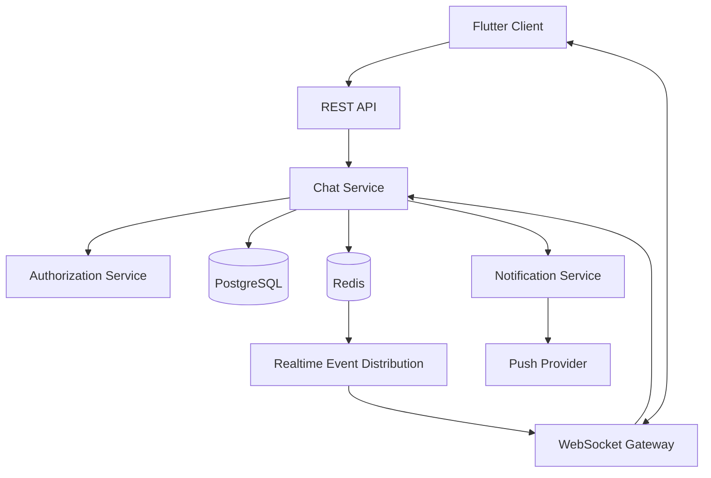
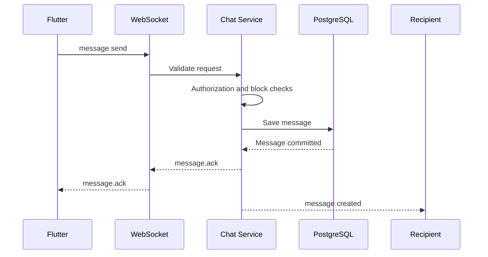

# CHAT_AND_REALTIME.md

# Mesajlaşma ve Gerçek Zamanlı İletişim Mimarisi

**Proje:** AI Destekli Fal ve Sosyal Etkileşim Platformu  
**Dosya:** `CHAT_AND_REALTIME.md`  
**Sürüm:** 1.0.0  
**Durum:** Teknik mimari taslağı  
**Önerilen yaklaşım:** REST API + WebSocket + PostgreSQL + Redis

---

## 1. Amaç

Bu doküman, platformdaki kullanıcılar arası mesajlaşma sisteminin ve gerçek zamanlı iletişim altyapısının nasıl geliştirileceğini tanımlar.

Mesajlaşma sistemi platformun aşağıdaki modülleriyle entegre çalışacaktır:

- Sosyal ağ
- Flört ve eşleşme
- Falcılar Ligi
- Kullanıcı profilleri
- Bildirim sistemi
- Moderasyon sistemi

Sistemin temel hedefleri:

1. Güvenilir mesaj gönderimi.
2. Gerçek zamanlı mesaj teslimatı.
3. Çevrimdışı mesajların korunması.
4. Okundu ve teslim edildi bilgilerinin yönetilmesi.
5. Kullanıcıların çevrimiçi durumlarının izlenmesi.
6. Güvenli konuşma erişimi.
7. Engelleme ve raporlama.
8. Birden fazla cihazın desteklenmesi.
9. Bağlantı kesintilerinden sonra senkronizasyon.
10. Ölçeklenebilir iletişim altyapısı.

**Temel prensip:** WebSocket mesaj iletimini hızlandırır; kalıcı mesaj kayıtlarının doğruluk kaynağı backend ve veritabanıdır.

---

## 2. Mesajlaşma Türleri

Platformun ilk sürümünde üç temel mesajlaşma senaryosu desteklenebilir.

### 2.1. Sosyal mesajlaşma

Kullanıcıların sosyal ağ üzerinden birbirleriyle iletişim kurmasını sağlar.

Özellikler:

- Birebir konuşma.
- Metin mesajı.
- Görsel paylaşımı.
- Okundu bilgisi.
- Kullanıcı engelleme.
- Konuşma raporlama.

İlk mesajı kimin gönderebileceği, mesaj isteği ve gizlilik ayarlarıyla yönetilmelidir.

### 2.2. Flört mesajlaşması

Flört modülündeki kullanıcılar arasında gerçekleşir.

Önerilen temel kural:

**Karşılıklı eşleşme gerçekleşmeden doğrudan flört mesajlaşması başlatılamaz.**

Eşleşme kaldırıldığında konuşmanın gelecekteki kullanımına ilişkin politika uygulanmalıdır.

Kullanıcı engelleme işlemi yeni mesaj gönderimini durdurmalıdır.

### 2.3. Falcılar Ligi mesajlaşması

Kullanıcı ve fal yorumcusu arasında siparişle ilişkili iletişimi sağlar.

Özellikler:

- Siparişle ilişkili konuşma.
- Hizmet hakkında bilgi alışverişi.
- Gerekli görsellerin paylaşılması.
- Sipariş durumuyla ilişkili mesajlar.

Sipariş konuşmaları, kişisel sosyal mesajlaşmadan ayrı bir konuşma türü olarak modellenmelidir.

---

## 3. Sistem Mimarisi

Önerilen mimari:



### 3.1. Bileşenler

| Bileşen | Sorumluluk |
|---|---|
| Flutter Chat UI | Konuşma ve mesaj ekranları |
| REST API | Geçmiş, konuşma yönetimi ve senkronizasyon |
| WebSocket Gateway | Canlı bağlantı ve olay iletimi |
| Chat Service | Mesajlaşma iş kuralları |
| Authorization Service | Katılımcı ve erişim kontrolü |
| PostgreSQL | Kalıcı mesaj ve konuşma verileri |
| Redis | Presence, geçici durum ve olay dağıtımı |
| Notification Service | Çevrimdışı ve uygulama içi bildirimler |

---

## 4. Konuşma Modeli

Her mesaj belirli bir konuşmaya bağlı olmalıdır.

Önerilen tablo: `conversations`

| Alan | Veri tipi | Açıklama |
|---|---|---|
| id | UUID | Konuşma kimliği |
| type | ENUM/VARCHAR | SOCIAL, DATING, MARKETPLACE |
| reference_id | UUID, nullable | Eşleşme veya sipariş referansı |
| created_by | UUID | Oluşturan kullanıcı |
| status | VARCHAR | ACTIVE, CLOSED, RESTRICTED |
| created_at | TIMESTAMPTZ | Oluşturulma zamanı |
| updated_at | TIMESTAMPTZ | Güncelleme zamanı |

### 4.1. Konuşma katılımcıları

Önerilen tablo: `conversation_participants`

| Alan | Açıklama |
|---|---|
| id | Katılımcı kaydı |
| conversation_id | Konuşma |
| user_id | Kullanıcı |
| joined_at | Katılım zamanı |
| left_at | Ayrılma zamanı |
| last_read_message_id | Son okunan mesaj |
| is_muted | Sessize alma |
| is_archived | Arşivleme |

`conversation_id` ve `user_id` birleşimi için unique constraint uygulanmalıdır.

### 4.2. Konuşma oluşturma kuralları

- Sosyal konuşmalarda kullanıcı gizlilik ayarları kontrol edilir.
- Flört konuşmalarında aktif karşılıklı eşleşme doğrulanır.
- Marketplace konuşmalarında sipariş ilişkisi kontrol edilir.
- Engellenen kullanıcılar arasında yeni konuşma başlatılamaz.
- Aynı bağlam için gereksiz yinelenen konuşmalar engellenir.

---

## 5. Mesaj Veri Modeli

Önerilen tablo: `messages`

| Alan | Veri tipi | Açıklama |
|---|---|---|
| id | UUID | Mesaj kimliği |
| conversation_id | UUID | Bağlı konuşma |
| sender_id | UUID | Gönderen |
| client_message_id | UUID | İstemci idempotency anahtarı |
| type | VARCHAR | TEXT, IMAGE, SYSTEM |
| content | TEXT, nullable | Metin içeriği |
| metadata | JSONB | Güvenli ek bilgiler |
| reply_to_message_id | UUID, nullable | Yanıtlanan mesaj |
| created_at | TIMESTAMPTZ | Oluşturulma zamanı |
| edited_at | TIMESTAMPTZ, nullable | Düzenlenme zamanı |
| deleted_at | TIMESTAMPTZ, nullable | Silinme zamanı |

### 5.1. Mesaj türleri

**TEXT:** Normal metin mesajları.

**IMAGE:** Görsel veya medya referansı içeren mesajlar.

**SYSTEM:** Konuşmayla ilgili sistem olayları.

İlerleyen aşamada sesli mesaj ve diğer medya türleri eklenebilir.

### 5.2. Mesaj doğrulama

- Boş metin mesajı engellenmelidir.
- Mesaj uzunluğu sınırlandırılmalıdır.
- Medya türü ve boyutu doğrulanmalıdır.
- Gönderen kullanıcı konuşmanın aktif katılımcısı olmalıdır.
- Mesaj gönderme yetkisi sunucuda doğrulanmalıdır.
- Spam ve hız sınırlama kontrolleri uygulanmalıdır.

---

## 6. Mesaj Gönderme Akışı

Önerilen mesaj gönderme akışı:



### 6.1. İşlem adımları

1. Kullanıcı mesaj yazar.
2. Flutter geçici bir `client_message_id` üretir.
3. Mesaj yerel arayüzde PENDING olarak gösterilir.
4. İstemci WebSocket üzerinden gönderim yapar.
5. Backend konuşma erişimini kontrol eder.
6. Mesaj veritabanına kaydedilir.
7. Backend gönderene ACK döner.
8. Mesaj alıcıya canlı olarak iletilir.
9. Alıcı çevrimdışıysa uygun bildirim akışı çalıştırılır.

### 6.2. İdempotency

Aynı `client_message_id`, gönderen ve konuşma kombinasyonuyla tekrar gönderilen mesaj ikinci kez oluşturulmamalıdır.

Bu mekanizma özellikle bağlantı kopması ve tekrar denemelerde önemlidir.

---

## 7. Mesaj Durumları

İstemci tarafında mesajlar aşağıdaki durumlarla gösterilebilir:

| Durum | Açıklama |
|---|---|
| PENDING | Mesaj gönderilmeyi bekliyor |
| SENDING | Sunucuya iletiliyor |
| SENT | Sunucu tarafından kalıcı olarak kaydedildi |
| DELIVERED | Alıcı istemciden teslim onayı alındı |
| READ | Alıcı tarafından okundu bilgisi gönderildi |
| FAILED | Gönderim başarısız |

### 7.1. Önemli ayrım

`SENT`, mesajın alıcı tarafından görüldüğü anlamına gelmez.

`DELIVERED`, alıcı cihazının mesajı aldığını ifade eder.

`READ`, alıcı istemcisinin ilgili mesajı okundu olarak bildirdiğini ifade eder.

Teslim ve okundu bilgileri istemci olaylarına dayanır; kullanıcının mesajı gerçekten dikkatle okuduğunun kesin kanıtı değildir.

### 7.2. Çoklu cihaz

Kullanıcının birden fazla cihazı varsa teslim ve okundu durumu cihaz bazında veya kullanıcı bazında yönetilebilir.

İlk sürümde kullanıcı bazında okunma durumu tercih edilebilir.

---

## 8. WebSocket Protokolü

Önerilen bağlantı adresi:

```text
wss://api.example.com/ws/chat
```

Gerçek domain deployment aşamasında belirlenecektir.

### 8.1. Bağlantı güvenliği

- Yalnızca WSS kullanılmalıdır.
- Bağlantı sırasında kullanıcı kimliği doğrulanmalıdır.
- Token süresi dolduğunda yeniden doğrulama yapılmalıdır.
- Yetkisiz konuşmalara abonelik engellenmelidir.
- Bağlantı ve olay gönderme hızları sınırlandırılmalıdır.

Mobil istemcide kimlik doğrulama için güvenli bağlantı kurulumu kullanılmalıdır. Uzun ömürlü erişim tokenları URL query parametrelerine eklenmemelidir.

### 8.2. Event formatı

Önerilen standart olay yapısı:

```json
{
  "event": "message.send",
  "request_id": "request-uuid",
  "data": {
    "conversation_id": "conversation-uuid",
    "client_message_id": "message-uuid",
    "type": "TEXT",
    "content": "Merhaba"
  }
}
```

### 8.3. Temel olaylar

| Event | Yön | Açıklama |
|---|---|---|
| `message.send` | Client → Server | Mesaj gönder |
| `message.ack` | Server → Client | Mesaj kabul edildi |
| `message.created` | Server → Client | Yeni mesaj |
| `message.failed` | Server → Client | Mesaj gönderimi başarısız |
| `message.read` | Client → Server | Okundu bilgisi |
| `message.read_updated` | Server → Client | Okunma durumu güncellendi |
| `typing.start` | Client → Server | Yazmaya başladı |
| `typing.stop` | Client → Server | Yazmayı bıraktı |
| `presence.updated` | Server → Client | Çevrimiçi durum değişti |
| `conversation.updated` | Server → Client | Konuşma güncellendi |

---

## 9. REST API

WebSocket gerçek zamanlı olaylar için, REST API ise kalıcı veri sorgulama ve yönetim için kullanılmalıdır.

### 9.1. Konuşma endpointleri

| Method | Endpoint | Açıklama |
|---|---|---|
| GET | `/api/v1/chat/conversations` | Konuşmaları listele |
| POST | `/api/v1/chat/conversations` | Konuşma oluştur |
| GET | `/api/v1/chat/conversations/{id}` | Konuşma detayı |
| PATCH | `/api/v1/chat/conversations/{id}` | Konuşma ayarları |
| DELETE | `/api/v1/chat/conversations/{id}` | Kullanıcının konuşmayı kaldırma işlemi |

### 9.2. Mesaj endpointleri

| Method | Endpoint | Açıklama |
|---|---|---|
| GET | `/api/v1/chat/conversations/{id}/messages` | Mesaj geçmişi |
| POST | `/api/v1/chat/conversations/{id}/messages` | Mesaj gönderme fallback |
| PATCH | `/api/v1/chat/messages/{id}` | Mesaj düzenleme |
| DELETE | `/api/v1/chat/messages/{id}` | Mesaj silme |
| POST | `/api/v1/chat/conversations/{id}/read` | Okundu bilgisi |

Bu endpointler `API_SPECIFICATION.md` ile uyumlu hale getirilmelidir.

---

## 10. Mesaj Geçmişi ve Pagination

Mesaj geçmişi tek seferde yüklenmemelidir.

Önerilen yaklaşım: Cursor-based pagination.

Örnek:

```http
GET /api/v1/chat/conversations/{id}/messages?limit=30&before=cursor
```

### 10.1. Mesaj sıralama

Mesajlar sunucu tarafından belirlenen sıralama anahtarına göre gösterilmelidir.

Aynı zaman damgasına sahip mesajlarda kararlı sıralama için benzersiz mesaj kimliği veya konuşma içi sıra numarası kullanılabilir.

### 10.2. İlk yükleme

- En yeni mesajlar getirilir.
- Kullanıcı yukarı kaydırdıkça eski mesajlar yüklenir.
- Yeni gelen mesajlar listeye eklenir.
- Aynı mesaj iki kez gösterilmez.

---

## 11. Çevrimdışı Mesajlaşma

Kullanıcı internete bağlı değilken de konuşma geçmişini sınırlı ölçüde görüntüleyebilir.

### 11.1. Çevrimdışı davranış

- Son görüntülenen mesajlar yerel cache üzerinden gösterilebilir.
- Yeni mesajlar geçici olarak gönderim kuyruğuna alınabilir.
- İnternet geldiğinde bekleyen mesajlar yeniden gönderilebilir.
- Aynı mesajın tekrar oluşması idempotency ile engellenir.

### 11.2. Yeniden senkronizasyon

WebSocket bağlantısı yeniden kurulduğunda istemci:

1. Kimliğini yeniden doğrular.
2. Son bilinen mesaj konumunu bildirir.
3. Eksik mesajları REST API üzerinden alır.
4. Yerel mesaj durumlarını günceller.
5. Canlı olay dinlemeye devam eder.

Bu yaklaşım WebSocket olaylarının kaçırılması durumunda veri tutarlılığını korur.

---

## 12. Typing Indicator

Kullanıcı mesaj yazarken karşı tarafa geçici durum bilgisi gönderilebilir.

Örnek:

```json
{
  "event": "typing.start",
  "data": {
    "conversation_id": "conversation-uuid"
  }
}
```

### 12.1. Kurallar

- Typing olayları kalıcı veritabanında saklanmamalıdır.
- Çok sık gönderim engellenmelidir.
- Belirli süre sonra otomatik sona ermelidir.
- Yalnızca konuşma katılımcılarına iletilmelidir.
- Kullanıcı gizlilik tercihleri dikkate alınmalıdır.

---

## 13. Presence Sistemi

Presence sistemi kullanıcıların çevrimiçi durumunu yönetir.

Önerilen durumlar:

- ONLINE
- OFFLINE
- AWAY

### 13.1. Redis kullanımı

Aktif bağlantı bilgileri Redis üzerinde geçici olarak tutulabilir.

Örnek anahtar:

```text
presence:user:{user_id}
```

### 13.2. Heartbeat

İstemci belirli aralıklarla bağlantının aktif olduğunu bildirebilir.

Heartbeat alınmadığında bağlantı zaman aşımına uğrayabilir.

### 13.3. Gizlilik

- Kullanıcı çevrimiçi durumunu gizleyebilmelidir.
- Engellenen kullanıcılar presence bilgisine erişememelidir.
- Son görülme bilgisi kullanıcı izni ve gizlilik politikasına göre gösterilmelidir.

---

## 14. Okundu Bilgisi

Okundu bilgisi kullanıcıların konuşma durumlarını takip etmesini sağlar.

### 14.1. Temel yaklaşım

Her katılımcı için son okunan mesaj referansı tutulabilir.

Örnek:

```text
conversation_participants.last_read_message_id
```

### 14.2. İşlem akışı

1. Kullanıcı konuşmayı açar.
2. Görüntülenen son mesaj belirlenir.
3. İstemci okundu olayı gönderir.
4. Backend mesajın ilgili konuşmaya ait olduğunu doğrular.
5. Son okunan mesaj konumu güncellenir.
6. Diğer katılımcıya okundu olayı iletilir.

Okundu konumu geriye alınmamalıdır.

---

## 15. Mesaj Bildirimleri

Chat Module, Notification Module ile entegre çalışmalıdır.

### 15.1. Push gönderim koşulları

Push bildirim gönderimi aşağıdaki faktörlere göre belirlenebilir:

- Kullanıcının bildirim tercihleri.
- Konuşmanın sessize alınmış olması.
- Kullanıcının ilgili konuşmada aktif olup olmaması.
- Kullanıcının çevrimiçi durumu.
- Kullanıcının engelleme ayarları.

### 15.2. Bildirim içeriği

Varsayılan güvenli bildirim:

**Yeni mesajın var.**

Kullanıcı açıkça izin vermedikçe mesaj içeriğinin tamamı kilit ekranı bildirimine eklenmemelidir.

---

## 16. Engelleme Sistemi

Kullanıcılar başka kullanıcıları engelleyebilmelidir.

### 16.1. Engelleme etkileri

- Yeni mesaj gönderimi engellenir.
- Yeni konuşma başlatma engellenir.
- Uygun modüllerde profil etkileşimleri sınırlandırılır.
- Flört keşfinde engellenen kullanıcı gösterilmez.
- Presence bilgisi paylaşılmaz.

### 16.2. Engelleme veri modeli

Önerilen tablo: `user_blocks`

| Alan | Açıklama |
|---|---|
| id | Engelleme kaydı |
| blocker_id | Engelleyen kullanıcı |
| blocked_id | Engellenen kullanıcı |
| created_at | Engelleme zamanı |

Aynı kullanıcı çiftine ait yinelenen engelleme kayıtları engellenmelidir.

---

## 17. Raporlama ve Moderasyon

Kullanıcılar uygunsuz mesajları veya konuşmaları raporlayabilmelidir.

### 17.1. Rapor nedenleri

- Taciz
- Spam
- Dolandırıcılık
- Tehdit
- Uygunsuz içerik
- Sahte hesap
- Diğer

### 17.2. Rapor akışı

1. Kullanıcı mesajı raporlar.
2. Rapor nedeni seçilir.
3. Gerekli ve izinli kanıt bilgileri eklenir.
4. Moderation Module kayıt oluşturur.
5. Yetkili moderatör raporu inceler.
6. Karar ve işlem kayıt altına alınır.

### 17.3. Gizlilik sınırları

Moderatörler bütün özel mesajlara sınırsız erişim sahibi olmamalıdır.

Rapor inceleme sürecinde yalnızca gerekli kanıt kapsamına erişim verilmelidir.

Bu erişimler denetlenmelidir.

---

## 18. Medya Mesajları

Görsel mesajlar doğrudan veritabanında binary veri olarak saklanmamalıdır.

Önerilen yaklaşım:

- Dosya object storage üzerinde tutulur.
- Veritabanında medya referansı saklanır.
- Erişim kısa ömürlü imzalı URL üzerinden sağlanır.
- Dosya türü ve boyutu doğrulanır.
- Zararlı içerik taraması yapılır.

### 18.1. Medya güvenliği

- Dosya erişimi konuşma yetkisine bağlı olmalıdır.
- Dosya URL'leri kalıcı herkese açık bağlantılar olmamalıdır.
- Görsel metadata bilgileri uygun şekilde temizlenmelidir.
- Dosya silme politikası mesaj saklama politikasıyla uyumlu olmalıdır.

---

## 19. Mesaj Silme ve Düzenleme

### 19.1. Mesaj düzenleme

- Yalnızca mesaj sahibi düzenleyebilir.
- Düzenleme zaman sınırı belirlenebilir.
- Düzenlenen mesaj işaretlenebilir.
- Düzenleme olayları diğer istemcilere iletilir.

### 19.2. Mesaj silme

İki farklı işlem değerlendirilebilir:

**Kendimden sil:** Mesaj yalnızca ilgili kullanıcının arayüzünden kaldırılır.

**Herkesten sil:** Mesajın görünürlüğü tüm katılımcılar için kaldırılır.

Silme işlemleri veri saklama, raporlama ve hukuki yükümlülüklerle uyumlu olmalıdır.

### 19.3. Soft delete

Mesaj silme işlemleri ilk aşamada `deleted_at` alanı üzerinden yönetilebilir.

Kalıcı veri imhası ayrı saklama ve silme politikalarına göre gerçekleştirilmelidir.

---

## 20. Ölçeklenebilirlik

İlk aşamada WebSocket altyapısı backend uygulaması içerisinde çalışabilir.

Trafik arttığında:

- Birden fazla WebSocket instance.
- Redis tabanlı olay dağıtımı.
- Load balancer.
- Bağlantı yönetimi.
- Ayrı Chat Worker süreçleri.

kullanılabilir.

### 20.1. Çoklu instance

Bir kullanıcı bir sunucuya, diğer kullanıcı başka sunucuya bağlı olabilir.

Bu durumda mesaj olayları Redis veya uygun message broker üzerinden ilgili instance'a iletilmelidir.

### 20.2. Redis Pub/Sub sınırı

Redis Pub/Sub tek başına kalıcı mesaj kuyruğu değildir.

Bu nedenle mesajların kalıcı kaynağı PostgreSQL olmalıdır.

Kritik olayların kaybolmaması için Transactional Outbox veya kalıcı event queue yaklaşımı değerlendirilmelidir.

---

## 21. Güvenlik Gereksinimleri

- WebSocket bağlantıları doğrulanmalıdır.
- Konuşma katılımcılığı her kritik işlemde kontrol edilmelidir.
- Mesaj içeriği doğrulanmalıdır.
- Rate limiting uygulanmalıdır.
- Kullanıcı engelleme kuralları backend'de uygulanmalıdır.
- Mesaj içerikleri loglara yazılmamalıdır.
- Dosya yüklemeleri güvenli olmalıdır.
- Yetkisiz konuşma abonelikleri engellenmelidir.
- Mesajlaşma verileri aktarımda ve saklamada korunmalıdır.
- Oturum iptali realtime bağlantılara yansıtılmalıdır.

### 21.1. Uçtan uca şifreleme

İlk mimari taslak uçtan uca şifrelemeyi zorunlu bir özellik olarak tanımlamaz.

E2EE uygulanmadığı sürece platform mesajlaşmayı uçtan uca şifreli olarak tanıtmamalıdır.

E2EE gelecekte planlanırsa anahtar yönetimi, çoklu cihaz, moderasyon ve mesaj kurtarma süreçleri yeniden tasarlanmalıdır.

---

## 22. Performans Hedefleri

Başlangıç performans hedefleri:

| Metrik | Hedef |
|---|---|
| Mesaj gönderme | Kullanıcıya hızlı geri bildirim |
| Mesaj teslimatı | Uygun ağ koşullarında düşük gecikme |
| Konuşma yükleme | Pagination ile hızlı açılış |
| Yeniden bağlanma | Otomatik ve kontrollü |
| Mesaj tutarlılığı | Yinelenen mesaj oluşmaması |
| Realtime bağlantı | Kararlı ve izlenebilir |

Kesin gecikme ve kapasite hedefleri yük testleri sonucunda belirlenecektir.

---

## 23. Test Stratejisi

### 23.1. Unit Tests

- Mesaj doğrulama.
- Katılımcı kontrolü.
- Engelleme kontrolü.
- Mesaj durumu.
- Okundu konumu.
- Idempotency.

### 23.2. Integration Tests

- REST API.
- WebSocket bağlantısı.
- PostgreSQL kayıtları.
- Redis olay dağıtımı.
- Notification Module.
- Medya yükleme.

### 23.3. End-to-End Tests

- Kullanıcı A, kullanıcı B'ye mesaj gönderir.
- Kullanıcı B çevrimdışıyken mesaj alır.
- Kullanıcı B çevrimiçi olduğunda mesajı görür.
- Mesaj okundu olarak işaretlenir.
- Kullanıcı A engellenir.
- Engellenen kullanıcı mesaj gönderemez.
- Bağlantı kesilip tekrar kurulur.
- Eksik mesajlar senkronize edilir.
- Aynı mesaj tekrar gönderildiğinde yinelenmez.

---

## 24. Açık Teknik Kararlar

| Konu | Durum |
|---|---|
| Realtime protokol | WebSocket önerildi |
| Backend framework | FastAPI önerildi |
| Kalıcı veritabanı | PostgreSQL önerildi |
| Presence altyapısı | Redis önerildi |
| Olay dağıtımı | Redis / broker TBD |
| Mesaj şifreleme modeli | TBD |
| E2EE | Gelecek değerlendirmesi |
| Mesaj saklama süresi | TBD |
| Medya saklama süresi | TBD |
| Mesaj düzenleme sınırı | TBD |
| Mesaj isteği sistemi | TBD |
| Grup sohbetleri | Gelecek aşama |
| Sesli mesaj | Gelecek aşama |
| Sesli/görüntülü görüşme | Gelecek aşama |

---

## 25. Kabul Kriterleri

- [ ] Kullanıcılar birebir konuşma başlatabiliyor.
- [ ] Mesajlar veritabanına kaydediliyor.
- [ ] WebSocket üzerinden canlı mesaj iletiliyor.
- [ ] Mesaj geçmişi pagination ile yükleniyor.
- [ ] Aynı mesaj tekrar oluşturulmuyor.
- [ ] Bağlantı kopması sonrası senkronizasyon çalışıyor.
- [ ] Okundu bilgisi yönetiliyor.
- [ ] Typing indicator çalışıyor.
- [ ] Presence sistemi gizlilik ayarlarına uyuyor.
- [ ] Çevrimdışı kullanıcılar mesajlarını sonradan alabiliyor.
- [ ] Bildirim sistemi entegre.
- [ ] Engellenen kullanıcı mesaj gönderemiyor.
- [ ] Konuşma erişimi backend tarafından doğrulanıyor.
- [ ] Medya dosyaları güvenli şekilde saklanıyor.
- [ ] Mesaj raporlama çalışıyor.
- [ ] Kritik mesaj olayları izlenebiliyor.

---

## 26. İlişkili Dokümanlar

- `PROJECT_OVERVIEW.md`
- `APP_FEATURES.md`
- `USER_FLOWS.md`
- `USER_ROLES.md`
- `API_SPECIFICATION.md`
- `DATABASE_SCHEMA.md`
- `SYSTEM_ARCHITECTURE.md`
- `BACKEND_ARCHITECTURE.md`
- `FLUTTER_ARCHITECTURE.md`
- `NOTIFICATION_SYSTEM.md`
- `SECURITY_AND_PRIVACY.md`
- `CONTENT_MODERATION.md`

---

## 27. Sonuç

Mesajlaşma altyapısı platformun sosyal, flört ve hizmet pazaryeri özelliklerini birbirine bağlayan önemli bileşenlerden biridir.

Sistem, gerçek zamanlı iletişim sunarken veri bütünlüğünü, kullanıcı gizliliğini ve erişim güvenliğini korumalıdır.

**Temel mimari kararı:** WebSocket canlı olay iletimi için, PostgreSQL kalıcı mesaj kayıtları için, Redis ise geçici durum ve olay dağıtımı için kullanılacaktır.

Bu ayrım sayesinde bağlantı kesintileri yaşansa bile mesajların güvenilir şekilde saklanması ve yeniden senkronize edilmesi mümkün olacaktır.

**Doküman durumu:** Teknik mimari taslağı.

**Not:** Mesaj saklama politikaları, E2EE kararı ve gerçek zamanlı ölçeklendirme ihtiyaçları geliştirme ve test aşamalarında kesinleştirilecektir.