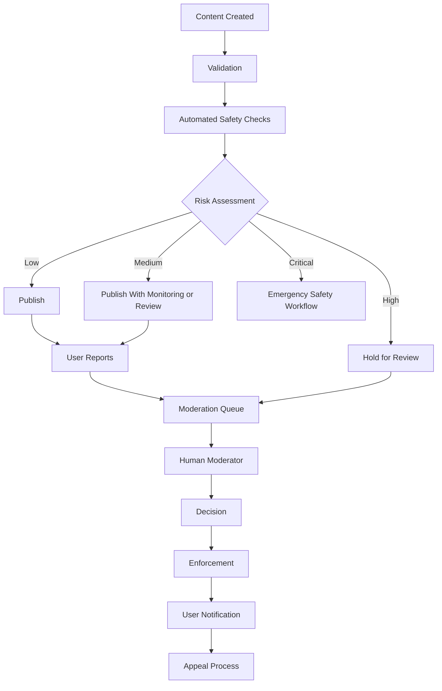

# CONTENT_MODERATION.md

# İçerik Moderasyonu ve Platform Güvenliği

**Proje:** AI Destekli Fal ve Sosyal Etkileşim Platformu  
**Dosya:** `CONTENT_MODERATION.md`  
**Sürüm:** 1.0.0  
**Durum:** Ürün ve teknik mimari taslağı  
**Önerilen öncelik:** P1 — Kullanıcı içerikleri yayınlanmadan önce temel moderasyon zorunlu

---

## 1. Amaç

Bu doküman, platformda kullanıcılar tarafından oluşturulan içeriklerin, kullanıcı etkileşimlerinin ve ticari hizmetlerin güvenli biçimde yönetilmesi için moderasyon sistemini tanımlar.

Platformun moderasyon kapsamına giren modüller:

- Sosyal gönderiler ve yorumlar.
- Topluluklar ve tartışmalar.
- Kullanıcı profilleri.
- Flört profilleri ve etkileşimleri.
- Özel mesajlaşma.
- AI fal girdileri ve çıktıları.
- Falcılar Ligi hizmetleri.
- Yorumcu değerlendirmeleri.
- Kullanıcı raporları.
- Yönetici ve moderatör işlemleri.

### 1.1. Temel hedefler

1. Kullanıcıların güvenliğini artırmak.
2. Taciz, tehdit ve dolandırıcılığı azaltmak.
3. Yasaklı içeriklerin yayılmasını önlemek.
4. Kullanıcı raporlarını sistematik biçimde değerlendirmek.
5. Moderasyon kararlarının tutarlı olmasını sağlamak.
6. Hatalı kararlara itiraz edilebilmesini sağlamak.
7. Moderatör işlemlerini denetlenebilir hale getirmek.
8. Kullanıcı gizliliğini korumak.
9. Platform kurallarını açık ve uygulanabilir tutmak.

**Temel ilke:** Moderasyon yalnızca içerik silmek değildir. Önleme, tespit, inceleme, yaptırım, itiraz ve denetim süreçlerinin tamamını kapsar.

---

## 2. Moderasyon Prensipleri

### 2.1. Orantılılık

Her ihlal aynı yaptırımı gerektirmez.

Örneğin düşük riskli bir spam gönderisi ile ciddi bir tehdit aynı şekilde değerlendirilmemelidir.

### 2.2. Tutarlılık

Benzer ihlaller, benzer koşullarda benzer kararlarla sonuçlanmalıdır.

### 2.3. Şeffaflık

Kullanıcıya mümkün olduğunda:

- Hangi kuralın ihlal edildiği.
- Hangi işlemin uygulandığı.
- İşlemin süresi.
- İtiraz hakkı.

açıklanmalıdır.

### 2.4. Gizlilik

Moderatörler yalnızca görevleri için gerekli kullanıcı verilerine erişebilmelidir.

### 2.5. İnsan denetimi

Yüksek etkili yaptırımlar için insan incelemesi veya uygun bir insan denetimi mekanizması bulunmalıdır.

### 2.6. Hata düzeltilebilirliği

Yanlış moderasyon kararları geri alınabilmeli ve ilgili kayıtlar düzeltilebilmelidir.

---

## 3. Moderasyon Kapsamı

| Modül | İçerik türleri | Temel riskler |
|---|---|---|
| Social | Gönderi, yorum, görsel | Taciz, spam, uygunsuz içerik |
| Community | Konu, yanıt, topluluk açıklaması | Organize taciz, spam |
| Dating | Profil, biyografi, görsel | Sahte hesap, taciz, dolandırıcılık |
| Chat | Mesaj, medya | Tehdit, taciz, dolandırıcılık |
| Fortune | Fal girdisi ve AI çıktısı | Zararlı yönlendirme, hassas içerik |
| Marketplace | Hizmet açıklaması, teslim, değerlendirme | Yanıltıcı vaat, dolandırıcılık |
| Profile | Kullanıcı adı, biyografi, avatar | Taklit, taciz, uygunsuz görsel |

---

## 4. İçerik Politikası

Platformun kullanıcıya açık topluluk kuralları, teknik moderasyon sisteminin temelini oluşturmalıdır.

### 4.1. Yasaklı davranışlar

- Tehdit ve hedefli taciz.
- Nefret söylemi.
- Cinsel istismar içerikleri.
- Çocukların cinsel istismarına ilişkin içerikler.
- Şiddeti teşvik eden içerikler.
- Dolandırıcılık.
- Kimlik taklidi.
- İzinsiz özel bilgi paylaşımı.
- Spam ve otomatik kötüye kullanım.
- Zararlı veya yasa dışı hizmetlerin tanıtımı.
- Kullanıcıları korkutarak para talep etme.
- Platform güvenliğini aşmaya yönelik kötüye kullanım.

### 4.2. Bağlam değerlendirmesi

İçerik değerlendirmesinde bağlam önemlidir.

Örneğin:

- Bir tehdidi bildiren kullanıcı.
- Bir ihlali eleştiren gönderi.
- Eğitim amaçlı açıklama.
- Gerçek bir taciz mesajı.

aynı şekilde sınıflandırılmamalıdır.

Otomatik sistemler bağlamı yanlış değerlendirebileceğinden belirsiz vakalar insan incelemesine yönlendirilmelidir.

---

## 5. Moderasyon Seviyeleri

İçerikler risk seviyelerine göre sınıflandırılabilir.

| Seviye | Tanım | Örnek işlem |
|---|---|---|
| LOW | Düşük risk | Yayınla veya izle |
| MEDIUM | İnceleme gerektirebilir | Uyarı veya inceleme |
| HIGH | Ciddi ihlal şüphesi | Geçici kısıtlama ve öncelikli inceleme |
| CRITICAL | Acil ve ağır risk | Acil güvenlik prosedürü |

Risk seviyesi tek başına nihai yaptırımı belirlememelidir.

### 5.1. Kritik durumlar

Çocukların cinsel istismarına ilişkin materyal, ciddi şiddet tehdidi veya yakın tehlike gibi durumlarda özel prosedür uygulanmalıdır.

Bu prosedür:

- Yetkili güvenlik ekibine yönlendirme.
- Delil bütünlüğünün korunması.
- Yetkisiz erişimin önlenmesi.
- Uygulanabilir hukuki bildirim yükümlülüklerinin değerlendirilmesi.

adımlarını kapsamalıdır.

---

## 6. Genel Moderasyon Mimarisi



### 6.1. Bileşenler

- Content Validation Service
- Automated Moderation Adapter
- Risk Assessment Service
- Report Service
- Moderation Queue
- Moderation Case Service
- Enforcement Service
- Appeal Service
- Audit Log Service

İlk sürümde bunlar tek bir `Moderation Module` altında geliştirilebilir.

---

## 7. Otomatik Moderasyon

Otomatik moderasyon, yüksek hacimli içeriklerde ilk kontrol katmanı olarak kullanılabilir.

### 7.1. Metin kontrolleri

- Spam örüntüleri.
- Tehdit ifadeleri.
- Hedefli taciz.
- Dolandırıcılık yönlendirmeleri.
- Yasaklı hizmet reklamları.
- Kişisel veri ifşası riski.

### 7.2. Görsel kontrolleri

- Uygunsuz görsel içeriği.
- Zararlı içerik kategorileri.
- Profil fotoğrafı politikası.
- Tekrarlanan spam görselleri.
- Bilinen yasaklı içerik eşleşmeleri.

### 7.3. AI kullanımı

AI destekli moderasyon sistemi:

- İçeriği sınıflandırabilir.
- Risk sinyalleri üretebilir.
- Moderatöre özet sunabilir.
- İlgili politika maddelerini önerebilir.

Ancak model çıktıları mutlak doğruluk olarak kabul edilmemelidir.

### 7.4. Örnek sınıflandırma

```json
{
  "content_id": "content-uuid",
  "content_type": "SOCIAL_POST",
  "model_version": "moderation-v1",
  "risk_level": "MEDIUM",
  "categories": [
    {
      "name": "harassment",
      "confidence": 0.72
    }
  ],
  "recommended_action": "HUMAN_REVIEW"
}
```

`confidence`, modelin tahmin skorudur; ihlalin gerçekleştiğine dair kesin kanıt değildir.

---

## 8. Yayınlama Öncesi ve Sonrası Kontroller

### 8.1. Yayınlama öncesi

Özellikle şu alanlarda kullanılabilir:

- Yeni kullanıcı profilleri.
- Yorumcu hizmet açıklamaları.
- Herkese açık görseller.
- Topluluk oluşturma.
- Yüksek riskli içerikler.

### 8.2. Yayınlama sonrası

- Kullanıcı raporları.
- Periyodik risk taramaları.
- Spam davranışlarının analizi.
- İçerik düzenlemeleri sonrası yeniden kontrol.
- Topluluk moderatörü raporları.

### 8.3. Gecikme yönetimi

Her içerik için uzun süren AI kontrolünü HTTP isteği içinde çalıştırmak gerekli değildir.

Düşük riskli içeriklerde hızlı kontroller ve sonradan denetim kullanılabilir.

Yüksek riskli içerikler uygun şekilde bekletilebilir.

---

## 9. Kullanıcı Raporlama Sistemi

Kullanıcılar platformdaki içerikleri ve hesapları raporlayabilmelidir.

### 9.1. Raporlanabilir kaynaklar

- Kullanıcı.
- Gönderi.
- Yorum.
- Topluluk.
- Topluluk konusu.
- Mesaj.
- Flört profili.
- Yorumcu profili.
- Hizmet.
- Değerlendirme.
- Sipariş davranışı.

### 9.2. Rapor nedenleri

| Kod | Açıklama |
|---|---|
| HARASSMENT | Taciz |
| THREAT | Tehdit |
| HATE_SPEECH | Nefret söylemi |
| SPAM | Spam |
| SCAM | Dolandırıcılık |
| IMPERSONATION | Kimlik taklidi |
| PRIVACY | Gizlilik ihlali |
| SEXUAL_CONTENT | Uygunsuz cinsel içerik |
| VIOLENCE | Şiddet içeriği |
| MISLEADING_SERVICE | Yanıltıcı hizmet |
| OTHER | Diğer |

### 9.3. Rapor oluşturma

1. Kullanıcı raporla seçeneğini açar.
2. Rapor nedenini seçer.
3. İsteğe bağlı açıklama ekler.
4. Backend kaynak erişimini ve rapor verisini doğrular.
5. Rapor kaydedilir.
6. Risk ve öncelik değerlendirmesi yapılır.
7. Gerekirse moderasyon vakası oluşturulur.

### 9.4. Rapor gizliliği

Raporlayan kişinin kimliği, raporlanan kullanıcıya varsayılan olarak açıklanmamalıdır.

---

## 10. Rapor Veri Modeli

Önerilen tablo: `moderation_reports`

| Alan | Veri tipi | Açıklama |
|---|---|---|
| id | UUID | Rapor kimliği |
| reporter_id | UUID | Raporlayan kullanıcı |
| target_type | VARCHAR | Kaynak türü |
| target_id | UUID | Kaynak kimliği |
| reason | VARCHAR | Rapor nedeni |
| description | TEXT | Kullanıcı açıklaması |
| status | VARCHAR | Rapor durumu |
| priority | VARCHAR | Öncelik |
| case_id | UUID, nullable | Bağlı moderasyon vakası |
| created_at | TIMESTAMPTZ | Oluşturulma zamanı |
| resolved_at | TIMESTAMPTZ, nullable | Sonuçlanma zamanı |

### 10.1. Rapor durumları

- OPEN
- TRIAGED
- UNDER_REVIEW
- RESOLVED
- REJECTED
- CLOSED

### 10.2. Tekrarlanan raporlar

Aynı içerik için birden fazla rapor gelebilir.

Sistem:

- Raporları ayrı kayıtlar olarak saklayabilir.
- Aynı moderasyon vakasında birleştirebilir.
- Rapor sayısını tek başına ihlal kanıtı saymamalıdır.

Bu yaklaşım organize ve kötü niyetli toplu raporlamanın etkisini azaltır.

---

## 11. Moderasyon Vakaları

Rapor ile moderasyon vakası birbirinden ayrı kavramlardır.

Bir vaka birden fazla raporu içerebilir.

Önerilen tablo: `moderation_cases`

- id
- target_type
- target_id
- status
- priority
- assigned_moderator_id
- policy_version
- created_at
- updated_at
- resolved_at

### 11.1. Vaka durumları

- OPEN
- ASSIGNED
- INVESTIGATING
- ACTION_REQUIRED
- RESOLVED
- CLOSED

### 11.2. Vaka önceliklendirme

Öncelik aşağıdaki faktörlerden etkilenebilir:

- Olası zararın ciddiyeti.
- Devam eden risk.
- İçeriğin yayılma düzeyi.
- Etkilenen kullanıcı sayısı.
- Önceki doğrulanmış ihlaller.
- Gerekli acil müdahale.

---

## 12. Moderasyon Kararları

Olası kararlar:

| Karar | Açıklama |
|---|---|
| NO_VIOLATION | İhlal tespit edilmedi |
| WARNING | Kullanıcı uyarıldı |
| CONTENT_REMOVED | İçerik kaldırıldı |
| CONTENT_RESTRICTED | İçerik görünürlüğü sınırlandırıldı |
| FEATURE_RESTRICTED | Belirli özellik kısıtlandı |
| TEMP_SUSPENSION | Geçici hesap askıya alma |
| PERMANENT_BAN | Kalıcı hesap kapatma |
| ESCALATED | Üst incelemeye aktarıldı |

### 12.1. Karar kaydı

Her karar için:

- İlgili vaka.
- İhlal edilen politika.
- Uygulanan işlem.
- Kararı veren yetkili.
- Karar zamanı.
- Gerekçe.
- Varsa işlem süresi.

saklanmalıdır.

---

## 13. Yaptırım Sistemi

Yaptırımlar yalnızca içerik silme işleminden oluşmamalıdır.

### 13.1. Özellik bazlı kısıtlamalar

Örnekler:

- Sosyal gönderi oluşturma yasağı.
- Yorum yapma yasağı.
- Mesaj gönderme yasağı.
- Flört keşfine erişim yasağı.
- Yorumcu hizmeti yayınlama yasağı.
- Yeni sipariş kabul etme yasağı.

### 13.2. Süreli yaptırımlar

Örnek:

```json
{
  "user_id": "user-uuid",
  "restriction": "CHAT_SEND_DISABLED",
  "starts_at": "2026-11-06T10:00:00Z",
  "expires_at": "2026-11-07T10:00:00Z",
  "reason_code": "HARASSMENT"
}
```

### 13.3. Enforcement Service

Yaptırım yalnızca yönetici panelinde görünmemeli, ilgili backend modülleri tarafından uygulanmalıdır.

Örneğin mesaj gönderme yasağı olan kullanıcıya Chat Module tarafından mesaj gönderme izni verilmemelidir.

---

## 14. İtiraz Sistemi

Kullanıcılar belirli moderasyon kararlarına itiraz edebilmelidir.

### 14.1. İtiraz akışı

1. Kullanıcı yaptırım bildirimini alır.
2. İtiraz seçeneğini açar.
3. Gerekçesini iletir.
4. İtiraz kaydı oluşturulur.
5. Uygun yetkili inceleme yapar.
6. Karar onaylanır, değiştirilir veya kaldırılır.
7. Kullanıcıya sonuç bildirilir.

### 14.2. İtiraz durumları

- SUBMITTED
- UNDER_REVIEW
- APPROVED
- REJECTED
- CLOSED

### 14.3. Bağımsız inceleme

Mümkün olduğunda itirazı ilk kararı veren moderatörden farklı bir yetkili incelemelidir.

### 14.4. İtiraz veri modeli

`moderation_appeals`

- id
- enforcement_id
- user_id
- explanation
- status
- reviewed_by
- decision_reason
- created_at
- resolved_at

---

## 15. Sosyal Ağ Moderasyonu

Sosyal ağdaki içerikler herkese açık olabileceğinden yayılma riski taşır.

### 15.1. Kontroller

- Gönderi oluşturma limiti.
- Yorum spam kontrolü.
- Görsel içerik taraması.
- Raporlama.
- İçerik kaldırma.
- Kullanıcı kısıtlama.
- Tekrarlanan ihlal analizi.

### 15.2. İçerik görünürlüğü

İçerik durumları:

- PUBLISHED
- UNDER_REVIEW
- RESTRICTED
- REMOVED

İçerik görünürlüğü, moderasyon kararlarına uygun biçimde güncellenmelidir.

---

## 16. Topluluk Moderasyonu

Toplulukların kendi moderatörleri bulunabilir.

### 16.1. Topluluk moderatörü yetkileri

- Topluluk gönderisi kaldırma.
- Konu kilitleme.
- Yorum gizleme.
- Topluluk üyeliğini sınırlandırma.
- Topluluk kurallarını yönetme.
- Platform moderasyonuna rapor iletme.

### 16.2. Yetki sınırları

Topluluk moderatörleri:

- Platform genelinde hesap kapatamaz.
- Başka toplulukların içeriklerini yönetemez.
- Kullanıcıların özel mesajlarını inceleyemez.
- Platform güvenlik politikalarını geçersiz kılamaz.

Platform moderasyonu, topluluk moderasyonunun üzerinde yetkiye sahiptir.

---

## 17. Flört Modülü Moderasyonu

Flört modülü kişisel güvenlik açısından özel kontroller gerektirir.

### 17.1. Risk alanları

- Sahte profil.
- Kimlik taklidi.
- Taciz.
- Israrlı istenmeyen iletişim.
- Dolandırıcılık.
- Rıza dışı görsel paylaşımı.
- Yaş uygunluğu ihlalleri.

### 17.2. Güvenlik kontrolleri

- Açık katılım.
- Engelleme.
- Raporlama.
- Mesajlaşma kısıtlamaları.
- Profil moderasyonu.
- Yaş uygunluğu kontrolleri.
- Şüpheli hesap incelemesi.

### 17.3. Eşleşme güvenliği

Engellenen veya güvenlik nedeniyle kısıtlanan kullanıcılar uygun eşleşme havuzlarından çıkarılmalıdır.

Moderasyon yaptırımları Matching Module ve Chat Module tarafından uygulanmalıdır.

---

## 18. Özel Mesaj Moderasyonu

Özel mesajlar, herkese açık gönderilerden farklı gizlilik beklentilerine sahiptir.

### 18.1. Temel prensip

Platform, tüm özel mesajları moderatörlere sürekli ve sınırsız biçimde açmamalıdır.

### 18.2. Rapor bazlı inceleme

Kullanıcı bir mesajı raporladığında:

- Raporlanan mesaj.
- Gerekliyse sınırlı konuşma bağlamı.
- İlgili kullanıcı ve konuşma referansları.

yetkili moderasyon sürecine aktarılabilir.

### 18.3. Erişim denetimi

Özel mesaj incelemelerinde:

- Yetkili rol kontrolü.
- Gerekli veriyle sınırlama.
- Audit logging.
- Veri saklama süresi.
- İtiraz ve denetim mekanizması.

uygulanmalıdır.

### 18.4. Şifreleme etkisi

Gelecekte uçtan uca şifreleme uygulanırsa sunucu tarafı mesaj inceleme ve raporlama mimarisi buna uygun yeniden tasarlanmalıdır.

---

## 19. AI Fal Moderasyonu

AI tarafından üretilen fal yorumları da güvenlik kontrollerine tabi olmalıdır.

### 19.1. Riskli AI çıktıları

- Kesin sağlık teşhisi.
- Tedaviyi bırakma yönlendirmesi.
- Finansal kazanç garantisi.
- Hukuki sonuç garantisi.
- Kullanıcıyı korkutarak ödeme yönlendirmesi.
- Kendine zarar verme davranışını teşvik.
- Tehdit veya taciz içeriği.

### 19.2. Güvenli yorumlama

AI fal yorumları eğlence amaçlı sunulmalıdır.

Örnek:

**Uygun:** "Falındaki semboller yeni başlangıçlar temasını çağrıştırıyor."

**Uygun olmayan:** "Kesin olarak ciddi bir hastalığın var."

### 19.3. AI çıktı kontrolü

Önerilen işlem:

1. Kullanıcı girdisi doğrulanır.
2. AI yorum oluşturur.
3. Çıktı güvenlik kontrolünden geçer.
4. Gerekirse yeniden oluşturma veya güvenli yanıt uygulanır.
5. Sonuç kullanıcıya sunulur.

Ayrıntılı AI tasarımı `AI_SYSTEM_DESIGN.md` içerisindedir.

---

## 20. Falcılar Ligi Moderasyonu

Pazaryerinde ticari güvenlik ayrıca ele alınmalıdır.

### 20.1. Moderasyon kapsamı

- Yorumcu başvuruları.
- Hizmet açıklamaları.
- Yorumcu profilleri.
- Hizmet teslimleri.
- Kullanıcı değerlendirmeleri.
- Sipariş mesajları.
- İtiraz ve dolandırıcılık raporları.

### 20.2. Yasaklı ticari davranışlar

- Gerçek dışı kesin sonuç vaatleri.
- Kullanıcıyı korkutarak ek ödeme talebi.
- Platform dışı ödeme yönlendirmesi.
- Sahte değerlendirme.
- Hizmet teslim etmeden tamamlandı gösterme.
- Sağlık, hukuk veya finans alanında yetkisiz kesin danışmanlık iddiaları.

### 20.3. Yaptırımlar

- Hizmet yayından kaldırma.
- Hizmet yayınlama kısıtlaması.
- Yeni sipariş kabulünü durdurma.
- Yorumcu statüsünü askıya alma.
- Hesap yaptırımı.
- Gerekli finansal inceleme.

Finansal blokaj ve iade işlemleri Payment Module üzerinden yürütülmelidir.

---

## 21. Spam ve Bot Önleme

### 21.1. Spam sinyalleri

- Kısa sürede çok sayıda gönderi.
- Tekrarlanan aynı mesaj.
- Çok sayıda kullanıcıya aynı içeriği gönderme.
- Olağan dışı takip veya beğeni davranışı.
- Şüpheli bağlantılar.
- Çoklu hesap davranışı.

### 21.2. Önlemler

- Rate limiting.
- Hesap doğrulama.
- Risk bazlı ek doğrulama.
- Geçici işlem kısıtlamaları.
- Tekrarlanan içerik tespiti.
- Şüpheli hesap incelemesi.

### 21.3. Yanlış pozitifler

Yoğun kullanım tek başına kötüye kullanım kanıtı değildir.

Özellikle ağır yaptırımlarda ek sinyaller ve gerektiğinde insan incelemesi kullanılmalıdır.

---

## 22. Moderasyon Veri Modeli

Temel tablolar:

| Tablo | Sorumluluk |
|---|---|
| `moderation_reports` | Kullanıcı raporları |
| `moderation_cases` | İnceleme vakaları |
| `moderation_decisions` | Moderasyon kararları |
| `moderation_enforcements` | Uygulanan yaptırımlar |
| `moderation_appeals` | İtirazlar |
| `moderation_evidence` | İzinli kanıt referansları |
| `moderation_audit_logs` | Yetkili işlem kayıtları |
| `moderation_policy_versions` | Politika sürümleri |

### 22.1. Veri bütünlüğü

- Kararlar ilgili vakaya bağlanmalıdır.
- Yaptırımlar karar kayıtlarına bağlanmalıdır.
- İtirazlar ilgili yaptırıma bağlanmalıdır.
- Denetim kayıtları yetkisiz değişikliğe karşı korunmalıdır.
- Kanıt erişimleri rol bazında sınırlandırılmalıdır.

---

## 23. Moderasyon API Tasarımı

### 23.1. Kullanıcı endpointleri

| Method | Endpoint | Açıklama |
|---|---|---|
| POST | `/api/v1/moderation/reports` | Rapor oluştur |
| GET | `/api/v1/moderation/reports/me` | Kullanıcının raporları |
| GET | `/api/v1/moderation/enforcements/me` | Kullanıcının yaptırımları |
| POST | `/api/v1/moderation/appeals` | İtiraz oluştur |
| GET | `/api/v1/moderation/appeals/me` | İtiraz geçmişi |

### 23.2. Yönetici endpointleri

| Method | Endpoint | Açıklama |
|---|---|---|
| GET | `/api/v1/admin/moderation/cases` | Vaka listesi |
| GET | `/api/v1/admin/moderation/cases/{id}` | Vaka detayı |
| POST | `/api/v1/admin/moderation/cases/{id}/assign` | Vaka ata |
| POST | `/api/v1/admin/moderation/cases/{id}/decisions` | Karar oluştur |
| POST | `/api/v1/admin/moderation/enforcements` | Yaptırım uygula |
| GET | `/api/v1/admin/moderation/appeals` | İtiraz listesi |
| POST | `/api/v1/admin/moderation/appeals/{id}/resolve` | İtiraz sonuçlandır |

Bütün yönetici endpointleri güçlü rol ve kaynak yetkilendirmesi gerektirir.

---

## 24. Backend Klasör Yapısı

```text
moderation/
├── router.py
├── admin_router.py
├── schemas.py
├── models.py
├── repository.py
├── dependencies.py
│
├── services/
│   ├── report_service.py
│   ├── case_service.py
│   ├── risk_service.py
│   ├── decision_service.py
│   ├── enforcement_service.py
│   ├── appeal_service.py
│   └── audit_service.py
│
├── integrations/
│   ├── text_moderation.py
│   └── image_moderation.py
│
├── policies/
│   ├── policy_rules.py
│   └── policy_versions.py
│
└── tests/
```

---

## 25. Yönetici Moderasyon Paneli

### 25.1. Ana ekran

Gösterilecek bilgiler:

- Açık rapor sayısı.
- Kritik vakalar.
- İnceleme bekleyen içerikler.
- Atanmış vakalar.
- Ortalama çözüm süresi.
- Son uygulanan yaptırımlar.

### 25.2. Vaka detay ekranı

- Rapor bilgileri.
- İlgili içerik.
- Gerekli bağlam.
- Önceki doğrulanmış ihlaller.
- Politika referansları.
- Moderasyon geçmişi.
- Karar seçenekleri.
- Gerekçe alanı.

### 25.3. Yetki seviyeleri

Önerilen roller:

**Community Moderator:** Yalnızca yetkili olduğu topluluğu yönetir.

**Platform Moderator:** Platform genelinde tanımlanmış içerik ve vaka incelemelerini yapar.

**Senior Moderator:** Ağır yaptırımları ve itirazları değerlendirebilir.

**Administrator:** Moderasyon yapılandırmalarını ve yetkileri yönetir.

Yetki matrisi `USER_ROLES.md` ile uyumlu olmalıdır.

---

## 26. Bildirim Entegrasyonu

Moderasyon olayları Notification Module üzerinden iletilmelidir.

| Olay | Bildirim |
|---|---|
| İçerik kaldırıldı | Kullanıcıya gerekçe |
| Hesap kısıtlandı | Yaptırım bildirimi |
| Kısıtlama sona erdi | Bilgilendirme |
| İtiraz alındı | Başvuru onayı |
| İtiraz sonuçlandı | Karar bildirimi |
| Rapor incelendi | Uygun kapsamda durum bilgisi |

Raporlayan kullanıcıya başka bir kişinin özel hesap veya yaptırım detayları gereksiz yere açıklanmamalıdır.

---

## 27. Audit Logging

Moderasyon işlemleri denetlenebilir olmalıdır.

### 27.1. Kaydedilecek işlemler

- Vaka görüntüleme.
- Vaka atama.
- Karar oluşturma.
- İçerik kaldırma.
- Hesap kısıtlama.
- İtiraz değerlendirme.
- Yaptırım kaldırma.
- Hassas kanıt erişimi.

### 27.2. Audit log alanları

- actor_id
- action
- target_type
- target_id
- timestamp
- reason
- request_id
- metadata

Audit log kayıtlarına erişim sınırlandırılmalı ve saklama süreleri belirlenmelidir.

---

## 28. Veri Gizliliği ve Saklama

### 28.1. Veri minimizasyonu

Moderasyon için gerekli olmayan kişisel bilgiler saklanmamalıdır.

### 28.2. Kanıt saklama

Kanıtlar:

- Güvenli depolamada tutulmalıdır.
- Yetki kontrollü erişilmelidir.
- Saklama süresiyle yönetilmelidir.
- Gerektiğinde silinmelidir.
- Hukuki saklama yükümlülükleriyle uyumlu olmalıdır.

### 28.3. Hesap silme

Hesap silme talebi geldiğinde moderasyon kayıtlarının durumu veri koruma ve hukuki saklama politikalarına göre değerlendirilmelidir.

Hesap silme, tüm denetim kayıtlarının koşulsuz ve anında yok edilmesi anlamına gelmeyebilir.

---

## 29. Moderasyon Performans Metrikleri

| Metrik | Açıklama |
|---|---|
| Reports Created | Oluşturulan rapor sayısı |
| Open Cases | Açık vaka sayısı |
| Time to First Review | İlk incelemeye kadar geçen süre |
| Resolution Time | Ortalama çözüm süresi |
| Enforcement Rate | Yaptırımla sonuçlanan vaka oranı |
| Appeal Rate | İtiraz oranı |
| Appeal Overturn Rate | İtiraz sonrası değişen karar oranı |
| Repeat Violation Rate | Tekrarlanan ihlal oranı |
| Automated Flag Rate | Otomatik işaretlenen içerik oranı |
| False Positive Rate | Hatalı pozitif oranı |

### 29.1. Kalite değerlendirmesi

Moderasyon başarısı yalnızca kaldırılan içerik sayısıyla ölçülmemelidir.

Hatalı karar oranı, inceleme kalitesi, kullanıcı güvenliği ve itiraz sonuçları birlikte değerlendirilmelidir.

---

## 30. Test Stratejisi

### 30.1. Unit Tests

- Rapor doğrulama.
- Risk sınıflandırma.
- Yaptırım süresi hesaplama.
- Yetki kontrolleri.
- İtiraz durumu geçişleri.
- Politika versiyonlama.

### 30.2. Integration Tests

- Social Module.
- Community Module.
- Dating Module.
- Chat Module.
- Marketplace Module.
- Notification Module.
- Moderation API.

### 30.3. End-to-End Tests

- Kullanıcı gönderi raporlar.
- Moderasyon vakası oluşur.
- Moderatör vakayı inceler.
- İçerik kaldırılır.
- Kullanıcı bildirim alır.
- Kullanıcı itiraz eder.
- İtiraz incelenir.
- Karar değiştirilirse yaptırım güncellenir.

### 30.4. Kritik güvenlik testleri

- Yetkisiz moderatör erişimi.
- Özel mesajlara yetkisiz erişim.
- Sahte rapor spam'i.
- Toplu kötü niyetli raporlama.
- Yaptırım atlatma girişimi.
- Moderasyon API rate limiting.
- Audit log manipülasyonu.
- Silinen içeriğin cache üzerinden erişilebilir kalması.

---

## 31. MVP Kapsamı

İlk sürümde zorunlu önerilen özellikler:

- Kullanıcı raporlama.
- Sosyal içerik moderasyonu.
- Profil moderasyonu.
- Mesaj raporlama.
- Engelleme.
- Temel spam kontrolleri.
- Moderasyon vaka listesi.
- İçerik kaldırma.
- Kullanıcı uyarma.
- Hesap kısıtlama.
- Yönetici audit log.
- Temel itiraz mekanizması.

İleri aşamada geliştirilebilecek özellikler:

- Gelişmiş AI moderasyonu.
- Otomatik risk skorlama.
- Moderatör iş yükü optimizasyonu.
- Çok dilli moderasyon modelleri.
- Gelişmiş sahte hesap tespiti.
- Moderasyon kalite analitiği.

---

## 32. Açık Teknik Kararlar

| Konu | Durum |
|---|---|
| Moderasyon mimarisi | Merkezi modül |
| Kullanıcı raporlama | Zorunlu |
| İnsan incelemesi | Gerekli |
| AI moderasyon sağlayıcısı | TBD |
| Görsel moderasyon sağlayıcısı | TBD |
| Risk eşikleri | Testlerle belirlenecek |
| İtiraz süreleri | TBD |
| Kanıt saklama süresi | Hukuki değerlendirme gerekli |
| Otomatik yaptırım sınırları | TBD |
| Moderatör yetki matrisi | Detaylandırılacak |
| Acil güvenlik prosedürü | Operasyonel tasarım gerekli |
| Politika sürümleme | Gerekli |

---

## 33. Kabul Kriterleri

- [ ] Kullanıcılar içerik ve hesap raporlayabiliyor.
- [ ] Raporlar veritabanına kaydediliyor.
- [ ] Aynı kaynakla ilgili raporlar birleştirilebiliyor.
- [ ] Moderasyon vakaları oluşturulabiliyor.
- [ ] Moderatörler yetkileri dahilinde inceleme yapabiliyor.
- [ ] Moderasyon kararları kaydediliyor.
- [ ] İçerikler kaldırılabiliyor veya kısıtlanabiliyor.
- [ ] Kullanıcı hesaplarına özellik bazlı yaptırım uygulanabiliyor.
- [ ] Yaptırımlar ilgili backend modüllerinde geçerli oluyor.
- [ ] Kullanıcılar uygun kararlara itiraz edebiliyor.
- [ ] İtirazlar sonuçlandırılabiliyor.
- [ ] Moderasyon işlemleri audit log'a kaydediliyor.
- [ ] Özel mesaj incelemeleri sınırlandırılıyor.
- [ ] AI fal çıktıları güvenlik kontrollerinden geçiyor.
- [ ] Falcılar Ligi hizmetleri moderasyona tabi.
- [ ] Engellenen kullanıcıların etkileşimleri sınırlandırılıyor.
- [ ] Kritik vakalar öncelikli incelemeye aktarılıyor.
- [ ] Kullanıcı gizliliği korunuyor.

---

## 34. İlişkili Dokümanlar

- `PROJECT_OVERVIEW.md`
- `APP_FEATURES.md`
- `PRD.md`
- `USER_ROLES.md`
- `USER_FLOWS.md`
- `API_SPECIFICATION.md`
- `DATABASE_SCHEMA.md`
- `SYSTEM_ARCHITECTURE.md`
- `BACKEND_ARCHITECTURE.md`
- `SECURITY_AND_PRIVACY.md`
- `AI_SYSTEM_DESIGN.md`
- `CHAT_AND_REALTIME.md`
- `MATCHING_ALGORITHM.md`
- `FORTUNE_TELLER_MARKETPLACE.md`
- `NOTIFICATION_SYSTEM.md`
- `LEGAL_AND_COMPLIANCE.md`

---

## 35. Sonuç

İçerik moderasyonu, platformun güvenilir ve sürdürülebilir biçimde çalışabilmesi için temel altyapı bileşenlerinden biridir.

Sosyal ağ, topluluk, flört, özel mesajlaşma ve Falcılar Ligi modülleri ortak moderasyon altyapısını kullanmalı; ancak her modülün kendine özgü riskleri ve erişim kuralları korunmalıdır.

**Temel mimari kararı:** Merkezi moderasyon servisi; modül bazlı politika kuralları, insan incelemesi, orantılı yaptırımlar, kullanıcı itirazları ve denetlenebilir karar kayıtlarıyla birlikte çalışacaktır.

**Doküman durumu:** Ürün ve teknik mimari taslağı.

**Not:** Platform kuralları, saklama süreleri, ağır ihlal prosedürleri ve hukuki bildirim yükümlülükleri yayına çıkmadan önce kesinleştirilmelidir.