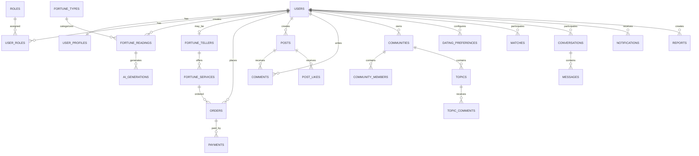

# DATABASE_SCHEMA.md
# Veritabanı Şeması ve Veri Modeli

**Belge Sürümü:** 1.0.0  
**Durum:** İlk Taslak  
**Proje:** Fal ve Sosyal Platform  
**Veritabanı Teknolojisi:** TBD  
**Önerilen Yaklaşım:** İlişkisel Veritabanı

---

## 1. Belgenin Amacı

Bu belge, platformda kullanılacak temel veri yapılarını, tabloları, alanları, ilişkileri ve veri yönetim kurallarını tanımlar.

Platform aşağıdaki ana sistemleri kapsar:

- Kullanıcı ve profil yönetimi.
- Kimlik doğrulama ve yetkilendirme.
- AI destekli fal hizmetleri.
- İnsan falcı hizmetleri ve Falcılar Ligi.
- Sipariş ve ödeme yönetimi.
- Sosyal ağ ve içerik paylaşımı.
- Topluluk ve forum sistemi.
- Dating ve eşleşme sistemi.
- Mesajlaşma.
- Bildirimler.
- Moderasyon ve yönetim.

Veritabanı tasarımı modüler olacak şekilde hazırlanmalıdır.

## 2. Veritabanı Tasarım İlkeleri

1. Her kayıt benzersiz bir kimliğe sahip olmalıdır.
2. İlişkili veriler foreign key üzerinden bağlanmalıdır.
3. Kritik işlemlerde veri bütünlüğü korunmalıdır.
4. Kullanıcıların özel verileri yetkisiz erişime kapalı olmalıdır.
5. Silme ve arşivleme politikaları veri türüne göre belirlenmelidir.
6. Tarih alanları standart zaman formatında tutulmalıdır.
7. Para değerleri kayan noktalı sayı yerine uygun decimal türünde saklanmalıdır.
8. Sık kullanılan sorgular için indeksler oluşturulmalıdır.
9. Kullanıcı tarafından oluşturulan içeriklerin sahibi takip edilebilmelidir.
10. Kritik finansal hareketlerin geçmişi değiştirilemez kayıt mantığıyla korunmalıdır.

### 2.1. Genel Alan Standartları

Çoğu tabloda aşağıdaki alanların kullanılması önerilir:

| Alan | Tür | Açıklama |
|---|---|---|
| id | UUID | Benzersiz kayıt kimliği |
| created_at | Timestamp | Oluşturulma tarihi |
| updated_at | Timestamp | Son güncellenme tarihi |

Gerektiğinde:

- `deleted_at`: Mantıksal silme tarihi.
- `status`: Kayıt durumu.
- `created_by`: Kaydı oluşturan kullanıcı.
- `updated_by`: Son güncelleyen kullanıcı.

Tüm tarih alanları UTC olarak saklanmalı, kullanıcıya gösterilirken yerel saat dilimine dönüştürülmelidir.

## 3. Genel Veritabanı İlişki Diyagramı

Bu diyagram genel ilişki yapısını gösterir. Uygulama geliştirme aşamasında tüm ilişkiler ve ara tablolar ayrıntılandırılacaktır.

## 4. Kullanıcı ve Kimlik Yönetimi

### 4.1. USERS

Platformdaki bütün kullanıcıların temel kayıtlarını tutar.

| Alan | Tür | Açıklama |
|---|---|---|
| id | UUID | Kullanıcı kimliği |
| email | VARCHAR | E-posta |
| username | VARCHAR | Kullanıcı adı |
| password_hash | VARCHAR | Şifre özeti |
| phone_number | VARCHAR | Telefon numarası, opsiyonel |
| email_verified | BOOLEAN | E-posta doğrulaması |
| phone_verified | BOOLEAN | Telefon doğrulaması |
| account_status | ENUM | Hesap durumu |
| last_login_at | TIMESTAMP | Son giriş |
| created_at | TIMESTAMP | Kayıt tarihi |
| updated_at | TIMESTAMP | Güncelleme tarihi |
| deleted_at | TIMESTAMP | Silinme tarihi |

Önerilen hesap durumları:

- ACTIVE
- PENDING_VERIFICATION
- SUSPENDED
- BANNED
- DEACTIVATED

**Kurallar:**

- E-posta ve kullanıcı adı benzersiz olmalıdır.
- Şifreler açık metin olarak saklanmamalıdır.
- Harici kimlik sağlayıcısı kullanılırsa şifre alanı boş olabilir.
- Hesap silme süreci ilgili veri saklama politikasına uygun yürütülmelidir.

### 4.2. USER_PROFILES

Kullanıcının herkese açık veya kontrollü biçimde paylaşılabilecek profil bilgilerini tutar.

| Alan | Tür | Açıklama |
|---|---|---|
| id | UUID | Profil kimliği |
| user_id | UUID | Kullanıcı referansı |
| display_name | VARCHAR | Görünen ad |
| bio | TEXT | Profil açıklaması |
| avatar_url | TEXT | Profil fotoğrafı |
| birth_date | DATE | Doğum tarihi, opsiyonel |
| gender | VARCHAR | Kullanıcının beyan ettiği bilgi, opsiyonel |
| location | VARCHAR | Genel konum, opsiyonel |
| profile_visibility | ENUM | Profil görünürlüğü |
| created_at | TIMESTAMP | Oluşturulma |
| updated_at | TIMESTAMP | Güncelleme |

Doğum tarihi ve cinsiyet gibi bilgiler yalnızca gerekli özellikler için ve uygun kullanıcı kontrolüyle işlenmelidir. Dating sistemine katılım bu bilgilerin otomatik olarak paylaşılması anlamına gelmez.

### 4.3. ROLES

Sistemde tanımlı rolleri tutar.

| Alan | Tür | Açıklama |
|---|---|---|
| id | UUID | Rol kimliği |
| name | VARCHAR | Rol adı |
| description | TEXT | Rol açıklaması |

Örnek roller:

- USER
- FORTUNE_TELLER
- COMMUNITY_OWNER
- COMMUNITY_MODERATOR
- CONTENT_MODERATOR
- SUPPORT_AGENT
- SYSTEM_ADMIN

### 4.4. USER_ROLES

Kullanıcıların sahip olduğu rolleri tutar.

| Alan | Tür | Açıklama |
|---|---|---|
| id | UUID | Kayıt kimliği |
| user_id | UUID | Kullanıcı |
| role_id | UUID | Rol |
| assigned_at | TIMESTAMP | Atanma tarihi |
| assigned_by | UUID | Atayan yönetici |
| status | ENUM | Rol durumu |

Bir kullanıcı birden fazla role sahip olabilir.

### 4.5. AUTH_IDENTITIES

Harici kimlik sağlayıcılarıyla bağlantıları tutar.

| Alan | Tür | Açıklama |
|---|---|---|
| id | UUID | Kayıt kimliği |
| user_id | UUID | Kullanıcı |
| provider | VARCHAR | Google, Apple vb. |
| provider_user_id | VARCHAR | Sağlayıcıdaki kullanıcı kimliği |
| created_at | TIMESTAMP | Bağlanma tarihi |

Şifre yönetimi harici sağlayıcıya bırakılırsa ilgili hassas kimlik bilgileri uygulamanın veritabanında gereksiz yere tutulmamalıdır.

## 5. Fal Sistemi

### 5.1. FORTUNE_TYPES

Platformda sunulan fal türlerini tanımlar.

| Alan | Tür | Açıklama |
|---|---|---|
| id | UUID | Fal türü kimliği |
| name | VARCHAR | Fal türü |
| slug | VARCHAR | URL/uygulama anahtarı |
| description | TEXT | Açıklama |
| input_schema | JSONB | Gerekli kullanıcı girdileri |
| is_active | BOOLEAN | Kullanım durumu |
| created_at | TIMESTAMP | Oluşturulma |

Örnekler:

- COFFEE
- TAROT
- DREAM
- PALM
- GENERAL

Yeni fal türleri kod değişikliği gerektirmeden tanımlanabilecek şekilde tasarlanması tercih edilir; ancak her türün özel iş kuralları ayrıca uygulanabilir.

### 5.2. FORTUNE_READINGS

Kullanıcıların oluşturduğu fal kayıtlarını tutar.

| Alan | Tür | Açıklama |
|---|---|---|
| id | UUID | Fal kimliği |
| user_id | UUID | Fal sahibi |
| fortune_type_id | UUID | Fal türü |
| input_data | JSONB | Fal girdileri |
| result_text | TEXT | Fal sonucu |
| result_data | JSONB | Yapılandırılmış sonuç |
| generation_type | ENUM | AI veya insan falcı |
| visibility | ENUM | Gizlilik seviyesi |
| status | ENUM | İşlem durumu |
| created_at | TIMESTAMP | Oluşturulma |
| completed_at | TIMESTAMP | Tamamlanma |

Önerilen durumlar:

- PENDING
- PROCESSING
- COMPLETED
- FAILED
- CANCELLED

**Önemli:** Özel fal girdileri ve sonuçları varsayılan olarak yalnızca kullanıcı tarafından erişilebilir olmalıdır.

### 5.3. FORTUNE_MEDIA

Fal kayıtlarına bağlı görselleri ve diğer dosyaları tutar.

| Alan | Tür | Açıklama |
|---|---|---|
| id | UUID | Medya kimliği |
| fortune_reading_id | UUID | Fal kaydı |
| storage_key | TEXT | Depolama anahtarı |
| media_type | VARCHAR | Görsel türü |
| file_size | BIGINT | Dosya boyutu |
| created_at | TIMESTAMP | Yüklenme tarihi |

Dosyanın kendisi veritabanında tutulmaz. Veritabanında dosya referansı ve metadata bulunur.

### 5.4. AI_GENERATIONS

AI tarafından gerçekleştirilen üretim işlemlerini takip eder.

| Alan | Tür | Açıklama |
|---|---|---|
| id | UUID | Üretim kimliği |
| fortune_reading_id | UUID | İlgili fal |
| provider | VARCHAR | AI sağlayıcısı |
| model | VARCHAR | Kullanılan model |
| prompt_version | VARCHAR | Prompt sürümü |
| input_tokens | INTEGER | Girdi token sayısı |
| output_tokens | INTEGER | Çıktı token sayısı |
| cost_amount | DECIMAL | Tahmini maliyet |
| processing_time_ms | INTEGER | İşlem süresi |
| status | ENUM | İşlem durumu |
| error_code | VARCHAR | Hata kodu |
| created_at | TIMESTAMP | İşlem tarihi |

AI yanıtlarının tamamını saklama kararı; gizlilik, hata ayıklama ve veri saklama politikaları değerlendirilerek verilmelidir. Hassas prompt içerikleri gereksiz yere loglanmamalıdır.

## 6. Falcılar Ligi

### 6.1. FORTUNE_TELLERS

İnsan falcıların platform profillerini tutar.

| Alan | Tür | Açıklama |
|---|---|---|
| id | UUID | Falcı kimliği |
| user_id | UUID | Kullanıcı hesabı |
| title | VARCHAR | Profil başlığı |
| description | TEXT | Tanıtım |
| experience_years | INTEGER | Deneyim yılı |
| verification_status | ENUM | Doğrulama durumu |
| rating_average | DECIMAL | Ortalama puan |
| total_reviews | INTEGER | Değerlendirme sayısı |
| is_available | BOOLEAN | Hizmet durumu |
| created_at | TIMESTAMP | Oluşturulma |

Doğrulama durumları:

- PENDING
- APPROVED
- REJECTED
- SUSPENDED

### 6.2. FORTUNE_SERVICES

Falcıların sunduğu hizmetleri tutar.

| Alan | Tür | Açıklama |
|---|---|---|
| id | UUID | Hizmet kimliği |
| fortune_teller_id | UUID | Falcı |
| title | VARCHAR | Hizmet adı |
| description | TEXT | Hizmet açıklaması |
| fortune_type_id | UUID | Fal türü |
| price_amount | DECIMAL | Fiyat |
| currency | VARCHAR | Para birimi |
| delivery_time_hours | INTEGER | Tahmini teslim süresi |
| is_active | BOOLEAN | Aktiflik |

### 6.3. FORTUNE_REVIEWS

Kullanıcıların falcıları değerlendirmesini sağlar.

| Alan | Tür | Açıklama |
|---|---|---|
| id | UUID | Değerlendirme |
| order_id | UUID | İlgili sipariş |
| user_id | UUID | Değerlendiren |
| fortune_teller_id | UUID | Falcı |
| rating | SMALLINT | Puan |
| comment | TEXT | Yorum |
| created_at | TIMESTAMP | Tarih |

Bir sipariş için aynı kullanıcı yalnızca bir değerlendirme oluşturabilmelidir.

## 7. Sipariş ve Ödeme Sistemi

### 7.1. ORDERS

Falcı hizmetleri için oluşturulan siparişleri tutar.

| Alan | Tür | Açıklama |
|---|---|---|
| id | UUID | Sipariş kimliği |
| user_id | UUID | Sipariş sahibi |
| fortune_teller_id | UUID | Hizmeti sunan falcı |
| service_id | UUID | Satın alınan hizmet |
| total_amount | DECIMAL | Toplam tutar |
| currency | VARCHAR | Para birimi |
| commission_amount | DECIMAL | Platform komisyonu |
| teller_earning_amount | DECIMAL | Falcı kazancı |
| status | ENUM | Sipariş durumu |
| delivery_deadline | TIMESTAMP | Teslim hedefi |
| created_at | TIMESTAMP | Oluşturulma |
| completed_at | TIMESTAMP | Tamamlanma |

Sipariş oluşturulduğunda hizmet adı, fiyat ve komisyon gibi ticari bilgiler sipariş üzerinde anlık değerleriyle saklanmalıdır. Böylece hizmet fiyatı sonradan değişse bile geçmiş sipariş etkilenmez.

### 7.2. PAYMENTS

Ödeme işlemlerini tutar.

| Alan | Tür | Açıklama |
|---|---|---|
| id | UUID | Ödeme kimliği |
| order_id | UUID | Sipariş |
| provider | VARCHAR | Ödeme sağlayıcısı |
| provider_transaction_id | VARCHAR | Sağlayıcı işlem kimliği |
| amount | DECIMAL | Ödeme tutarı |
| currency | VARCHAR | Para birimi |
| status | ENUM | Ödeme durumu |
| paid_at | TIMESTAMP | Ödeme tarihi |
| created_at | TIMESTAMP | Oluşturulma |

### 7.3. FINANCIAL_LEDGER

Platformdaki finansal hareketlerin denetlenebilir kaydını tutar.

| Alan | Tür | Açıklama |
|---|---|---|
| id | UUID | Hareket kimliği |
| user_id | UUID | İlgili kullanıcı, varsa |
| order_id | UUID | İlgili sipariş |
| transaction_type | ENUM | Hareket türü |
| amount | DECIMAL | Tutar |
| currency | VARCHAR | Para birimi |
| reference_id | VARCHAR | Harici referans |
| created_at | TIMESTAMP | İşlem tarihi |

Finansal hareket kayıtları geçmişi bozacak şekilde değiştirilmemelidir. Hatalı kayıtlar düzeltme veya ters kayıt yöntemiyle ele alınmalıdır.

## 8. Sosyal Ağ Sistemi

### 8.1. POSTS

Kullanıcı gönderilerini tutar.

| Alan | Tür | Açıklama |
|---|---|---|
| id | UUID | Gönderi |
| user_id | UUID | Gönderi sahibi |
| fortune_reading_id | UUID | Paylaşılan fal, opsiyonel |
| content | TEXT | Gönderi metni |
| visibility | ENUM | Görünürlük |
| status | ENUM | İçerik durumu |
| created_at | TIMESTAMP | Oluşturulma |
| updated_at | TIMESTAMP | Güncelleme |

### 8.2. POST_MEDIA

Gönderilere eklenen medya kayıtlarını tutar.

| Alan | Tür | Açıklama |
|---|---|---|
| id | UUID | Medya |
| post_id | UUID | Gönderi |
| storage_key | TEXT | Dosya anahtarı |
| media_type | VARCHAR | Dosya türü |
| created_at | TIMESTAMP | Tarih |

### 8.3. COMMENTS

Gönderi yorumlarını tutar.

| Alan | Tür | Açıklama |
|---|---|---|
| id | UUID | Yorum |
| post_id | UUID | Gönderi |
| user_id | UUID | Yorum sahibi |
| parent_comment_id | UUID | Üst yorum, opsiyonel |
| content | TEXT | Yorum |
| status | ENUM | Durum |
| created_at | TIMESTAMP | Tarih |

### 8.4. POST_LIKES

Beğenileri tutar.

| Alan | Tür | Açıklama |
|---|---|---|
| id | UUID | Kayıt |
| post_id | UUID | Gönderi |
| user_id | UUID | Beğenen |
| created_at | TIMESTAMP | Tarih |

`post_id + user_id` birleşimi benzersiz olmalıdır.

## 9. Topluluk Sistemi

### 9.1. COMMUNITIES

Topluluk bilgilerini tutar.

| Alan | Tür | Açıklama |
|---|---|---|
| id | UUID | Topluluk |
| owner_user_id | UUID | Kurucu |
| name | VARCHAR | Topluluk adı |
| slug | VARCHAR | Benzersiz kısa ad |
| description | TEXT | Açıklama |
| icon_url | TEXT | Topluluk görseli |
| visibility | ENUM | Görünürlük |
| status | ENUM | Durum |
| created_at | TIMESTAMP | Tarih |

### 9.2. COMMUNITY_MEMBERS

Topluluk üyeliklerini tutar.

| Alan | Tür | Açıklama |
|---|---|---|
| id | UUID | Üyelik |
| community_id | UUID | Topluluk |
| user_id | UUID | Kullanıcı |
| role | ENUM | Topluluk rolü |
| joined_at | TIMESTAMP | Katılım |

`community_id + user_id` benzersiz olmalıdır.

### 9.3. TOPICS

Topluluklarda açılan konuları tutar.

| Alan | Tür | Açıklama |
|---|---|---|
| id | UUID | Konu |
| community_id | UUID | Topluluk |
| user_id | UUID | Konuyu açan |
| title | VARCHAR | Başlık |
| content | TEXT | İçerik |
| status | ENUM | Durum |
| created_at | TIMESTAMP | Tarih |

### 9.4. TOPIC_COMMENTS

Konu altındaki yorumları tutar.

| Alan | Tür | Açıklama |
|---|---|---|
| id | UUID | Yorum |
| topic_id | UUID | Konu |
| user_id | UUID | Kullanıcı |
| parent_comment_id | UUID | Üst yorum |
| content | TEXT | İçerik |
| status | ENUM | Durum |
| created_at | TIMESTAMP | Tarih |

## 10. Dating ve Eşleşme Sistemi

### 10.1. DATING_PREFERENCES

Kullanıcının eşleşme tercihlerini tutar.

| Alan | Tür | Açıklama |
|---|---|---|
| id | UUID | Tercih kaydı |
| user_id | UUID | Kullanıcı |
| is_enabled | BOOLEAN | Katılım izni |
| preferred_age_min | INTEGER | Alt yaş sınırı |
| preferred_age_max | INTEGER | Üst yaş sınırı |
| preferred_distance_km | INTEGER | Mesafe tercihi |
| preferences_data | JSONB | Diğer tercihler |
| updated_at | TIMESTAMP | Güncelleme |

Eşleşme sistemine katılım açık rızaya dayanmalıdır. Kullanıcı katılımı kapattığında yeni öneri ve eşleşme işlemleri durdurulmalıdır.

### 10.2. MATCH_INTERACTIONS

Kullanıcıların birbirleriyle ilgili etkileşimlerini tutar.

| Alan | Tür | Açıklama |
|---|---|---|
| id | UUID | Etkileşim |
| actor_user_id | UUID | İşlemi yapan |
| target_user_id | UUID | Hedef kullanıcı |
| action | ENUM | LIKE, PASS vb. |
| created_at | TIMESTAMP | Tarih |

`actor_user_id + target_user_id` için uygun benzersizlik ve güncelleme kuralları tanımlanmalıdır.

### 10.3. MATCHES

Karşılıklı eşleşmeleri tutar.

| Alan | Tür | Açıklama |
|---|---|---|
| id | UUID | Eşleşme |
| user_a_id | UUID | İlk kullanıcı |
| user_b_id | UUID | İkinci kullanıcı |
| status | ENUM | Eşleşme durumu |
| matched_at | TIMESTAMP | Eşleşme tarihi |
| ended_at | TIMESTAMP | Sonlanma tarihi |

Aynı iki kullanıcı arasında yinelenen aktif eşleşmeler engellenmelidir. Kullanıcı engelleme ve eşleşmeyi sonlandırma kuralları da uygulanmalıdır.

### 10.4. USER_BLOCKS

Engellenen kullanıcıları tutar.

| Alan | Tür | Açıklama |
|---|---|---|
| id | UUID | Kayıt |
| blocker_user_id | UUID | Engelleyen |
| blocked_user_id | UUID | Engellenen |
| created_at | TIMESTAMP | Tarih |

Engelleme işlemi mesajlaşma, eşleşme ve içerik görünürlüğünde dikkate alınmalıdır.

## 11. Mesajlaşma Sistemi

### 11.1. CONVERSATIONS

Konuşmaları tutar.

| Alan | Tür | Açıklama |
|---|---|---|
| id | UUID | Konuşma |
| type | ENUM | PRIVATE, GROUP vb. |
| created_at | TIMESTAMP | Oluşturulma |
| updated_at | TIMESTAMP | Güncelleme |

### 11.2. CONVERSATION_PARTICIPANTS

Konuşmaya katılan kullanıcıları tutar.

| Alan | Tür | Açıklama |
|---|---|---|
| id | UUID | Katılımcı kaydı |
| conversation_id | UUID | Konuşma |
| user_id | UUID | Kullanıcı |
| joined_at | TIMESTAMP | Katılım |
| last_read_at | TIMESTAMP | Son okuma |

### 11.3. MESSAGES

Mesaj içeriklerini tutar.

| Alan | Tür | Açıklama |
|---|---|---|
| id | UUID | Mesaj |
| conversation_id | UUID | Konuşma |
| sender_user_id | UUID | Gönderen |
| content | TEXT | Mesaj |
| message_type | ENUM | TEXT, IMAGE vb. |
| status | ENUM | Durum |
| created_at | TIMESTAMP | Tarih |
| deleted_at | TIMESTAMP | Silinme |

Mesajlara erişim yalnızca konuşmanın yetkili katılımcılarına verilmelidir.

## 12. Bildirim Sistemi

### 12.1. NOTIFICATIONS

Kullanıcılara gönderilen bildirimleri tutar.

| Alan | Tür | Açıklama |
|---|---|---|
| id | UUID | Bildirim |
| user_id | UUID | Alıcı |
| type | VARCHAR | Bildirim türü |
| title | VARCHAR | Başlık |
| body | TEXT | İçerik |
| reference_type | VARCHAR | İlgili kayıt türü |
| reference_id | UUID | İlgili kayıt |
| is_read | BOOLEAN | Okundu mu |
| created_at | TIMESTAMP | Tarih |

### 12.2. DEVICE_TOKENS

Push bildirimleri için cihaz tokenlarını tutar.

| Alan | Tür | Açıklama |
|---|---|---|
| id | UUID | Kayıt |
| user_id | UUID | Kullanıcı |
| device_token | TEXT | Push token |
| platform | ENUM | IOS, ANDROID |
| is_active | BOOLEAN | Aktiflik |
| updated_at | TIMESTAMP | Güncelleme |

## 13. Moderasyon ve Raporlama

### 13.1. REPORTS

Kullanıcıların içerik veya hesap bildirimlerini tutar.

| Alan | Tür | Açıklama |
|---|---|---|
| id | UUID | Rapor |
| reporter_user_id | UUID | Raporlayan |
| target_type | VARCHAR | USER, POST, COMMENT vb. |
| target_id | UUID | Hedef kayıt |
| reason | VARCHAR | Rapor nedeni |
| description | TEXT | Açıklama |
| status | ENUM | İnceleme durumu |
| assigned_to | UUID | İnceleyen |
| created_at | TIMESTAMP | Tarih |
| resolved_at | TIMESTAMP | Çözüm tarihi |

### 13.2. MODERATION_ACTIONS

Uygulanan moderasyon işlemlerini tutar.

| Alan | Tür | Açıklama |
|---|---|---|
| id | UUID | İşlem |
| moderator_user_id | UUID | Moderatör |
| target_type | VARCHAR | Hedef tür |
| target_id | UUID | Hedef |
| action_type | VARCHAR | İşlem türü |
| reason | TEXT | Gerekçe |
| created_at | TIMESTAMP | Tarih |

### 13.3. AUDIT_LOGS

Kritik sistem işlemlerini kaydeder.

| Alan | Tür | Açıklama |
|---|---|---|
| id | UUID | Kayıt |
| actor_user_id | UUID | İşlemi yapan |
| action | VARCHAR | İşlem |
| resource_type | VARCHAR | Kaynak türü |
| resource_id | UUID | Kaynak kimliği |
| metadata | JSONB | Ek bilgiler |
| created_at | TIMESTAMP | Tarih |

Audit kayıtlarında şifre, token, ödeme kartı bilgisi veya gereksiz hassas içerik tutulmamalıdır.

## 14. İlişki ve Silme Kuralları

Veritabanındaki ilişkiler için silme politikası veri türüne göre belirlenmelidir.

| Veri | Önerilen politika |
|---|---|
| Kullanıcı profili | Hesap silme sürecine bağlı |
| Fal kayıtları | Saklama ve silme politikasına bağlı |
| Finansal kayıtlar | Yasal saklama gerekliliklerine bağlı |
| Sosyal gönderiler | Silme veya anonimleştirme politikası |
| Mesajlar | Gizlilik ve saklama politikasına bağlı |
| Moderasyon kayıtları | Yetkili erişimle sınırlı saklama |
| Audit kayıtları | Değiştirilemez ve sınırlı erişimli saklama |

Kullanıcı silme işlemi, bütün ilişkili kayıtları gelişigüzel silen tek bir veritabanı komutuna dönüştürülmemelidir. Yasal saklama yükümlülükleri, veri minimizasyonu ve kullanıcı talepleri birlikte değerlendirilmelidir.

## 15. İndeksleme ve Performans

Önerilen indeksler:

| Tablo | İndeks |
|---|---|
| USERS | email, username |
| FORTUNE_READINGS | user_id, created_at |
| FORTUNE_TELLERS | verification_status, rating_average |
| FORTUNE_SERVICES | fortune_teller_id, is_active |
| ORDERS | user_id, status, created_at |
| PAYMENTS | order_id, provider_transaction_id |
| POSTS | user_id, created_at |
| COMMENTS | post_id, created_at |
| COMMUNITIES | slug |
| TOPICS | community_id, created_at |
| MATCHES | user_a_id, user_b_id |
| MESSAGES | conversation_id, created_at |
| NOTIFICATIONS | user_id, is_read, created_at |

İndeksler gerçek sorgu örüntülerine göre gözden geçirilmeli ve gereksiz indekslerden kaçınılmalıdır.

## 16. Veri Bütünlüğü ve İşlem Yönetimi

Aşağıdaki işlemler transaction veya eşdeğer tutarlılık mekanizmalarıyla yürütülmelidir:

- Sipariş oluşturma ve ödeme durumunu güncelleme.
- Ödeme sonrası finansal hareket kaydı oluşturma.
- Karşılıklı eşleşme oluşturma.
- Fal üretim sonucunu kayıtla ilişkilendirme.
- Topluluk üyeliği ve rol güncelleme.
- Sipariş tamamlandığında falcı kazanç kaydı oluşturma.

Harici servislerle yapılan işlemlerde transaction tek başına yeterli değildir. Webhook doğrulaması, idempotency anahtarları ve tekrar deneme mekanizmaları kullanılmalıdır.

## 17. MVP İçin Öncelikli Tablolar

İlk sürümde tüm tabloların geliştirilmesi zorunlu değildir.

Önerilen başlangıç listesi:

**Temel kullanıcı sistemi**
- USERS
- USER_PROFILES
- ROLES
- USER_ROLES
- AUTH_IDENTITIES

**AI fal sistemi**
- FORTUNE_TYPES
- FORTUNE_READINGS
- FORTUNE_MEDIA
- AI_GENERATIONS

**Temel sosyal sistem**
- POSTS
- POST_MEDIA
- COMMENTS
- POST_LIKES

**Temel yönetim**
- NOTIFICATIONS
- REPORTS
- AUDIT_LOGS

Falcılar Ligi, ödeme, topluluk, dating ve gelişmiş mesajlaşma tabloları ilgili modüller geliştirilirken eklenebilir.

## 18. Açık Kararlar

Aşağıdaki konular henüz kesinleştirilmemiştir:

- PostgreSQL veya alternatif veritabanı.
- UUID üretim yöntemi.
- ORM veya query builder tercihi.
- Soft delete kapsamı.
- Kullanıcı verisi saklama süreleri.
- Medya saklama sağlayıcısı.
- Finansal kayıt ve mutabakat modeli.
- Mesaj saklama ve silme politikası.
- Dating verilerinin ayrıştırılması.
- AI girdi ve çıktı saklama politikası.
- Arama ve öneri sistemlerinin veri altyapısı.

## 19. Kabul Kriterleri

Veritabanı tasarımı aşağıdaki koşulları karşılamalıdır:

- Her temel modül için tanımlı veri yapıları bulunmalıdır.
- Kullanıcı ve rol ilişkileri desteklenmelidir.
- Fal kayıtları kullanıcılarla ilişkilendirilmelidir.
- AI üretim kayıtları izlenebilmelidir.
- Falcı hizmetleri siparişlerle ilişkilendirilmelidir.
- Ödeme ve finansal hareketler denetlenebilmelidir.
- Sosyal ağ ve topluluk içerikleri ayrı yönetilmelidir.
- Dating katılımı ve tercihleri ayrı tutulmalıdır.
- Mesajlaşma erişim kontrolleri desteklenmelidir.
- Kritik işlemler veri bütünlüğünü korumalıdır.
- Hassas kullanıcı verileri gereksiz yere çoğaltılmamalıdır.

---

**Belge Sonu**

**Önemli:** Bu belge mantıksal veri modelidir. Uygulama öncesinde seçilen veritabanına göre gerçek migration dosyaları, constraint'ler, indeksler ve sorgular hazırlanmalıdır.