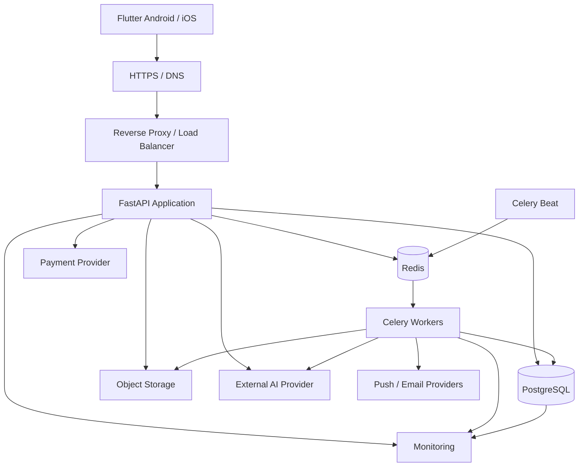
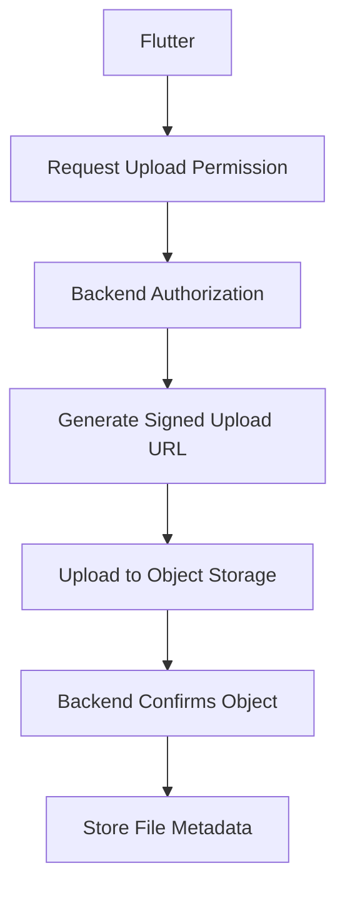
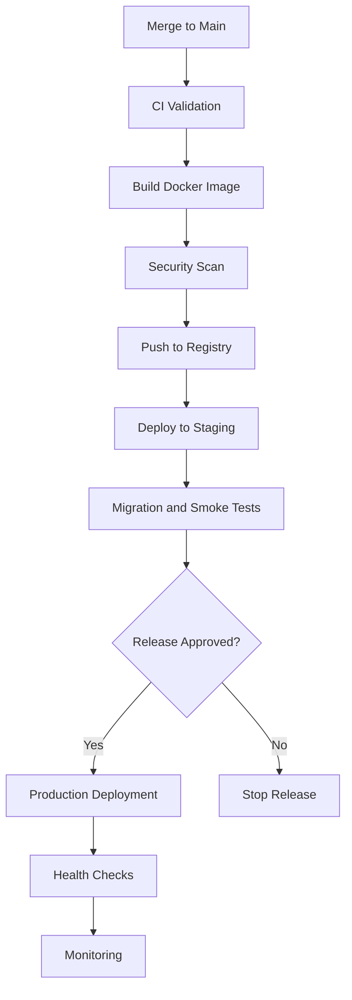

# DEPLOYMENT_AND_DEVOPS.md

# Deployment, DevOps ve Production Altyapı Mimarisi

**Proje:** AI Destekli Fal ve Sosyal Etkileşim Platformu  
**Dosya:** `DEPLOYMENT_AND_DEVOPS.md`  
**Sürüm:** 1.0.0  
**Durum:** Teknik altyapı tasarım taslağı  
**Öncelik:** P0 — Temel dağıtım ve güvenlik altyapısı MVP öncesinde tamamlanmalıdır.

---

## 1. Amaç

Bu doküman, platformun geliştirme, test, staging ve production ortamlarında nasıl çalıştırılacağını; uygulama sürümlerinin nasıl dağıtılacağını; sunucu, veritabanı, önbellek, background worker ve dosya depolama bileşenlerinin nasıl yönetileceğini tanımlar.

Temel hedefler:

1. Tekrarlanabilir deployment süreçleri oluşturmak.
2. Geliştirme ve production ortamlarını birbirinden ayırmak.
3. Güvenli yapılandırma ve secret yönetimi sağlamak.
4. Otomatik test ve yayınlama süreçleri kurmak.
5. Sistem hatalarını hızlı tespit etmek.
6. Veri kaybı riskini azaltmak.
7. Geri alınabilir sürümler oluşturmak.
8. Gereksiz altyapı maliyetlerinden kaçınmak.
9. Kullanıcı sayısı arttığında ölçeklenebilen bir mimari kurmak.

**Temel yaklaşım:** İlk sürümde yönetilebilir bir Modular Monolith altyapısı kullanılacaktır. Mikroservis ve Kubernetes gibi daha karmaşık çözümler ancak ölçülmüş ihtiyaç oluştuğunda değerlendirilecektir.

---

## 2. Teknoloji Altyapısı

| Katman | Önerilen teknoloji |
|---|---|
| Mobil uygulama | Flutter |
| Backend API | Python / FastAPI |
| ASGI server | Uvicorn |
| Veritabanı | PostgreSQL |
| Cache / broker | Redis |
| Background jobs | Celery |
| Container | Docker |
| Local orchestration | Docker Compose |
| Reverse proxy | Caddy veya Nginx |
| CI/CD | GitHub Actions |
| Object storage | S3 uyumlu servis |
| Push notifications | Firebase Cloud Messaging |
| Error tracking | Sentry veya alternatif |
| Monitoring | Prometheus + Grafana |
| Log aggregation | Loki veya yönetilen servis |
| TLS | Otomatik sertifika yönetimi |

Bu teknolojiler öneridir. Kesin seçimler maliyet, ekip yetkinliği ve barındırma sağlayıcısına göre onaylanmalıdır.

---

## 3. Ortam Mimarisi

Dört temel ortam tanımlanacaktır.

### 3.1. Local

Geliştiricinin bilgisayarında çalışan ortam.

Bileşenler:

- Flutter development.
- FastAPI.
- PostgreSQL.
- Redis.
- Celery worker.
- Yerel veya test object storage.

### 3.2. CI

Pull request ve merge işlemlerinde otomatik doğrulama yapan geçici ortam.

Gerçek kullanıcı verileri kullanılmamalıdır.

### 3.3. Staging

Production ortamına benzer yapılandırmayla çalışan test ortamı.

Kullanım amaçları:

- Entegrasyon testleri.
- Migration doğrulama.
- Release smoke tests.
- Ödeme sandbox testleri.
- Mobil release candidate doğrulaması.

### 3.4. Production

Gerçek kullanıcıların eriştiği ortam.

Production üzerinde yalnızca onaylı sürümler çalışmalıdır.

### 3.5. Ortam izolasyonu

| Kaynak | Local | Staging | Production |
|---|---|---|---|
| Database | Local | Ayrı | Ayrı |
| Redis | Local | Ayrı | Ayrı |
| Secrets | Geliştirici | Staging secrets | Production secrets |
| Payment | Sandbox | Sandbox | Canlı sağlayıcı |
| Push | Test | Test | Canlı |
| Object storage | Test | Ayrı bucket | Production bucket |

Production kimlik bilgileri staging veya local ortamda kullanılmamalıdır.

---

## 4. Production Sistem Mimarisi



### 4.1. Temel bileşenler

**Reverse Proxy:** HTTPS bağlantılarını sonlandırır, yönlendirme ve güvenlik kontrollerini uygular.

**FastAPI:** Kullanıcı isteklerini ve iş kurallarını yönetir.

**PostgreSQL:** Kalıcı iş verilerini saklar.

**Redis:** Cache, rate limiting ve görev kuyruğu için kullanılabilir.

**Celery Worker:** AI fal işleme, bildirim ve diğer background görevlerini çalıştırır.

**Celery Beat:** Zamanlanmış görevleri tetikler.

**Object Storage:** Kullanıcı görselleri ve dosyalarını saklar.

**Monitoring:** Sistem sağlığını ve performansını takip eder.

---

## 5. Önerilen Repository Yapısı

Monorepo yaklaşımı kullanılabilir.

```text
project/
├── apps/
│   ├── mobile/
│   └── backend/
│
├── infrastructure/
│   ├── docker/
│   ├── compose/
│   ├── proxy/
│   ├── monitoring/
│   └── scripts/
│
├── docs/
│   ├── PROJECT_OVERVIEW.md
│   ├── SYSTEM_ARCHITECTURE.md
│   └── DEPLOYMENT_AND_DEVOPS.md
│
├── .github/
│   └── workflows/
│
├── .gitignore
├── README.md
└── Makefile
```

### 5.1. Avantajları

- Flutter ve backend sürümlerinin birlikte takip edilmesi.
- Ortak dokümantasyon.
- Merkezi CI/CD.
- Daha kolay entegrasyon testleri.
- Küçük ekip için düşük operasyonel karmaşıklık.

---

## 6. Backend Dockerfile

Önerilen başlangıç Dockerfile:

```dockerfile
FROM python:3.12-slim

ENV PYTHONDONTWRITEBYTECODE=1
ENV PYTHONUNBUFFERED=1

WORKDIR /app

RUN groupadd --system appgroup \
    && useradd --system --gid appgroup appuser

COPY requirements.txt .

RUN pip install --no-cache-dir -r requirements.txt

COPY . .

RUN chown -R appuser:appgroup /app

USER appuser

EXPOSE 8000

CMD [
  "uvicorn",
  "app.main:app",
  "--host",
  "0.0.0.0",
  "--port",
  "8000"
]
```

### 6.1. Docker kuralları

- Resmî ve güvenilir base image kullanılmalıdır.
- Image sürümleri kontrol edilmelidir.
- Gereksiz paketler eklenmemelidir.
- Container root kullanıcısıyla çalışmamalıdır.
- Secret değerleri image içerisine gömülmemelidir.
- `.dockerignore` kullanılmalıdır.
- Dependency sürümleri sabitlenmelidir.
- Production image güvenlik taramasından geçirilmelidir.

### 6.2. Production iyileştirmeleri

İlerleyen aşamada:

- Multi-stage build.
- Image digest pinning.
- SBOM oluşturma.
- Image signing.
- Read-only filesystem.
- Linux capability kısıtlamaları.

uygulanabilir.

---

## 7. Docker Compose — Local Ortam

Aşağıdaki yapı başlangıç örneğidir.

```yaml
services:
  api:
    build:
      context: ../../apps/backend
    command: >
      uvicorn app.main:app
      --host 0.0.0.0
      --port 8000
      --reload
    ports:
      - "127.0.0.1:8000:8000"
    env_file:
      - ../../apps/backend/.env.local
    volumes:
      - ../../apps/backend:/app
    depends_on:
      postgres:
        condition: service_healthy
      redis:
        condition: service_healthy

  worker:
    build:
      context: ../../apps/backend
    command: celery -A app.worker.celery_app worker --loglevel=info
    env_file:
      - ../../apps/backend/.env.local
    depends_on:
      postgres:
        condition: service_healthy
      redis:
        condition: service_healthy

  postgres:
    image: postgres:17
    environment:
      POSTGRES_DB: app_local
      POSTGRES_USER: app
      POSTGRES_PASSWORD: local_only_password
    ports:
      - "127.0.0.1:5432:5432"
    volumes:
      - postgres_data:/var/lib/postgresql/data
    healthcheck:
      test: ["CMD-SHELL", "pg_isready -U app -d app_local"]
      interval: 5s
      timeout: 5s
      retries: 10

  redis:
    image: redis:7-alpine
    command: redis-server --appendonly yes
    ports:
      - "127.0.0.1:6379:6379"
    volumes:
      - redis_data:/data
    healthcheck:
      test: ["CMD", "redis-cli", "ping"]
      interval: 5s
      timeout: 3s
      retries: 10

volumes:
  postgres_data:
  redis_data:
```

**Not:** Bu örnek yalnızca local geliştirme içindir. Production ortamında sabitlenmiş image sürümleri, ayrı secret yönetimi, kalıcı veri politikası ve güvenlik sertleştirmesi uygulanmalıdır.

`app.worker.celery_app` yolu gerçek backend paket yapısına göre güncellenmelidir.

---

## 8. Production Container Yönetimi

İlk sürüm için iki yaklaşım değerlendirilebilir.

### 8.1. Yönetilen container platformu

Backend ve worker süreçleri yönetilen bir container sağlayıcısında çalıştırılır.

Avantajları:

- Daha az sunucu yönetimi.
- Daha kolay deployment.
- Hazır log ve monitoring entegrasyonları.
- Ölçeklendirme kolaylığı.

Dezavantajları:

- Sağlayıcıya bağımlılık.
- Kullanıma göre artabilen maliyet.
- Bazı altyapı ayarlarında sınırlı kontrol.

### 8.2. VPS + Docker Compose

Uygulama tek veya birkaç sanal sunucuda çalıştırılır.

Avantajları:

- Daha yüksek kontrol.
- Küçük ölçek için öngörülebilir maliyet.
- Öğrenme ve özelleştirme esnekliği.

Dezavantajları:

- Güncelleme sorumluluğu.
- Yedekleme sorumluluğu.
- Güvenlik sertleştirmesi.
- Operasyonel bakım.

### 8.3. Başlangıç önerisi

Küçük ekip için yönetilen PostgreSQL ve object storage ile birlikte basit bir container dağıtımı tercih edilebilir.

VPS kullanılacaksa operasyonel bakım kapasitesi ayrıca değerlendirilmelidir.

---

## 9. Reverse Proxy ve HTTPS

Bütün mobil API trafiği HTTPS üzerinden çalışmalıdır.

### 9.1. Reverse proxy görevleri

- TLS termination.
- HTTP → HTTPS yönlendirme.
- Request body limitleri.
- Güvenli header yapılandırması.
- WebSocket upgrade desteği.
- Uygun timeout değerleri.
- Erişim logları.

### 9.2. Örnek Caddyfile

```caddyfile
api.example.com {
    encode zstd gzip

    reverse_proxy api:8000
}
```

Bu örnekte `example.com` yer tutucudur.

Gerçek domain ve container ağı deployment sırasında yapılandırılmalıdır.

### 9.3. Güvenlik kuralları

- Geçerli TLS sertifikası.
- Güvenli TLS sürümleri.
- HTTPS zorunluluğu.
- Güvenilir proxy yapılandırması.
- Rate limiting.
- Uygun request limitleri.

---

## 10. Domain ve DNS

Önerilen alan adı yapısı:

| Alan adı | Amaç |
|---|---|
| `api.example.com` | Production API |
| `staging-api.example.com` | Staging API |
| `admin.example.com` | Yönetici paneli |
| `status.example.com` | Durum sayfası |

Yönetici paneli yalnızca domain ayrımıyla korunmuş sayılmamalıdır.

Güçlü kimlik doğrulama, MFA, yetkilendirme ve gerektiğinde ağ erişim kısıtlamaları uygulanmalıdır.

---

## 11. PostgreSQL Production Yönetimi

PostgreSQL platformun ana kalıcı veri kaynağıdır.

### 11.1. Temel kurallar

- Production veritabanı internete açık olmamalıdır.
- Yalnızca yetkili servisler erişebilmelidir.
- Güçlü kimlik bilgileri kullanılmalıdır.
- TLS bağlantısı tercih edilmelidir.
- Düzenli yedek alınmalıdır.
- Connection pool kullanılmalıdır.
- Slow query monitoring uygulanmalıdır.

### 11.2. Veritabanı kullanıcıları

Önerilen ayrım:

- Application user.
- Migration user.
- Read-only analytics user.
- Backup user.

Uygulama kullanıcısına gereksiz yönetici yetkileri verilmemelidir.

### 11.3. Migration yönetimi

Alembic migrationları kontrollü deployment adımı olarak çalıştırılmalıdır.

Önerilen sıra:

1. Yedekleme ve geri dönüş hazırlığı.
2. Migration uyumluluk kontrolü.
3. Migration çalıştırma.
4. Uygulama deployment.
5. Smoke tests.
6. Monitoring.

Geriye uyumsuz değişikliklerde expand-contract yaklaşımı uygulanmalıdır.

---

## 12. Redis Production Yönetimi

Redis aşağıdaki amaçlarla kullanılabilir:

- Cache.
- Rate limiting.
- Celery broker.
- Geçici oturum verileri.
- Realtime koordinasyon.

### 12.1. Güvenlik

- İnternete açık port bulunmamalıdır.
- Kimlik doğrulama kullanılmalıdır.
- Ağ erişimi sınırlandırılmalıdır.
- Bellek limitleri belirlenmelidir.
- Eviction policy amaca göre seçilmelidir.

### 12.2. Ayrı kullanım alanları

Kritik görev kuyruğu ile kolayca yeniden üretilebilen cache verileri aynı Redis örneğinde tutulursa kaynak rekabeti oluşabilir.

Büyüme aşamasında broker ve cache ayrılabilir.

### 12.3. Veri güvenilirliği

Redis kalıcı finansal kayıtların doğruluk kaynağı olmamalıdır.

Ödeme, kredi ve sipariş kayıtları PostgreSQL üzerinde güvenilir transactionlarla yönetilmelidir.

---

## 13. Celery Worker Mimarisi

Background işlemler API isteklerinden ayrılmalıdır.

### 13.1. Görev türleri

- AI fal işleme.
- Görsel işleme.
- Bildirim gönderme.
- E-posta gönderme.
- Analitik aggregation.
- Zamanlanmış temizlik.
- Sipariş zaman aşımı kontrolleri.

### 13.2. Queue ayrımı

Önerilen kuyruklar:

```text
ai_processing
notifications
marketplace
analytics
maintenance
```

### 13.3. Worker stratejisi

AI işlemleri daha uzun sürebilir.

Bildirim işlemleri ise genellikle kısa süreli ve gecikmeye duyarlıdır.

Bu nedenle AI ve bildirim workerları ayrı concurrency ayarlarıyla çalıştırılabilir.

### 13.4. Görev güvenilirliği

- Idempotency.
- Retry limitleri.
- Exponential backoff.
- Timeout.
- Hata kaydı.
- Başarısız görev inceleme süreci.

### 13.5. Kritik kural

Background görevlerinin birden fazla kez çalışabileceği varsayılmalıdır.

Finansal veya kredi tüketimiyle ilgili işlemler tekrar çalıştırıldığında çift işlem oluşturmamalıdır.

---

## 14. Object Storage

Kullanıcıların yüklediği görseller ve dosyalar uygulama container dosya sisteminde kalıcı olarak saklanmamalıdır.

### 14.1. Saklanabilecek dosyalar

- Kahve falı görselleri.
- El falı görselleri.
- Profil fotoğrafları.
- Sosyal medya görselleri.
- Falcılar Ligi teslim dosyaları.
- İzinli rapor ekleri.

### 14.2. Güvenlik

- Private bucket varsayılanı.
- Signed URL.
- Dosya türü kontrolü.
- Dosya boyutu limiti.
- Zararlı dosya taraması.
- Erişim yetkisi.
- Saklama süresi.
- Silme politikası.

### 14.3. Upload akışı



Dosya yüklenmiş olması, dosyanın güvenli veya kullanıcıya gösterilebilir olduğu anlamına gelmez.

Gerekli kontroller tamamlanmadan dosya yayınlanmamalıdır.

---

## 15. Environment Configuration

Ortam yapılandırmaları `ENVIRONMENT_CONFIGURATION.md` içerisinde ayrıntılı tanımlanacaktır.

### 15.1. Örnek değişkenler

```dotenv
APP_ENV=production
APP_DEBUG=false

DATABASE_URL=postgresql+asyncpg://...
REDIS_URL=redis://...

JWT_SECRET_KEY=...
AI_PROVIDER_API_KEY=...
PAYMENT_PROVIDER_SECRET=...

OBJECT_STORAGE_BUCKET=...
OBJECT_STORAGE_REGION=...

SENTRY_DSN=...
```

Bu değerler şema örneğidir; gerçek secret değerleri repository içerisine yazılmamalıdır.

### 15.2. Yapılandırma doğrulama

Uygulama başlangıcında:

- Zorunlu değişkenler.
- Veri tipleri.
- URL formatları.
- Environment uyumluluğu.
- Güvenlik ayarları.

doğrulanmalıdır.

Production ortamında eksik kritik yapılandırmayla uygulama başlatılmamalıdır.

---

## 16. Secret Yönetimi

Secret örnekleri:

- JWT signing keys.
- Database credentials.
- AI API keys.
- Payment credentials.
- Push notification credentials.
- Storage credentials.

### 16.1. Kurallar

- Secretlar Git'e eklenmemelidir.
- Docker image içerisine gömülmemelidir.
- Loglarda gösterilmemelidir.
- Ortam bazında ayrılmalıdır.
- Erişimler sınırlandırılmalıdır.
- Gerektiğinde rotasyon yapılmalıdır.

### 16.2. Secret rotasyonu

Rotasyon sürecinde:

1. Yeni secret oluşturulur.
2. İlgili servisler güncellenir.
3. Yeni secret doğrulanır.
4. Eski secret devre dışı bırakılır.
5. İşlem kayıt altına alınır.

JWT anahtar rotasyonu gibi işlemlerde geçiş süresi ve anahtar kimliği desteği gerekebilir.

---

## 17. Git Branch Stratejisi

Küçük ekip için basit branch stratejisi önerilir.

### 17.1. Branch yapısı

```text
main
feature/*
fix/*
hotfix/*
```

### 17.2. Kurallar

- `main` korumalı olmalıdır.
- Doğrudan push sınırlandırılmalıdır.
- Pull request kullanılmalıdır.
- CI testleri geçmelidir.
- Kod incelemesi yapılmalıdır.
- Release sürümleri etiketlenmelidir.

### 17.3. Commit standardı

Conventional Commits kullanılabilir.

Örnekler:

```text
feat(auth): add refresh token rotation
fix(payment): prevent duplicate credit usage
test(chat): add reconnect integration tests
docs(devops): define deployment strategy
```

---

## 18. CI Pipeline

GitHub Actions önerilmektedir.

### 18.1. Pull request kontrolleri

- Python lint.
- Python type checking.
- Backend unit tests.
- Backend integration tests.
- Flutter analyze.
- Flutter tests.
- Dependency scanning.
- Secret scanning.
- Docker build doğrulaması.

### 18.2. Örnek GitHub Actions

```yaml
name: Backend CI

on:
  pull_request:
  push:
    branches:
      - main

jobs:
  test:
    runs-on: ubuntu-latest

    defaults:
      run:
        working-directory: apps/backend

    steps:
      - uses: actions/checkout@v4

      - uses: actions/setup-python@v5
        with:
          python-version: "3.12"

      - name: Install dependencies
        run: pip install -r requirements-dev.txt

      - name: Lint
        run: ruff check .

      - name: Run unit tests
        run: pytest tests/unit -q
```

Bu örnek yalnızca unit test pipeline'ının başlangıç iskeletidir.

Production öncesinde integration, security ve build kontrolleri eklenmelidir.

GitHub Actions sürümleri güvenlik politikası kapsamında sabitlenmelidir.

---

## 19. CD Pipeline

Deployment işlemleri kontrollü biçimde otomatikleştirilebilir.

### 19.1. Önerilen akış



### 19.2. Image etiketleme

Örnek:

```text
backend:1.0.0
backend:1.0.1
backend:git-abc123
```

Production deployment için değişmez image digest kullanılması tercih edilmelidir.

`latest` etiketi tek başına güvenilir sürüm referansı değildir.

### 19.3. Production onayı

İlk sürümde production deployment manuel onay gerektirebilir.

Bu yaklaşım özellikle küçük ekiplerde kontrolsüz yayın riskini azaltır.

---

## 20. Deployment Stratejileri

### 20.1. Rolling Deployment

Uygulama örnekleri kademeli güncellenir.

Avantaj:

- Uygun altyapıda kesintisiz yayın.

### 20.2. Blue-Green Deployment

İki ayrı uygulama ortamı kullanılır.

Yeni sürüm doğrulandıktan sonra trafik aktarılır.

Avantaj:

- Hızlı geri dönüş.

Dezavantaj:

- Ek kaynak maliyeti.

### 20.3. Başlangıç yaklaşımı

MVP için kontrollü yeniden başlatma veya yönetilen platformun rolling deployment özelliği yeterli olabilir.

Kesintisiz deployment hedefi trafik ve maliyet gereksinimlerine göre belirlenmelidir.

---

## 21. Health Check Sistemi

En az iki health endpoint önerilir.

### 21.1. Liveness

```text
GET /health/live
```

Uygulama sürecinin çalıştığını gösterir.

Veritabanı veya harici AI sağlayıcısının durumunu her istekte kontrol etmesi gerekmez.

### 21.2. Readiness

```text
GET /health/ready
```

Uygulamanın trafik kabul etmeye hazır olup olmadığını değerlendirir.

Kontroller:

- Kritik yapılandırma.
- Gerekli veritabanı bağlantısı.
- Uygulama başlangıç durumu.

### 21.3. Dependency health

Harici servislerin durumu ayrı operasyonel kontrollerle izlenebilir.

Örneğin AI sağlayıcısının geçici olarak erişilememesi bütün uygulamanın sürekli yeniden başlatılmasına neden olmamalıdır.

---

## 22. Logging Mimarisi

Backend ve worker süreçleri yapılandırılmış log üretmelidir.

### 22.1. Örnek log

```json
{
  "timestamp": "2026-11-06T11:00:00Z",
  "level": "INFO",
  "service": "backend-api",
  "environment": "production",
  "request_id": "request-uuid",
  "event": "fortune_request_completed",
  "duration_ms": 1250
}
```

### 22.2. Log seviyeleri

- DEBUG
- INFO
- WARNING
- ERROR
- CRITICAL

### 22.3. Log güvenliği

Loglarda aşağıdaki bilgiler bulunmamalıdır:

- Parolalar.
- Access tokenlar.
- API keyler.
- Ödeme kartı bilgileri.
- Özel mesaj içerikleri.
- Ham fal görselleri.
- Gereksiz kişisel veriler.

### 22.4. Correlation ID

Bir kullanıcı isteği backend, worker ve diğer servisler arasında takip edilebilmelidir.

Bunun için `request_id` veya `trace_id` kullanılmalıdır.

---

## 23. Monitoring Mimarisi

Monitoring üç temel alanı kapsamalıdır.

### 23.1. Infrastructure Metrics

- CPU.
- RAM.
- Disk.
- Network.
- Container restart.
- Database connections.

### 23.2. Application Metrics

- HTTP request count.
- HTTP error rate.
- Response latency.
- Worker queue length.
- Failed tasks.
- WebSocket connections.

### 23.3. Business Metrics

- Fal tamamlama oranı.
- Ödeme başarı oranı.
- AI maliyeti.
- Sipariş tamamlama oranı.
- Bildirim başarısı.

Business metrics `ANALYTICS_AND_METRICS.md` ile uyumlu olmalıdır.

---

## 24. Error Tracking

Flutter ve backend için merkezi hata izleme kullanılmalıdır.

### 24.1. Backend

- Exception tracking.
- Stack trace.
- Release version.
- Environment.
- Request correlation.
- Hata sıklığı.

### 24.2. Flutter

- Crash reports.
- Unhandled exceptions.
- App version.
- Platform.
- Cihaz ve işletim sistemi bilgileri, gerekli ve izinli kapsamda.

### 24.3. Gizlilik

Hata izleme araçlarına özel mesaj, fal metni veya hassas kullanıcı verileri kontrolsüz gönderilmemelidir.

---

## 25. Alerting

Kritik sistem problemleri otomatik uyarı üretmelidir.

| Olay | Önerilen önem |
|---|---|
| API tamamen erişilemez | Critical |
| Veritabanı erişilemez | Critical |
| Ödeme doğrulama hataları arttı | Critical |
| Worker görevleri birikiyor | High |
| AI maliyeti anormal arttı | High |
| Disk kapasitesi azalıyor | High |
| Mobil crash oranı arttı | High |
| Tekil arka plan görevi başarısız | Medium |

### 25.1. Alarm kuralları

- Alarm eşikleri ölçümlere dayanmalıdır.
- Tekrarlayan uyarılar gruplanmalıdır.
- Yanlış pozitifler azaltılmalıdır.
- Kritik olayların sorumlusu belirlenmelidir.

---

## 26. Backup Stratejisi

Yedekleme özellikle PostgreSQL ve object storage için gereklidir.

### 26.1. PostgreSQL

Önerilen başlangıç yaklaşımı:

- Günlük otomatik yedek.
- Uygun sağlayıcıda point-in-time recovery.
- Şifreli yedek saklama.
- Ayrı erişim yetkileri.
- Düzenli geri yükleme testi.

### 26.2. Object Storage

- Bucket versioning.
- Lifecycle policy.
- Silme koruması.
- Gerekli dosyalar için yedekleme veya replikasyon.

### 26.3. Backup doğrulama

Yedek alınmış olması, verinin geri yüklenebileceğini garanti etmez.

Bu nedenle geri yükleme testleri düzenli yapılmalıdır.

---

## 27. Disaster Recovery

Sistem ciddi bir arıza veya veri kaybı yaşadığında uygulanacak kurtarma planı tanımlanmalıdır.

### 27.1. RPO

**Recovery Point Objective:** Kabul edilebilir maksimum veri kaybı süresi.

### 27.2. RTO

**Recovery Time Objective:** Sistemin hedeflenen geri dönüş süresi.

### 27.3. Başlangıç hedefleri

| Sistem | Örnek RPO | Örnek RTO |
|---|---|---|
| PostgreSQL | ≤ 1 saat | ≤ 4 saat |
| Object Storage | ≤ 24 saat | ≤ 8 saat |
| API | Veri kaybı olmadan | ≤ 2 saat |
| Worker | Kalıcı görev kayıtlarına bağlı | ≤ 4 saat |

Bu değerler örnek hedeflerdir; seçilen altyapının gerçek yetenekleriyle doğrulanmadan taahhüt olarak kullanılmamalıdır.

### 27.4. Kurtarma prosedürü

1. Olay tespit edilir.
2. Etki alanı belirlenir.
3. Gerekirse trafik veya işlemler durdurulur.
4. Veri bütünlüğü değerlendirilir.
5. Uygun yedek veya sağlam ortam seçilir.
6. Sistem geri yüklenir.
7. Veri ve işlev testleri yapılır.
8. Trafik kontrollü açılır.
9. Olay raporu hazırlanır.

---

## 28. Database Migration ve Rollback

Veritabanı migrationları deployment'ın en riskli aşamalarından biridir.

### 28.1. Expand-Contract

Önerilen süreç:

1. Yeni alan veya tablo eklenir.
2. Eski ve yeni uygulama sürümleri birlikte çalışabilir.
3. Veri gerekiyorsa taşınır.
4. Yeni kod devreye alınır.
5. Eski yapı kullanım dışı bırakılır.
6. Daha sonraki sürümde kaldırılır.

### 28.2. Rollback sınırları

Her migration güvenli biçimde geri alınamaz.

Özellikle veri silen veya dönüştüren migrationlar için geri dönüş planı ayrıca hazırlanmalıdır.

### 28.3. Migration kontrolleri

- Staging testi.
- Backup doğrulama.
- Lock süresi analizi.
- Uzun süren migration kontrolü.
- Veri bütünlüğü kontrolü.

---

## 29. Feature Flags

Yeni özellikler deployment yapılmadan açılıp kapatılabilmelidir.

### 29.1. Örnek flagler

```text
FEATURE_SOCIAL_ENABLED
FEATURE_COMMUNITIES_ENABLED
FEATURE_DATING_ENABLED
FEATURE_MARKETPLACE_ENABLED
FEATURE_AI_TAROT_ENABLED
```

### 29.2. Kullanım amaçları

- Kademeli yayın.
- Beta kullanıcı grupları.
- Hızlı özellik kapatma.
- A/B testleri.
- Riskli özelliklerin kontrollü açılması.

### 29.3. Güvenlik

Feature flagler backend yetkilendirmesinin yerine geçmemelidir.

Flutter arayüzünde gizlenen bir özelliğin API erişimi de uygun şekilde kontrol edilmelidir.

---

## 30. Ölçeklendirme Stratejisi

### 30.1. Aşama 1 — MVP

- Tek backend deployment.
- Ayrı worker.
- Yönetilen PostgreSQL.
- Redis.
- Object storage.
- Temel monitoring.

### 30.2. Aşama 2 — Büyüme

- Birden fazla API instance.
- Worker concurrency ayarları.
- Queue ayrımı.
- Database connection pool.
- Cache optimizasyonu.
- CDN.

### 30.3. Aşama 3 — Yüksek trafik

- Load balancer.
- Horizontal scaling.
- Read replica.
- Gelişmiş queue altyapısı.
- Ayrı analitik depolama.
- İhtiyaç duyulan modüllerin servis olarak ayrılması.

### 30.4. Ölçeklendirme kriterleri

Ölçeklendirme kararları:

- CPU / RAM.
- API latency.
- Queue backlog.
- Database yükü.
- WebSocket bağlantıları.
- Maliyet.

gibi gerçek ölçümlere dayanmalıdır.

---

## 31. WebSocket Deployment

Chat Module gerçek zamanlı bağlantılar kullanacaktır.

### 31.1. Gereksinimler

- WebSocket proxy desteği.
- Uzun bağlantı timeoutları.
- Bağlantı kopması yönetimi.
- Reconnect.
- Token doğrulama.
- Çoklu instance koordinasyonu.

### 31.2. Çoklu instance

Birden fazla API instance çalıştığında kullanıcı bağlantıları farklı instance'lara dağılabilir.

Bu durumda mesaj ve bağlantı olayları için Redis Pub/Sub veya uygun bir realtime koordinasyon mekanizması değerlendirilebilir.

Redis Pub/Sub kalıcı mesaj depolama yerine kullanılmamalıdır.

Kalıcı mesaj kayıtları veritabanında tutulmalıdır.

---

## 32. Mobil Uygulama Release Süreci

Flutter uygulaması Android ve iOS için ayrı yayınlama süreçlerine sahip olacaktır.

### 32.1. Android

Önerilen süreç:

1. Version güncelleme.
2. Flutter analyze.
3. Flutter tests.
4. Release build.
5. Signing.
6. Internal testing.
7. Closed testing.
8. Production rollout.

### 32.2. iOS

Önerilen süreç:

1. Version güncelleme.
2. Flutter analyze.
3. Flutter tests.
4. iOS release build.
5. Signing.
6. TestFlight.
7. App Store review.
8. Production release.

### 32.3. Mobil sürüm uyumluluğu

Mobil kullanıcılar her zaman son sürüme geçmeyebilir.

Bu nedenle backend:

- Desteklenen minimum sürümü tanımlamalıdır.
- API geriye uyumluluğunu korumalıdır.
- Kritik güncellemelerde sürüm kontrolü uygulayabilmelidir.

---

## 33. API Versioning

API sürümleri açık biçimde yönetilmelidir.

Örnek:

```text
/api/v1/auth/login
/api/v1/fortune/requests
/api/v1/marketplace/orders
```

### 33.1. Kurallar

- Geriye uyumlu değişiklikler tercih edilmelidir.
- Kırıcı değişiklikler kontrollü yayınlanmalıdır.
- Mobil istemcilerin desteklenen sürümleri takip edilmelidir.
- Eski API sürümleri duyurulan politikaya göre kaldırılmalıdır.

---

## 34. Altyapı Güvenliği

### 34.1. Sunucu güvenliği

- Güvenlik güncellemeleri.
- SSH key authentication.
- Gereksiz portların kapatılması.
- Firewall.
- Minimum yetki.
- Ayrı servis kullanıcıları.
- Audit logging.

### 34.2. Container güvenliği

- Root olmayan kullanıcı.
- Minimum image.
- Image scanning.
- Resource limits.
- Secret izolasyonu.
- Gereksiz Linux capability'lerinin kaldırılması.

### 34.3. Ağ güvenliği

- Private network.
- Database erişim sınırları.
- Redis erişim sınırları.
- TLS.
- Güvenilir reverse proxy.
- Uygun DDoS koruması.

### 34.4. Yönetici erişimi

Production yönetici erişimleri:

- MFA.
- Role-based access.
- Audit log.
- Minimum yetki.
- Gerektiğinde VPN veya erişim proxy'si.

ile korunmalıdır.

---

## 35. Maliyet Yönetimi

İlk aşamada altyapı maliyetlerinin kontrol altında tutulması önemlidir.

### 35.1. Maliyet kalemleri

- API hosting.
- Worker hosting.
- PostgreSQL.
- Redis.
- Object storage.
- Network traffic.
- AI API.
- Monitoring.
- Domain.
- E-posta ve bildirim servisleri.

### 35.2. Maliyet optimizasyonu

- Gereksiz worker kapasitesini azaltma.
- AI görevlerini ayrı ölçeklendirme.
- Cache kullanımı.
- Görsel optimizasyonu.
- Storage lifecycle.
- Log saklama süreleri.
- Harcama alarmları.

### 35.3. Kritik kural

Maliyet azaltmak amacıyla güvenlik, yedekleme veya finansal veri bütünlüğü kontrolleri devre dışı bırakılmamalıdır.

---

## 36. Operasyonel Runbook

Kritik olaylar için kısa müdahale belgeleri hazırlanmalıdır.

### 36.1. Gerekli runbooklar

- API erişilemez.
- PostgreSQL bağlantısı kesildi.
- Redis erişilemez.
- Celery görevleri birikti.
- AI sağlayıcısı hata veriyor.
- Ödeme sağlayıcısı erişilemez.
- Object storage erişilemez.
- WebSocket bağlantıları başarısız.
- Deployment geri alınmalı.
- Veri geri yüklenmeli.

### 36.2. Runbook formatı

Her runbook:

1. Belirti.
2. Olası neden.
3. İlk kontrol.
4. Güvenli müdahale.
5. Doğrulama.
6. Escalation.
7. Olay sonrası kayıt.

başlıklarını içermelidir.

---

## 37. Incident Management

Production olayları önem seviyelerine göre yönetilmelidir.

| Seviye | Açıklama |
|---|---|
| SEV1 | Kritik hizmet kesintisi veya ciddi veri güvenliği riski |
| SEV2 | Önemli modül kesintisi |
| SEV3 | Kısmi işlev bozukluğu |
| SEV4 | Düşük etkili operasyonel sorun |

### 37.1. Olay yönetimi

1. Olay tespit edilir.
2. Önem seviyesi belirlenir.
3. Sorumlu atanır.
4. Etki azaltılır.
5. Sistem doğrulanır.
6. Olay raporu hazırlanır.
7. Kalıcı düzeltme planlanır.

### 37.2. Postmortem

Önemli olaylardan sonra:

- Zaman çizelgesi.
- Kök neden.
- Kullanıcı etkisi.
- Müdahale süreci.
- Tekrarlamayı önleyici aksiyonlar.

kaydedilmelidir.

---

## 38. Production Release Checklist

### Kod ve test

- [ ] CI başarılı.
- [ ] Kritik unit testler başarılı.
- [ ] Integration testler başarılı.
- [ ] API contract testleri başarılı.
- [ ] Güvenlik taramaları tamamlandı.
- [ ] Release image oluşturuldu.

### Altyapı

- [ ] Production environment doğrulandı.
- [ ] Secretlar yapılandırıldı.
- [ ] Database bağlantısı sağlıklı.
- [ ] Redis bağlantısı sağlıklı.
- [ ] Worker çalışıyor.
- [ ] Object storage erişilebilir.
- [ ] HTTPS aktif.

### Veri güvenliği

- [ ] Backup doğrulandı.
- [ ] Migration test edildi.
- [ ] Rollback planı hazır.
- [ ] Yetkilendirme kontrolleri tamamlandı.

### Operasyon

- [ ] Monitoring aktif.
- [ ] Error tracking aktif.
- [ ] Kritik alarmlar aktif.
- [ ] Sorumlu ekip bilgilendirildi.
- [ ] Smoke test planı hazır.

---

## 39. MVP DevOps Kapsamı

### P0 — Zorunlu

- Docker backend image.
- Local Docker Compose.
- Production hosting.
- PostgreSQL.
- Redis.
- Worker.
- HTTPS.
- Environment separation.
- Secret management.
- CI test pipeline.
- Backup.
- Health checks.
- Temel logging.
- Temel error monitoring.

### P1 — Yüksek öncelik

- Otomatik staging deployment.
- Kontrollü production deployment.
- Merkezi log toplama.
- Monitoring dashboard.
- Kritik alarmlar.
- Feature flags.
- Release smoke tests.
- Restore testleri.

### P2 — Büyüme

- Horizontal scaling.
- Blue-green deployment.
- Gelişmiş tracing.
- Read replica.
- Gelişmiş maliyet optimizasyonu.
- Infrastructure as Code.
- Çok bölgeli disaster recovery.

---

## 40. Açık Teknik Kararlar

| Konu | Durum |
|---|---|
| Backend hosting sağlayıcısı | TBD |
| Production orchestration | TBD |
| PostgreSQL hosting | Yönetilen servis önerildi |
| Redis hosting | TBD |
| Object storage | S3 uyumlu servis önerildi |
| Reverse proxy | Caddy / Nginx |
| CI/CD | GitHub Actions önerildi |
| Container registry | TBD |
| Monitoring | Prometheus / Grafana önerildi |
| Error tracking | Sentry veya alternatif |
| Log aggregation | TBD |
| Backup sağlayıcısı | TBD |
| Domain | TBD |
| Production region | TBD |
| RPO / RTO | Doğrulanacak |
| Deployment approval | Manuel onay önerildi |
| Feature flags | Planlandı |

---

## 41. Kabul Kriterleri

- [ ] Backend Docker ile çalışıyor.
- [ ] Local geliştirme ortamı tek komutla başlatılabiliyor.
- [ ] Staging ve production ayrılmış.
- [ ] Production secretları güvenli yönetiliyor.
- [ ] API HTTPS üzerinden erişilebilir.
- [ ] PostgreSQL güvenli ağda çalışıyor.
- [ ] Redis güvenli ağda çalışıyor.
- [ ] Celery worker görevleri işliyor.
- [ ] Object storage entegrasyonu çalışıyor.
- [ ] CI otomatik testleri çalıştırıyor.
- [ ] Deployment sürümleri takip ediliyor.
- [ ] Health check endpointleri çalışıyor.
- [ ] Monitoring metrikleri toplanıyor.
- [ ] Hatalar merkezi izleniyor.
- [ ] Kritik alarmlar çalışıyor.
- [ ] Otomatik veritabanı yedekleri alınıyor.
- [ ] Yedekten geri yükleme test edildi.
- [ ] Migration prosedürü tanımlandı.
- [ ] Rollback prosedürü tanımlandı.
- [ ] Production release checklist uygulanıyor.
- [ ] Kritik olaylar için runbook mevcut.

---

## 42. İlişkili Dokümanlar

- `PROJECT_OVERVIEW.md`
- `PRD.md`
- `SYSTEM_ARCHITECTURE.md`
- `BACKEND_ARCHITECTURE.md`
- `FLUTTER_ARCHITECTURE.md`
- `API_SPECIFICATION.md`
- `DATABASE_SCHEMA.md`
- `AI_SYSTEM_DESIGN.md`
- `SECURITY_AND_PRIVACY.md`
- `PAYMENT_AND_MONETIZATION.md`
- `NOTIFICATION_SYSTEM.md`
- `CHAT_AND_REALTIME.md`
- `CONTENT_MODERATION.md`
- `ANALYTICS_AND_METRICS.md`
- `TESTING_STRATEGY.md`
- `DEVELOPMENT_ROADMAP.md`
- `ENVIRONMENT_CONFIGURATION.md`
- `LEGAL_AND_COMPLIANCE.md`

---

## 43. Sonuç

Deployment ve DevOps altyapısı, platformun yalnızca yayınlanmasını değil; güvenli, izlenebilir, geri alınabilir ve sürdürülebilir biçimde işletilmesini sağlamalıdır.

İlk aşamada küçük bir ekip için yönetilebilir container mimarisi yeterlidir.

Kullanıcı sayısı arttıkça API, worker, veritabanı ve realtime bileşenleri bağımsız ölçeklendirilebilir.

**Temel mimari kararı:** Flutter istemcisi, FastAPI tabanlı Modular Monolith backend, PostgreSQL, Redis, Celery ve object storage üzerinde çalışan; Docker ile paketlenen, GitHub Actions ile doğrulanan ve kontrollü production deployment süreçleriyle yayınlanan bir sistem kullanılacaktır.

**Doküman durumu:** Teknik altyapı tasarım taslağı.

**Not:** Hosting sağlayıcısı, altyapı maliyetleri, secret yönetimi, yedekleme hedefleri ve production region geliştirme öncesinde kesinleştirilmelidir.