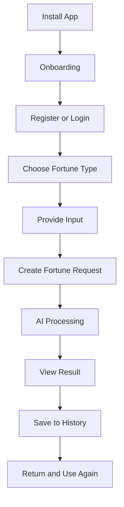
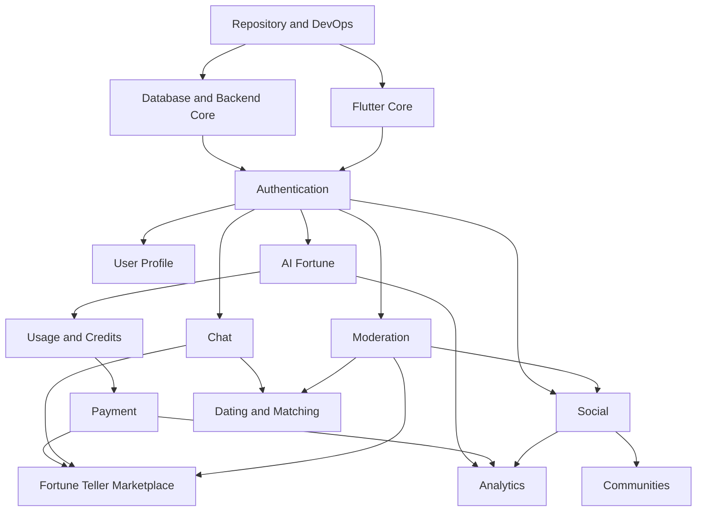

# DEVELOPMENT_ROADMAP.md

# Geliştirme Yol Haritası, Sprint Planı ve MVP Stratejisi

**Proje:** AI Destekli Fal ve Sosyal Etkileşim Platformu  
**Dosya:** `DEVELOPMENT_ROADMAP.md`  
**Sürüm:** 1.0.0  
**Durum:** Uygulama planı taslağı  
**Planlama yaklaşımı:** Aşamalı teslimat, bağımlılık bazlı geliştirme ve iki haftalık sprintler

**2026-11-08 çalışma sırası kararı:** Önce tüm ürünün ekranları ve kullanıcı akışları tasarlanacak; ardından ilk geliştirilecek sürüm netleştirilecek. [ADR-0001](../project/decisions/ADR-0001-once-urun-tasarimi.md) ve [güncel ilerleme haritası](../project/PROGRESS_MAP.md) bu sırayı izler. Aşağıdaki teknik sprintler taslak referans olarak korunur; süre ve teknoloji onayı değildir.

---

## 1. Amaç

Bu doküman, ürün ve teknik mimari belgelerinde tanımlanan özelliklerin uygulanabilir geliştirme görevlerine dönüştürülmesini sağlar.

Yol haritası şu soruları yanıtlar:

1. İlk hangi sistemler geliştirilecek?
2. Flutter ve backend ekipleri nasıl paralel çalışacak?
3. MVP hangi özelliklerden oluşacak?
4. Modüller hangi sırayla devreye alınacak?
5. Sprintlerin tamamlanma kriterleri neler olacak?
6. Teknik borç nasıl yönetilecek?
7. Test ve güvenlik süreçleri geliştirmeye nasıl entegre edilecek?
8. Ürün hangi koşullarda yayına hazır sayılacak?
9. İlk yayından sonra hangi özellikler geliştirilecek?

**Temel ilke:** Geliştirme sırası, özelliklerin çekiciliğine göre değil; teknik bağımlılıklarına, kullanıcı değerine, maliyetine ve riskine göre belirlenmelidir.

---

## 2. Ürün Vizyonu

Platformun uzun vadeli hedefi, fal ve sembolik yorumlama deneyimini sosyal etkileşimle birleştiren çok modüllü bir mobil uygulama oluşturmaktır.

Ana ürün alanları:

- AI Fal Merkezi.
- Kullanıcı profilleri.
- Sosyal paylaşım.
- Konu toplulukları.
- İnsan fal yorumcuları pazaryeri.
- İsteğe bağlı flört ve eşleşme.
- Özel mesajlaşma.
- Abonelik ve kredi sistemi.
- Bildirimler.
- Moderasyon.
- Analitik.

Bu modüllerin tamamı uzun vadeli ürün kapsamındadır.

Ancak ilk yayın için hepsinin aynı anda tamamlanması gerekli değildir.

---

## 3. Ürün Geliştirme Stratejisi

Ürün dört ana aşamada geliştirilecektir.

| Aşama | Hedef | Çıktı |
|---|---|---|
| Foundation | Teknik temel | Çalışan uygulama altyapısı |
| Core MVP | Temel ürün değeri | AI fal uygulaması |
| Social Expansion | Kullanıcı etkileşimi | Sosyal ağ ve topluluklar |
| Marketplace & Matching | Ticari ve sosyal genişleme | Falcılar Ligi ve flört |

### 3.1. Foundation

Kimlik doğrulama, veritabanı, Flutter mimarisi, backend altyapısı, CI/CD ve temel güvenlik.

### 3.2. Core MVP

Kullanıcının kayıt olup fal oluşturabildiği, sonucu görüntüleyebildiği ve kullanım hakkının yönetildiği çalışan ürün.

### 3.3. Social Expansion

Kullanıcıların içerik paylaşabildiği, birbirleriyle etkileşim kurabildiği ve topluluklara katılabildiği yapı.

### 3.4. Marketplace & Matching

İnsan fal yorumcuları pazaryeri, ticari işlemler ve isteğe bağlı flört/eşleşme özellikleri.

---

## 4. MVP Tanımı

İlk sürümün amacı:

**Kullanıcının uygulamaya kayıt olması, bir AI fal deneyimi başlatması, sonucunu görüntülemesi ve tekrar kullanmak istemesi.**

### 4.1. MVP özellikleri

- Splash ve onboarding.
- Kayıt ve giriş.
- Kullanıcı profili.
- AI kahve falı.
- AI tarot veya metin tabanlı ikinci fal türü.
- Fal geçmişi.
- Günlük ücretsiz kullanım limiti.
- Kredi veya kullanım hakkı altyapısı.
- Temel bildirimler.
- Kullanıcı ayarları.
- Hesap silme ve gizlilik kontrolleri.
- AI içerik güvenliği.
- Temel analitik.
- Crash monitoring.
- Yönetici için minimum operasyonel araçlar.

### 4.2. MVP dışında bırakılabilecek özellikler

- Gelişmiş sosyal feed.
- Reddit benzeri topluluklar.
- Falcılar Ligi.
- Flört ve eşleşme.
- Görüntülü fal.
- Canlı yayın.
- Gelişmiş abonelik paketleri.
- Gelişmiş öneri algoritmaları.

### 4.3. MVP başarı koşulu

MVP yalnızca uygulamanın açılmasıyla tamamlanmış sayılmaz.

Aşağıdaki uçtan uca akış çalışmalıdır:



---

## 5. Teknik Bağımlılık Sırası

Modüller rastgele sırayla geliştirilmeyecektir.



### 5.1. Kritik bağımlılıklar

**Authentication:** Neredeyse bütün kullanıcı modüllerinin temelidir.

**Payment:** Ücretli AI hizmetleri ve Falcılar Ligi için gereklidir.

**Chat:** Flört ve pazaryeri iletişiminde kullanılır.

**Moderation:** Kullanıcı içerikleri ve etkileşimleri yayına alınmadan önce temel yetenekleri hazır olmalıdır.

**Analytics:** MVP'den itibaren veri toplamalıdır.

---

## 6. Önceliklendirme Sistemi

Görevler dört öncelik seviyesinde yönetilecektir.

| Seviye | Anlamı |
|---|---|
| P0 | Yayın için zorunlu |
| P1 | Yüksek öncelikli |
| P2 | Planlı geliştirme |
| P3 | Gelecek iyileştirme |

### 6.1. Öncelik kriterleri

Her görev değerlendirilirken:

- Kullanıcı değeri.
- Teknik bağımlılık.
- Güvenlik riski.
- Ticari katkı.
- Geliştirme maliyeti.
- Bakım maliyeti.

dikkate alınmalıdır.

### 6.2. Öncelik örneği

| Özellik | Öncelik |
|---|---|
| Authentication | P0 |
| AI fal oluşturma | P0 |
| Fal geçmişi | P0 |
| Veri güvenliği | P0 |
| Crash tracking | P0 |
| Temel moderasyon | P0 |
| Ödeme | Ücretli özellik yayını için P0 |
| Sosyal feed | P1 |
| Topluluklar | P2 |
| Falcılar Ligi | P2 |
| Flört | P2 |
| Görüntülü fal | P3 |

---

## 7. Sprint Planlama Modeli

İki haftalık sprintler önerilmektedir.

Her sprint:

1. Sprint hedefi.
2. Seçilen görevler.
3. Teknik bağımlılıklar.
4. Kabul kriterleri.
5. Test planı.
6. Demo çıktısı.

içermelidir.

### 7.1. Sprint kapasitesi

Sprint kapasitesi ekipteki kişi sayısı ve gerçek çalışma süresine göre belirlenmelidir.

Aşağıdaki takvim, küçük ve deneyimli bir ekip için başlangıç planıdır; kesin teslim taahhüdü değildir.

### 7.2. Definition of Ready

Bir görev geliştirmeye alınmadan önce:

- Amacı açık olmalıdır.
- Kabul kriterleri bulunmalıdır.
- API veya UI bağımlılıkları bilinmelidir.
- Gerekli tasarım veya sözleşme hazır olmalıdır.
- Belirsizlikler kayıt altına alınmalıdır.

---

## 8. Foundation — Sprint 1

**Hedef:** Proje altyapısını oluşturmak.

### Backend görevleri

- FastAPI projesi.
- Modüler klasör yapısı.
- PostgreSQL bağlantısı.
- SQLAlchemy kurulumu.
- Alembic migration altyapısı.
- Redis bağlantısı.
- Environment configuration.
- Health check endpointleri.

### Flutter görevleri

- Flutter projesi.
- Feature-first klasör yapısı.
- Routing.
- Tema sistemi.
- Ortak UI bileşenleri.
- API client.
- Hata yönetimi.
- State management seçimi.

### DevOps görevleri

- Git repository.
- Branch protection.
- Dockerfile.
- Docker Compose.
- GitHub Actions.
- Lint ve test pipeline.

### Çıktı

Flutter uygulaması geliştirme backend'ine bağlanabilir.

Backend veritabanına erişebilir.

CI temel testleri çalıştırır.

---

## 9. Foundation — Sprint 2

**Hedef:** Authentication ve kullanıcı altyapısını tamamlamak.

### Backend görevleri

- User modeli.
- Authentication endpointleri.
- Password hashing.
- Access token.
- Refresh token.
- Token rotation.
- E-posta doğrulama.
- Parola sıfırlama.
- RBAC altyapısı.

### Flutter görevleri

- Onboarding.
- Giriş ekranı.
- Kayıt ekranı.
- Parola sıfırlama.
- Oturum yönetimi.
- Güvenli token saklama.
- Auth guard.

### Test görevleri

- Authentication unit testleri.
- Token yenileme testleri.
- Yetkisiz erişim testleri.
- Flutter auth widget testleri.

### Çıktı

Kullanıcı güvenli biçimde kayıt olabilir, giriş yapabilir ve oturumunu yönetebilir.

---

## 10. Core MVP — Sprint 3

**Hedef:** Kullanıcı profili ve fal altyapısı.

### Backend görevleri

- User profile API.
- Fortune request modeli.
- Fortune result modeli.
- AI provider adapter.
- Prompt template sistemi.
- Object storage adapter.
- Dosya doğrulama.

### Flutter görevleri

- Ana sayfa.
- Profil ekranı.
- Fal türü seçim ekranı.
- Kahve falı görsel yükleme.
- Fal talebi oluşturma ekranı.

### Test görevleri

- Profil yetkilendirme.
- Dosya yükleme doğrulaması.
- AI adapter mock testleri.
- Fal talebi validation.

### Çıktı

Kullanıcı fal girdisini hazırlayıp backend'e gönderebilir.

---

## 11. Core MVP — Sprint 4

**Hedef:** AI fal işleme sürecini tamamlamak.

### Backend görevleri

- Celery worker.
- AI processing queue.
- Prompt oluşturma.
- AI response parsing.
- Fal durum makinesi.
- Retry ve timeout.
- Fal geçmişi.
- AI maliyet kayıtları.

### Flutter görevleri

- İşlem bekleme ekranı.
- Fal sonucu ekranı.
- Fal geçmişi.
- Hata ve tekrar deneme akışı.
- Sonuç paylaşımı için temel altyapı.

### Test görevleri

- AI timeout.
- Bozuk model yanıtı.
- Tekrarlanan worker görevi.
- Başarısız fal işlemi.
- Fal geçmişi erişim kontrolü.

### Çıktı

Kullanıcı AI fal oluşturabilir, işlemin sonucunu görüntüleyebilir ve geçmiş falına erişebilir.

---

## 12. Core MVP — Sprint 5

**Hedef:** Kullanım hakkı, kredi altyapısı ve temel bildirimler.

### Backend görevleri

- Günlük ücretsiz kullanım limiti.
- Kullanım hakkı kayıtları.
- Kredi ledger altyapısı.
- Atomik kredi tüketimi.
- Başarısız işlem telafisi.
- Notification Module temel yapısı.
- FCM entegrasyonu.

### Flutter görevleri

- Kalan kullanım hakkı gösterimi.
- Limit doldu ekranı.
- Bildirim izinleri.
- Bildirim merkezi.
- Kullanıcı ayarları.

### Test görevleri

- Eşzamanlı kredi tüketimi.
- Çift kredi düşme koruması.
- Başarısız fal sonrası telafi.
- Bildirim tercihleri.

### Çıktı

Kullanım hakları güvenilir biçimde yönetilir ve kullanıcı fal sonucundan haberdar olabilir.

---

## 13. Core MVP — Sprint 6

**Hedef:** Ürünü ilk test yayınına hazırlamak.

### Backend görevleri

- Temel moderasyon.
- Analytics eventleri.
- Rate limiting.
- Audit logging.
- Account deletion.
- Production configuration.
- API güvenlik kontrolleri.

### Flutter görevleri

- UI son düzenlemeleri.
- Loading ve empty state.
- Hata mesajları.
- Gizlilik ve hesap ayarları.
- Crash tracking.
- Android internal build.
- iOS TestFlight hazırlığı, ilgili platform hedefleniyorsa.

### Test görevleri

- E2E kullanıcı akışı.
- Authentication regression.
- AI işlem testleri.
- Güvenlik kontrolleri.
- Staging smoke tests.

### Çıktı

Kapalı beta için aday sürüm hazırlanır.

---

## 14. İlk MVP Takvimi

Önerilen plan:

| Sprint | Süre | Ana çıktı |
|---|---|---|
| Sprint 1 | 2 hafta | Teknik altyapı |
| Sprint 2 | 2 hafta | Authentication |
| Sprint 3 | 2 hafta | Profil ve fal girdisi |
| Sprint 4 | 2 hafta | AI fal sistemi |
| Sprint 5 | 2 hafta | Kullanım hakkı ve bildirim |
| Sprint 6 | 2 hafta | Güvenlik ve beta hazırlığı |

**Toplam başlangıç tahmini: 12 hafta.**

Bu süre; küçük, düzenli çalışan, gerekli teknik yetkinliklere sahip bir ekip varsayımıyla hazırlanmıştır.

Ekip kapasitesi, tasarım değişiklikleri, harici servis onayları ve test sonuçları takvimi değiştirebilir.

---

## 15. Beta Yayın Süreci

MVP tamamlandıktan sonra doğrudan geniş kitleye açılmak yerine kontrollü beta önerilir.

### 15.1. Internal Alpha

Amaç:

- Temel akışları doğrulamak.
- Kritik hataları bulmak.
- AI maliyetlerini ölçmek.
- Performansı gözlemlemek.

### 15.2. Closed Beta

Sınırlı kullanıcı grubuyla:

- Onboarding.
- Fal tamamlama.
- Tekrar kullanım.
- Kullanıcı geri bildirimi.
- Crash oranı.
- AI yanıt kalitesi.

ölçülür.

### 15.3. Public Launch

Kapalı beta kabul kriterleri karşılandıktan sonra kademeli yayın yapılabilir.

---

## 16. MVP Başarı Metrikleri

Başlangıçta takip edilecek metrikler:

| Metrik | Amaç |
|---|---|
| Registration Conversion | Kayıt deneyimi |
| Activation Rate | İlk fal deneyimi |
| Fortune Completion Rate | AI sistem güvenilirliği |
| D1 Retention | İlk geri dönüş |
| D7 Retention | Erken kullanıcı tutundurma |
| AI Cost per Fortune | Birim maliyet |
| Crash-Free Users | Mobil kararlılık |
| API Error Rate | Backend kararlılığı |

### 16.1. Hedef belirleme

Kesin başarı eşikleri, ilk beta verileri ve ürünün ticari modeli değerlendirilerek belirlenmelidir.

Örnek bir ilk değerlendirme:

- Fal tamamlanma oranı ≥ %95.
- Kritik kullanıcı akışlarında açık P0 hata bulunmaması.
- Kontrol altında AI işlem maliyeti.
- Kabul edilebilir crash oranı.
- Olumlu kullanıcı geri bildirimleri.

Bunlar başlangıç değerlendirme hedefleridir, garanti edilmiş performans değerleri değildir.

---

## 17. Ödeme Sistemi Geliştirme Aşaması

Ücretli AI fal veya kredi paketleri yayınlanmadan önce Payment Module tamamlanmalıdır.

### Backend görevleri

- Payment provider adapter.
- Checkout session.
- Webhook verification.
- Idempotency.
- Payment state machine.
- Refund.
- Ledger reconciliation.
- Credit purchase.

### Flutter görevleri

- Kredi paketleri.
- Satın alma ekranı.
- Ödeme sonucu.
- İşlem geçmişi.
- Hata ve iptal durumları.

### Kritik bağımlılık

Mobil uygulama içindeki dijital içerik ve özellik satışları için Apple App Store ve Google Play ödeme kuralları ayrıca değerlendirilmelidir.

Harici ödeme sağlayıcısı seçimi, ilgili mağaza kuralları ve uygulanabilir mevzuatla uyumlu olmalıdır.

---

## 18. Social Expansion — Sprint 7

**Hedef:** Sosyal ağ temel altyapısı.

### Backend

- Social post modeli.
- Feed endpointleri.
- Beğeni.
- Yorum.
- Takip.
- Pagination.
- İçerik raporlama.

### Flutter

- Sosyal akış.
- Gönderi oluşturma.
- Gönderi detayı.
- Yorum ekranı.
- Kullanıcı profilindeki gönderiler.

### Testler

- Feed pagination.
- Gönderi sahipliği.
- Beğeni tutarlılığı.
- Moderasyon görünürlüğü.

---

## 19. Social Expansion — Sprint 8

**Hedef:** Sosyal ağın güvenilir ve kullanılabilir hale getirilmesi.

### Backend

- Feed optimizasyonu.
- Görsel işleme.
- Bildirim olayları.
- Engelleme entegrasyonu.
- İçerik görünürlük kuralları.
- Spam kontrolleri.

### Flutter

- Feed performans iyileştirmesi.
- Bildirim yönlendirmeleri.
- Profil etkileşimleri.
- Engelleme ve raporlama.
- Boş ve hata durumları.

### Çıktı

Sosyal ağ kontrollü beta yayınına hazırlanır.

---

## 20. Communities — Sprint 9

**Hedef:** Topluluk sisteminin ilk sürümü.

### Backend

- Community modeli.
- Membership.
- Topic.
- Reply.
- Community roles.
- Community moderation.

### Flutter

- Topluluk keşfi.
- Topluluk detayları.
- Konu listesi.
- Konu oluşturma.
- Yanıt ekranı.
- Topluluk yönetimi.

### Çıktı

Kullanıcılar topluluklara katılabilir ve tartışmalara katılabilir.

---

## 21. Chat — Sprint 10

**Hedef:** Gerçek zamanlı mesajlaşma altyapısı.

### Backend

- Conversation modeli.
- Message modeli.
- WebSocket authentication.
- Mesaj gönderme.
- Mesaj geçmişi.
- Read receipts.
- Reconnect synchronization.
- Block integration.

### Flutter

- Konuşma listesi.
- Sohbet ekranı.
- Mesaj gönderme.
- Mesaj durumları.
- Bağlantı yönetimi.
- Bildirim yönlendirmesi.

### Çıktı

Yetkilendirilmiş kullanıcılar güvenilir biçimde mesajlaşabilir.

---

## 22. Marketplace — Sprint 11

**Hedef:** Falcılar Ligi katalog ve yorumcu altyapısı.

### Backend

- Yorumcu başvurusu.
- Yorumcu onayı.
- Yorumcu profili.
- Hizmet oluşturma.
- Hizmet listeleme.
- Hizmet moderasyonu.
- Yorumcu paneli.

### Flutter

- Falcılar Ligi ana ekranı.
- Yorumcu keşfi.
- Yorumcu profili.
- Hizmet detayları.
- Yorumcu başvuru ekranı.
- Hizmet yönetimi.

### Çıktı

Onaylı yorumcular hizmet oluşturabilir, müşteriler hizmetleri keşfedebilir.

---

## 23. Marketplace — Sprint 12

**Hedef:** Sipariş ve teslimat sistemi.

### Backend

- Sipariş oluşturma.
- Payment entegrasyonu.
- Sipariş durum makinesi.
- Yorumcu kapasitesi.
- Sipariş kabul.
- Hizmet teslimi.
- Sipariş mesajlaşması.
- Komisyon hesaplama.
- Kazanç kayıtları.

### Flutter

- Sipariş oluşturma.
- Ödeme akışı.
- Sipariş takibi.
- Yorumcu sipariş paneli.
- Teslim ekranı.
- Kazanç özeti.

### Çıktı

Müşteri hizmet satın alabilir ve yorumcu hizmet teslim edebilir.

---

## 24. Marketplace — Sprint 13

**Hedef:** Pazaryeri güvenliği ve kalite süreçleri.

### Backend

- Değerlendirme.
- Yorumcu puanlama.
- İtiraz.
- İade.
- Payout entegrasyonu.
- Finansal mutabakat.
- Dolandırıcılık kontrolleri.

### Flutter

- Değerlendirme ekranı.
- İtiraz ekranı.
- Kazanç geçmişi.
- Yorumcu performans ekranı.

### Çıktı

Falcılar Ligi kontrollü ticari beta için hazır hale gelir.

---

## 25. Dating — Sprint 14

**Hedef:** İsteğe bağlı flört modülü.

### Backend

- Dating opt-in.
- Dating profile.
- Preferences.
- Candidate filtering.
- Like/pass.
- Mutual match.
- Block integration.
- Matching score.

### Flutter

- Flört katılım ekranı.
- Flört profili.
- Tercihler.
- Öneriler.
- Beğeni ve geçme.
- Eşleşmeler.

### Çıktı

Kullanıcılar isteğe bağlı olarak eşleşme sistemini kullanabilir.

---

## 26. Dating — Sprint 15

**Hedef:** Eşleşme kalitesi, mesajlaşma ve güvenlik.

### Backend

- Matching score optimizasyonu.
- Fal sinyali izni.
- Match-based chat permissions.
- Güvenlik filtreleri.
- Eşleşme analitiği.
- Şikâyet entegrasyonu.

### Flutter

- Eşleşme sonrası sohbet.
- Eşleşme bildirimleri.
- Gizlilik ayarları.
- Engelleme ve raporlama.
- Flört modülünü kapatma.

### Çıktı

Flört modülü kontrollü beta için hazırlanır.

---

## 27. Genişleme Takvimi

| Sprint | Modül | Süre |
|---|---|---|
| 7 | Social Core | 2 hafta |
| 8 | Social Improvements | 2 hafta |
| 9 | Communities | 2 hafta |
| 10 | Chat | 2 hafta |
| 11 | Marketplace Catalog | 2 hafta |
| 12 | Marketplace Orders | 2 hafta |
| 13 | Marketplace Safety & Finance | 2 hafta |
| 14 | Dating Core | 2 hafta |
| 15 | Dating Integration | 2 hafta |

**Genişleme için başlangıç tahmini: 18 hafta.**

İlk MVP ile birlikte toplam plan yaklaşık 30 haftalık geliştirme çalışması öngörmektedir.

Ödeme sağlayıcısı entegrasyonu, mağaza incelemeleri, hukuki hazırlık ve ek stabilizasyon süreleri bu tahmine dahil değildir.

Bu takvim kesin teslim taahhüdü değildir.

---

## 28. Flutter ve Backend Paralel Çalışma

Flutter ve backend ekipleri birbirlerini sürekli beklememelidir.

### 28.1. API-first yaklaşımı

Her özellik için:

1. Veri modeli tanımlanır.
2. API sözleşmesi hazırlanır.
3. Request/response örnekleri belirlenir.
4. Flutter mock adapter oluşturur.
5. Backend endpointi geliştirir.
6. Contract test çalıştırılır.
7. Gerçek entegrasyon yapılır.

### 28.2. Örnek

Fal oluşturma özelliğinde:

**Backend:** `POST /api/v1/fortune/requests`

**Flutter:** Fal oluşturma ekranı ve repository.

İki taraf ortak API sözleşmesine göre paralel çalışabilir.

### 28.3. Entegrasyon sorumluluğu

Bir özelliğin tamamlanmış sayılması için yalnızca frontend veya backend'in bitmesi yeterli değildir.

Uçtan uca entegrasyon doğrulanmalıdır.

---

## 29. Görev Yönetim Sistemi

GitHub Projects veya benzeri bir araç kullanılabilir.

### 29.1. Önerilen durumlar

- BACKLOG
- READY
- IN_PROGRESS
- IN_REVIEW
- TESTING
- DONE
- BLOCKED

### 29.2. Issue formatı

```markdown
## Amaç

Bu görev neden gerekli?

## Kapsam

Hangi özellik geliştirilecek?

## Teknik gereksinimler

- Gereksinim 1
- Gereksinim 2

## Kabul kriterleri

- [ ] Kriter 1
- [ ] Kriter 2

## Testler

- Unit
- Integration
- E2E

## Bağımlılıklar

İlgili görevler ve modüller
```

### 29.3. Görev boyutu

Bir görev mümkün olduğunca tek sprint içerisinde tamamlanabilecek büyüklükte olmalıdır.

Büyük özellikler küçük, doğrulanabilir görevlere bölünmelidir.

---

## 30. Definition of Done

Bir görev ancak aşağıdaki kriterleri karşıladığında tamamlanmış kabul edilmelidir.

- [ ] İşlev geliştirilmiş.
- [ ] Kabul kriterleri karşılanmış.
- [ ] Kod incelemesi yapılmış.
- [ ] Gerekli unit testler yazılmış.
- [ ] Gerekli integration testler başarılı.
- [ ] Güvenlik kontrolleri yapılmış.
- [ ] API sözleşmesi güncellenmiş.
- [ ] Dokümantasyon güncellenmiş.
- [ ] CI başarılı.
- [ ] Staging doğrulaması yapılmış, gerekiyorsa.
- [ ] Kritik hata bulunmuyor.

**Önemli:** Kodun yazılmış olması, görevin tamamlandığı anlamına gelmez.

---

## 31. Ekip Organizasyonu

Küçük ekip için önerilen sorumluluk alanları:

| Alan | Sorumluluk |
|---|---|
| Product / Technical Lead | Mimari, önceliklendirme, entegrasyon |
| Flutter | Mobil arayüz ve istemci mantığı |
| Backend | API, veritabanı ve iş kuralları |
| AI | Prompt, model adapterı, değerlendirme |
| DevOps | Deployment, CI/CD, monitoring |
| QA | Test senaryoları ve doğrulama |
| UI/UX | Kullanıcı akışları ve tasarım |

Bir kişi birden fazla sorumluluk üstlenebilir.

Ancak kritik alanların sorumluluğu açık olmalıdır.

### 31.1. Küçük ekip için pratik yaklaşım

İki veya üç geliştiricili bir ekipte:

- Flutter ve backend geliştirme paralel yürütülebilir.
- AI entegrasyonu backend sorumluluğunda olabilir.
- DevOps başlangıçta ortak sorumluluk olabilir.
- Test yazımı her geliştiricinin görevi olmalıdır.

---

## 32. Teknik Borç Yönetimi

Hızlı geliştirme sırasında teknik borç oluşabilir.

Ancak kontrolsüz teknik borç sonraki sprintleri yavaşlatır.

### 32.1. Teknik borç kategorileri

- Eksik test.
- Karmaşık servis mantığı.
- Tekrarlanan kod.
- Performans sorunları.
- Eksik logging.
- Zayıf hata yönetimi.
- Eski dependency.
- Eksik dokümantasyon.

### 32.2. Yönetim

- Teknik borçlar issue olarak kaydedilmelidir.
- Güvenlik ve veri bütünlüğü borçları ertelenmemelidir.
- Sprint kapasitesinde bakım işleri için pay ayrılmalıdır.
- Büyük refactor işlemleri ölçülmüş ihtiyaca dayanmalıdır.

---

## 33. Risk Yönetimi

| Risk | Etki | Önlem |
|---|---|---|
| AI maliyetlerinin yükselmesi | Yüksek | Kullanım limitleri ve maliyet takibi |
| Ödeme entegrasyonu gecikmesi | Yüksek | Erken sağlayıcı değerlendirmesi |
| Flutter/backend uyumsuzluğu | Orta | API-first ve contract tests |
| Güvenlik açığı | Kritik | Security review ve otomatik test |
| Scope creep | Yüksek | MVP sınırlarını koruma |
| Ekip kapasitesinin düşmesi | Orta/Yüksek | Önceliklendirme ve tampon süre |
| App Store inceleme gecikmesi | Orta | Erken uyumluluk kontrolü |
| Sosyal içerik kötüye kullanımı | Yüksek | Moderasyon altyapısı |
| Marketplace dolandırıcılığı | Yüksek | Doğrulama ve finansal kontroller |
| Flört modülünde güvenlik sorunları | Yüksek | Opt-in, engelleme ve raporlama |

---

## 34. Değişiklik Yönetimi

Yeni özellik talepleri doğrudan aktif sprinte eklenmemelidir.

### 34.1. Değişiklik süreci

1. Talep kaydedilir.
2. Kullanıcı değeri değerlendirilir.
3. Teknik maliyet belirlenir.
4. Bağımlılıklar incelenir.
5. Öncelik atanır.
6. Uygun sprint veya release'e planlanır.

### 34.2. Kritik istisnalar

Güvenlik açıkları, veri kaybı veya ciddi production hataları mevcut sprint önceliklerini değiştirebilir.

---

## 35. Release Planı

Önerilen release aşamaları:

| Release | Kapsam |
|---|---|
| v0.1.0 | Foundation |
| v0.2.0 | Authentication ve profil |
| v0.3.0 | AI fal prototipi |
| v0.4.0 | AI fal ve kullanım hakları |
| v0.5.0 | Kapalı beta |
| v1.0.0 | Core MVP production |
| v1.1.0 | Social |
| v1.2.0 | Communities |
| v1.3.0 | Chat |
| v1.4.0 | Marketplace |
| v1.5.0 | Dating |

Sürüm numaraları öneridir.

Gerçek release sırası beta sonuçlarına göre değişebilir.

---

## 36. MVP Release Gate

İlk production yayını için aşağıdaki koşullar sağlanmalıdır.

### Ürün

- [ ] Kullanıcı kayıt olabiliyor.
- [ ] Kullanıcı giriş yapabiliyor.
- [ ] Fal oluşturabiliyor.
- [ ] Fal sonucunu görüntüleyebiliyor.
- [ ] Fal geçmişine erişebiliyor.
- [ ] Kullanım limitleri çalışıyor.
- [ ] Hesap ve gizlilik ayarları bulunuyor.

### Teknik

- [ ] API güvenli.
- [ ] Veritabanı migrationları doğrulandı.
- [ ] Worker sistemi çalışıyor.
- [ ] AI timeout ve retry yönetimi mevcut.
- [ ] Monitoring aktif.
- [ ] Backup aktif.
- [ ] Crash tracking aktif.
- [ ] Kritik testler başarılı.

### Operasyonel

- [ ] Gizlilik politikası hazır.
- [ ] Kullanım koşulları hazır.
- [ ] Destek kanalı mevcut.
- [ ] Hesap silme süreci çalışıyor.
- [ ] App Store / Play Store gereksinimleri karşılandı.
- [ ] Kritik hata müdahale planı mevcut.

---

## 37. İlk Yayın Sonrası Öncelikler

İlk yayından sonra yeni özellik geliştirmeden önce ürün verileri incelenmelidir.

### 37.1. İncelenecek sorular

- Kullanıcılar kayıt akışını tamamlıyor mu?
- İlk falı oluşturabiliyorlar mı?
- Fal sonuçlarından memnunlar mı?
- Tekrar geliyorlar mı?
- AI işlem maliyeti sürdürülebilir mi?
- En çok hangi fal türü kullanılıyor?
- Hangi ekranda kullanıcı kaybediliyor?
- En sık hangi hatalar yaşanıyor?

### 37.2. Karar yaklaşımı

Eğer temel fal deneyimi düşük tamamlanma veya tutundurma oranına sahipse, sosyal ağ geliştirmesine geçmeden önce çekirdek deneyim iyileştirilmelidir.

---

## 38. Geliştirme Metrikleri

| Metrik | Açıklama |
|---|---|
| Sprint Goal Completion | Sprint hedefinin tamamlanması |
| Cycle Time | Görevin başlangıçtan bitişe süresi |
| Lead Time | Talep ile teslim arasındaki süre |
| Deployment Frequency | Yayın sıklığı |
| Change Failure Rate | Hatalı yayın oranı |
| Bug Reopen Rate | Yeniden açılan hata oranı |
| Test Pass Rate | Başarılı test oranı |
| Technical Debt Backlog | Teknik borç birikimi |

Bu metrikler bireysel geliştiricileri cezalandırmak için değil, ekip süreçlerini iyileştirmek için kullanılmalıdır.

---

## 39. Uzun Vadeli Geliştirme Alanları

MVP ve genişleme aşamalarından sonra değerlendirilebilecek özellikler:

- Gelişmiş AI fal türleri.
- Sesli AI yorumları.
- Kişiselleştirilmiş fal deneyimi.
- Gelişmiş sosyal öneriler.
- Canlı fal seansları.
- Yorumcu abonelikleri.
- Çoklu dil desteği.
- Çoklu para birimi.
- Gelişmiş analitik.
- Gelişmiş eşleşme algoritmaları.

Bu özellikler kullanıcı talebi, güvenlik, maliyet ve ticari değer doğrultusunda önceliklendirilmelidir.

---

## 40. Açık Kararlar

| Konu | Durum |
|---|---|
| Ekip büyüklüğü | TBD |
| Haftalık geliştirme kapasitesi | TBD |
| Sprint süresi | 2 hafta önerildi |
| State management | TBD |
| Backend hosting | TBD |
| AI sağlayıcısı | TBD |
| Ödeme sağlayıcısı | TBD |
| İlk yayın platformu | Android/iOS kararı gerekli |
| MVP ücretlendirme modeli | TBD |
| Beta kullanıcı hedefi | TBD |
| Production yayın tarihi | TBD |
| Marketplace yayını | Beta sonuçlarına bağlı |
| Dating yayını | Güvenlik hazırlığına bağlı |

---

## 41. İlişkili Dokümanlar

- `PROJECT_OVERVIEW.md`
- `APP_FEATURES.md`
- `USER_ROLES.md`
- `USER_FLOWS.md`
- `PRD.md`
- `UI_UX_GUIDELINES.md`
- `API_SPECIFICATION.md`
- `AI_SYSTEM_DESIGN.md`
- `PAYMENT_AND_MONETIZATION.md`
- `SECURITY_AND_PRIVACY.md`
- `DATABASE_SCHEMA.md`
- `SYSTEM_ARCHITECTURE.md`
- `FLUTTER_ARCHITECTURE.md`
- `BACKEND_ARCHITECTURE.md`
- `NOTIFICATION_SYSTEM.md`
- `CHAT_AND_REALTIME.md`
- `MATCHING_ALGORITHM.md`
- `FORTUNE_TELLER_MARKETPLACE.md`
- `CONTENT_MODERATION.md`
- `ANALYTICS_AND_METRICS.md`
- `TESTING_STRATEGY.md`
- `DEPLOYMENT_AND_DEVOPS.md`
- `ENVIRONMENT_CONFIGURATION.md`
- `LEGAL_AND_COMPLIANCE.md`

---

## 42. Sonuç

Geliştirme süreci, bütün özellikleri aynı anda oluşturmaya çalışmak yerine teknik bağımlılıklara ve kullanıcı değerine göre ilerlemelidir.

İlk hedef çalışan, güvenli ve ölçülebilir bir AI fal uygulamasıdır.

Bu çekirdek ürün doğrulandıktan sonra sosyal ağ, topluluklar, mesajlaşma, Falcılar Ligi ve isteğe bağlı flört modülü aşamalı olarak eklenebilir.

**Temel geliştirme kararı:** İlk altı sprintte Core MVP tamamlanacak; sonraki geliştirme aşamaları kullanıcı verileri, ekip kapasitesi ve ticari önceliklere göre yeniden planlanacaktır.

**Başlangıç takvim tahmini:** 12 hafta Core MVP + 18 hafta genişleme; entegrasyon, mağaza onayları ve ek stabilizasyon süreleri hariç.

**Doküman durumu:** Uygulama planı taslağı.
