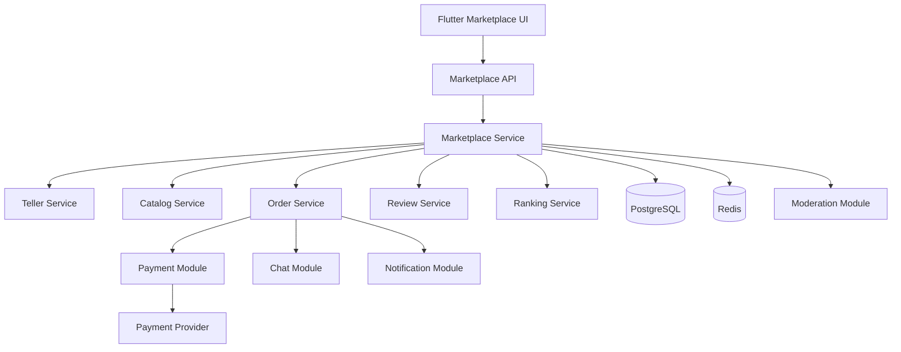
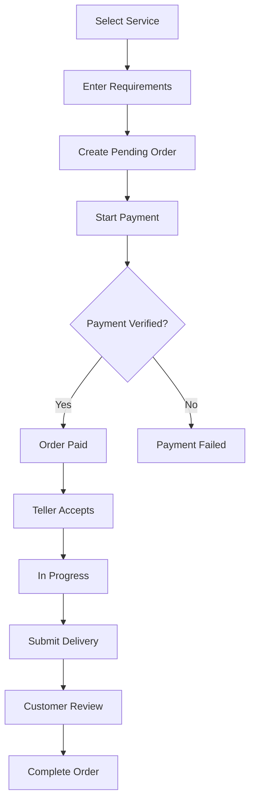

# FORTUNE_TELLER_MARKETPLACE.md

# Falcılar Ligi — Hizmet Pazaryeri Mimarisi

**Proje:** AI Destekli Fal ve Sosyal Etkileşim Platformu  
**Dosya:** `FORTUNE_TELLER_MARKETPLACE.md`  
**Sürüm:** 1.0.0  
**Durum:** Ürün ve teknik mimari taslağı  
**Önerilen öncelik:** P2

---

## 1. Amaç

Falcılar Ligi, kullanıcıların insan fal yorumcularından ücretli veya ücretsiz hizmet alabilecekleri platform içi bir pazaryeridir.

Bu modülün amacı:

- Fal yorumcularına hizmet sunabilecekleri bir alan sağlamak.
- Kullanıcıların yorumcuları keşfetmesini kolaylaştırmak.
- Güvenilir sipariş ve ödeme akışları oluşturmak.
- Hizmet teslim süreçlerini takip etmek.
- Yorumcu performansını ölçmek.
- Kullanıcıların değerlendirme yapmasını sağlamak.
- Platform komisyonlarını yönetmek.
- Dolandırıcılık ve kötüye kullanımı azaltmak.

Falcılar Ligi, AI Fal Merkezi'nden bağımsız bir modüldür. Kullanıcılar AI fal hizmetini kullanmadan da insan yorumculardan hizmet alabilir.

**Temel ilke:** Platform, yorumcuların sunduğu hizmetlerin teslimatını ve ticari işlemlerini yönetir; fal yorumlarının bilimsel doğruluğunu veya geleceğe ilişkin iddialarını garanti etmez.

---

## 2. Pazaryeri İş Modeli

Platform üç temel aktörden oluşur.

| Aktör | Rol |
|---|---|
| Müşteri | Hizmet satın alan kullanıcı |
| Fal yorumcusu | Hizmet sunan kullanıcı |
| Platform | Sipariş, ödeme, güvenlik ve moderasyon altyapısını yöneten sistem |

Bir kullanıcı hem müşteri hem de fal yorumcusu olabilir.

Yorumcu statüsü, normal kullanıcı hesabına eklenen yetkilendirilmiş bir roldür.

### 2.1. Gelir modeli

Platform aşağıdaki gelir yöntemlerini değerlendirebilir:

- Sipariş başına komisyon.
- Öne çıkarılan hizmetler.
- Yorumcu abonelik paketleri.
- Platform içi tanıtım alanları.

Ücretli öne çıkarma uygulandığında sponsorlu veya ücretli yerleşimler açıkça belirtilmelidir.

### 2.2. Temel ticari kurallar

- Hizmet fiyatı satın alma öncesinde açıkça gösterilmelidir.
- Platform komisyonu yorumcuya bildirilmelidir.
- Sipariş ve ödeme durumları ayrı yönetilmelidir.
- Kullanıcı, hizmetin kapsamını satın almadan önce görebilmelidir.
- İade ve iptal koşulları işlem öncesinde erişilebilir olmalıdır.
- Yorumcular platform dışı ödeme talep ederek kullanıcıları yönlendirememelidir.

---

## 3. Genel Sistem Mimarisi



İlk sürümde bu bileşenler `BACKEND_ARCHITECTURE.md` içerisinde önerilen Modular Monolith mimarisinin parçaları olarak çalışabilir.

Ayrı mikroservis olarak geliştirilmesi zorunlu değildir.

---

## 4. Yorumcu Başvuru Sistemi

Her kullanıcı doğrudan hizmet yayınlayamamalıdır.

Yorumcu olmak isteyen kullanıcılar başvuru sürecinden geçmelidir.

### 4.1. Başvuru adımları

1. Kullanıcı yorumcu başvurusu başlatır.
2. Gerekli profil bilgilerini doldurur.
3. Sunacağı fal türlerini seçer.
4. Hizmet açıklamasını hazırlar.
5. Örnek yorum içerikleri sağlayabilir.
6. Gerekli ticari ve kimlik doğrulama bilgilerini iletir.
7. Başvuru incelemeye alınır.
8. Yönetici başvuruyu onaylar veya reddeder.
9. Onaylanan kullanıcı yorumcu paneline erişebilir.

### 4.2. Başvuru durumları

| Durum | Açıklama |
|---|---|
| DRAFT | Başvuru taslak |
| SUBMITTED | Başvuru gönderildi |
| UNDER_REVIEW | İnceleniyor |
| MORE_INFO_REQUIRED | Ek bilgi gerekli |
| APPROVED | Onaylandı |
| REJECTED | Reddedildi |
| SUSPENDED | Yetki askıya alındı |

### 4.3. Başvuru kriterleri

- Yaş uygunluğu.
- Gerekli hesap doğrulaması.
- Hizmet kurallarını kabul etme.
- Yeterli profil bilgisi.
- Yasaklı içerik sunmama.
- Ticari yükümlülükleri karşılayabilme.

Platform onayı, yorumcunun doğaüstü yeteneklerinin doğrulandığı anlamına gelmez.

---

## 5. Yorumcu Profili

Yorumcu profili müşterinin hizmet almadan önce değerlendireceği temel sayfadır.

### 5.1. Profil bilgileri

- Görünen ad.
- Profil fotoğrafı.
- Kısa biyografi.
- Hizmet verilen fal türleri.
- Hizmet açıklamaları.
- Fiyat aralığı.
- Ortalama değerlendirme.
- Tamamlanan sipariş sayısı.
- Ortalama teslim süresi.
- Uygunluk durumu.
- Kullanıcı yorumları.

### 5.2. Profil rozetleri

Önerilen rozetler:

| Rozet | Açıklama |
|---|---|
| Onaylı Yorumcu | Platform başvuru ve doğrulama sürecinden geçmiş |
| Yeni Yorumcu | Platformda yeni hizmet vermeye başlamış |
| Yüksek Memnuniyet | Belirlenen değerlendirme kriterlerini karşılamış |
| Zamanında Teslim | Teslim performansı yüksek |

Rozetler açık kriterlere dayanmalıdır.

Ücret karşılığında verilen rozetler, bağımsız kalite veya doğrulama rozeti gibi sunulmamalıdır.

---

## 6. Hizmet Kataloğu

Her yorumcu birden fazla hizmet oluşturabilir.

### 6.1. Hizmet türleri

Örnek kategoriler:

- Kahve falı.
- Tarot yorumu.
- Rüya yorumu.
- El falı.
- Genel fal yorumu.
- İlişki temalı eğlence yorumu.
- Kariyer temalı eğlence yorumu.

Sağlık teşhisi, hukuki sonuç veya finansal kazanç garantisi veren hizmetler desteklenmemelidir.

### 6.2. Hizmet bilgileri

| Alan | Açıklama |
|---|---|
| title | Hizmet adı |
| description | Hizmet açıklaması |
| category | Fal türü |
| price | Hizmet fiyatı |
| currency | Para birimi |
| delivery_time | Tahmini teslim süresi |
| requirements | Müşteriden istenen bilgiler |
| status | Hizmet durumu |
| max_active_orders | Eşzamanlı sipariş kapasitesi |

### 6.3. Hizmet durumları

- DRAFT
- PENDING_REVIEW
- ACTIVE
- PAUSED
- REJECTED
- ARCHIVED

### 6.4. Hizmet doğrulama

Hizmet yayınlanmadan önce:

- Başlık ve açıklama doğrulanmalıdır.
- Fiyat sınırları kontrol edilmelidir.
- Yasaklı vaatler tespit edilmelidir.
- Hizmet kapsamı açık olmalıdır.
- Tahmini teslim süresi belirtilmelidir.

---

## 7. Sipariş Oluşturma Akışı

### 7.1. Kullanıcı akışı

1. Kullanıcı yorumcu keşif ekranını açar.
2. Yorumcu profilini inceler.
3. Hizmet seçer.
4. Hizmet detaylarını görüntüler.
5. Gerekli bilgileri girer.
6. Fiyat ve koşulları onaylar.
7. Ödeme adımına geçer.
8. Ödeme başarılı olursa sipariş etkinleşir.
9. Yorumcu siparişten haberdar edilir.
10. Hizmet tamamlandığında kullanıcıya sonuç sunulur.

### 7.2. Örnek sipariş akışı



Ödeme başarılı olmadan siparişin ücretli hizmet aşamasına geçmesine izin verilmemelidir.

---

## 8. Sipariş Durum Makinesi

Önerilen sipariş durumları:

| Durum | Açıklama |
|---|---|
| PENDING_PAYMENT | Ödeme bekleniyor |
| PAID | Ödeme doğrulandı |
| ACCEPTED | Yorumcu kabul etti |
| IN_PROGRESS | Hizmet hazırlanıyor |
| DELIVERED | Teslim gönderildi |
| COMPLETED | Sipariş tamamlandı |
| CANCELLED | İptal edildi |
| DISPUTED | İtiraz açıldı |
| REFUND_PENDING | İade bekleniyor |
| REFUNDED | İade tamamlandı |

### 8.1. Geçiş kuralları

- `PENDING_PAYMENT → PAID`: Doğrulanmış ödeme.
- `PAID → ACCEPTED`: Yorumcu kabulü.
- `ACCEPTED → IN_PROGRESS`: Hizmet başlangıcı.
- `IN_PROGRESS → DELIVERED`: Teslim oluşturulması.
- `DELIVERED → COMPLETED`: Müşteri onayı veya tanımlanmış otomatik tamamlama kuralı.
- Uygun durumlar → `DISPUTED`: Geçerli itiraz.
- İade onayı → `REFUND_PENDING → REFUNDED`.

İptal ve iade koşulları siparişin mevcut durumuna göre değişebilir.

### 8.2. Durum geçişi güvenliği

Sipariş durumu doğrudan istemciden gelen değerle değiştirilmemelidir.

Her geçiş backend servisinde doğrulanmalıdır.

---

## 9. Sipariş Veri Modeli

Önerilen tablo: `marketplace_orders`

| Alan | Veri tipi | Açıklama |
|---|---|---|
| id | UUID | Sipariş kimliği |
| customer_id | UUID | Müşteri |
| teller_id | UUID | Yorumcu |
| service_id | UUID | Satın alınan hizmet |
| status | VARCHAR | Sipariş durumu |
| price_amount | NUMERIC | Sipariş fiyatı |
| currency | VARCHAR | Para birimi |
| commission_amount | NUMERIC | Platform komisyonu |
| teller_earning | NUMERIC | Yorumcu kazancı |
| payment_id | UUID, nullable | Ödeme referansı |
| requirements | JSONB | Hizmet giriş bilgileri |
| accepted_at | TIMESTAMPTZ | Kabul zamanı |
| delivered_at | TIMESTAMPTZ | Teslim zamanı |
| completed_at | TIMESTAMPTZ | Tamamlanma zamanı |
| created_at | TIMESTAMPTZ | Oluşturulma zamanı |

### 9.1. Fiyat sabitleme

Sipariş oluşturulduğunda geçerli fiyat ve komisyon bilgileri sipariş kaydına kopyalanmalıdır.

Yorumcunun hizmet fiyatını daha sonra değiştirmesi mevcut siparişleri etkilememelidir.

---

## 10. Ödeme ve Komisyon Sistemi

Ödeme işlemleri `Payment Module` tarafından yürütülür.

Marketplace Module ödeme sağlayıcısına doğrudan bağımlı olmamalıdır.

### 10.1. Komisyon hesaplama

Örnek:

- Hizmet fiyatı: 200 TL
- Platform komisyon oranı: %20
- Platform komisyonu: 40 TL
- Yorumcu brüt payı: 160 TL

Formül:

\[
C = P \times r
\]

\[
E = P - C
\]

Burada:

- \(P\): Komisyon hesabına esas tutar
- \(r\): Komisyon oranı
- \(C\): Platform komisyonu
- \(E\): Yorumcuya ayrılan brüt pay

Bu örneğe ödeme sağlayıcısı ücretleri, vergiler, iadeler ve diğer olası kesintiler dahil değildir.

### 10.2. Komisyon kuralları

- Komisyon oranı merkezi yapılandırmadan yönetilmelidir.
- Oran değişiklikleri geçmiş siparişleri etkilememelidir.
- Sipariş bazında komisyon kaydı tutulmalıdır.
- İade durumunda komisyon düzeltmesi yapılmalıdır.
- Yorumcuya net ödeme tutarı açıkça gösterilmelidir.

### 10.3. Ödeme sağlayıcısı

Seçilecek sağlayıcının pazaryeri modeli, alt satıcı ödemeleri ve komisyon dağıtımı desteği değerlendirilmelidir.

Platformun müşteri fonlarını doğrudan tutması veya yorumcular adına ödeme dağıtması, uygulanabilir finansal mevzuata uygun bir sağlayıcı ve sözleşme modeli gerektirebilir.

Bu nedenle kesin ödeme mimarisi sağlayıcı ve hukuki inceleme tamamlanmadan kilitlenmemelidir.

---

## 11. Yorumcu Kazanç Paneli

Yorumcular kazançlarını ve sipariş durumlarını görüntüleyebilmelidir.

### 11.1. Gösterilecek metrikler

- Toplam sipariş.
- Tamamlanan sipariş.
- Bekleyen sipariş.
- Toplam satış tutarı.
- Platform komisyonu.
- İade tutarı.
- Ödemeye uygun kazanç.
- Gerçekleşen ödemeler.

### 11.2. Kazanç durumları

| Durum | Açıklama |
|---|---|
| PENDING | Sipariş tamamlanması veya ödeme kesinleşmesi bekleniyor |
| AVAILABLE | Ödemeye uygun |
| PAYOUT_PROCESSING | Ödeme aktarımı işleniyor |
| PAID_OUT | Ödeme gerçekleştirildi |
| HELD | İtiraz veya risk nedeniyle bekletiliyor |
| REVERSED | İade veya düzeltme uygulandı |

Kazanç panelindeki toplamlar finansal kayıtlarla tutarlı olmalıdır.

---

## 12. Yorumcuya Ödeme Aktarımı

Yorumculara yapılacak ödemeler ayrı bir payout süreciyle yönetilmelidir.

### 12.1. Ödeme koşulları

- Sipariş tamamlanmış olmalıdır.
- Ödeme kesinleşmiş olmalıdır.
- Açık itiraz veya risk blokajı bulunmamalıdır.
- Gerekli ticari doğrulamalar tamamlanmış olmalıdır.
- Minimum ödeme tutarı politikası karşılanmalıdır.

### 12.2. Payout veri modeli

`marketplace_payouts`

- id
- teller_id
- amount
- currency
- status
- provider_reference
- requested_at
- processed_at
- completed_at
- failure_reason

### 12.3. Finansal bütünlük

Payout kayıtları doğrudan değiştirilebilir bir bakiye alanına dayanmamalıdır.

Finansal hareketler denetlenebilir ledger kayıtları üzerinden hesaplanmalıdır.

---

## 13. Hizmet Teslim Sistemi

Yorumcu hizmet sonucunu sipariş üzerinden teslim eder.

### 13.1. Teslim formatları

İlk sürüm için:

- Metin yorumu.
- Görsel ekleri.
- PDF veya uygun belge çıktısı.

İlerleyen aşamada sesli yorum desteklenebilir.

### 13.2. Teslim kaydı

`marketplace_deliveries`

| Alan | Açıklama |
|---|---|
| id | Teslim kimliği |
| order_id | Sipariş |
| teller_id | Yorumcu |
| content | Teslim metni |
| attachments | Dosya referansları |
| version | Teslim sürümü |
| submitted_at | Teslim zamanı |

### 13.3. Teslim doğrulama

- Yalnızca ilgili yorumcu teslim yapabilir.
- Sipariş uygun durumda olmalıdır.
- Boş teslim engellenmelidir.
- Dosya türleri doğrulanmalıdır.
- Teslim kaydı oluşturulduğunda kullanıcı bilgilendirilmelidir.

---

## 14. Sipariş Mesajlaşması

Her sipariş için ilgili müşteri ve yorumcu arasında konuşma oluşturulabilir.

Konuşma türü:

`MARKETPLACE`

### 14.1. Özellikler

- Sipariş hakkında soru sorma.
- Ek bilgi isteme.
- Görsel paylaşımı.
- Teslimat hakkında iletişim.
- Sorun bildirme.

### 14.2. Güvenlik

- Yalnızca sipariş tarafları konuşmaya erişebilir.
- Engelleme ve moderasyon politikaları uygulanır.
- Platform dışı ödeme yönlendirmeleri sınırlandırılır.
- Mesajlaşma sipariş durumuna göre kısıtlanabilir.

Teknik detaylar `CHAT_AND_REALTIME.md` içerisindedir.

---

## 15. Değerlendirme ve Yorum Sistemi

Kullanıcılar tamamlanan siparişlerden sonra yorumcuya değerlendirme bırakabilir.

### 15.1. Değerlendirme alanları

- 1–5 yıldız puanı.
- Metin yorumu.
- Hizmet kalitesi değerlendirmesi.
- Teslim süresi memnuniyeti.
- Genel deneyim.

### 15.2. Kurallar

- Yalnızca gerçek ve uygun siparişe sahip müşteri değerlendirme yapabilir.
- Bir sipariş için tek aktif değerlendirme bulunmalıdır.
- Yorumcu kendi hizmetini değerlendirememelidir.
- Sahte değerlendirmeler tespit edilmelidir.
- Değerlendirme silme ve itiraz politikaları tanımlanmalıdır.

### 15.3. Değerlendirme modeli

`marketplace_reviews`

- id
- order_id
- customer_id
- teller_id
- rating
- comment
- status
- created_at
- updated_at

---

## 16. Yorumcu Puanlama

Yorumcu puanı yalnızca yıldız ortalamasından oluşmamalıdır.

Değerlendirilebilecek faktörler:

- Ortalama yıldız puanı.
- Değerlendirme sayısı.
- Zamanında teslim oranı.
- Tamamlanan sipariş oranı.
- İptal oranı.
- Geçerli şikâyet oranı.

### 16.1. Bayesian Rating

Az değerlendirmeye sahip yorumcuların sıralamada aşırı avantaj veya dezavantaj yaşamaması için Bayesian Average yaklaşımı değerlendirilebilir.

\[
R = \frac{v}{v+m}\bar{r}+\frac{m}{v+m}C
\]

Burada:

- \(v\): Yorumcu değerlendirme sayısı
- \(\bar{r}\): Yorumcu ortalaması
- \(m\): Önsel ağırlık parametresi
- \(C\): Platform genel değerlendirme ortalaması

Bu yöntem özellikle yeni yorumcuların değerlendirilmesinde faydalı olabilir.

---

## 17. Falcılar Ligi Sıralama Algoritması

Yorumcuların keşif ekranındaki sıralaması birden fazla faktöre dayanmalıdır.

### 17.1. Önerilen faktörler

| Faktör | Örnek ağırlık |
|---|---:|
| Kullanıcı memnuniyeti | %35 |
| Sipariş tamamlama oranı | %25 |
| Zamanında teslim | %20 |
| Profil ve hizmet kalitesi | %10 |
| Keşif çeşitliliği | %10 |

Bu ağırlıklar başlangıç hipotezidir.

### 17.2. Sıralama ilkeleri

- Yeni yorumcular tamamen görünmez olmamalıdır.
- Çok sayıda siparişi olan yorumcular otomatik olarak her zaman ilk sırada olmamalıdır.
- Sahte değerlendirmeler puanı etkilememelidir.
- Geçerli şikâyetler güvenlik değerlendirmesine dahil edilmelidir.
- Ücretli öne çıkarma organik sıralamadan ayrılmalıdır.

### 17.3. Filtreleme

Kullanıcılar yorumcuları aşağıdaki kriterlere göre filtreleyebilir:

- Fal türü.
- Fiyat aralığı.
- Ortalama puan.
- Tahmini teslim süresi.
- Müsaitlik durumu.

---

## 18. Sipariş Kapasitesi

Yorumcular aynı anda sınırlı sayıda sipariş kabul edebilir.

Önerilen alan:

`max_active_orders`

### 18.1. Kapasite kontrolü

Aktif sipariş sayısı kapasiteye ulaştığında:

- Yeni sipariş geçici olarak kapatılabilir.
- Kullanıcıya tahmini bekleme süresi gösterilebilir.
- Yorumcu müsait değil durumuna alınabilir.

Kapasite kontrolü backend üzerinde transaction güvenliğiyle yapılmalıdır.

---

## 19. İptal ve İade Sistemi

İptal ve iade kuralları hizmet durumuna göre değerlendirilmelidir.

### 19.1. Örnek senaryolar

| Senaryo | Olası işlem |
|---|---|
| Ödeme başarısız | Sipariş etkinleşmez |
| Yorumcu siparişi kabul etmedi | İptal/iade değerlendirmesi |
| Yorumcu teslim süresini aştı | İptal veya çözüm süreci |
| Müşteri hizmet başlamadan vazgeçti | Geçerli iptal koşulları |
| Hizmet teslim edildi | İtiraz ve uygulanabilir iade hakları |
| Dolandırıcılık şüphesi | İşlem incelemeye alınır |

Bu tablo kesin hukuki iade hakkı tanımı değildir. Dijital hizmetlerde uygulanacak tüketici mevzuatı ve cayma hakkı istisnaları ayrıca değerlendirilmelidir.

### 19.2. İade akışı

1. İade talebi oluşturulur.
2. Sipariş ve ödeme durumu doğrulanır.
3. Gerekli inceleme yapılır.
4. İade kararı verilir.
5. Payment Module üzerinden iade başlatılır.
6. Sağlayıcı sonucu doğrulanır.
7. Sipariş ve finansal kayıtlar güncellenir.
8. Taraflara bildirim gönderilir.

---

## 20. İtiraz ve Uyuşmazlık Yönetimi

Müşteri veya yorumcu siparişle ilgili itiraz oluşturabilir.

### 20.1. İtiraz nedenleri

- Hizmet teslim edilmedi.
- Teslim süresi aşıldı.
- Hizmet açıklamasına aykırı teslim.
- Yanlış ücretlendirme.
- Uygunsuz iletişim.
- Dolandırıcılık şüphesi.
- Diğer.

### 20.2. İtiraz durumları

- OPEN
- UNDER_REVIEW
- WAITING_FOR_RESPONSE
- RESOLVED
- REJECTED
- CLOSED

### 20.3. İtiraz kayıtları

`marketplace_disputes`

- id
- order_id
- opened_by
- reason
- description
- status
- assigned_moderator_id
- resolution
- created_at
- resolved_at

### 20.4. İnceleme prensipleri

- Taraflara açıklama hakkı verilmelidir.
- Gerekli sipariş kayıtları korunmalıdır.
- Moderatör işlemleri audit log'a yazılmalıdır.
- İtiraz sonucunda finansal düzeltme gerekiyorsa Payment Module kullanılmalıdır.
- Kişisel veriler yalnızca gerekli kapsamda incelenmelidir.

---

## 21. Dolandırıcılık ve Kötüye Kullanım Önlemleri

### 21.1. Riskli davranışlar

- Sahte yorumcu hesapları.
- Sahte değerlendirmeler.
- Platform dışı ödeme talepleri.
- Hizmet teslim etmeden ödeme alma girişimleri.
- Çoklu hesapla puan manipülasyonu.
- Kullanıcıları korkutarak ek ödeme talep etme.
- Sağlık veya finansal sonuç garantileri verme.
- Taciz veya uygunsuz mesajlaşma.

### 21.2. Önlemler

- Yorumcu doğrulaması.
- Sipariş bazlı değerlendirme.
- Ödeme sağlayıcısı doğrulaması.
- Risk bazlı işlem incelemesi.
- Moderasyon.
- Şikâyet mekanizması.
- İşlem limitleri.
- Audit logging.
- Gerekli durumlarda hesap askıya alma.

### 21.3. Fal içeriklerine özel koruma

Yorumcular kullanıcıları korkutarak veya acil tehdit algısı oluşturarak ek ödeme talep edememelidir.

Örneğin "Üzerindeki tehlikeyi kaldırmak için hemen ek ödeme yapmalısın" gibi manipülatif hizmet satışları yasaklanmalıdır.

---

## 22. Bildirim Entegrasyonu

Marketplace Module, Notification Module üzerinden olay üretmelidir.

| Olay | Alıcı |
|---|---|
| Yeni sipariş | Yorumcu |
| Sipariş kabul edildi | Müşteri |
| Sipariş reddedildi | Müşteri |
| Hizmet teslim edildi | Müşteri |
| Yeni değerlendirme | Yorumcu |
| İtiraz oluşturuldu | İlgili taraflar |
| İade tamamlandı | Müşteri |
| Kazanç ödemesi tamamlandı | Yorumcu |

Bildirim gönderimi sipariş transaction'ını gereksiz yere bekletmemelidir.

---

## 23. API Tasarımı

### 23.1. Yorumcu endpointleri

| Method | Endpoint | Açıklama |
|---|---|---|
| POST | `/api/v1/marketplace/teller-applications` | Başvuru oluştur |
| GET | `/api/v1/marketplace/tellers` | Yorumcu listele |
| GET | `/api/v1/marketplace/tellers/{id}` | Yorumcu profili |
| PATCH | `/api/v1/marketplace/tellers/me` | Yorumcu profilini güncelle |

### 23.2. Hizmet endpointleri

| Method | Endpoint | Açıklama |
|---|---|---|
| GET | `/api/v1/marketplace/services` | Hizmet listele |
| POST | `/api/v1/marketplace/services` | Hizmet oluştur |
| GET | `/api/v1/marketplace/services/{id}` | Hizmet detayı |
| PATCH | `/api/v1/marketplace/services/{id}` | Hizmet güncelle |
| DELETE | `/api/v1/marketplace/services/{id}` | Hizmet arşivle |

### 23.3. Sipariş endpointleri

| Method | Endpoint | Açıklama |
|---|---|---|
| POST | `/api/v1/marketplace/orders` | Sipariş oluştur |
| GET | `/api/v1/marketplace/orders` | Siparişleri listele |
| GET | `/api/v1/marketplace/orders/{id}` | Sipariş detayı |
| POST | `/api/v1/marketplace/orders/{id}/accept` | Sipariş kabul |
| POST | `/api/v1/marketplace/orders/{id}/deliver` | Hizmet teslim |
| POST | `/api/v1/marketplace/orders/{id}/cancel` | Sipariş iptal |
| POST | `/api/v1/marketplace/orders/{id}/disputes` | İtiraz oluştur |

### 23.4. Değerlendirme endpointleri

| Method | Endpoint | Açıklama |
|---|---|---|
| POST | `/api/v1/marketplace/reviews` | Değerlendirme oluştur |
| GET | `/api/v1/marketplace/tellers/{id}/reviews` | Değerlendirmeleri listele |

### 23.5. Kazanç endpointleri

| Method | Endpoint | Açıklama |
|---|---|---|
| GET | `/api/v1/marketplace/earnings` | Kazanç özeti |
| GET | `/api/v1/marketplace/payouts` | Ödeme geçmişi |

Endpoint sözleşmeleri `API_SPECIFICATION.md` ile uyumlu hale getirilmelidir.

---

## 24. Backend Modül Yapısı

```text
marketplace/
├── router.py
├── schemas.py
├── models.py
├── dependencies.py
│
├── services/
│   ├── teller_service.py
│   ├── application_service.py
│   ├── catalog_service.py
│   ├── order_service.py
│   ├── delivery_service.py
│   ├── review_service.py
│   ├── ranking_service.py
│   ├── earnings_service.py
│   └── dispute_service.py
│
├── repositories/
│   ├── teller_repository.py
│   ├── service_repository.py
│   ├── order_repository.py
│   ├── review_repository.py
│   └── dispute_repository.py
│
├── events/
│   └── marketplace_events.py
│
└── tests/
```

### 24.1. Modüller arası bağımlılıklar

Marketplace Module aşağıdaki modüllerle servis sözleşmeleri üzerinden iletişim kurar:

- User Module
- Payment Module
- Chat Module
- Notification Module
- Moderation Module

Marketplace kendi iş alanı dışındaki tabloları doğrudan değiştirmemelidir.

---

## 25. Flutter Ekranları

### Müşteri ekranları

- Falcılar Ligi ana sayfası.
- Yorumcu keşif ekranı.
- Yorumcu profil ekranı.
- Hizmet detay ekranı.
- Sipariş oluşturma ekranı.
- Ödeme ekranı.
- Sipariş takip ekranı.
- Hizmet teslim ekranı.
- Değerlendirme ekranı.
- İtiraz ekranı.

### Yorumcu ekranları

- Yorumcu başvuru ekranı.
- Yorumcu paneli.
- Hizmet oluşturma ekranı.
- Hizmet yönetimi.
- Gelen siparişler.
- Sipariş detayları.
- Teslim oluşturma.
- Kazanç paneli.
- Değerlendirmeler.
- Müsaitlik ayarları.

### Yönetici ekranları

- Başvuru inceleme.
- Yorumcu yönetimi.
- Hizmet moderasyonu.
- Sipariş inceleme.
- İtiraz yönetimi.
- Komisyon yapılandırması.
- Finansal raporlama.

---

## 26. Performans ve Ölçeklenebilirlik

### 26.1. İlk sürüm

- PostgreSQL tabanlı listeleme.
- Cursor pagination.
- Redis cache.
- Basit sıralama algoritması.
- Background notification jobs.

### 26.2. Büyüme aşaması

- Gelişmiş arama altyapısı.
- Önceden hesaplanmış yorumcu skorları.
- Sıralama cache'i.
- Ayrı finansal raporlama süreçleri.
- Worker ölçeklendirme.
- Gelişmiş dolandırıcılık tespiti.

### 26.3. Kritik indeksler

Önerilen indeks alanları:

- `marketplace_orders.customer_id`
- `marketplace_orders.teller_id`
- `marketplace_orders.status`
- `marketplace_services.category`
- `marketplace_services.status`
- `marketplace_reviews.teller_id`
- `marketplace_disputes.order_id`

Kesin indeksler sorgu planları ve gerçek kullanım verileriyle belirlenmelidir.

---

## 27. Analitik ve Başarı Metrikleri

| Metrik | Açıklama |
|---|---|
| Active Tellers | Aktif yorumcu sayısı |
| Active Services | Aktif hizmet sayısı |
| Order Conversion Rate | Hizmet görüntülemeden siparişe dönüşüm |
| Gross Merchandise Value | Toplam sipariş hacmi |
| Platform Revenue | Platformun kazandığı gelir |
| Order Completion Rate | Tamamlanan sipariş oranı |
| On-Time Delivery Rate | Zamanında teslim oranı |
| Refund Rate | İade oranı |
| Dispute Rate | İtiraz oranı |
| Average Rating | Ortalama değerlendirme |
| Repeat Purchase Rate | Tekrar satın alma oranı |
| Teller Retention | Yorumcu devamlılığı |

### 27.1. Başarı kriteri

Pazaryeri başarısı yalnızca toplam satış hacmiyle ölçülmemelidir.

Sipariş tamamlama, müşteri memnuniyeti, yorumcu sürdürülebilirliği ve güvenlik metrikleri birlikte değerlendirilmelidir.

---

## 28. Test Stratejisi

### 28.1. Unit Tests

- Komisyon hesaplama.
- Sipariş durum geçişleri.
- Kapasite kontrolü.
- Yorumcu puanlama.
- Değerlendirme yetkisi.
- İade hesaplama.
- Kazanç hesaplama.

### 28.2. Integration Tests

- Marketplace API.
- Payment Module.
- Chat Module.
- Notification Module.
- PostgreSQL.
- Background jobs.
- Moderation Module.

### 28.3. End-to-End Tests

- Kullanıcı yorumcu başvurusu yapar.
- Yönetici başvuruyu onaylar.
- Yorumcu hizmet oluşturur.
- Müşteri hizmet satın alır.
- Ödeme doğrulanır.
- Yorumcu siparişi kabul eder.
- Yorumcu teslim yapar.
- Müşteri değerlendirme bırakır.
- Kazanç kaydı oluşur.
- Uygun ödeme aktarımı gerçekleşir.
- İtiraz ve iade akışları test edilir.

### 28.4. Kritik hata senaryoları

- Aynı ödeme webhookunun tekrar gelmesi.
- Kullanıcının aynı siparişi iki kez ödemeye çalışması.
- Yorumcu kapasitesinin eşzamanlı siparişlerle aşılması.
- Sipariş tesliminden önce kazanç aktarılması.
- İade sonrası kazancın yanlış hesaplanması.
- Yetkisiz kullanıcının sipariş detayına erişmesi.
- Aynı sipariş için tekrar değerlendirme yapılması.

---

## 29. Açık Teknik ve Ticari Kararlar

| Konu | Durum |
|---|---|
| Marketplace mimarisi | Modular Monolith |
| Yorumcu başvuru süreci | Planlandı |
| Yorumcu doğrulama yöntemi | TBD |
| Hizmet türleri | İlk katalog önerildi |
| Komisyon oranı | TBD |
| Ödeme sağlayıcısı | TBD |
| Alt satıcı ödeme modeli | Hukuki/teknik inceleme gerekli |
| Payout sıklığı | TBD |
| Minimum payout tutarı | TBD |
| Sipariş otomatik tamamlama süresi | TBD |
| Sipariş kabul süresi | TBD |
| İptal ve iade kuralları | Hukuki inceleme gerekli |
| Yorumcu sıralama algoritması | İlk taslak hazır |
| Ücretli öne çıkarma | Gelecek aşama |
| Yorumcu aboneliği | Gelecek aşama |
| Çoklu para birimi | Gelecek aşama |

---

## 30. MVP Kapsamı

İlk sürümde önerilen özellikler:

- Yorumcu başvurusu.
- Yönetici onayı.
- Yorumcu profili.
- Hizmet oluşturma.
- Hizmet listeleme.
- Hizmet satın alma.
- Sipariş takibi.
- Metin tabanlı hizmet teslimi.
- Sipariş mesajlaşması.
- Sipariş değerlendirme.
- Temel komisyon hesaplama.
- İptal ve itiraz yönetimi.

İleri aşamaya bırakılabilecek özellikler:

- Canlı görüntülü fal.
- Sesli fal seansları.
- Gelişmiş yorumcu abonelikleri.
- Sponsorlu hizmetler.
- Gelişmiş sıralama modelleri.
- Otomatik fiyat optimizasyonu.
- Çoklu ülke ve para birimi desteği.

---

## 31. Kabul Kriterleri

- [ ] Kullanıcı yorumcu başvurusu oluşturabiliyor.
- [ ] Yönetici başvuruları inceleyebiliyor.
- [ ] Onaylı yorumcular hizmet yayınlayabiliyor.
- [ ] Hizmetler kategorilere göre listeleniyor.
- [ ] Kullanıcı hizmet detaylarını görüntüleyebiliyor.
- [ ] Sipariş oluşturulabiliyor.
- [ ] Ödeme doğrulanmadan sipariş etkinleşmiyor.
- [ ] Sipariş durumları kontrollü değişiyor.
- [ ] Yorumcu kapasitesi kontrol ediliyor.
- [ ] Hizmet teslimi kaydediliyor.
- [ ] Sipariş mesajlaşması çalışıyor.
- [ ] Tamamlanan sipariş değerlendirilebiliyor.
- [ ] Komisyon hesaplaması doğru çalışıyor.
- [ ] Kazanç kayıtları izlenebiliyor.
- [ ] İade ve itiraz akışları bulunuyor.
- [ ] Yetkisiz sipariş erişimi engelleniyor.
- [ ] Dolandırıcılık ve kötüye kullanım kontrolleri uygulanıyor.
- [ ] Kritik finansal işlemler audit log'a yazılıyor.

---

## 32. İlişkili Dokümanlar

- `PROJECT_OVERVIEW.md`
- `APP_FEATURES.md`
- `PRD.md`
- `USER_ROLES.md`
- `USER_FLOWS.md`
- `API_SPECIFICATION.md`
- `DATABASE_SCHEMA.md`
- `SYSTEM_ARCHITECTURE.md`
- `BACKEND_ARCHITECTURE.md`
- `FLUTTER_ARCHITECTURE.md`
- `PAYMENT_AND_MONETIZATION.md`
- `CHAT_AND_REALTIME.md`
- `NOTIFICATION_SYSTEM.md`
- `SECURITY_AND_PRIVACY.md`
- `CONTENT_MODERATION.md`
- `ANALYTICS_AND_METRICS.md`

---

## 33. Sonuç

Falcılar Ligi, platformun insan yorumcuları ve müşterileri buluşturan ticari modülüdür.

Sistemin başarısı yalnızca kullanıcıların yorumcu bulabilmesine değil, siparişlerin güvenilir biçimde tamamlanmasına, ödemelerin doğru yönetilmesine ve her iki tarafın da haklarının korunmasına bağlıdır.

**Temel mimari kararı:** Sipariş yönetimi, ödeme işlemleri ve finansal kayıtlar ayrı sorumluluk alanları olarak tasarlanmalıdır. Marketplace Module hizmet ve sipariş yaşam döngüsünü yönetirken Payment Module finansal işlemlerin doğruluğunu sağlamalıdır.

**Doküman durumu:** Ürün ve teknik mimari taslağı.

**Not:** Ödeme dağıtımı, komisyon, iade ve ticari doğrulama kuralları hukuki ve sağlayıcı değerlendirmesi tamamlandıktan sonra kesinleştirilmelidir.