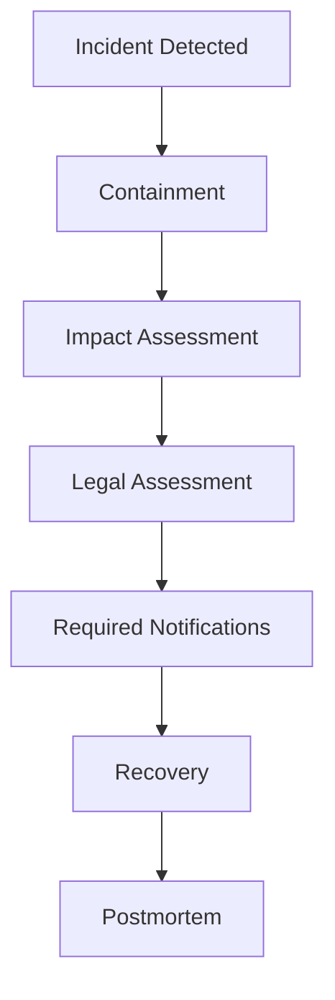

# LEGAL_AND_COMPLIANCE.md

# Hukuki Gereksinimler, Gizlilik, Platform Politikaları ve Uyumluluk

**Proje:** AI Destekli Fal ve Sosyal Etkileşim Platformu  
**Dosya:** `LEGAL_AND_COMPLIANCE.md`  
**Sürüm:** 1.0.0  
**Durum:** Hukuki ve operasyonel uyumluluk taslağı  
**Hedef pazar:** Öncelikli olarak Türkiye  
**Öncelik:** P0 — İlgili gereksinimler production yayını öncesinde doğrulanmalıdır.

---

## 1. Amaç

Bu doküman, platformun geliştirilmesi, yayınlanması ve işletilmesi sırasında değerlendirilmesi gereken hukuki, düzenleyici ve platform politikası gereksinimlerini tanımlar.

Kapsam:

- Kişisel verilerin korunması.
- Kullanıcı sözleşmeleri.
- Gizlilik ve aydınlatma metinleri.
- Açık rıza ve tercih yönetimi.
- AI tarafından oluşturulan fal yorumları.
- Kullanıcı içerikleri.
- Sosyal ağ ve topluluklar.
- Özel mesajlaşma.
- Flört ve eşleşme.
- Falcılar Ligi pazaryeri.
- Dijital ödemeler.
- Abonelikler.
- Tüketici hakları.
- İçerik moderasyonu.
- Çocukların korunması.
- Fikri mülkiyet.
- App Store ve Google Play gereksinimleri.
- Veri saklama ve silme.
- İhlal ve şikâyet süreçleri.

Bu belge, yazılım ekibi için uygulama gereksinimleri oluşturur. Hukuki görüş veya mevzuata uygunluk garantisi değildir.

---

## 2. Hukuki Tasarım İlkeleri

Platform aşağıdaki ilkeler doğrultusunda tasarlanmalıdır:

1. Privacy by design.
2. Privacy by default.
3. Data minimization.
4. Purpose limitation.
5. Transparency.
6. User control.
7. Security by design.
8. Accountability.
9. Proportionate moderation.
10. Consumer transparency.

### 2.1. Privacy by design

Kişisel verilerin korunması sonradan eklenen bir özellik değil, sistem mimarisinin parçası olmalıdır.

### 2.2. Privacy by default

Yeni kullanıcıların hesapları gereksiz veri paylaşımına açık olmamalıdır.

### 2.3. Data minimization

Bir özelliğin çalışması için gerekli olmayan kişisel veriler talep edilmemelidir.

### 2.4. Transparency

Kullanıcılar hangi verilerinin hangi amaçlarla işlendiğini, kiminle paylaşıldığını ve haklarını nasıl kullanabileceklerini anlayabilmelidir.

---

## 3. Uygulanabilir Hukuki Çerçeve

Türkiye odaklı ilk değerlendirmede aşağıdaki düzenlemeler ve yükümlülük alanları incelenmelidir.

| Düzenleme / alan | İlgili konu |
|---|---|
| 6698 sayılı KVKK | Kişisel veri işleme |
| KVKK ikincil düzenlemeleri | Aydınlatma, veri güvenliği, aktarım ve diğer yükümlülükler |
| 6502 sayılı Kanun | Tüketicinin korunması |
| Mesafeli Sözleşmeler Yönetmeliği | Uzaktan satış ve hizmetler |
| 6563 sayılı Kanun | Elektronik ticaret ve ticari elektronik ileti |
| 5651 sayılı Kanun | İnternet ortamındaki içerik ve hizmetlere ilişkin yükümlülükler |
| 5846 sayılı Kanun | Fikri mülkiyet hakları |
| 6493 sayılı Kanun | Ödeme hizmetleriyle ilgili düzenlemeler |
| Türk Borçlar Kanunu | Sözleşmesel ilişkiler |
| Türk Ticaret Kanunu | Ticari faaliyetler |
| Vergi mevzuatı | Gelir, komisyon, belge ve kayıt yükümlülükleri |
| Apple App Review Guidelines | iOS uygulama politikaları |
| Google Play Policies | Android uygulama politikaları |

Bu liste kapsamlı bir hukuki envanter değildir.

Özellikle platformun aracı hizmet sağlayıcı, içerik sağlayıcı, yer sağlayıcı veya başka bir düzenlenmiş rol kapsamında değerlendirilip değerlendirilmeyeceği somut iş modeline göre belirlenmelidir.

Mevzuat ve mağaza politikalarının güncel sürümleri yayın öncesinde kontrol edilmelidir.

---

## 4. Hukuki Sorumluluk Modeli

Platformda farklı aktörler bulunacaktır.

### 4.1. Platform işletmecisi

Platformun:

- Kullanıcı hesaplarını.
- AI hizmetlerini.
- Sosyal etkileşim altyapısını.
- Pazaryeri teknik sistemlerini.
- Moderasyon süreçlerini.
- Veri güvenliğini.

yöneten tüzel veya gerçek kişidir.

### 4.2. Son kullanıcı

AI fal hizmetlerini kullanan, içerik paylaşan veya diğer kullanıcılarla etkileşime giren kişidir.

### 4.3. İnsan fal yorumcusu

Falcılar Ligi üzerinden hizmet sunan kişidir.

Yorumcunun platformla hukuki ilişkisi ayrıca sözleşmeyle belirlenmelidir.

### 4.4. Ödeme sağlayıcısı

Ödeme işlemlerini ilgili yetki ve sözleşmeler çerçevesinde yürüten üçüncü taraftır.

### 4.5. AI sağlayıcısı

Yapay zekâ modelleri veya ilgili altyapı hizmetlerini sunan üçüncü taraftır.

### 4.6. Veri işleme rolleri

Platformun ve tedarikçilerinin veri sorumlusu veya veri işleyen konumları, gerçekleştirilen işlemler ve sözleşmeler üzerinden değerlendirilmelidir.

Bir sağlayıcının teknik olarak veriye erişmesi, tek başına bütün hukuki rol dağılımını belirlemez.

---

## 5. KVKK Veri Envanteri

Platformda işlenebilecek veri kategorileri aşağıdaki gibidir.

| Veri kategorisi | Örnek | Kullanım amacı |
|---|---|---|
| Kimlik / hesap | Kullanıcı ID, kullanıcı adı | Hesap yönetimi |
| İletişim | E-posta | Doğrulama ve bildirim |
| Profil | Biyografi, avatar | Kullanıcı profili |
| Fal girdileri | Fotoğraf, yazılı açıklama | Fal oluşturma |
| Fal sonuçları | AI yorum metni | Hizmet sunumu |
| Sosyal içerikler | Gönderi, yorum | Sosyal etkileşim |
| Mesajlar | Özel mesaj | İletişim |
| Tercihler | Bildirim ve eşleşme tercihleri | Kişiselleştirme |
| İşlem verileri | Sipariş, kredi hareketi | Ticari işlemler |
| Teknik veriler | IP, cihaz bilgisi, log | Güvenlik ve işletim |
| Moderasyon verileri | Rapor ve yaptırım kayıtları | Platform güvenliği |

### 5.1. Özel nitelikli kişisel veriler

Kullanıcılar serbest metinlerde sağlık, inanç, cinsel yaşam veya diğer hassas bilgileri paylaşabilir.

Bu nedenle platform, özel nitelikli kişisel verilerin işlenmesi riskini ayrıca değerlendirmelidir.

**Fal girdileri ve özel mesajlar, yalnızca sıradan kullanıcı içeriği olarak kabul edilmemelidir.**

### 5.2. Veri minimizasyonu

MVP için zorunlu olmayan:

- Açık adres.
- T.C. kimlik numarası.
- Hassas sağlık bilgileri.
- Kesin konum.
- Gereksiz kimlik belgeleri.

talep edilmemelidir.

Yorumcu doğrulaması veya ticari yükümlülükler için bazı ek veriler gerekiyorsa bunlar ayrı süreçte, belirli amaç ve hukuki dayanakla işlenmelidir.

---

## 6. Veri İşleme Hukuki Sebepleri

Her veri işleme faaliyeti için geçerli hukuki sebep belirlenmelidir.

Olası hukuki sebepler:

- Sözleşmenin kurulması veya ifasıyla doğrudan ilgili olma.
- Hukuki yükümlülüğün yerine getirilmesi.
- Bir hakkın tesisi, kullanılması veya korunması.
- İlgili kişinin temel haklarına zarar vermeyen meşru menfaat.
- Kanunda öngörülen diğer sebepler.
- Gerektiğinde açık rıza.

### 6.1. Açık rıza her işlem için varsayılan çözüm değildir

Bir işlemin sözleşmenin ifası için zorunlu olması halinde uygun hukuki sebep ayrıca değerlendirilmelidir.

Gereksiz veya geçersiz açık rıza mekanizmaları kullanılmamalıdır.

### 6.2. Ayrı amaçlar

Aşağıdaki faaliyetler aynı hukuki sebebe dayanmak zorunda değildir:

- Hesap oluşturma.
- Fal üretme.
- Pazarlama.
- Analitik.
- Flört profili oluşturma.
- Üçüncü taraf AI sağlayıcısına veri gönderme.
- Kişiselleştirme.

Her amaç için ayrı değerlendirme yapılmalıdır.

---

## 7. Aydınlatma Metni

Kullanıcıya kişisel verilerin işlenmesi hakkında anlaşılır bilgi verilmelidir.

### 7.1. İçerik

Aydınlatma metninde uygun kapsamda:

- Veri sorumlusunun kimliği.
- İşlenen veri kategorileri.
- İşleme amaçları.
- Hukuki sebepler.
- Veri aktarımı.
- Toplama yöntemleri.
- İlgili kişi hakları.
- Başvuru yöntemi.

yer almalıdır.

### 7.2. Erişilebilirlik

Aydınlatma metni:

- Kayıt ekranında erişilebilir olmalıdır.
- Ayarlardan tekrar açılabilmelidir.
- Güncel sürüm numarasına sahip olmalıdır.
- Kullanıcı tarafından anlaşılabilir dilde hazırlanmalıdır.

### 7.3. Versiyonlama

```text
privacy_notice_version
published_at
effective_at
```

alanlarıyla metin sürümleri takip edilebilir.

---

## 8. Açık Rıza ve Tercih Yönetimi

Açık rızanın gerekli olduğu işlemlerde kullanıcıya gerçek seçim hakkı tanınmalıdır.

### 8.1. Gereksinimler

- Rıza belirli olmalıdır.
- Bilgilendirmeye dayanmalıdır.
- Özgür iradeyle verilmelidir.
- Geri alınabilir olmalıdır.
- Gereksiz işlemler için hizmet şartına dönüştürülmemelidir.

### 8.2. Örnek tercihler

- Pazarlama bildirimleri.
- İsteğe bağlı kişiselleştirme.
- Flört modülüne katılım.
- Fal verilerinin belirli ikincil amaçlarla kullanılması.

Flört modülüne katılım için verilen ürün tercihi ile KVKK kapsamında gereken açık rıza aynı kavram değildir; uygun şekilde ayrı modellenmelidir.

### 8.3. Veri modeli

```text
user_consents
-------------
id
user_id
purpose
legal_basis_reference
notice_version
consent_version
granted
recorded_at
withdrawn_at
collection_channel
```

Rıza kayıtları, rıza gerekmeyen veri işleme faaliyetlerinin hukuki dayanaklarını temsil etmek için gelişigüzel kullanılmamalıdır.

---

## 9. Veri Saklama Politikası

Veriler sınırsız süre saklanmamalıdır.

### 9.1. Veri sınıflandırması

- Aktif hesap verileri.
- Fal geçmişi.
- Geçici fal görselleri.
- Sosyal içerikler.
- Özel mesajlar.
- Finansal kayıtlar.
- Güvenlik logları.
- Moderasyon kayıtları.
- Silinmiş hesaplara ait sınırlı kayıtlar.

### 9.2. Saklama tablosu

| Veri | Saklama yaklaşımı |
|---|---|
| Hesap bilgileri | Hesap yaşam döngüsüne bağlı |
| Fal geçmişi | Kullanıcı tercihi ve hizmet gereksinimine bağlı |
| Ham fal görselleri | Mümkün olan en kısa gerekli süre |
| Sosyal gönderiler | Yayın ve silme politikasına bağlı |
| Özel mesajlar | Mesajlaşma politikası ve hukuki gereksinimlere bağlı |
| Ödeme kayıtları | Uygulanabilir yasal saklama yükümlülüklerine bağlı |
| Güvenlik logları | Belirlenmiş risk ve saklama politikasına bağlı |
| Moderasyon delilleri | İtiraz, güvenlik ve hukuki gereksinimlere bağlı |

Kesin süreler veri envanteri ve hukuk incelemesi sonucunda belirlenecektir.

### 9.3. Silme

Saklama amacı sona eren veriler için:

- Silme.
- Yok etme.
- Anonimleştirme.

yöntemlerinden uygun olanı uygulanmalıdır.

---

## 10. Hesap Silme

Kullanıcılar hesap silme talebini uygulama üzerinden başlatabilmelidir.

### 10.1. Kullanıcı akışı

1. Kullanıcı ayarlara girer.
2. Hesap silme seçeneğini seçer.
3. Sonuçlar açıklanır.
4. Gerekli kimlik doğrulama yapılır.
5. Talep işleme alınır.
6. Silme veya saklama istisnaları uygulanır.
7. Kullanıcıya sonuç bildirilir.

### 10.2. Teknik gereksinimler

- Hesap erişiminin sonlandırılması.
- Aktif oturumların iptali.
- Silinebilir profil verilerinin kaldırılması.
- İlgili medya dosyalarının silinmesi.
- Üçüncü taraf sistemlerdeki verilerin değerlendirilmesi.
- Hukuken saklanması gereken kayıtların ayrılması.

### 10.3. Açık siparişler

Kullanıcının devam eden pazaryeri siparişleri veya uyuşmazlıkları varsa, bunların yönetimi ayrı süreçle ele alınmalıdır.

Hesap silme işlemi finansal kayıtların kontrolsüz yok edilmesine neden olmamalıdır.

---

## 11. Veri Sahibi Başvuruları

Kullanıcılar kişisel verilerine ilişkin haklarını kullanabilmelidir.

### 11.1. Başvuru türleri

- Veri işlenip işlenmediğini öğrenme.
- İşlenen veriler hakkında bilgi talep etme.
- İşleme amacını öğrenme.
- Aktarım yapılan taraflar hakkında bilgi talep etme.
- Düzeltme.
- Uygun koşullarda silme veya yok etme.
- Kanunda öngörülen diğer haklar.

### 11.2. Operasyonel süreç

```text
Request Received
      ↓
Identity Verification
      ↓
Request Classification
      ↓
Legal Review
      ↓
Data Collection / Action
      ↓
Response
      ↓
Audit Record
```

Başvuru süreleri ve yanıt yöntemleri güncel mevzuata göre uygulanmalıdır.

### 11.3. Yetkilendirme

Veri taleplerinde başka kullanıcıların özel verileri açıklanmamalıdır.

---

## 12. Yurt Dışına Veri Aktarımı

AI, hosting, analytics ve bildirim sağlayıcıları yurt dışında bulunabilir.

### 12.1. Değerlendirilecek konular

- Sağlayıcının bulunduğu ülke.
- Verinin işlendiği bölgeler.
- Alt işleyenler.
- Aktarımın hukuki dayanağı.
- Uygulanabilir aktarım mekanizması.
- Sözleşmesel ve teknik güvenceler.
- Saklama ve silme koşulları.

### 12.2. AI sağlayıcıları

Fal girdileri üçüncü taraf AI sağlayıcısına gönderiliyorsa:

- Kullanıcı bilgilendirilmelidir.
- Gereksiz tanımlayıcılar çıkarılmalıdır.
- Sağlayıcının veri kullanım koşulları incelenmelidir.
- Model eğitimi için veri kullanım politikası doğrulanmalıdır.
- Gerekli aktarım mekanizmaları sağlanmalıdır.

### 12.3. Kritik karar

Yurt dışı aktarımı yalnızca kullanıcı sözleşmesine bir cümle eklenerek otomatik olarak hukuka uygun hale gelmez.

---

## 13. AI Fal Hizmetinin Hukuki Konumu

AI fal yorumları eğlence ve sembolik yorumlama deneyimi olarak sunulacaktır.

### 13.1. Temel açıklama

Uygulama, AI yorumlarının:

- Bilimsel doğruluğu kanıtlanmış tahminler olmadığını.
- Geleceğe ilişkin kesin bilgi sağlamadığını.
- Profesyonel danışmanlık yerine geçmediğini.

açıkça belirtmelidir.

### 13.2. Yasaklanması gereken iddialar

Ürün pazarlamasında veya AI çıktılarında:

- Geleceği kesin olarak bilme.
- Hastalık teşhis etme.
- Tedavi önerme.
- Finansal kazancı garanti etme.
- Hukuki sonuçları kesin olarak öngörme.
- Kişilerin kaderini değiştirme garantisi.

gibi iddialardan kaçınılmalıdır.

### 13.3. Örnek kullanıcı açıklaması

> Bu yorum yapay zekâ tarafından eğlence ve kişisel yorumlama amacıyla oluşturulmuştur. Geleceğe ilişkin kesin bilgi veya profesyonel tavsiye niteliği taşımaz.

Bu ifade başlangıç taslağıdır; nihai ürün metni hukuki ve ürün incelemesinden geçirilmelidir.

---

## 14. AI Şeffaflığı

Kullanıcı, bir yorumun AI tarafından mı yoksa insan yorumcu tarafından mı üretildiğini ayırt edebilmelidir.

### 14.1. Arayüz gereksinimleri

- AI içerikleri uygun şekilde etiketlenmelidir.
- İnsan yorumcu profilleri açıkça belirtilmelidir.
- Otomatik oluşturulan içerikler insan hizmeti gibi sunulmamalıdır.
- Karma hizmetlerde AI kullanım kapsamı açıklanmalıdır.

### 14.2. Örnek etiketler

```text
AI Tarafından Oluşturuldu
İnsan Yorumcu
AI Destekli İnsan Yorumu
```

### 14.3. AI sağlayıcı değişikliği

Model sağlayıcısının değişmesi, veri işleme ve kullanıcı bilgilendirme yükümlülüklerini etkileyebilir.

Değişiklik öncesinde etki değerlendirmesi yapılmalıdır.

---

## 15. AI İçerik Güvenliği

AI çıktıları kullanıcıyı korkutarak veya manipüle ederek para harcamaya yönlendirmemelidir.

### 15.1. Riskli örnekler

- “Üzerinde lanet var, kaldırmak için ödeme yap.”
- “Kesinlikle ciddi hastalığın var.”
- “Bu yatırımı yaparsan kesin kazanırsın.”
- “Bu kişi senin kaderin, onu bırakmamalısın.”
- “Yakında kesin olarak kötü bir olay yaşayacaksın.”

### 15.2. Koruma mekanizmaları

- System prompt güvenlik kuralları.
- Output moderation.
- Riskli konu tespiti.
- Kullanıcı geri bildirimi.
- İnsan incelemesi.
- Model sürüm takibi.

### 15.3. Kriz durumları

Kendine zarar verme veya ciddi tehlike ifadeleriyle karşılaşıldığında, kullanıcıya uygun destek kaynaklarına yönlendirme yapılabilir.

Uygulama, sağlayamadığı acil müdahale veya kesintisiz izleme hizmetini vaat etmemelidir.

---

## 16. Kullanıcı Sözleşmesi

Platformun genel kullanıcı sözleşmesi aşağıdaki alanları kapsamalıdır.

### 16.1. Ana başlıklar

1. Taraflar ve tanımlar.
2. Hizmetin kapsamı.
3. Hesap oluşturma.
4. Kullanıcı yükümlülükleri.
5. Yasaklanan davranışlar.
6. AI fal hizmetleri.
7. Sosyal paylaşım.
8. Mesajlaşma.
9. Falcılar Ligi.
10. Flört modülü.
11. Ödemeler.
12. Abonelikler.
13. İçerik hakları.
14. Moderasyon.
15. Hesap kapatma.
16. Sorumluluk ve uygulanabilir sınırlar.
17. Şikâyet ve uyuşmazlık süreçleri.
18. Sözleşme değişiklikleri.

### 16.2. Haksız şart riski

Kullanıcı sözleşmesi, tüketici haklarını geçersiz kılacak veya platformu hukuken mümkün olmayan biçimde tüm sorumluluktan kurtaracak hükümler içermemelidir.

---

## 17. Topluluk Kuralları

Sosyal ağ ve topluluklarda davranış kuralları bulunmalıdır.

### 17.1. Yasaklanan içerik ve davranışlar

- Tehdit.
- Taciz.
- Nefret söylemi.
- Kişisel veri ifşası.
- Dolandırıcılık.
- Taklit hesap.
- Spam.
- İzinsiz özel içerik paylaşımı.
- Çocukların cinsel istismarı.
- Yasa dışı içerik.
- Kötüye kullanılan ticari yönlendirmeler.

### 17.2. Moderasyon ilkeleri

- Açık kurallar.
- Tutarlı uygulama.
- Orantılı yaptırım.
- Gerekli durumlarda insan incelemesi.
- İtiraz mekanizması.
- İşlem kayıtları.

### 17.3. Topluluk yöneticileri

Topluluk moderatörleri yalnızca yetkili oldukları topluluk alanlarını yönetebilmelidir.

Özel mesajlara veya finansal verilere erişim verilmemelidir.

---

## 18. Kullanıcı İçerikleri ve Fikri Mülkiyet

Kullanıcılar:

- Fotoğraf.
- Gönderi.
- Yorum.
- Topluluk konusu.
- Profil görseli.

paylaşabilir.

### 18.1. İçerik hakları

Kullanıcıların yükledikleri içeriklere ilişkin hak ve sorumlulukları sözleşmede açıklanmalıdır.

### 18.2. Platform lisansı

Platformun içeriği hizmet kapsamında görüntülemesi, depolaması ve teknik olarak işlemesi için gerekli lisansın kapsamı belirlenmelidir.

Gereksiz derecede geniş hak devri hükümlerinden kaçınılmalıdır.

### 18.3. Telif şikâyetleri

Hak sahipleri için bildirim ve inceleme süreci oluşturulmalıdır.

### 18.4. AI eğitim kullanımı

Kullanıcı içerikleri AI model eğitimi için kullanılacaksa bu faaliyet ayrı veri işleme ve fikri mülkiyet değerlendirmesi gerektirir.

Varsayılan olarak böyle bir kullanım yapılacağı varsayılmamalıdır.

---

## 19. Özel Mesajlaşma Gizliliği

Chat Module kullanıcılar arasında özel iletişim sağlayacaktır.

### 19.1. Gereksinimler

- Mesaj erişimi yetkilendirilmelidir.
- Mesajlar üçüncü kullanıcılara gösterilmemelidir.
- Yönetici erişimi sınırlandırılmalıdır.
- Erişimler denetlenebilir olmalıdır.
- Gereksiz mesaj içerikleri loglanmamalıdır.

### 19.2. Moderasyon

Özel mesajlaşmada kullanıcı raporları, spam ve güvenlik mekanizmaları uygulanabilir.

Bununla birlikte geniş kapsamlı içerik inceleme uygulamaları gizlilik ve hukuki gereksinimler açısından ayrıca değerlendirilmelidir.

### 19.3. Şifreleme iddiaları

Uçtan uca şifreleme gerçekten uygulanmadıkça uygulama böyle bir güvenlik özelliğine sahip olduğunu iddia etmemelidir.

---

## 20. Flört Modülü — Yaş ve Katılım

Flört modülü isteğe bağlı bir özellik olacaktır.

### 20.1. Yaş sınırı

Flört modülüne erişim için **18 yaş ve üzeri** kullanıcı koşulu önerilmektedir.

Yaş doğrulama yöntemi ve güvenilirliği ayrıca tasarlanmalıdır.

### 20.2. Opt-in

Kullanıcılar flört modülüne otomatik dahil edilmemelidir.

Katılım açık bir kullanıcı eylemiyle gerçekleşmelidir.

### 20.3. Çıkış

Kullanıcı flört modülünü kapatabilmelidir.

Bu işlem:

- Yeni aday gösterimini.
- Profil keşfedilebilirliğini.
- Yeni eşleşme oluşturmayı.

durdurmalıdır.

Mevcut konuşmaların ve kayıtların durumu açıkça tanımlanmalıdır.

---

## 21. Flört Modülü — Güvenlik

### 21.1. Temel kontroller

- Kullanıcı engelleme.
- Kullanıcı raporlama.
- İstenmeyen iletişim sınırları.
- Taciz moderasyonu.
- Sahte profil kontrolleri.
- Yaş uygunluğu kontrolleri.
- Konum gizliliği.

### 21.2. Konum verileri

Kesin konum kullanıcı profillerinde varsayılan olarak gösterilmemelidir.

Konum tabanlı eşleşme kullanılacaksa:

- Amaç açıklanmalıdır.
- Gerekli izinler alınmalıdır.
- Hassas konum paylaşımı sınırlandırılmalıdır.
- Kullanıcı kontrolü sağlanmalıdır.

### 21.3. Eşleşme açıklamaları

Astrolojik veya fal temelli uyumluluk skorları bilimsel kesinlik taşıyan ilişki tahminleri gibi sunulmamalıdır.

Örnek:

> Uyumluluk yorumu eğlence amaçlıdır; kişiler arasındaki gerçek ilişki uyumunu bilimsel olarak ölçmez.

---

## 22. Flört Modülü — Profil Verileri

Flört profili ana kullanıcı profilinden ayrı modellenmelidir.

### 22.1. Ayrı tutulabilecek veriler

- Flört profili görünürlüğü.
- Yaş aralığı tercihi.
- İlgi alanları.
- Eşleşme tercihleri.
- Flört biyografisi.
- Katılım durumu.

### 22.2. Hassas tercihler

Bazı eşleşme tercihleri özel nitelikli kişisel verileri ortaya çıkarabilir.

Bu alanlar için veri minimizasyonu, hukuki sebep ve erişim kontrolü ayrıca değerlendirilmelidir.

### 22.3. Silme

Flört profilinin silinmesi, ana platform hesabının silinmesini gerektirmemelidir.

---

## 23. Falcılar Ligi — Hukuki Model

Falcılar Ligi insan yorumcuların hizmet sunduğu pazaryeri modülüdür.

### 23.1. Temel soru

Platform:

- Hizmeti doğrudan mı satıyor?
- Bağımsız yorumculara aracılık mı ediyor?
- Ödemeyi kim tahsil ediyor?
- İadeden kim sorumlu?
- Belgeyi kim düzenliyor?
- Kullanıcıyla sözleşmenin tarafı kim?

Bu sorular teknik geliştirme öncesinde netleştirilmelidir.

### 23.2. Yorumcu sözleşmesi

İnsan yorumcular için ayrı sözleşme hazırlanmalıdır.

Sözleşmede:

- Hizmet kapsamı.
- Komisyon.
- Sipariş yükümlülükleri.
- Teslim süreleri.
- İade ve uyuşmazlıklar.
- Yasaklanan davranışlar.
- Vergisel sorumluluklar.
- Veri koruma yükümlülükleri.
- Hesap kapatma.

gibi konular değerlendirilmelidir.

---

## 24. Falcılar Ligi — Yorumcu Doğrulama

### 24.1. Başvuru bilgileri

İhtiyaca göre:

- İletişim bilgileri.
- Ticari durum.
- Vergisel bilgiler.
- Ödeme hesabı bilgileri.
- Gerekli doğrulama belgeleri.

talep edilebilir.

### 24.2. Veri güvenliği

Doğrulama belgeleri:

- Private storage üzerinde tutulmalıdır.
- Yetkili personelle sınırlandırılmalıdır.
- Erişimleri loglanmalıdır.
- Gereksiz süre saklanmamalıdır.

### 24.3. Yetki sınırı

Platform, yorumcunun kimliğini doğruladığı için yorumlarının bilimsel doğruluğunu veya geleceğe ilişkin kesin bilgi sunduğunu iddia etmemelidir.

---

## 25. Falcılar Ligi — Hizmet Açıklamaları

Yorumcuların hizmet açıklamaları açık ve yanıltıcı olmayan şekilde sunulmalıdır.

### 25.1. Gösterilecek bilgiler

- Hizmet türü.
- Hizmet kapsamı.
- Fiyat.
- Tahmini teslim süresi.
- Yorumcu bilgileri.
- Teslim biçimi.
- İptal ve iade koşulları.
- Uygun tüketici bilgilendirmeleri.

### 25.2. Yasaklanan iddialar

- Kesin gelecek tahmini.
- Hastalık tedavisi.
- Büyü veya lanet kaldırma garantisi.
- Kesin ilişki sonucu.
- Kesin finansal kazanç.
- Korkutarak ek ödeme talebi.

### 25.3. Moderasyon

Yorumcu hizmetleri yayına alınmadan önce uygun moderasyon kontrollerinden geçirilebilir.

---

## 26. Falcılar Ligi — Sipariş ve Uyuşmazlıklar

### 26.1. Sipariş kayıtları

- Sipariş ID.
- Taraflar.
- Hizmet.
- Fiyat.
- Komisyon.
- Ödeme durumu.
- Teslim durumu.
- İade durumu.
- Zaman damgaları.

### 26.2. İtiraz süreci

Kullanıcı:

1. Siparişi seçer.
2. Sorunu bildirir.
3. Gerekli açıklamayı ekler.
4. İnceleme başlatılır.
5. Karar bildirilir.
6. Uygun iade veya düzeltme uygulanır.

### 26.3. Karar şeffaflığı

İade ve uyuşmazlık kararları tutarlı kurallara dayanmalıdır.

Yorumcunun ticari kazancı, moderasyon kararlarının bağımsızlığını bozmamalıdır.

---

## 27. Ödeme Hizmetleri ve Fon Yönetimi

### 27.1. Kritik mimari karar

Platform, kullanıcı fonlarını kendi kontrolünde tutan bir ödeme kuruluşu gibi tasarlanmamalıdır.

Ödeme tahsilatı, komisyon dağıtımı ve yorumcu ödemeleri için yetkili sağlayıcılar ve uygun sözleşmesel model değerlendirilmelidir.

### 27.2. Ödeme sağlayıcısı

Seçilecek sağlayıcının:

- Pazaryeri modeli.
- Alt satıcı işlemleri.
- İadeler.
- Komisyon dağıtımı.
- Mutabakat.
- Yorumcu ödemeleri.

için gerekli özellikleri desteklemesi değerlendirilmelidir.

### 27.3. Teknik kayıtlar

Platform kendi işlem ve sipariş kayıtlarını tutabilir.

Ancak bu kayıtlar lisans gerektiren ödeme hizmetlerinin platform tarafından sunulmasına gerekçe oluşturmaz.

---

## 28. Dijital Krediler

Platformda AI fal hizmetleri için kredi sistemi kullanılabilir.

### 28.1. Kredi niteliği

Kredilerin:

- Ön ödemeli dijital kullanım hakkı mı olduğu.
- İade koşulları.
- Geçerlilik süresi.
- Devredilebilirliği.
- Para karşılığı geri ödenebilirliği.

hukuken değerlendirilmelidir.

### 28.2. Önerilen sınırlar

Başlangıçta kredilerin:

- Kullanıcılar arasında transfer edilmemesi.
- Nakit karşılığı çekilememesi.
- Platform dışı ödeme aracı olarak kullanılmaması.

önerilir.

Bu sınırlamalar tek başına düzenleyici yükümlülükleri ortadan kaldırmaz.

### 28.3. Kullanıcı bilgilendirmesi

Satın alma öncesinde:

- Kredi miktarı.
- Fiyat.
- Kullanım alanları.
- Geçerlilik koşulları.
- İade koşulları.

açıkça gösterilmelidir.

---

## 29. Abonelikler

Abonelik modeli kullanılırsa kullanıcılar düzenli ödeme koşulları hakkında açıkça bilgilendirilmelidir.

### 29.1. Gösterilecek bilgiler

- Abonelik fiyatı.
- Faturalama dönemi.
- Sunulan haklar.
- Yenileme koşulları.
- İptal yöntemi.
- Ücretsiz deneme varsa koşulları.

### 29.2. Otomatik yenileme

Otomatik yenileme gizlenmemelidir.

### 29.3. İptal

Kullanıcı aboneliğini ilgili satış kanalı ve kurallar çerçevesinde yönetebilmelidir.

### 29.4. Mobil mağazalar

App Store veya Google Play üzerinden oluşturulan aboneliklerde ilgili mağazanın abonelik ve faturalama kuralları uygulanmalıdır.

---

## 30. Mesafeli Satış ve Tüketici Hakları

Ücretli hizmetlerde uygulanabilir tüketici hukuku yükümlülükleri değerlendirilmelidir.

### 30.1. Ön bilgilendirme

İlgili işlem türüne göre:

- Satıcı veya sağlayıcı bilgileri.
- Hizmetin temel özellikleri.
- Toplam fiyat.
- Ek masraflar.
- Ödeme koşulları.
- Teslim veya ifa koşulları.
- Cayma hakkı ve istisnaları.
- Şikâyet yöntemleri.

açıklanmalıdır.

### 30.2. Cayma hakkı

Dijital içerik ve hizmetlerde cayma hakkına ilişkin kurallar ve istisnalar işlem türüne göre değişebilir.

Platform, bütün dijital işlemlerin otomatik olarak iade dışı olduğunu varsaymamalıdır.

### 30.3. Kayıt

Gerekli bilgilendirme ve kullanıcı onayları uygun şekilde kayıt altına alınmalıdır.

---

## 31. Vergisel Yükümlülükler

Platform gelir modeli aşağıdaki gelir türlerini içerebilir:

- AI fal satışı.
- Kredi satışı.
- Abonelik.
- Pazaryeri komisyonu.
- Reklam.
- Diğer dijital hizmetler.

### 31.1. Değerlendirme

- Vergi mükellefiyeti.
- Fatura ve belge düzeni.
- KDV.
- Komisyon gelirleri.
- Yorumcu ödemeleri.
- Yurt dışı sağlayıcı faturaları.
- Muhasebe ve kayıt yükümlülükleri.

mali müşavir ve hukuk uzmanıyla netleştirilmelidir.

### 31.2. Teknik gereksinim

Finansal kayıtlar denetlenebilir olmalıdır.

Silinen kullanıcı hesapları nedeniyle yasal finansal kayıtlar kontrolsüz biçimde kaybolmamalıdır.

---

## 32. App Store Uyumluluğu

iOS sürümü için Apple'ın güncel kuralları incelenmelidir.

### 32.1. Kontrol alanları

- Uygulama içi satın alma.
- Dijital içerikler.
- Abonelikler.
- Kullanıcı içerikleri.
- Moderasyon.
- Hesap silme.
- Gizlilik açıklamaları.
- Veri toplama beyanları.
- Yaş derecelendirmesi.
- Kullanıcı güvenliği.

### 32.2. AI fal uygulaması

Fal ve sembolik yorumlama hizmetlerinin nasıl tanıtıldığı, yanıltıcı iddialar ve kullanıcı güvenliği açısından değerlendirilmelidir.

### 32.3. Falcılar Ligi

İnsan tarafından sunulan hizmetlerin ödeme kategorisi, hizmetin niteliğine göre incelenmelidir.

AI dijital hizmetleri ile insan hizmetleri için aynı ödeme kuralının geçerli olduğu varsayılmamalıdır.

---

## 33. Google Play Uyumluluğu

Android sürümü için Google Play'in güncel politikaları incelenmelidir.

### 33.1. Kontrol alanları

- Google Play Billing.
- Dijital ürünler.
- Abonelikler.
- Kullanıcı tarafından oluşturulan içerikler.
- Kullanıcı güvenliği.
- Veri güvenliği beyanları.
- Hesap silme.
- Uygulama izinleri.
- Yaş derecelendirmesi.
- Yanıltıcı içerik.

### 33.2. Data Safety

Uygulamanın veri toplama ve paylaşım davranışı doğru beyan edilmelidir.

### 33.3. Üçüncü taraf SDK'lar

Firebase, analytics, reklam ve diğer SDK'ların veri işleme davranışları da değerlendirilmelidir.

---

## 34. Yaş Derecelendirmesi

Platformun genel yaş derecelendirmesi ile flört modülünün yaş sınırı ayrı değerlendirilmelidir.

### 34.1. Risk faktörleri

- Kullanıcı tarafından oluşturulan içerikler.
- Özel mesajlaşma.
- Flört.
- Yetişkin temalar.
- Satın alma.
- Rastgele kullanıcı etkileşimi.

### 34.2. Ürün kararı

Genel uygulamanın yalnızca yetişkinlere mi açık olacağı, yoksa yaşa göre modül erişimi mi uygulanacağı belirlenmelidir.

### 34.3. Kritik kural

Flört modülünün yalnızca 18+ olması, genel uygulamanın otomatik olarak daha düşük yaş derecelendirmesine uygun olduğu anlamına gelmez.

---

## 35. Çocukların Korunması

Platform çocuk kullanıcıları kabul edecekse ek koruma gereksinimleri değerlendirilmelidir.

### 35.1. Koruma alanları

- Yaşa uygun içerik.
- Mesajlaşma kısıtları.
- Profil görünürlüğü.
- Reklam ve pazarlama.
- Veri minimizasyonu.
- Yaş doğrulama.
- Yetişkinlerle etkileşim sınırları.

### 35.2. Başlangıç önerisi

MVP için yalnızca yetişkin kullanıcıları hedeflemek operasyonel karmaşıklığı azaltabilir.

Ancak bu kararın gerçek yaş doğrulama ve mağaza politikalarıyla desteklenmesi gerekir.

---

## 36. Reklam ve Ticari İletişim

Reklam ve pazarlama özellikleri eklenirse ilgili düzenlemeler değerlendirilmelidir.

### 36.1. Pazarlama bildirimleri

Ticari elektronik iletiler için gerekli izin ve ret mekanizmaları uygulanmalıdır.

### 36.2. Sponsorlu içerik

Sponsorlu gönderiler veya ücretli tanıtımlar açıkça ayırt edilebilmelidir.

### 36.3. Yanıltıcı reklam

AI fal hizmetlerinin bilimsel doğruluğu veya geleceği kesin bilme yeteneği varmış gibi reklam yapılmamalıdır.

### 36.4. Influencer iş birlikleri

Ücretli iş birliklerinde reklam ilişkisinin uygun şekilde açıklanması sağlanmalıdır.

---

## 37. Üçüncü Taraf SDK ve Servisler

Kullanılabilecek üçüncü taraf hizmetler:

- AI sağlayıcıları.
- Firebase.
- Analytics.
- Crash monitoring.
- Payment provider.
- E-posta sağlayıcısı.
- Object storage.
- Moderasyon sağlayıcısı.

### 37.1. Tedarikçi değerlendirmesi

Her sağlayıcı için:

- İşlenen veri.
- İşleme amacı.
- Veri bölgesi.
- Alt işleyenler.
- Saklama süresi.
- Güvenlik önlemleri.
- Sözleşmesel şartlar.
- Veri silme yetenekleri.

incelenmelidir.

### 37.2. Tedarikçi envanteri

```text
third_party_services
--------------------
service_name
service_category
data_categories
processing_purpose
data_region
contract_reference
security_review_status
last_reviewed_at
```

---

## 38. Güvenlik İhlali Yönetimi

Kişisel veri ihlalleri için müdahale planı hazırlanmalıdır.

### 38.1. Olay örnekleri

- Yetkisiz veritabanı erişimi.
- API anahtarı sızıntısı.
- Özel mesajların açığa çıkması.
- Kullanıcı görsellerinin yanlışlıkla public olması.
- Hesap ele geçirme.
- Yedek dosyalarının sızması.

### 38.2. Müdahale akışı



### 38.3. Bildirim yükümlülükleri

İhlalin niteliğine göre yetkili kurumlara ve ilgili kişilere bildirim gerekip gerekmediği güncel mevzuat kapsamında değerlendirilmelidir.

Süreler ve bildirim içeriği olay müdahale prosedüründe ayrıca tanımlanmalıdır.

---

## 39. Moderasyon ve Hukuki Talepler

Platform içerik şikâyetleri ve hukuki talepler için kayıtlı süreç oluşturmalıdır.

### 39.1. Talep kategorileri

- Kullanıcı şikâyeti.
- Gizlilik ihlali.
- Telif hakkı.
- Dolandırıcılık.
- Tehdit.
- Çocuk güvenliği.
- Yetkili makam talebi.

### 39.2. Yetkili makam talepleri

Talepler:

- Kaynak doğrulaması.
- Hukuki geçerlilik incelemesi.
- Kapsam değerlendirmesi.
- Yetkili personel onayı.
- Güvenli veri aktarımı.
- Audit logging.

adımlarından geçirilmelidir.

### 39.3. Veri minimizasyonu

Yasal olarak gerekenden daha fazla kullanıcı verisi paylaşılmamalıdır.

---

## 40. Kullanıcı Destek ve Şikâyet Sistemi

Kullanıcılar aşağıdaki konularda destek alabilmelidir:

- Hesap erişimi.
- Veri hakları.
- Ödeme.
- İade.
- Fal hizmeti.
- Falcılar Ligi siparişi.
- İçerik şikâyeti.
- Taciz.
- Hesap silme.

### 40.1. Destek kayıtları

```text
support_tickets
---------------
id
user_id
category
status
priority
assigned_to
created_at
updated_at
resolved_at
```

### 40.2. Erişim

Destek personeli yalnızca görevini yerine getirmek için gerekli verilere erişebilmelidir.

---

## 41. Gerekli Hukuki Metinler

Production yayını öncesinde hazırlanması gereken metinler:

| Metin | Öncelik |
|---|---|
| Kullanıcı Sözleşmesi | P0 |
| KVKK Aydınlatma Metni | P0 |
| Gizlilik Politikası | P0 |
| Topluluk Kuralları | İlgili modül yayını için P0 |
| AI Fal Açıklaması | P0 |
| Hesap Silme Politikası | P0 |
| Veri Saklama ve İmha Politikası | P0 |
| Satış Ön Bilgilendirme Metni | Ücretli satış için P0 |
| Mesafeli Satış / Hizmet Sözleşmesi | Uygulanabildiği ölçüde P0 |
| İade ve İptal Politikası | Ücretli satış için P0 |
| Abonelik Koşulları | Abonelik için P0 |
| Yorumcu Sözleşmesi | Marketplace için P0 |
| Marketplace Hizmet Koşulları | Marketplace için P0 |
| Flört Modülü Kuralları | Dating için P0 |
| Çerez Politikası | Kullanılan web teknolojilerine bağlı |
| Ticari İleti Bilgilendirmesi | İlgili pazarlama faaliyetleri için P0 |

---

## 42. Hukuki Metin Versiyonlama

Kullanıcıya gösterilen metinler versiyonlanmalıdır.

### 42.1. Önerilen model

```text
legal_documents
---------------
id
document_type
version
language
content_location
published_at
effective_at
is_active
```

### 42.2. Kullanıcı kabul kayıtları

```text
legal_acceptances
-----------------
id
user_id
document_id
accepted_at
acceptance_method
```

### 42.3. Kritik ayrım

Her hukuki metin için kabul kutucuğu gerekli olmayabilir.

Aydınlatma, açık rıza ve sözleşme kabulü birbirinden farklı hukuki işlemlerdir.

Arayüz bunları tek ve belirsiz bir onay altında birleştirmemelidir.

---

## 43. Flutter Hukuki Ekranları

### 43.1. Authentication

- Kullanıcı sözleşmesi erişimi.
- Aydınlatma metni erişimi.
- Gerektiğinde ayrı rıza kontrolleri.

### 43.2. Settings

- Gizlilik politikası.
- Veri tercihleri.
- Hesap silme.
- Destek.
- Veri talepleri.
- Bildirim tercihleri.

### 43.3. AI Fortune

- AI açıklaması.
- Eğlence amaçlı kullanım bilgilendirmesi.
- Girdi işleme açıklaması.

### 43.4. Marketplace

- Satıcı bilgileri.
- Hizmet şartları.
- Fiyat.
- İptal ve iade.
- Sipariş şikâyeti.

### 43.5. Dating

- 18+ erişim kontrolü.
- Katılım tercihi.
- Gizlilik ayarları.
- Engelleme.
- Raporlama.
- Modülden çıkış.

---

## 44. Backend Hukuki Servisleri

Önerilen modül:

```text
app/modules/legal/
├── api/
│   └── routes.py
├── application/
│   └── services.py
├── domain/
│   └── models.py
├── infrastructure/
│   └── repositories.py
└── schemas/
    └── legal.py
```

### 44.1. Sorumluluklar

- Aktif hukuki metinleri sunmak.
- Sürüm bilgisi sağlamak.
- Gerekli kabul kayıtlarını tutmak.
- Açık rıza kayıtlarını yönetmek.
- Veri talebi süreçleriyle entegre olmak.
- Audit kayıtları üretmek.

### 44.2. API örnekleri

```text
GET  /api/v1/legal/documents
GET  /api/v1/legal/documents/{type}

POST /api/v1/legal/acceptances

GET  /api/v1/users/me/consents
PUT  /api/v1/users/me/consents

POST /api/v1/privacy/requests
GET  /api/v1/privacy/requests/me
```

### 44.3. Güvenlik

Kullanıcı yalnızca kendi rıza ve başvuru kayıtlarını görüntüleyebilmelidir.

Yönetici erişimi RBAC ve audit logging ile korunmalıdır.

---

## 45. Hukuki Uyumluluk Testleri

### 45.1. Authentication

- [ ] Hukuki metinlere kayıt öncesi erişilebiliyor.
- [ ] Gerekli sözleşme kabulü kaydediliyor.
- [ ] Açık rıza ayrı yönetiliyor.
- [ ] Rıza verilmediğinde gereksiz işlem yapılmıyor.

### 45.2. Gizlilik

- [ ] Kullanıcı verilerine yetkisiz erişim engelleniyor.
- [ ] Hesap silme akışı çalışıyor.
- [ ] Veri talepleri kaydediliyor.
- [ ] Saklama ve silme politikaları uygulanıyor.

### 45.3. AI

- [ ] AI içeriği etiketleniyor.
- [ ] Eğlence amaçlı açıklama gösteriliyor.
- [ ] Riskli AI çıktıları kontrol ediliyor.
- [ ] Kullanıcı girdileri gereksiz loglanmıyor.

### 45.4. Marketplace

- [ ] Hizmet fiyatı açık.
- [ ] Yorumcu bilgileri uygun kapsamda gösteriliyor.
- [ ] İade koşulları erişilebilir.
- [ ] Sipariş kayıtları tutuluyor.
- [ ] Uyuşmazlık süreci çalışıyor.

### 45.5. Dating

- [ ] Yaş uygunluğu kontrol ediliyor.
- [ ] Kullanıcı açıkça katılıyor.
- [ ] Modül kapatılabiliyor.
- [ ] Engelleme ve raporlama çalışıyor.
- [ ] Konum verileri korunuyor.

---

## 46. Hukuki Risk Matrisi

| Risk | Etki | Öncelik |
|---|---|---|
| Yetkisiz kişisel veri işleme | Kritik | P0 |
| Yurt dışı veri aktarımının hatalı kurulması | Kritik | P0 |
| Kullanıcı verisi sızıntısı | Kritik | P0 |
| Ödeme modelinin mevzuata aykırılığı | Kritik | P0 |
| Yanıltıcı AI fal iddiaları | Yüksek | P0 |
| Mağaza ödeme kurallarına aykırılık | Yüksek | P0 |
| Çocukların flört modülüne erişimi | Kritik | P0 |
| Yetersiz moderasyon | Yüksek | P0 |
| Belirsiz iade koşulları | Yüksek | P0 |
| Eksik telif şikâyeti süreci | Orta/Yüksek | P1 |
| Eksik pazarlama izinleri | Yüksek | İlgili faaliyet öncesi P0 |
| Yetersiz yorumcu sözleşmesi | Yüksek | Marketplace öncesi P0 |

---

## 47. Hukuki İnceleme Kapıları

Her modül için ayrı yayın onayı uygulanmalıdır.

### Gate 1 — Core MVP

- Kullanıcı sözleşmesi.
- Aydınlatma.
- Gizlilik.
- AI açıklaması.
- Veri işleme envanteri.
- Hesap silme.
- Sağlayıcı sözleşmeleri.
- Mağaza gereksinimleri.

### Gate 2 — Paid Features

- Ödeme modeli.
- Dijital kredi.
- Abonelik.
- Ön bilgilendirme.
- İade.
- Vergisel süreçler.

### Gate 3 — Social & Communities

- Topluluk kuralları.
- İçerik moderasyonu.
- Telif şikâyetleri.
- Kullanıcı raporları.
- İçerik saklama.

### Gate 4 — Marketplace

- Yorumcu sözleşmeleri.
- Komisyon.
- Ödeme dağıtımı.
- Vergi.
- İade ve uyuşmazlık.
- Satıcı doğrulaması.

### Gate 5 — Dating

- Yaş uygunluğu.
- Opt-in.
- Profil gizliliği.
- Hassas tercihler.
- Mesajlaşma güvenliği.
- Kullanıcı raporlama.

Her gate ilgili özellik production ortamında açılmadan önce tamamlanmalıdır.

---

## 48. Operasyonel Sorumluluklar

| Sorumluluk | Önerilen sahip |
|---|---|
| Hukuki metin hazırlığı | Hukuk danışmanı |
| KVKK veri envanteri | Hukuk + teknik ekip |
| Veri güvenliği | Backend / DevOps |
| Kullanıcı arayüzü açıklamaları | Product + Flutter |
| Ödeme modeli | Product + hukuk + finans |
| Yorumcu sözleşmeleri | Hukuk + marketplace |
| Moderasyon kuralları | Trust & Safety + hukuk |
| Mağaza politikaları | Product + mobile |
| Veri talepleri | Yetkilendirilmiş operasyon ekibi |
| İhlal müdahalesi | Security + hukuk + operasyon |

Küçük ekipte bir kişi birden fazla sorumluluk üstlenebilir; ancak karar sahipleri açıkça belirlenmelidir.

---

## 49. Açık Hukuki Kararlar

| Karar | Durum |
|---|---|
| Platform işletmecisi | TBD |
| Şirket yapısı | TBD |
| Genel kullanıcı yaş sınırı | TBD |
| Flört yaş sınırı | 18+ önerildi |
| AI veri sağlayıcısı | TBD |
| Yurt dışı veri aktarım mekanizması | TBD |
| Veri saklama süreleri | TBD |
| Marketplace hukuki modeli | TBD |
| Yorumcuların ticari statüsü | TBD |
| Ödeme sağlayıcısı | TBD |
| Dijital kredi hukuki niteliği | TBD |
| Abonelik modeli | TBD |
| İade politikası | TBD |
| App Store ödeme modeli | TBD |
| Google Play ödeme modeli | TBD |
| Vergi ve belge düzeni | TBD |
| Hukuk danışmanı incelemesi | Bekleniyor |

---

## 50. Production Hukuki Checklist

### Şirket ve operasyon

- [ ] Platform işletmecisi belirlendi.
- [ ] Gerekli ticari ve vergisel süreçler değerlendirildi.
- [ ] Destek ve iletişim bilgileri hazırlandı.
- [ ] Hukuki sorumluluklar belirlendi.

### KVKK

- [ ] Veri envanteri oluşturuldu.
- [ ] Hukuki sebepler belirlendi.
- [ ] Aydınlatma metni hazırlandı.
- [ ] Gerekli rıza süreçleri uygulandı.
- [ ] Yurt dışı aktarım değerlendirildi.
- [ ] Saklama ve imha politikası hazırlandı.
- [ ] Veri sahibi başvuru süreci çalışıyor.
- [ ] İhlal müdahale planı hazır.

### AI

- [ ] AI içerikleri etiketleniyor.
- [ ] Eğlence amaçlı açıklamalar mevcut.
- [ ] Yanıltıcı iddialar engelleniyor.
- [ ] AI sağlayıcısının veri işleme koşulları incelendi.
- [ ] Riskli çıktı kontrolleri çalışıyor.

### Sosyal ağ

- [ ] Topluluk kuralları hazır.
- [ ] Raporlama çalışıyor.
- [ ] Moderasyon çalışıyor.
- [ ] İtiraz süreci mevcut.
- [ ] Telif şikâyeti kanalı mevcut.

### Ticari işlemler

- [ ] Ödeme modeli hukuken incelendi.
- [ ] Fiyatlandırma açık.
- [ ] İade koşulları hazır.
- [ ] Abonelik koşulları hazır, uygulanıyorsa.
- [ ] Finansal kayıtlar güvenli.
- [ ] Mağaza ödeme kuralları doğrulandı.

### Marketplace

- [ ] Yorumcu sözleşmesi hazır.
- [ ] Yorumcu doğrulaması tanımlandı.
- [ ] Komisyon modeli açık.
- [ ] Sipariş ve teslim koşulları açık.
- [ ] Uyuşmazlık süreci çalışıyor.

### Dating

- [ ] Yaş uygunluğu kontrol ediliyor.
- [ ] Katılım isteğe bağlı.
- [ ] Profil gizliliği sağlanıyor.
- [ ] Engelleme çalışıyor.
- [ ] Raporlama çalışıyor.
- [ ] Modülden çıkış çalışıyor.

### Mağaza yayını

- [ ] App Store politikaları incelendi.
- [ ] Google Play politikaları incelendi.
- [ ] Veri toplama beyanları doğru.
- [ ] Yaş derecelendirmesi doğrulandı.
- [ ] Hesap silme gereksinimleri karşılandı.
- [ ] Hukuki metinler erişilebilir.

---

## 51. İlişkili Dokümanlar

- `PROJECT_OVERVIEW.md`
- `APP_FEATURES.md`
- `USER_ROLES.md`
- `USER_FLOWS.md`
- `PRD.md`
- `UI_UX_GUIDELINES.md`
- `API_SPECIFICATION.md`
- `AI_SYSTEM_DESIGN.md`
- `PAYMENT_AND_MONETIZATION.md`
- `SECURITY_AND_PRIVACY.md`
- `DATABASE_SCHEMA.md`
- `SYSTEM_ARCHITECTURE.md`
- `FLUTTER_ARCHITECTURE.md`
- `BACKEND_ARCHITECTURE.md`
- `NOTIFICATION_SYSTEM.md`
- `CHAT_AND_REALTIME.md`
- `MATCHING_ALGORITHM.md`
- `FORTUNE_TELLER_MARKETPLACE.md`
- `CONTENT_MODERATION.md`
- `ANALYTICS_AND_METRICS.md`
- `TESTING_STRATEGY.md`
- `DEPLOYMENT_AND_DEVOPS.md`
- `DEVELOPMENT_ROADMAP.md`
- `ENVIRONMENT_CONFIGURATION.md`

---

## 52. Sonuç

Platformun hukuki uyumluluğu yalnızca kullanıcı sözleşmesi ve gizlilik politikası hazırlamakla sağlanamaz.

Uyumluluk gereksinimleri:

- Veri modellerine.
- API yetkilendirmesine.
- Flutter kullanıcı akışlarına.
- Ödeme altyapısına.
- Moderasyon süreçlerine.
- AI güvenlik kontrollerine.
- Saklama ve silme mekanizmalarına.
- Operasyonel süreçlere.

doğrudan yansıtılmalıdır.

**Temel karar:** Her modül, kendi hukuki ve güvenlik gereksinimleri tamamlanmadan production ortamında kullanıma açılmayacaktır.

İlk yayın için AI fal ve kullanıcı hesabı süreçleri önceliklidir. Sosyal ağ, Falcılar Ligi ve flört modülü kendi yayın öncesi uyumluluk kontrollerinden geçerek aşamalı biçimde açılacaktır.

**Doküman durumu:** Hukuki ve operasyonel uyumluluk taslağı. Nihai hukuki onay beklenmektedir.

---

**Dokümantasyon seti: 25/25 tamamlandı.**