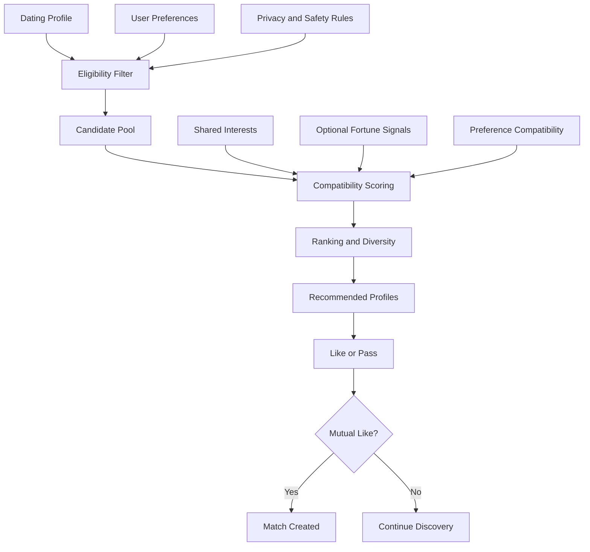
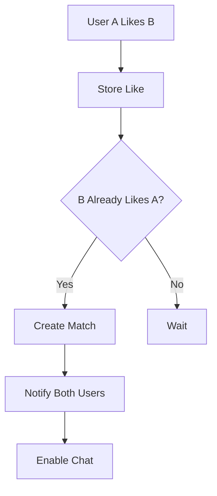

# MATCHING_ALGORITHM.md

# Fal Tabanlı Eşleşme ve Öneri Algoritması

**Proje:** AI Destekli Fal ve Sosyal Etkileşim Platformu  
**Dosya:** `MATCHING_ALGORITHM.md`  
**Sürüm:** 1.0.0  
**Durum:** Algoritma tasarım taslağı  
**Öncelik:** P2

---

## 1. Amaç

Bu doküman, platformun flört ve eşleşme modülünde kullanılacak öneri algoritmasının çalışma prensiplerini tanımlar.

Sistem, klasik flört uygulamalarından farklı olarak kullanıcıların açıkça belirttiği tercihleri, ortak ilgi alanlarını ve izin verdikleri fal deneyimlerinden elde edilen tematik sinyalleri bir araya getirerek tanışma önerileri sunmayı amaçlar.

Eşleşme algoritmasının hedefleri:

- Kullanıcıların ortak ilgi alanlarına sahip kişilerle tanışmasını sağlamak.
- Karşılıklı tercihleri dikkate almak.
- Fal deneyimini sosyal keşif mekanizmasına dönüştürmek.
- Kullanıcıların ilgisini çekebilecek profilleri önermek.
- İstenmeyen eşleşmeleri azaltmak.
- Kullanıcı güvenliğini ve gizliliğini korumak.
- Eşleşme önerilerini anlaşılır hale getirmek.

**Temel ilke:** Fal sonuçları bilimsel uyumluluk ölçümü değildir. Algoritma bunları eğlence amaçlı, isteğe bağlı keşif sinyalleri olarak kullanır; gerçek ilişki uyumunu veya gelecekteki ilişki başarısını garanti etmez.

---

## 2. Eşleşme Sisteminin Kapsamı

Eşleşme sistemi yalnızca flört modülüne açıkça katılan kullanıcılar için çalışacaktır.

Kullanıcı flört modülüne katılmadan:

- Eşleşme havuzuna alınamaz.
- Flört profili diğer kullanıcılara önerilemez.
- Fal sonuçları eşleşme amacıyla işlenemez.
- Flört bildirimleri alamaz.

Kullanıcı istediği zaman flört modülünden ayrılabilmelidir.

### 2.1. Kullanım senaryoları

1. Kullanıcı flört modülünü etkinleştirir.
2. Flört profilini oluşturur.
3. Tercihlerini belirler.
4. Fal verilerinin eşleşme için kullanılmasına ayrı olarak izin verebilir.
5. Sistem uygun adayları filtreler.
6. Adaylar için uyum puanları hesaplanır.
7. Kullanıcıya önerilen profiller gösterilir.
8. Kullanıcı beğenme veya geçme işlemi yapar.
9. Karşılıklı beğeni gerçekleşirse eşleşme oluşturulur.
10. Kullanıcılar mesajlaşmaya başlayabilir.

---

## 3. Algoritma Mimarisi

Önerilen yapı:



Algoritma iki temel aşamadan oluşur:

**Aşama 1 — Uygunluk filtreleme:** Kullanıcının görebileceği adayları belirler.

**Aşama 2 — Sıralama:** Uygun adayları kullanıcı açısından anlamlı bir sıraya yerleştirir.

Bu iki aşama birbirinden bağımsız uygulanmalıdır.

---

## 4. Kullanılacak Veri Kaynakları

### 4.1. Flört profili

Kullanıcının isteğe bağlı olarak sağladığı bilgiler:

- Görünen ad
- Profil fotoğrafları
- Biyografi
- Yaş
- İlgi alanları
- Tanışma amacı
- Tercih edilen yaş aralığı
- Tercih edilen mesafe
- Görünürlük ayarları

Flört özelliğinin yetişkinlere yönelik olması önerilir. Yaş uygunluğu ve doğrulama yöntemi ürünün hukuki değerlendirmesinde kesinleştirilmelidir.

### 4.2. Kullanıcı tercihleri

- Tercih edilen yaş aralığı
- Tercih edilen cinsiyet veya diğer uygun tanışma tercihleri
- Mesafe tercihi
- Tanışma amacı
- Ortak ilgi alanları
- Eşleşme görünürlüğü

Hassas tercihlerin işlenmesi için uygulanabilir hukuki şartlar ayrıca değerlendirilmelidir.

### 4.3. Fal sinyalleri

Kullanıcı açıkça izin verdiğinde aşağıdaki tematik bilgiler değerlendirilebilir:

- Fal yorumunda geçen ilişki temaları
- Kullanıcının seçtiği semboller
- Kullanıcının ilgi duyduğu fal kategorileri
- Eğlence amaçlı karakter arketipleri
- Ortak fal temaları

Fal yorumundan kişinin gerçek psikolojik özellikleri, sağlık durumu veya güvenilirliği hakkında kesin çıkarımlar yapılmamalıdır.

---

## 5. Fal Verilerinden Sinyal Çıkarma

Fal sonuçları doğrudan metin benzerliği üzerinden eşleştirilmek yerine kontrollü bir etiketleme sistemine dönüştürülebilir.

### 5.1. Örnek temalar

| Tema | Açıklama |
|---|---|
| adventure | Macera ve yenilik |
| stability | Düzen ve istikrar |
| creativity | Yaratıcılık |
| communication | İletişim |
| independence | Bağımsızlık |
| romance | Romantizm |
| curiosity | Merak |
| social_energy | Sosyal etkileşim |

Bu etiketler kullanıcı hakkında doğrulanmış kişilik tespitleri değildir. Fal içeriğindeki eğlence amaçlı temaları temsil eder.

### 5.2. Örnek AI çıktısı

```json
{
  "fortune_id": "fortune-uuid",
  "signal_version": "1.0",
  "themes": [
    {
      "key": "adventure",
      "weight": 0.8
    },
    {
      "key": "communication",
      "weight": 0.7
    },
    {
      "key": "creativity",
      "weight": 0.6
    }
  ]
}
```

Buradaki ağırlıklar, metindeki tema belirginliğini temsil eder. Kullanıcının gerçek kişilik özelliklerinin kesinlik derecesi değildir.

### 5.3. Sinyal üretim kuralları

- Sadece izin verilmiş fal kayıtları işlenmelidir.
- Ham fal metinleri mümkün olduğunca eşleşme servisinde saklanmamalıdır.
- Hassas kişisel çıkarımlar üretilmemelidir.
- Sinyaller versiyonlanmalıdır.
- Kullanıcı iznini geri çektiğinde türetilmiş sinyaller de silme sürecine dahil edilmelidir.
- AI sonuçları güvenilir ve kesin bilgi olarak değerlendirilmemelidir.

---

## 6. Uygunluk Filtreleme

Puanlama yapılmadan önce adayların uygunluğu kontrol edilmelidir.

### 6.1. Zorunlu filtreler

Aday:

- Aktif kullanıcı olmalıdır.
- Flört modülüne katılmış olmalıdır.
- Keşfedilebilir durumda olmalıdır.
- Yaş uygunluğu şartlarını sağlamalıdır.
- Karşılıklı zorunlu tercihleri karşılamalıdır.
- Engellenmiş kullanıcı olmamalıdır.
- Güvenlik nedeniyle kısıtlanmış olmamalıdır.
- Daha önce eşleşmiş veya geçilmiş profiller için tanımlanan tekrar gösterim kurallarına uymalıdır.

### 6.2. Karşılıklı tercih kontrolü

Örnek:

Kullanıcı A, 22–28 yaş aralığında kişilerle tanışmak istiyor.

Kullanıcı B, 20–25 yaş aralığında kişilerle tanışmak istiyor.

Adayların yaşları her iki tarafın tercihlerine de uygunsa eşleşme değerlendirmesine alınabilir.

Yalnızca A'nın B'yi tercih etmesi yeterli değildir; B'nin zorunlu tercihleri de karşılanmalıdır.

---

## 7. Uyum Puanlama Modeli

İlk sürümde açıklanabilir ve kural tabanlı bir puanlama modeli önerilmektedir.

### 7.1. Puan bileşenleri

| Bileşen | Sembol | Örnek ağırlık |
|---|---|---:|
| Ortak ilgi alanları | I | %35 |
| Tercih uyumu | P | %30 |
| Tanışma amacı uyumu | R | %20 |
| İsteğe bağlı fal temaları | F | %15 |

Toplam:

\[
S = 0.35I + 0.30P + 0.20R + 0.15F
\]

Burada bütün bileşenler 0–100 arasında normalize edilir.

Bu ağırlıklar başlangıç hipotezidir; gerçek kullanıcı verileriyle test edilmeden optimize edilmiş değerler olarak kabul edilmemelidir.

### 7.2. Fal izni bulunmadığında

Kullanıcı fal verilerini eşleşmede kullanmak istemiyorsa sistem çalışmaya devam etmelidir.

Bu durumda mevcut ağırlıklar yeniden normalize edilir:

\[
S = \frac{0.35I + 0.30P + 0.20R}{0.85}
\]

Böylece kullanıcı fal verisi paylaşmadığı için sistematik olarak düşük puan almaz.

### 7.3. Örnek hesaplama

| Bileşen | Puan |
|---|---:|
| İlgi alanları | 80 |
| Tercih uyumu | 90 |
| Tanışma amacı | 100 |
| Fal temaları | 70 |

Hesaplama:

\[
S = 0.35(80)+0.30(90)+0.20(100)+0.15(70)
\]

\[
S = 85.5
\]

Sonuç: **85,5 / 100 öneri puanı.**

Bu puan, iki kişinin gerçek romantik uyumluluğunun yüzde 85,5 olduğu anlamına gelmez. Yalnızca algoritmanın mevcut sinyallere göre hesapladığı sıralama değeridir.

---

## 8. İlgi Alanı Benzerliği

İlk sürümde ortak ilgi alanları Jaccard Similarity yöntemiyle değerlendirilebilir.

\[
J(A,B)=\frac{|A\cap B|}{|A\cup B|}
\]

Örnek:

Kullanıcı A:

- Müzik
- Seyahat
- Sinema
- Teknoloji

Kullanıcı B:

- Seyahat
- Sinema
- Kitap
- Teknoloji

Ortak ilgi alanları: 3

Toplam benzersiz ilgi alanı: 5

\[
J(A,B)=\frac{3}{5}=0.60
\]

İlgi alanı puanı: 60/100.

İlerleyen aşamada ilgi alanları kategori ve anlamsal benzerlik üzerinden değerlendirilebilir.

---

## 9. Fal Teması Benzerliği

Fal temaları sayısal vektörler olarak temsil edilebilir.

Örnek:

```json
{
  "adventure": 0.8,
  "communication": 0.7,
  "creativity": 0.6,
  "stability": 0.2
}
```

İki kullanıcının tema vektörleri arasında Cosine Similarity hesaplanabilir.

\[
\operatorname{cosine}(A,B)=
\frac{A\cdot B}{\|A\|\|B\|}
\]

### 9.1. Önemli sınırlama

Benzer fal temalarına sahip olmak iki kişinin gerçek hayatta uyumlu olduğu anlamına gelmez.

Bu özellik:

- Eğlenceli keşif
- Ortak sohbet konusu oluşturma
- Kullanıcı deneyimini farklılaştırma

amacıyla kullanılmalıdır.

Fal temalarının eşleşme başarısına etkisi A/B testleriyle değerlendirilmelidir.

---

## 10. Eşleşme Sıralama Sistemi

Uygun adaylar hesaplanan skor üzerinden sıralanabilir.

Ancak yalnızca en yüksek puanlı profilleri sürekli göstermek önerilmez.

### 10.1. Sıralama faktörleri

- Temel öneri puanı
- Kullanıcı tercihleri
- Profil güncelliği
- Uygun aday çeşitliliği
- Önceden gösterilen profiller
- Güvenlik ve görünürlük kuralları

### 10.2. Çeşitlilik

Sistem sürekli birbirine çok benzeyen profiller göstermek yerine kullanıcı tercihleri içinde kalan farklı ilgi alanlarına sahip kişileri de önerebilir.

### 10.3. Adil keşif

Yeni kullanıcıların hiç görüntülenmemesi veya popüler kullanıcıların sürekli öne çıkarılması önlenmelidir.

İlk sürümde basit keşif çeşitliliği mekanizması yeterlidir.

---

## 11. Beğeni ve Eşleşme Mantığı

### 11.1. Kullanıcı aksiyonları

- LIKE
- PASS
- BLOCK
- REPORT

### 11.2. Karşılıklı eşleşme

Kullanıcı A, kullanıcı B'yi beğenir.

Kullanıcı B de kullanıcı A'yı beğenirse eşleşme oluşur.



### 11.3. Tekrarlanan eşleşme kontrolü

Aynı kullanıcı çifti için birden fazla aktif eşleşme oluşturulmamalıdır.

Eşleşme oluşturma işlemi transaction içerisinde gerçekleştirilmelidir.

---

## 12. Veri Modeli

### 12.1. Dating Profiles

`dating_profiles`

| Alan | Açıklama |
|---|---|
| id | Profil kimliği |
| user_id | Kullanıcı |
| is_active | Flört katılım durumu |
| is_discoverable | Keşfedilebilirlik |
| bio | Flört biyografisi |
| relationship_goal | Tanışma amacı |
| created_at | Oluşturulma |
| updated_at | Güncellenme |

### 12.2. Dating Preferences

`dating_preferences`

- id
- user_id
- min_age
- max_age
- max_distance_km
- preferred_genders
- relationship_goals
- use_fortune_signals
- updated_at

Hassas tercih alanları için veri erişimi ve saklama politikası ayrıca belirlenmelidir.

### 12.3. Fortune Signals

`dating_fortune_signals`

- id
- user_id
- fortune_id
- signal_version
- themes
- created_at
- expires_at

Bu kayıtlar yalnızca izinli verilerden üretilmelidir.

### 12.4. Dating Actions

`dating_actions`

- id
- actor_id
- target_id
- action
- created_at

### 12.5. Matches

`dating_matches`

- id
- user_a_id
- user_b_id
- status
- matched_at
- ended_at

Kullanıcı çiftleri için sıralamadan bağımsız tekil anahtar kullanılmalıdır.

### 12.6. Recommendation Logs

`dating_recommendation_logs`

- id
- viewer_id
- candidate_id
- algorithm_version
- score
- shown_at
- action_taken

Analitik kayıtlarında gereksiz hassas profil bilgileri tutulmamalıdır.

---

## 13. API Tasarımı

| Method | Endpoint | Açıklama |
|---|---|---|
| POST | `/api/v1/dating/activate` | Flört modülünü etkinleştir |
| POST | `/api/v1/dating/deactivate` | Flört modülünü kapat |
| GET | `/api/v1/dating/profile` | Flört profilini getir |
| PUT | `/api/v1/dating/profile` | Profili güncelle |
| GET | `/api/v1/dating/preferences` | Tercihleri getir |
| PUT | `/api/v1/dating/preferences` | Tercihleri güncelle |
| GET | `/api/v1/dating/recommendations` | Önerilen profiller |
| POST | `/api/v1/dating/actions` | Beğen veya geç |
| GET | `/api/v1/dating/matches` | Eşleşmeler |
| DELETE | `/api/v1/dating/matches/{id}` | Eşleşmeyi kaldır |

Endpointler `API_SPECIFICATION.md` ile uyumlu hale getirilmelidir.

---

## 14. Backend Servis Yapısı

Önerilen modül:

```text
dating/
├── router.py
├── schemas.py
├── models.py
├── repository.py
├── service.py
├── eligibility.py
├── scoring.py
├── ranking.py
├── fortune_signals.py
├── matching.py
├── privacy.py
└── tests/
```

### 14.1. Servis sorumlulukları

**EligibilityService:** Uygun adayları belirler.

**CompatibilityScoringService:** Öneri puanlarını hesaplar.

**FortuneSignalService:** İzinli fal temalarını yönetir.

**RankingService:** Adayları sıralar.

**MatchingService:** Beğeni ve karşılıklı eşleşme işlemlerini yönetir.

**DatingPrivacyService:** Görünürlük ve gizlilik kurallarını uygular.

---

## 15. Örnek Puanlama Kodu

```python
from dataclasses import dataclass


@dataclass(frozen=True)
class CompatibilityInputs:
    interests: float
    preferences: float
    relationship_goal: float
    fortune: float | None = None


def clamp_score(value: float) -> float:
    return max(0.0, min(100.0, value))


def calculate_compatibility(
    inputs: CompatibilityInputs,
) -> float:
    weights = {
        "interests": 0.35,
        "preferences": 0.30,
        "relationship_goal": 0.20,
    }

    values = {
        "interests": clamp_score(inputs.interests),
        "preferences": clamp_score(inputs.preferences),
        "relationship_goal": clamp_score(
            inputs.relationship_goal
        ),
    }

    if inputs.fortune is not None:
        weights["fortune"] = 0.15
        values["fortune"] = clamp_score(inputs.fortune)

    total_weight = sum(weights.values())

    weighted_sum = sum(
        values[key] * weight
        for key, weight in weights.items()
    )

    return round(weighted_sum / total_weight, 2)
```

Bu fonksiyon yalnızca aday filtrelemesinden geçmiş profiller için kullanılmalıdır.

Zorunlu tercihleri karşılamayan veya engellenmiş adaylara puan hesaplanmamalıdır.

---

## 16. Kullanıcıya Uyum Açıklaması

Kullanıcıya yalnızca sayısal skor göstermek yerine anlaşılır açıklamalar sunulabilir.

Örnekler:

- "3 ortak ilgi alanınız var."
- "İkiniz de seyahat etmeyi seviyorsunuz."
- "Tanışma amaçlarınız benzer."
- "Fal yorumlarınızda ortak macera temaları bulunuyor."

### 16.1. Açıklama güvenliği

Sistem kullanıcı hakkında kesin psikolojik çıkarımlar yapmamalıdır.

Örneğin:

**Uygun:** "Fal yorumlarınızda benzer temalar bulunuyor."

**Uygun olmayan:** "Karakterleriniz kesinlikle uyumlu ve ilişkiniz başarılı olacak."

---

## 17. Gizlilik ve Güvenlik

### 17.1. Veri kullanımı

- Flört modülü açık katılım gerektirir.
- Fal sinyalleri için ayrı izin alınmalıdır.
- Kullanıcı iznini geri çekebilmelidir.
- Özel fal metinleri diğer kullanıcılara gösterilmemelidir.
- Eşleşme puanları hassas çıkarımlar içermemelidir.
- Kesin konum bilgisi paylaşılmamalıdır.

### 17.2. Engelleme

Engellenen kullanıcılar:

- Birbirlerine önerilmemelidir.
- Yeni eşleşme oluşturamamalıdır.
- Yeni mesaj gönderememelidir.

### 17.3. Kötüye kullanım

- Otomatik beğeni spam'i sınırlandırılmalıdır.
- Sahte hesaplar izlenmelidir.
- Taciz ve raporlama mekanizmaları bulunmalıdır.
- Kullanıcı profillerinin toplu şekilde çekilmesi engellenmelidir.
- Algoritma kötüye kullanım sinyallerini değerlendirebilmelidir.

---

## 18. Cold Start Problemi

Yeni kullanıcıların yeterli verisi bulunmayabilir.

### 18.1. Yeni kullanıcılar

Yeni kullanıcılar için:

- Açık tercih bilgileri
- İlgi alanları
- Tanışma amacı
- Temel profil bilgileri

kullanılabilir.

Fal geçmişi bulunması zorunlu değildir.

### 18.2. Yeni adaylar

Yeni kullanıcıların keşif havuzunda makul görünürlük elde etmesi sağlanmalıdır.

Popülerlik tek başına sıralama kriteri olmamalıdır.

---

## 19. Performans ve Ölçeklenebilirlik

### 19.1. İlk sürüm

- PostgreSQL sorguları.
- Zorunlu filtreleme.
- Python tabanlı puanlama.
- Sayfalı öneri listesi.
- Basit cache.

### 19.2. Büyüme aşaması

- Önceden hesaplanmış öneri skorları.
- Background scoring jobs.
- Redis cache.
- Gelişmiş aday havuzu oluşturma.
- Gerekirse vektör benzerliği altyapısı.

### 19.3. Daha ileri aşama

Yeterli ve uygun veri oluştuğunda öğrenen öneri modelleri değerlendirilebilir.

Ancak ilk sürümde makine öğrenmesi zorunlu değildir.

---

## 20. Algoritma Değerlendirme Metrikleri

| Metrik | Açıklama |
|---|---|
| Recommendation CTR | Önerilen profilin açılma oranı |
| Like Rate | Gösterim başına beğeni oranı |
| Mutual Match Rate | Karşılıklı eşleşme oranı |
| Conversation Start Rate | Eşleşmeden sonra sohbet başlama oranı |
| Reply Rate | İlk mesaja yanıt oranı |
| Report Rate | Şikâyet oranı |
| Block Rate | Engelleme oranı |
| Diversity | Öneri çeşitliliği |
| Retention | Kullanıcıların modüle geri dönüşü |

### 20.1. Başarı tanımı

Algoritmanın başarısı yalnızca beğeni sayısıyla ölçülmemelidir.

Kullanıcı güvenliği, karşılıklı etkileşim ve kullanıcı memnuniyeti birlikte değerlendirilmelidir.

### 20.2. A/B testleri

Test edilebilecek değişkenler:

- Fal temalarının puanlamaya dahil edilmesi.
- Farklı ağırlıklar.
- Açıklamalı öneriler.
- Öneri çeşitliliği.
- Farklı profil sıralamaları.

---

## 21. Algoritma Versiyonlama

Her öneri algoritması sürüm numarası taşımalıdır.

Örnek:

```text
matching_v1.0
matching_v1.1
matching_v2.0
```

Versiyonlama sayesinde:

- Algoritma değişiklikleri takip edilir.
- A/B testleri yapılabilir.
- Eski sonuçlar analiz edilebilir.
- Hatalı sürümler geri alınabilir.

---

## 22. Test Stratejisi

### Unit Tests

- İlgi alanı benzerliği.
- Tercih filtreleme.
- Puan hesaplama.
- Fal sinyali normalizasyonu.
- Eşleşme oluşturma.
- Tekrarlanan eşleşme kontrolü.

### Integration Tests

- Dating API.
- Veritabanı sorguları.
- AI sinyal üretimi.
- Chat Module entegrasyonu.
- Notification Module entegrasyonu.

### End-to-End Tests

- Kullanıcı flört modülünü etkinleştirir.
- Tercihlerini kaydeder.
- Önerilen profilleri görüntüler.
- Profil beğenir.
- Karşılıklı beğeni gerçekleşir.
- Eşleşme oluşur.
- Sohbet açılır.
- Kullanıcı eşleşmeyi kaldırır.
- Kullanıcı flört modülünü kapatır.

---

## 23. Açık Teknik Kararlar

| Konu | Durum |
|---|---|
| İlk algoritma | Kural tabanlı önerildi |
| İlgi alanı benzerliği | Jaccard önerildi |
| Fal tema benzerliği | Cosine Similarity önerildi |
| Fal sinyali ağırlığı | %15 başlangıç hipotezi |
| Ağırlık optimizasyonu | A/B testleriyle |
| Fal verisi kullanımı | Ayrı izin gerekli |
| Profil görünürlüğü | Kullanıcı kontrolünde |
| Yaş doğrulama | TBD |
| Mesafe hesaplama | TBD |
| Öğrenen öneri modeli | Gelecek aşama |
| Öneri cache süresi | TBD |
| Algoritma versiyonlama | Gerekli |

---

## 24. Kabul Kriterleri

- [ ] Flört modülüne katılım isteğe bağlı.
- [ ] Katılmayan kullanıcılar önerilmiyor.
- [ ] Karşılıklı tercihler filtreleniyor.
- [ ] Engellenen kullanıcılar önerilmiyor.
- [ ] İlgi alanı puanı hesaplanıyor.
- [ ] Tanışma amacı uyumu hesaplanıyor.
- [ ] Fal sinyalleri yalnızca izinle kullanılıyor.
- [ ] Fal sinyali bulunmadan da algoritma çalışıyor.
- [ ] Öneriler sıralanıyor.
- [ ] Beğenme ve geçme işlemleri çalışıyor.
- [ ] Karşılıklı beğeni eşleşme oluşturuyor.
- [ ] Yinelenen eşleşmeler engelleniyor.
- [ ] Eşleşme sonrası sohbet açılabiliyor.
- [ ] Kullanıcı flört modülünden ayrılabiliyor.
- [ ] Algoritma sürümü takip ediliyor.
- [ ] Kullanıcı gizliliği korunuyor.

---

## 25. İlişkili Dokümanlar

- `PROJECT_OVERVIEW.md`
- `APP_FEATURES.md`
- `PRD.md`
- `USER_ROLES.md`
- `USER_FLOWS.md`
- `DATABASE_SCHEMA.md`
- `SYSTEM_ARCHITECTURE.md`
- `BACKEND_ARCHITECTURE.md`
- `AI_SYSTEM_DESIGN.md`
- `CHAT_AND_REALTIME.md`
- `NOTIFICATION_SYSTEM.md`
- `SECURITY_AND_PRIVACY.md`

---

## 26. Sonuç

Fal tabanlı eşleşme sistemi, platformun sosyal keşif deneyimini farklılaştıran önemli bir özelliktir.

Ancak algoritmanın temelini gerçek kullanıcı tercihleri, karşılıklı uygunluk ve güvenlik kuralları oluşturmalıdır.

Fal sonuçlarından elde edilen temalar, bu yapıya yalnızca isteğe bağlı ve eğlence amaçlı bir keşif boyutu eklemelidir.

**Temel mimari kararı:** Önce uygun adayları güvenli biçimde filtrele, ardından açıklanabilir bir puanlama modeliyle sırala. Fal temalarını zorunlu bir veri kaynağı değil, isteğe bağlı yardımcı sinyal olarak kullan.

**Doküman durumu:** Algoritma tasarım taslağı.

**Not:** Ağırlıklar, filtreler ve öneri stratejileri gerçek kullanım testleriyle doğrulanmalıdır.