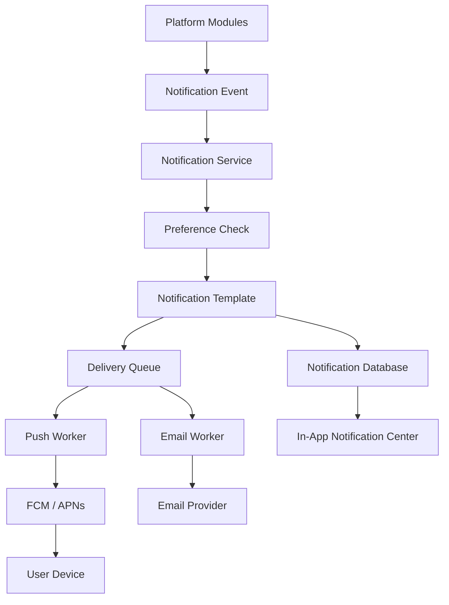

# NOTIFICATION_SYSTEM.md

# Bildirim Sistemi Mimarisi

**Proje:** AI Destekli Fal ve Sosyal Etkileşim Platformu  
**Dosya:** `NOTIFICATION_SYSTEM.md`  
**Sürüm:** 1.0.0  
**Durum:** Teknik taslak

---

## 1. Amaç

Bildirim sistemi, kullanıcıların platformda gerçekleşen önemli olaylardan zamanında haberdar olmasını sağlayan merkezi altyapıdır.

Platformda çok sayıda bağımsız modül bulunduğundan bildirim sistemi bu modüllerin her birine entegre çalışmalıdır.

Bildirim sisteminin temel sorumlulukları:

- Bildirim oluşturmak.
- Bildirimleri veritabanında saklamak.
- Kullanıcıya uygulama içi bildirim göstermek.
- Push notification göndermek.
- Kullanıcı bildirim tercihlerini yönetmek.
- Bildirimlerin okunma durumunu takip etmek.
- Başarısız bildirimleri kontrollü şekilde tekrar göndermek.
- Bildirim geçmişini kullanıcıya sunmak.
- Bildirim gönderimlerini ölçmek ve izlemek.

**Temel mimari prensip:** Diğer modüller bildirim gönderme altyapısını kendi içerisinde tekrar yazmamalı, merkezi Notification Module üzerinden kullanmalıdır.

---

## 2. Bildirim Kanalları

Platformda üç temel bildirim kanalı bulunacaktır.

### 2.1. Uygulama içi bildirimler

Kullanıcı uygulamayı açtığında bildirim merkezinde görüntülenir.

Örnekler:

- Yeni takipçi.
- Gönderiye gelen beğeni.
- Gönderiye gelen yorum.
- Yeni mesaj.
- Yeni eşleşme.
- Fal sonucunun hazır olması.
- Sipariş durumunun değişmesi.

Özellikler:

- Bildirim listesi.
- Okundu / okunmadı durumu.
- Tümünü okundu işaretleme.
- Bildirime tıklayarak ilgili ekrana yönlendirme.
- Bildirim geçmişi.

### 2.2. Push notifications

Uygulama arka plandayken veya kapalıyken kullanıcının cihazına gönderilir.

Önerilen altyapı:

- Firebase Cloud Messaging (FCM)
- APNs entegrasyonu (iOS tarafında gerekli altyapı)

Push bildirimleri uygulama içi bildirimlerin yerine geçmez. İki kanal birbirinden bağımsız yönetilmelidir.

### 2.3. E-posta bildirimleri

E-posta bildirimleri özellikle hesap güvenliği ve önemli işlemler için kullanılabilir.

Örnekler:

- Hesap doğrulama.
- Parola sıfırlama.
- Yeni cihazdan giriş uyarısı.
- Önemli hesap değişiklikleri.
- Sipariş ve ödeme makbuzu.
- Hukuki veya operasyonel açıdan gerekli duyurular.

Pazarlama e-postaları ile hizmetin yürütülmesi için gerekli işlem e-postaları ayrı yönetilmelidir.

---

## 3. Bildirim Kategorileri

| Kategori | Bildirim örnekleri | Öncelik |
|---|---|---|
| Authentication | Giriş uyarısı, parola değişikliği | Yüksek |
| Fortune | Fal sonucu hazır | Yüksek |
| Social | Beğeni, yorum, takip | Normal |
| Community | Yeni konu, yanıt, duyuru | Normal |
| Dating | Yeni eşleşme | Yüksek |
| Chat | Yeni mesaj | Yüksek |
| Marketplace | Sipariş güncellemesi | Yüksek |
| Payment | Ödeme ve iade durumu | Kritik |
| System | Bakım ve sistem duyuruları | Değişken |
| Marketing | Kampanya ve tanıtımlar | Düşük |

Bildirim önceliği, gönderim kanalı ve kullanıcı tercihleri birbirinden ayrı değerlendirilmelidir.

---

## 4. Genel Mimari

Önerilen sistem akışı:



### 4.1. Temel bileşenler

| Bileşen | Sorumluluk |
|---|---|
| Event Producer | Bildirim gerektiren olayı üretir |
| Notification Service | Bildirim kaydını oluşturur |
| Preference Service | Kullanıcı tercihlerini kontrol eder |
| Template Engine | Bildirim metnini hazırlar |
| Notification Repository | Bildirim kayıtlarını yönetir |
| Delivery Queue | Gönderim görevlerini kuyruğa alır |
| Push Worker | Push gönderimini gerçekleştirir |
| Email Worker | E-posta gönderimini gerçekleştirir |
| Notification API | Mobil uygulamaya bildirim verisi sağlar |

---

## 5. Bildirim Olayları

Her modül bildirim gerektiren bir olay meydana geldiğinde Notification Module'e olay iletmelidir.

### 5.1. Authentication Events

| Event | Açıklama |
|---|---|
| `auth.new_login` | Yeni cihaz veya oturumdan giriş |
| `auth.password_changed` | Parola değiştirildi |
| `auth.email_verified` | E-posta doğrulandı |
| `auth.suspicious_activity` | Şüpheli hesap etkinliği |

### 5.2. Fortune Events

| Event | Açıklama |
|---|---|
| `fortune.created` | Fal talebi oluşturuldu |
| `fortune.processing` | Fal işleniyor |
| `fortune.completed` | Fal sonucu hazır |
| `fortune.failed` | Fal işlemi başarısız |

### 5.3. Social Events

| Event | Açıklama |
|---|---|
| `social.new_follower` | Yeni takipçi |
| `social.post_liked` | Gönderi beğenildi |
| `social.new_comment` | Gönderiye yorum yapıldı |
| `social.comment_replied` | Yoruma yanıt verildi |
| `social.post_mentioned` | Kullanıcı gönderide etiketlendi |

### 5.4. Community Events

| Event | Açıklama |
|---|---|
| `community.new_member` | Topluluğa yeni üye katıldı |
| `community.new_post` | Yeni konu açıldı |
| `community.new_reply` | Konuya yanıt verildi |
| `community.announcement` | Topluluk duyurusu |

### 5.5. Dating Events

| Event | Açıklama |
|---|---|
| `dating.new_like` | Kullanıcı beğeni aldı |
| `dating.new_match` | Yeni karşılıklı eşleşme |
| `dating.match_removed` | Eşleşme kaldırıldı |

Flört modülüne katılmayan kullanıcılara bu modülle ilgili bildirim gönderilmemelidir.

### 5.6. Chat Events

| Event | Açıklama |
|---|---|
| `chat.new_message` | Yeni mesaj |
| `chat.message_read` | Mesaj okundu |
| `chat.mention` | Kullanıcıdan bahsedildi |

Mesajlaşma bildirimleri gereksiz tekrarları önlemek amacıyla birleştirilebilir.

### 5.7. Marketplace Events

| Event | Açıklama |
|---|---|
| `marketplace.order_created` | Yeni sipariş |
| `marketplace.order_accepted` | Sipariş kabul edildi |
| `marketplace.order_started` | Hizmet başladı |
| `marketplace.order_completed` | Hizmet tamamlandı |
| `marketplace.order_cancelled` | Sipariş iptal edildi |
| `marketplace.new_review` | Yeni değerlendirme |

### 5.8. Payment Events

| Event | Açıklama |
|---|---|
| `payment.succeeded` | Ödeme başarılı |
| `payment.failed` | Ödeme başarısız |
| `payment.refunded` | İade gerçekleşti |
| `subscription.renewed` | Abonelik yenilendi |
| `subscription.expiring` | Abonelik sona ermek üzere |

Ödeme bildirimleri yalnızca doğrulanmış backend olaylarından üretilmelidir.

---

## 6. Bildirim Veri Modeli

Önerilen ana tablo: `notifications`

| Alan | Veri tipi | Açıklama |
|---|---|---|
| id | UUID | Bildirim kimliği |
| recipient_id | UUID | Alıcı kullanıcı |
| actor_id | UUID, nullable | Olayı gerçekleştiren kullanıcı |
| type | VARCHAR | Bildirim türü |
| category | VARCHAR | Bildirim kategorisi |
| title | VARCHAR | Bildirim başlığı |
| body | TEXT | Bildirim açıklaması |
| data | JSONB | Yönlendirme ve ek metadata |
| reference_type | VARCHAR | İlgili kaynak türü |
| reference_id | UUID, nullable | İlgili kaynak kimliği |
| is_read | BOOLEAN | Okunma durumu |
| read_at | TIMESTAMP, nullable | Okunma zamanı |
| created_at | TIMESTAMP | Oluşturulma zamanı |
| expires_at | TIMESTAMP, nullable | Geçerlilik bitişi |

### 6.1. Örnek bildirim kaydı

```json
{
  "id": "notification-uuid",
  "recipient_id": "user-uuid",
  "actor_id": "actor-uuid",
  "type": "fortune.completed",
  "category": "fortune",
  "title": "Falın hazır",
  "body": "Fal yorumun tamamlandı. Sonucunu görüntüleyebilirsin.",
  "data": {
    "route": "/fortune/fortune-uuid",
    "fortune_id": "fortune-uuid"
  },
  "is_read": false
}
```

`data` alanına parola, token, özel fal içeriği veya gereksiz kişisel veri eklenmemelidir.

### 6.2. Bildirim teslimat tablosu

`notification_deliveries` tablosu kanal bazındaki gönderim durumlarını takip eder.

| Alan | Açıklama |
|---|---|
| id | Teslimat kimliği |
| notification_id | Bildirim kaydı |
| channel | PUSH / EMAIL |
| status | PENDING / SENT / FAILED |
| provider_message_id | Sağlayıcı mesaj referansı |
| attempt_count | Deneme sayısı |
| last_attempt_at | Son deneme zamanı |
| delivered_at | Sağlayıcı tarafından bildirilen teslimat zamanı |
| failure_reason | Hata açıklaması |
| created_at | Oluşturulma zamanı |

Push sağlayıcısının başarılı yanıtı, bildirimin kullanıcının ekranında kesin olarak görüldüğü anlamına gelmez. Teslimat ve görüntülenme ölçümleri ayrı tutulmalıdır.

---

## 7. Kullanıcı Bildirim Tercihleri

Kullanıcı hangi kategorilerde hangi kanallardan bildirim almak istediğini yönetebilmelidir.

### 7.1. Tercih örnekleri

| Kategori | In-App | Push | E-posta |
|---|---|---|---|
| Authentication | Evet | Evet | Evet |
| Fortune | Evet | Evet | İsteğe bağlı |
| Social | Evet | İsteğe bağlı | İsteğe bağlı |
| Community | Evet | İsteğe bağlı | İsteğe bağlı |
| Dating | Evet | İsteğe bağlı | İsteğe bağlı |
| Chat | Evet | Evet | İsteğe bağlı |
| Marketplace | Evet | Evet | Evet |
| Payment | Evet | Evet | Evet |
| Marketing | İsteğe bağlı | İsteğe bağlı | İsteğe bağlı |

Bu tablo başlangıç varsayılanlarını gösterir. Kullanıcının tercihleri ve uygulanabilir hukuki yükümlülükler esas alınmalıdır.

### 7.2. Tercih tablosu

`notification_preferences`

- `id`
- `user_id`
- `category`
- `in_app_enabled`
- `push_enabled`
- `email_enabled`
- `created_at`
- `updated_at`

### 7.3. Sessiz saatler

Kullanıcı belirli saatler arasında push bildirimlerini sessize alabilmelidir.

Örnek:

- Başlangıç: 23:00
- Bitiş: 08:00
- Saat dilimi: Kullanıcının seçtiği veya cihazından belirlenen saat dilimi

Sessiz saatlerde bildirimler uygulama içi bildirim merkezine kaydedilmeye devam edebilir.

Hesap güvenliği veya hukuken gerekli bildirimler için ayrı politika uygulanmalıdır.

---

## 8. Push Token Yönetimi

Her cihazın kendine ait push token kaydı bulunmalıdır.

Önerilen tablo: `user_devices`

| Alan | Açıklama |
|---|---|
| id | Cihaz kaydı |
| user_id | Kullanıcı |
| push_token | FCM/APNs token |
| platform | ANDROID / IOS |
| device_name | Cihaz tanımı |
| app_version | Uygulama sürümü |
| last_active_at | Son aktif zaman |
| created_at | Kayıt zamanı |
| updated_at | Güncelleme zamanı |

### 8.1. Token işlemleri

- Kullanıcı giriş yaptığında token backend'e gönderilir.
- Token değiştiğinde güncellenir.
- Kullanıcı çıkış yaptığında ilgili cihaz bağlantısı kaldırılır veya pasifleştirilir.
- Geçersiz tokenlar tespit edilerek temizlenir.
- Aynı kullanıcının birden fazla cihazı desteklenir.

Tokenlar gizli erişim verisi gibi korunmalı ve loglara yazılmamalıdır.

---

## 9. Bildirim Gönderim Akışı

Örnek: Kullanıcıya fal sonucu hazır bildirimi gönderilmesi.

1. AI Worker fal işlemini tamamlar.
2. Fortune Module sonucu veritabanına kaydeder.
3. `fortune.completed` olayı üretilir.
4. Notification Service olayı alır.
5. Kullanıcının bildirim tercihleri kontrol edilir.
6. Uygun bildirim kaydı oluşturulur.
7. Push gönderimi gerekiyorsa görev kuyruğa alınır.
8. Push Worker sağlayıcıya isteği gönderir.
9. Gönderim sonucu teslimat kaydına yazılır.
10. Kullanıcı bildirime tıkladığında ilgili fal ekranına yönlendirilir.

### 9.1. Transactional Outbox

Bildirim gerektiren önemli bir işlem ile olayın kuyruğa aktarılması arasında veri kaybını önlemek için Transactional Outbox yaklaşımı önerilir.

Örneğin ödeme başarılı olduğunda sipariş güncellemesi ve ilgili olay kaydı aynı veritabanı transaction'ında oluşturulabilir. Ayrı bir worker bu olayı kuyruğa aktarır.

Bu sayede veritabanı işlemi başarılı olup bildirim olayının kaybolması riski azaltılır.

---

## 10. Bildirim API Tasarımı

Önerilen endpointler:

| Method | Endpoint | Açıklama |
|---|---|---|
| GET | `/api/v1/notifications` | Bildirimleri listele |
| GET | `/api/v1/notifications/unread-count` | Okunmamış sayısı |
| GET | `/api/v1/notifications/{id}` | Bildirim detayı |
| PATCH | `/api/v1/notifications/{id}/read` | Okundu işaretle |
| PATCH | `/api/v1/notifications/read-all` | Tümünü okundu yap |
| DELETE | `/api/v1/notifications/{id}` | Bildirimi sil |
| GET | `/api/v1/notification-preferences` | Tercihleri getir |
| PUT | `/api/v1/notification-preferences` | Tercihleri güncelle |
| POST | `/api/v1/devices` | Cihaz tokenı kaydet |
| DELETE | `/api/v1/devices/{id}` | Cihaz bağlantısını kaldır |

### 10.1. Listeleme

Bildirimler sayfalı olarak sunulmalıdır.

Örnek:

```http
GET /api/v1/notifications?limit=20&cursor=next_cursor
```

Varsayılan sıralama en yeni bildirimden eskiye doğru olmalıdır.

### 10.2. Okundu işlemi

Okundu durumu backend tarafında tutulmalıdır. Böylece kullanıcı farklı cihazlardan giriş yaptığında bildirim durumu senkronize kalır.

---

## 11. Bildirim Şablonları

Bildirim metinleri merkezi şablon sistemi üzerinden oluşturulmalıdır.

Örnek:

| Event | Başlık | İçerik |
|---|---|---|
| fortune.completed | Falın hazır | Fal yorumun tamamlandı. |
| dating.new_match | Yeni eşleşme | Yeni biriyle eşleştin. |
| chat.new_message | Yeni mesaj | Yeni bir mesajın var. |
| marketplace.order_accepted | Sipariş kabul edildi | Siparişin kabul edildi. |
| social.post_liked | Yeni beğeni | Gönderin beğenildi. |

### 11.1. Şablon prensipleri

- Metinler merkezi yönetilmelidir.
- Çoklu dil desteği düşünülmelidir.
- Dinamik alanlar güvenli biçimde doldurulmalıdır.
- Kullanıcı tarafından gönderilen metinler doğrulanmadan HTML olarak işlenmemelidir.
- Bildirim başlıkları ve içerikleri özel verileri açığa çıkarmamalıdır.

---

## 12. Bildirim Birleştirme ve Spam Kontrolü

Sosyal özelliklerin yoğun kullanıldığı durumlarda kullanıcıya çok sayıda bildirim gönderilebilir.

Bu nedenle bildirim sistemi birleştirme ve sınırlandırma mekanizmalarına sahip olmalıdır.

### 12.1. Birleştirme örnekleri

Tek bir gönderiye kısa süre içerisinde çok sayıda beğeni geldiğinde:

- Her beğeni için ayrı push göndermek yerine
- Uygun bir süre içinde bildirimleri birleştirerek
- "Gönderin 5 yeni beğeni aldı" şeklinde bildirim oluşturulabilir.

### 12.2. Rate limiting

- Kullanıcı başına bildirim sınırı.
- Kategori bazında gönderim sınırı.
- Aynı olay için yinelenen bildirim kontrolü.
- Spam davranışlarının tespiti.

Kritik güvenlik ve ödeme bildirimleri sosyal bildirimlerden farklı önceliklendirilmelidir.

---

## 13. Retry ve Hata Yönetimi

Push veya e-posta gönderimi başarısız olduğunda kontrollü tekrar deneme yapılmalıdır.

### 13.1. Retry stratejisi

Örnek başlangıç politikası:

- İlk deneme: Hemen
- İkinci deneme: 30 saniye sonra
- Üçüncü deneme: 2 dakika sonra
- Dördüncü deneme: 10 dakika sonra

Bu süreler yapılandırılabilir olmalıdır.

### 13.2. Hata sınıflandırması

| Hata | İşlem |
|---|---|
| Geçersiz token | Token pasifleştirilir |
| Geçici sağlayıcı hatası | Retry |
| Rate limit | Bekleme ve retry |
| Yetkilendirme hatası | Sağlayıcı yapılandırması incelenir |
| Kalıcı e-posta hatası | Teslimat başarısız işaretlenir |
| Bilinmeyen hata | Log ve kontrollü retry |

Sürekli başarısız olan görevler Dead Letter Queue veya eşdeğer hata kuyruğuna aktarılmalıdır.

---

## 14. Deep Linking ve Bildirim Yönlendirme

Kullanıcı bildirime tıkladığında ilgili ekran açılmalıdır.

Örnek yönlendirmeler:

| Bildirim | Route |
|---|---|
| Fal sonucu hazır | `/fortune/{id}` |
| Yeni mesaj | `/chat/{conversationId}` |
| Yeni eşleşme | `/dating/matches/{id}` |
| Gönderi yorumu | `/social/post/{id}` |
| Topluluk yanıtı | `/communities/{id}/topics/{topicId}` |
| Sipariş güncellemesi | `/marketplace/orders/{id}` |

### 14.1. Güvenlik

Deep link üzerinden gelen kaynak kimliği güvenilir kabul edilmemelidir.

İlgili ekran açıldığında backend kaynak sahipliği ve erişim yetkisini tekrar doğrulamalıdır.

Kaynak silinmiş veya erişimden kaldırılmışsa kullanıcıya uygun hata ekranı gösterilmelidir.

---

## 15. Bildirim Gizliliği

Bildirim içerikleri cihaz kilit ekranında görünebileceğinden hassas bilgiler içermemelidir.

Örnek:

**Uygun:**
"Fal yorumun hazır. Görüntülemek için dokun."

**Uygun olmayan:**
Kullanıcının özel fal yorumunun tamamının kilit ekranında gösterilmesi.

Ayrıca:

- Özel mesaj içerikleri varsayılan olarak push içeriğine eklenmemelidir.
- Kullanıcı bildirim önizlemelerini kapatabilmelidir.
- Hassas işlem bildirimlerinde yalnızca gerekli bilgi gösterilmelidir.
- Bildirim payload'ları minimum veri içermelidir.

---

## 16. Performans ve Ölçeklenebilirlik

- Bildirim gönderimi API isteğini gereksiz yere bekletmemelidir.
- Kuyruk tabanlı gönderim tercih edilmelidir.
- Push gönderimleri toplu işlenebilmelidir.
- Bildirim listesi pagination kullanmalıdır.
- Okunmamış bildirim sayısı cache ile optimize edilebilir.
- Eski bildirimler saklama politikasına göre arşivlenebilir veya silinebilir.
- Worker sayısı ihtiyaç halinde artırılabilmelidir.

### 16.1. İzlenecek metrikler

- Oluşturulan bildirim sayısı.
- Push gönderim başarı oranı.
- E-posta gönderim başarı oranı.
- Ortalama gönderim gecikmesi.
- Başarısız teslimat sayısı.
- Retry sayısı.
- Geçersiz cihaz tokenı sayısı.
- Okunma oranı.
- Bildirim tıklama oranı.

---

## 17. Test Stratejisi

### Unit Tests

- Bildirim oluşturma.
- Tercih kontrolü.
- Şablon oluşturma.
- Bildirim birleştirme.
- Rate limiting.
- Retry politikası.

### Integration Tests

- Notification API.
- PostgreSQL kayıt işlemleri.
- Redis queue.
- Push provider adapter.
- E-posta sağlayıcı adapter.
- Outbox event aktarımı.

### End-to-End Tests

- Fal tamamlanınca bildirim gönderilmesi.
- Yeni mesaj bildirimi.
- Yeni eşleşme bildirimi.
- Sipariş güncellemesi.
- Kullanıcı tercihleri değişince gönderim davranışı.
- Bildirime tıklanınca doğru ekrana yönlendirme.
- Kullanıcı çıkış yaptığında cihaz tokenının yönetimi.

---

## 18. Açık Teknik Kararlar

| Konu | Durum |
|---|---|
| Push sağlayıcısı | FCM önerildi |
| iOS push altyapısı | APNs / FCM entegrasyonu |
| E-posta sağlayıcısı | TBD |
| Queue sistemi | Backend mimarisine bağlı |
| Retry politikası | Önerildi, test edilmeli |
| Transactional Outbox | Önerildi |
| Bildirim saklama süresi | TBD |
| Bildirim birleştirme süresi | TBD |
| Sessiz saatler | Desteklenecek |
| Çoklu dil | Planlandı |
| Analytics | TBD |

---

## 19. Kabul Kriterleri

- [ ] Bildirimler merkezi servis üzerinden oluşturuluyor.
- [ ] Uygulama içi bildirimler veritabanında saklanıyor.
- [ ] Push bildirimleri destekleniyor.
- [ ] Kullanıcı bildirim tercihlerini değiştirebiliyor.
- [ ] Birden fazla cihaz destekleniyor.
- [ ] Bildirimler okundu olarak işaretlenebiliyor.
- [ ] Bildirimler sayfalı listeleniyor.
- [ ] Deep link yönlendirmeleri çalışıyor.
- [ ] Yetkisiz kaynaklara erişim engelleniyor.
- [ ] Tekrarlanan bildirimler kontrol ediliyor.
- [ ] Başarısız gönderimler retry mekanizmasına sahip.
- [ ] Özel kullanıcı verileri bildirim içeriğinde açığa çıkmıyor.
- [ ] Kritik bildirim olayları izlenebiliyor.
- [ ] Bildirim tercihleri tüm cihazlarda senkronize ediliyor.

---

## 20. İlişkili Dokümanlar

- `PROJECT_OVERVIEW.md`
- `APP_FEATURES.md`
- `USER_FLOWS.md`
- `API_SPECIFICATION.md`
- `DATABASE_SCHEMA.md`
- `SYSTEM_ARCHITECTURE.md`
- `BACKEND_ARCHITECTURE.md`
- `FLUTTER_ARCHITECTURE.md`
- `CHAT_AND_REALTIME.md`
- `SECURITY_AND_PRIVACY.md`
- `PAYMENT_AND_MONETIZATION.md`

---

## 21. Sonuç

Bildirim sistemi, platformun tüm modüllerini kullanıcıyla buluşturan ortak iletişim altyapısıdır.

Sistemin merkezi, kuyruk tabanlı, kullanıcı tercihlerini dikkate alan ve hata toleransına sahip şekilde geliştirilmesi hedeflenmektedir.

**Temel mimari kararı:** Bildirim üretimi ile bildirim teslimatı birbirinden ayrılmalıdır. Böylece bir push sağlayıcısının geçici olarak çalışmaması platformun temel işlevlerini durdurmaz.

**Doküman durumu:** Teknik taslak.  
**Not:** Sağlayıcı, saklama süresi ve gönderim limitleri gerçek kullanım verileriyle kesinleştirilmelidir.