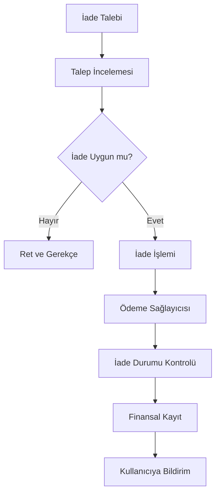

# PAYMENT_AND_MONETIZATION.md
# Ödeme Altyapısı ve Gelir Modeli

**Belge Sürümü:** 1.0.0  
**Durum:** İlk Taslak  
**Proje:** Fal ve Sosyal Platform  
**Ödeme Sağlayıcısı:** TBD  
**Para Birimi:** TRY (başlangıç önerisi)  
**İş Modeli:** Freemium + Abonelik + Komisyon + Hizmet Satışı

---

## 1. Belgenin Amacı

Bu belge, platformun gelir modellerini, ödeme sistemini, fiyatlandırma yaklaşımını, insan falcı hizmetlerinin ekonomik yapısını ve finansal işlem süreçlerini tanımlar.

Platformun sürdürülebilir bir gelir modeli oluşturması hedeflenmektedir.

Gelir modeli aşağıdaki kaynaklardan oluşabilir:

1. AI destekli fal hizmetleri.
2. Premium üyelik.
3. Falcılar Ligi üzerinden alınan komisyon.
4. Ek AI kullanım paketleri.
5. Özel dijital hizmetler.
6. İleride değerlendirilebilecek reklam ve iş birlikleri.

Bu modellerin tamamının ilk sürümde aktif olması zorunlu değildir.

## 2. Gelir Modelinin Genel Yapısı

Platform freemium yaklaşımıyla çalışacaktır.

Kullanıcılar ücretsiz olarak platforma katılabilecek, temel özellikleri deneyebilecek ve ihtiyaç duyduklarında ücretli hizmetlere geçebilecektir.

### 2.1. Gelir Kanalları

| Gelir Kaynağı | Açıklama | Öncelik |
|---|---|---|
| AI fal paketleri | Ek fal hakkı satışı | Yüksek |
| Premium üyelik | Aylık/yıllık abonelik | Yüksek |
| Falcılar Ligi komisyonu | Hizmet satışından pay | Yüksek |
| Özel yorum paketleri | Daha kapsamlı AI yorumları | Orta |
| Öne çıkarma | Falcı veya içerik görünürlüğü | Orta |
| Reklam | Sponsorlu içerikler | Düşük |
| Marka iş birlikleri | Kampanya ve ortaklıklar | Düşük |

## 3. Freemium Modeli

Kullanıcılar platformu ücretsiz kullanmaya başlayabilmelidir.

Ücretsiz kullanım, platformun temel değerini gösterecek kadar yeterli olmalıdır.

### 3.1. Ücretsiz Kullanıcı

Önerilen özellikler:

- Hesap oluşturma.
- Profil yönetimi.
- Sınırlı AI fal hakkı.
- Fal geçmişine temel erişim.
- Sosyal gönderileri görüntüleme.
- Topluluklara katılma.
- Temel etkileşimler.
- Dating sistemine isteğe bağlı katılım.

### 3.2. Premium Kullanıcı

Önerilen özellikler:

- Daha yüksek AI fal kotası.
- Genişletilmiş yorum seçenekleri.
- Ek fal türlerine erişim.
- Gelişmiş fal geçmişi.
- Özel profil özellikleri.
- Ek kişiselleştirme seçenekleri.
- Reklam bulunması hâlinde reklamsız kullanım.

Premium üyelik, insan falcı hizmetlerini otomatik olarak ücretsiz hâle getirmez.

## 4. Premium Abonelik Sistemi

### 4.1. Abonelik Planları

Önerilen plan yapısı:

| Plan | Süre | Açıklama |
|---|---|---|
| Free | Süresiz | Temel kullanım |
| Premium Monthly | Aylık | Premium özellikler |
| Premium Yearly | Yıllık | İndirimli yıllık üyelik |
| Premium Plus | Aylık/yıllık | Daha yüksek kullanım hakları |

Fiyatlar henüz belirlenmemiştir.

### 4.2. Abonelik Özellikleri

Her planın özellikleri merkezi bir yapıdan yönetilmelidir.

Örnek:

```json
{
  "plan": "PREMIUM",
  "billing_period": "MONTHLY",
  "features": {
    "daily_ai_fortune_limit": 10,
    "advanced_readings": true,
    "extended_history": true,
    "premium_customization": true
  }
}
```

Bu değerler örnektir; gerçek kullanım limitleri AI maliyetleri ve kullanıcı testleriyle belirlenmelidir.

### 4.3. Abonelik Durumları

- ACTIVE
- PENDING
- CANCELLED
- EXPIRED
- PAYMENT_FAILED
- REFUNDED

Abonelik iptali ile aboneliğin hemen sona ermesi aynı şey değildir. Kullanıcının mevcut dönem sonuna kadar erişimi devam edebilir.

### 4.4. SUBSCRIPTIONS Tablosu

| Alan | Tür | Açıklama |
|---|---|---|
| id | UUID | Abonelik |
| user_id | UUID | Kullanıcı |
| plan_id | UUID | Plan |
| provider | VARCHAR | Ödeme sağlayıcısı |
| provider_subscription_id | VARCHAR | Sağlayıcı abonelik kimliği |
| status | ENUM | Durum |
| started_at | TIMESTAMP | Başlangıç |
| current_period_start | TIMESTAMP | Dönem başlangıcı |
| current_period_end | TIMESTAMP | Dönem bitişi |
| cancelled_at | TIMESTAMP | İptal tarihi |

## 5. AI Fal Kullanım Ekonomisi

AI fal sistemi platformun hem temel ürünlerinden biri hem de değişken maliyet kaynağıdır.

### 5.1. Kullanım Modeli

Önerilen yaklaşım:

- Ücretsiz kullanıcıya belirli sayıda fal hakkı.
- Premium kullanıcıya daha yüksek kullanım limiti.
- Ek fal hakkı paketleri.
- Farklı fal türleri için farklı maliyet kategorileri.

### 5.2. AI Kullanım Paketleri

Örnek paket yapısı:

| Paket | İçerik |
|---|---|
| Mini | Az sayıda ek fal hakkı |
| Standart | Orta seviyede ek fal hakkı |
| Plus | Yüksek sayıda ek fal hakkı |

Paket fiyatları, kullanılan AI modelinin gerçek maliyeti, görsel işleme maliyeti ve ödeme kesintileri hesaplandıktan sonra belirlenmelidir.

### 5.3. AI Usage Ledger

AI kullanım hareketleri ayrı kaydedilmelidir.

| Alan | Açıklama |
|---|---|
| id | Hareket kimliği |
| user_id | Kullanıcı |
| fortune_reading_id | Fal kaydı |
| usage_type | FREE, PREMIUM, CREDIT |
| credits_used | Kullanılan hak |
| cost_amount | Platform maliyeti |
| created_at | Tarih |

### 5.4. Kullanım Hakkı Yönetimi

AI fal hakkı oluşturma ve düşme işlemleri atomik yürütülmelidir.

Aynı istek tekrar gönderildiğinde kullanıcıdan ikinci kez hak düşülmemelidir.

Başarısız AI işlemlerinde kullanılan hakkın iadesi veya yeniden deneme hakkı oluşturulması için açık kurallar belirlenmelidir.

## 6. Falcılar Ligi Gelir Modeli

Falcılar Ligi, platformun insan hizmetleri pazar yeridir.

Platform kullanıcıyı falcıyla buluşturur ve tamamlanan hizmet üzerinden komisyon elde eder.

### 6.1. İşleyiş

1. Falcı hizmetini ve fiyatını belirler.
2. Kullanıcı hizmeti seçer.
3. Sipariş oluşturulur.
4. Ödeme alınır.
5. Falcı hizmeti sunar.
6. Sipariş tamamlanır.
7. Platform komisyonu hesaplanır.
8. Falcının hak ettiği tutar finansal kayda aktarılır.
9. Ödeme sağlayıcısının ve ilgili mevzuatın izin verdiği şekilde falcıya ödeme gerçekleştirilir.

### 6.2. Komisyon Modeli

Örnek komisyon hesaplaması:

| İşlem | Örnek Tutar |
|---|---:|
| Hizmet fiyatı | 500 TL |
| Platform komisyonu (%20) | 100 TL |
| Falcı payı | 400 TL |

Bu tablo yalnızca örnek hesaplamadır. Vergiler, ödeme sağlayıcısı ücretleri, iade maliyetleri ve diğer yasal yükümlülükler ayrıca değerlendirilmelidir.

### 6.3. Komisyon Yapılandırması

Komisyon oranı sistem genelinde sabit kodlanmamalıdır.

Aşağıdaki seçenekler değerlendirilebilir:

- Standart komisyon.
- Falcı seviyesine göre komisyon.
- Kampanya komisyonu.
- Belirli hizmet türlerine özel komisyon.

Her siparişte uygulanan komisyon oranı ve hesaplama sonucu sipariş anında kayıt altına alınmalıdır.

### 6.4. Falcı Kazanç Sistemi

Falcı panelinde aşağıdaki bilgiler gösterilmelidir:

- Toplam sipariş.
- Tamamlanan sipariş.
- Bekleyen kazanç.
- Ödenebilir kazanç.
- Gerçekleşen ödemeler.
- Komisyon kesintileri.
- İade ve iptal hareketleri.

Falcının kazancı yalnızca tamamlanmış ve finansal olarak kesinleşmiş işlemler üzerinden hesaplanmalıdır.

## 7. Sipariş ve Ödeme Durumları

### 7.1. Sipariş Durumları

- PENDING_PAYMENT
- PAID
- ACCEPTED
- IN_PROGRESS
- DELIVERED
- COMPLETED
- CANCELLED
- DISPUTED
- REFUNDED

### 7.2. Ödeme Durumları

- INITIATED
- PENDING
- SUCCEEDED
- FAILED
- REFUND_PENDING
- REFUNDED
- PARTIALLY_REFUNDED

Sipariş ve ödeme durumları birbirinden ayrı tutulmalıdır.

Örneğin bir sipariş tamamlanmış olsa bile finansal mutabakat süreci henüz tamamlanmamış olabilir.

## 8. Ödeme Altyapısı

Ödeme sağlayıcısı henüz seçilmemiştir.

Seçim yapılırken aşağıdaki kriterler değerlendirilmelidir:

- Türkiye'de faaliyet ve kullanım uygunluğu.
- Kartlı ödeme desteği.
- Tekrarlayan ödeme ve abonelik desteği.
- İade ve iptal desteği.
- Webhook altyapısı.
- Pazar yeri ve satıcı ödemeleri desteği.
- Komisyon ve işlem maliyetleri.
- Güvenlik ve uyumluluk.
- Entegrasyon kolaylığı.

### 8.1. Sağlayıcı Adaptörü

Ödeme sistemi de AI sistemi gibi adaptör üzerinden tasarlanmalıdır.

```text
PaymentProvider
    |
    +-- create_payment()
    |
    +-- verify_payment()
    |
    +-- refund_payment()
    |
    +-- get_payment_status()
    |
    +-- manage_subscription()
    |
    +-- process_webhook()
```

Bu yapı sağlayıcı değişikliğinde uygulamanın bütün ödeme mantığının yeniden yazılmasını önler.

### 8.2. Kart Bilgilerinin Güvenliği

- Kart numarası ve CVV platform veritabanında tutulmamalıdır.
- Ödeme işlemleri sağlayıcının güvenli altyapısında yürütülmelidir.
- Webhook imzaları doğrulanmalıdır.
- Ödeme sonuçları backend tarafından teyit edilmelidir.
- İstemciden gelen başarılı ödeme bildirimi tek başına yeterli kabul edilmemelidir.

## 9. İade ve İptal Politikası

İade politikası hizmet türüne göre ayrı tanımlanmalıdır.

### 9.1. AI Fal İadesi

Değerlendirilebilecek durumlar:

- AI üretiminin teknik hata nedeniyle tamamlanmaması.
- Kullanım hakkının düşülmesine rağmen hizmetin sunulmaması.
- Çift işlem nedeniyle fazla ücret alınması.

### 9.2. İnsan Falcı Hizmeti İadesi

Değerlendirilebilecek durumlar:

- Falcının siparişi kabul etmemesi.
- Belirlenen süre içerisinde hizmetin sunulmaması.
- Hizmetin teknik olarak teslim edilememesi.
- Ödeme veya sipariş hatası.
- Uyuşmazlık sonucunda iade kararı verilmesi.

İade koşulları açıkça belirtilmeli ve yürürlükteki tüketici mevzuatına uygun hazırlanmalıdır.

### 9.3. İade İşlem Akışı



## 10. Promosyon ve Kampanya Sistemi

İlerleyen aşamalarda kullanıcı kazanımı ve satış dönüşümünü artırmak için kampanya altyapısı eklenebilir.

Özellikler:

- İndirim kodları.
- İlk fal kampanyası.
- Premium deneme süresi.
- Referans davet sistemi.
- Özel gün kampanyaları.
- Falcı hizmetlerinde indirim.

### 10.1. COUPONS

| Alan | Açıklama |
|---|---|
| id | Kampanya kimliği |
| code | Kupon kodu |
| discount_type | Yüzde veya sabit indirim |
| discount_value | İndirim miktarı |
| usage_limit | Kullanım sınırı |
| valid_from | Başlangıç |
| valid_until | Bitiş |
| status | Durum |

### 10.2. COUPON_REDEMPTIONS

| Alan | Açıklama |
|---|---|
| id | Kullanım kaydı |
| coupon_id | Kupon |
| user_id | Kullanıcı |
| order_id | Sipariş |
| redeemed_at | Kullanım tarihi |

Kuponların aynı işlemde veya aynı kullanıcı tarafından tekrar kullanımı için açık kurallar tanımlanmalıdır.

## 11. Referans ve Davet Sistemi

Kullanıcıların platforma yeni kullanıcı kazandırmasını teşvik etmek için ileride referans sistemi kurulabilir.

Önerilen akış:

1. Kullanıcı davet bağlantısı oluşturur.
2. Yeni kullanıcı bağlantı üzerinden kayıt olur.
3. Gerekli doğrulama ve uygunluk koşulları tamamlanır.
4. Ödül hakkı oluşur.
5. Ödül kullanım kaydına işlenir.

Ödülün nakit veya platform içi kredi olması ayrı bir iş kararıdır.

Sahte hesap ve kötüye kullanım kontrolleri bulunmalıdır.

## 12. Falcı Ödeme ve Kazanç Yönetimi

Falcıların kazançları güvenli ve denetlenebilir şekilde yönetilmelidir.

Önerilen veri yapıları:

- TELLER_PAYOUTS
- FINANCIAL_LEDGER
- PAYMENT_TRANSACTIONS
- COMMISSION_RULES

### 12.1. TELLER_PAYOUTS

| Alan | Tür | Açıklama |
|---|---|---|
| id | UUID | Ödeme kaydı |
| fortune_teller_id | UUID | Falcı |
| amount | DECIMAL | Ödeme tutarı |
| currency | VARCHAR | Para birimi |
| status | ENUM | Durum |
| provider_reference | VARCHAR | Sağlayıcı referansı |
| requested_at | TIMESTAMP | Talep tarihi |
| paid_at | TIMESTAMP | Ödeme tarihi |

Falcı ödemeleri için kimlik doğrulama, vergi, sözleşme ve ödeme sağlayıcısı gereksinimleri ayrıca değerlendirilmelidir.

## 13. Gelir ve Maliyet Analizi

Platformun finansal sağlığını takip edebilmek için gelir ve maliyet metrikleri tutulmalıdır.

### 13.1. Gelir Metrikleri

- Toplam brüt satış.
- Net platform geliri.
- Premium abonelik geliri.
- AI fal gelirleri.
- Falcılar Ligi komisyon geliri.
- Kullanıcı başına ortalama gelir.
- Abonelik yenileme oranı.

### 13.2. Maliyet Metrikleri

- AI API maliyeti.
- Görsel işleme maliyeti.
- Ödeme sağlayıcısı komisyonları.
- Sunucu ve depolama maliyetleri.
- Bildirim ve iletişim maliyetleri.
- İade ve chargeback maliyetleri.
- Operasyon ve moderasyon maliyetleri.

### 13.3. Temel Finansal Göstergeler

**ARPU:**

Kullanıcı başına ortalama gelir.

\[
ARPU = \frac{Toplam\ Gelir}{Aktif\ Kullanıcı\ Sayısı}
\]

**Dönüşüm Oranı:**

\[
Conversion = \frac{Ücretli\ Kullanıcı}{Aktif\ Kullanıcı} \times 100
\]

**Brüt Kâr:**

\[
Gross\ Profit = Gelir - Doğrudan\ Hizmet\ Maliyetleri
\]

**Abonelik Kaybı (Churn):**

\[
Churn = \frac{Dönem\ İçinde\ Kaybedilen\ Aboneler}{Dönem\ Başındaki\ Aboneler} \times 100
\]

Bu metrikler aylık olarak takip edilmelidir.

## 14. Gelir Modelinin Aşamalandırılması

### Aşama 1 — İlk Sürüm

- Ücretsiz kullanım.
- Sınırlı AI fal hakkı.
- Tekil AI fal satın alma veya paket modeli.
- Temel ödeme entegrasyonu, gerekiyorsa.

### Aşama 2 — Premium

- Aylık abonelik.
- Yıllık abonelik.
- Premium fal seçenekleri.
- Kullanım hakkı yönetimi.

### Aşama 3 — Falcılar Ligi

- Falcı hizmet satın alma.
- Komisyon modeli.
- Falcı kazanç paneli.
- Ödeme ve iade süreçleri.

### Aşama 4 — Ekonomi ve Büyüme

- Kampanyalar.
- Referans sistemi.
- Gelişmiş paketler.
- Öne çıkarma ve tanıtım seçenekleri.

## 15. Hukuki ve Operasyonel Gereklilikler

Ödeme ve gelir modeli devreye alınmadan önce aşağıdaki konular uzmanlarla değerlendirilmelidir:

- Türkiye'deki ödeme hizmetleri mevzuatı.
- Tüketici hakları.
- Mesafeli satış ve hizmet sözleşmeleri.
- Abonelik ve otomatik yenileme koşulları.
- İade ve cayma hakları.
- Vergilendirme ve faturalandırma.
- Falcıların platformdaki hukuki statüsü.
- Pazar yeri ve satıcı ödemeleri.
- KVKK ve kişisel veri işleme yükümlülükleri.
- Platformun dijital hizmet sunumuna ilişkin diğer yükümlülükleri.

Platform, kullanıcıların fal yorumlarını kesin gelecek tahmini veya profesyonel danışmanlık hizmeti olarak algılamasına neden olacak pazarlama ifadelerinden kaçınmalıdır.

## 16. Açık Kararlar

- Premium fiyatlandırması.
- Ücretsiz fal kotası.
- AI fal paketlerinin fiyatı.
- Komisyon oranı.
- Ödeme sağlayıcısı.
- Falcı ödeme yöntemi.
- Abonelik yenileme politikası.
- İade koşulları.
- Kampanya sistemi.
- Referans ödülleri.
- Vergi ve faturalandırma modeli.

## 17. Kabul Kriterleri

- Ücretsiz ve ücretli kullanım ayrımı yapılabilmelidir.
- Premium abonelikler takip edilebilmelidir.
- AI kullanım hakları güvenli yönetilmelidir.
- Falcı hizmetlerinden komisyon hesaplanabilmelidir.
- Sipariş ve ödeme durumları birbirinden ayrılmalıdır.
- Finansal hareketler denetlenebilir olmalıdır.
- İade süreçleri desteklenmelidir.
- Kart bilgileri platformda saklanmamalıdır.
- Ödeme sağlayıcısı entegrasyonu adaptör üzerinden yürütülmelidir.
- Gelir ve maliyet metrikleri raporlanabilmelidir.

---

**Belge Sonu**

**Önemli:** Bu belge bir iş modeli ve teknik ödeme taslağıdır. Gerçek fiyatlar, komisyonlar, ödeme sağlayıcısı ve hukuki süreçler ticari ve hukuki değerlendirmeler sonrasında kesinleştirilmelidir.