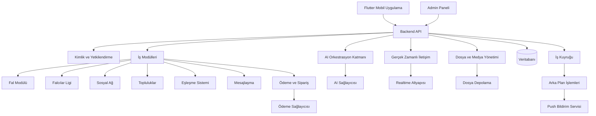
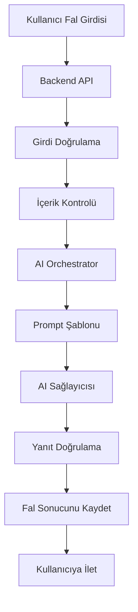
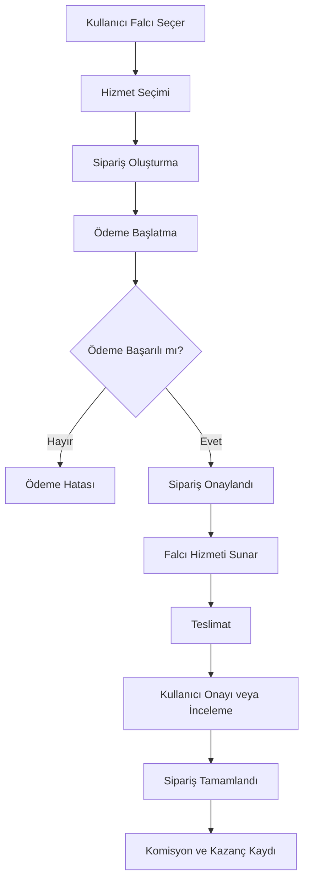
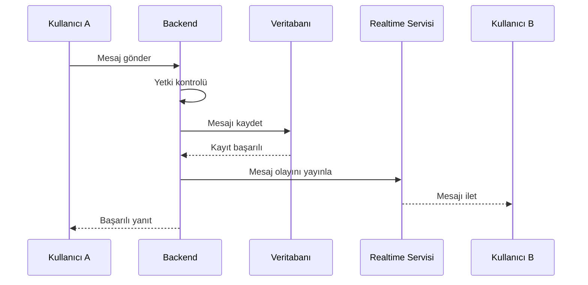

# SYSTEM_ARCHITECTURE.md
# Sistem Mimarisi ve Teknik Altyapı

**Belge Sürümü:** 1.0.0  
**Durum:** İlk Mimari Taslak  
**Proje:** Fal ve Sosyal Platform  
**Mobil Teknoloji:** Flutter (planlandı)  
**Diğer Teknolojiler:** TBD

---

## 1. Belgenin Amacı

Bu belge, platformun teknik mimarisini, sistem bileşenlerini, modüller arasındaki iletişimi ve dış servislerle entegrasyon yöntemlerini tanımlar.

Amaç; AI destekli fal hizmetlerini, insan falcı pazar yerini, sosyal ağı, toplulukları ve isteğe bağlı eşleşme sistemini tek bir platform içerisinde birbirinden bağımsız geliştirilebilir şekilde tasarlamaktır.

Bu mimari, ilk sürümün gereksiz yere karmaşıklaşmasını önlerken ileride büyümeye uygun bir altyapı oluşturmayı hedefler.

## 2. Mimari Tasarım İlkeleri

Sistem aşağıdaki ilkeler doğrultusunda geliştirilecektir:

1. **Modülerlik:** Her iş alanı kendi sorumluluklarına sahip olmalıdır.
2. **Bağımsız kullanılabilirlik:** Kullanıcı, platformun bütün özelliklerini kullanmak zorunda kalmamalıdır.
3. **Güvenlik:** Yetkilendirme ve veri erişimi sunucu tarafında kontrol edilmelidir.
4. **Ölçeklenebilirlik:** Kullanıcı ve işlem sayısı arttığında sistem genişletilebilmelidir.
5. **Bakım kolaylığı:** Kod yapısı, test edilebilir ve geliştirilebilir olmalıdır.
6. **Servis bağımsızlığı:** AI, ödeme ve bildirim servisleri değiştirilebilir tasarlanmalıdır.
7. **Veri bütünlüğü:** Ödeme, sipariş, mesaj ve fal kayıtları tutarlı biçimde saklanmalıdır.
8. **Gizlilik:** Kullanıcı verileri yalnızca gerekli amaçlar doğrultusunda işlenmelidir.

## 3. Genel Sistem Mimarisi

İlk aşamada önerilen mimari, modüler monolit yaklaşımıdır.

Bu yaklaşımda uygulamanın iş mantığı tek bir backend içerisinde çalışır ancak kod tabanı iş alanlarına göre ayrılır. Böylece başlangıçta mikroservislerin getireceği dağıtık sistem karmaşıklığına girilmez.

İlerleyen aşamalarda yoğun kullanılan modüller bağımsız servislere ayrılabilir.

### 3.1. Üst Düzey Mimari Diyagramı



### 3.2. Ana Sistem Bileşenleri

| Bileşen | Görevi | Teknoloji Durumu |
|---|---|---|
| Mobil uygulama | Kullanıcı arayüzü ve istemci işlemleri | Flutter |
| Backend API | İş mantığı ve veri yönetimi | TBD |
| Veritabanı | Kalıcı veri saklama | TBD |
| Kimlik sistemi | Kayıt, giriş ve oturum yönetimi | TBD |
| AI Gateway | AI servisleriyle iletişim | TBD |
| Dosya depolama | Fotoğraf ve medya saklama | TBD |
| Ödeme sistemi | Ödeme ve komisyon işlemleri | TBD |
| Realtime altyapısı | Anlık mesajlaşma | TBD |
| İş kuyruğu | Asenkron görevlerin yürütülmesi | TBD |
| Admin paneli | Yönetim ve denetim | TBD |

## 4. Mimari Yaklaşım: Modüler Monolit

İlk sürümde mikroservis mimarisi yerine modüler monolit önerilmektedir.

### 4.1. Neden Modüler Monolit?

- Tek bir backend uygulaması üzerinden geliştirme yapılabilir.
- Modüller arasında doğrudan ve kontrollü iletişim kurulabilir.
- Dağıtık sistem kaynaklı hata ve operasyon maliyetleri azaltılır.
- Geliştirme ve test süreçleri kolaylaşır.
- Gerektiğinde modüller bağımsız servislere dönüştürülebilir.

### 4.2. Modül Sınırları

Her modül aşağıdaki sorumluluklara sahip olmalıdır:

- Kendi iş kuralları.
- Kendi servis katmanı.
- Kendi veri erişim katmanı.
- Kendi API uç noktaları.
- Kendi testleri.
- Diğer modüllerle tanımlı arayüzler üzerinden iletişim.

Bir modülün başka bir modülün veritabanı tablolarını doğrudan değiştirmesine izin verilmemelidir.

## 5. Sistem Modülleri

### 5.1. Identity & Profile

Kullanıcı kimliği, hesap ve profil işlemlerini yönetir.

Sorumluluklar:

- Kayıt ve giriş.
- Oturum yönetimi.
- Profil oluşturma ve güncelleme.
- Kullanıcı tercihleri.
- Hesap silme ve veri talepleri.
- Rol ve yetki kontrolü.

İlgili roller:

- USER
- SYSTEM_ADMIN

### 5.2. Fortune Module

Platformun fal işlemlerini yönetir.

Sorumluluklar:

- Fal türlerinin listelenmesi.
- Fal oluşturma.
- Fal girdilerinin alınması.
- Fal sonuçlarının saklanması.
- Fal geçmişinin görüntülenmesi.
- Fal sonuçlarının paylaşılması.
- Kullanıcının fal gizlilik tercihleri.

Fal türleri ileride yeni seçenekler eklenebilecek şekilde tasarlanmalıdır.

### 5.3. AI Orchestration Module

AI sağlayıcılarıyla iletişimi yönetir.

Sorumluluklar:

- Kullanıcı girdisinin doğrulanması.
- Uygun prompt şablonunun seçilmesi.
- AI sağlayıcısına istek gönderilmesi.
- Yanıtın kontrol edilmesi.
- Sonucun ilgili fal kaydıyla ilişkilendirilmesi.
- Token ve maliyet takibi.
- Hata yönetimi ve tekrar deneme.

AI sağlayıcısına ait API anahtarları mobil uygulamada tutulmamalıdır.

### 5.4. Falcılar Ligi Module

İnsan falcıların platform üzerinden hizmet vermesini sağlar.

Sorumluluklar:

- Falcı başvuruları.
- Falcı profilleri.
- Hizmet ve fiyat tanımları.
- Kullanıcı değerlendirmeleri.
- Sipariş oluşturma.
- Sipariş takibi.
- Teslimat ve tamamlanma süreçleri.
- Falcı performans göstergeleri.

İlgili roller:

- FORTUNE_TELLER
- USER
- SYSTEM_ADMIN

### 5.5. Payment & Earnings Module

Ödeme ve gelir süreçlerini yönetir.

Sorumluluklar:

- Sipariş ödemeleri.
- Ödeme sağlayıcısı entegrasyonu.
- Komisyon hesaplama.
- Falcı kazanç kayıtları.
- İade ve iptal süreçleri.
- Ödeme geçmişi.
- Mutabakat kayıtları.

Ödeme kartı bilgileri platform veritabanında saklanmamalıdır. Kart işlemleri uygun ödeme sağlayıcısı üzerinden yürütülmelidir.

### 5.6. Social Feed Module

Kullanıcıların fal sonuçlarını ve diğer içeriklerini paylaşmasını sağlar.

Sorumluluklar:

- Gönderi oluşturma.
- Gönderi düzenleme ve silme.
- Beğeni.
- Yorum.
- Paylaşım.
- İçerik görünürlüğü.
- Akış sıralaması.

### 5.7. Communities Module

Reddit benzeri topluluk yapısını yönetir.

Sorumluluklar:

- Topluluk oluşturma.
- Topluluk yönetimi.
- Konu açma.
- Yanıt verme.
- Yorum yapma.
- Topluluk moderasyonu.
- Topluluk üyelikleri.

İlgili roller:

- COMMUNITY_OWNER
- COMMUNITY_MODERATOR

### 5.8. Dating & Matching Module

Kullanıcıların isteğe bağlı olarak eşleşmesini sağlar.

Sorumluluklar:

- Eşleşme tercihleri.
- Kullanıcıların eşleşmeye katılım izni.
- Uyum puanı hesaplama.
- Önerilen profiller.
- Beğeni ve karşılıklı eşleşme.
- Eşleşme geçmişi.
- Engelleme ve raporlama.

Bu modül varsayılan olarak kapalı olmalı ve kullanıcı açıkça katılmayı seçmelidir.

Kullanıcı, eşleşme sistemine katılmadan diğer platform özelliklerini kullanabilmelidir.

### 5.9. Messaging Module

Kullanıcılar arasındaki özel mesajlaşmayı yönetir.

Sorumluluklar:

- Konuşma oluşturma.
- Mesaj gönderme.
- Mesaj geçmişi.
- Okundu bilgisi.
- Mesaj silme politikası.
- Engellenen kullanıcı kontrolü.
- Mesaj bildirimleri.

### 5.10. Notification Module

Platformdaki olayların kullanıcılara iletilmesini sağlar.

Bildirim türleri:

- Yeni mesaj.
- Yeni yorum.
- Beğeni.
- Eşleşme.
- Fal sonucu hazır.
- Sipariş durumu değişikliği.
- Falcı başvuru sonucu.
- Topluluk etkileşimleri.

### 5.11. Moderation Module

Platform güvenliğini ve içerik denetimini yönetir.

Sorumluluklar:

- İçerik raporlama.
- Kullanıcı raporlama.
- İçerik kaldırma.
- Kullanıcı kısıtlama.
- Spam tespiti.
- Topluluk moderasyonu.
- Moderasyon geçmişi.

### 5.12. Admin & Audit Module

Yönetim paneli ve kritik işlem kayıtlarını yönetir.

Sorumluluklar:

- Kullanıcı yönetimi.
- Rol yönetimi.
- Falcı başvuru inceleme.
- İçerik denetimi.
- Ödeme ve sipariş takibi.
- Sistem istatistikleri.
- Kritik işlem kayıtları.

## 6. İstek ve Veri İşleme Akışı

Mobil uygulamadan gelen istekler backend üzerinden işlenir.

Örnek işlem sırası:

1. Flutter uygulaması API isteği gönderir.
2. Backend oturum bilgisini doğrular.
3. Kullanıcının ilgili işlem için yetkisi kontrol edilir.
4. İstek ilgili modüle yönlendirilir.
5. İş kuralları uygulanır.
6. Gerekiyorsa veritabanı veya dış servislerle iletişim kurulur.
7. İşlem sonucu istemciye döndürülür.
8. Gerekiyorsa arka plan olayı veya bildirim oluşturulur.

İşlem başarısız olduğunda standart hata formatı kullanılmalıdır.

Önerilen hata yapısı:

```json
{
  "success": false,
  "error": {
    "code": "RESOURCE_NOT_FOUND",
    "message": "İstenen kayıt bulunamadı."
  }
}
```

Başarılı yanıtlar da standart bir yapıya sahip olmalıdır.

## 7. AI Sistem Mimarisi

AI sistemi doğrudan mobil uygulamadan değil, backend üzerinden çalışmalıdır.

### 7.1. AI İşlem Akışı



### 7.2. AI Güvenlik ve Kontrol Kuralları

- AI anahtarları yalnızca sunucuda tutulmalıdır.
- Prompt şablonları sürümlendirilmelidir.
- Kullanıcı girdileri doğrulanmalıdır.
- İstek başına maliyet ve token sınırları uygulanmalıdır.
- Zaman aşımı ve hata yönetimi bulunmalıdır.
- Sağlayıcı yanıtları beklenen format açısından kontrol edilmelidir.
- Kullanıcıya sunulmadan önce gerekli güvenlik kontrolleri yapılmalıdır.
- AI tarafından üretilen fal yorumlarının eğlence ve kişisel yorum niteliğinde olduğu açıkça belirtilmelidir.

AI yorumları bilimsel olarak doğrulanmış gelecek tahminleri gibi sunulmamalıdır.

### 7.3. Sağlayıcı Bağımsızlığı

AI servisleri bir adaptör katmanı üzerinden kullanılmalıdır.

Böylece gelecekte AI sağlayıcısı veya model değiştirildiğinde uygulamanın diğer modüllerinde kapsamlı değişiklik yapılması gerekmez.

## 8. Falcılar Ligi ve Sipariş Mimarisi

İnsan falcı hizmetleri sipariş tabanlı bir yapıyla yönetilmelidir.

### 8.1. Sipariş Akışı



### 8.2. Sipariş Durumları

Önerilen durumlar:

- PENDING_PAYMENT
- PAYMENT_FAILED
- PAID
- ACCEPTED
- IN_PROGRESS
- DELIVERED
- COMPLETED
- CANCELLED
- REFUNDED
- DISPUTED

Durum geçişleri backend tarafından kontrol edilmelidir.

### 8.3. Ödeme Güvenliği

- Ödeme sağlayıcısının webhook imzaları doğrulanmalıdır.
- Aynı ödeme bildiriminin birden fazla kez işlenmesi engellenmelidir.
- Ödeme işlemlerinde idempotency kullanılmalıdır.
- Komisyon ve kazanç kayıtları denetlenebilir olmalıdır.
- İade ve iptal süreçleri açık kurallara bağlanmalıdır.
- Falcı kazançları için ayrı bir finansal hareket defteri tutulmalıdır.

Ödeme sağlayıcısı henüz belirlenmemiştir.

## 9. Gerçek Zamanlı Mesajlaşma

Mesajlaşma sistemi hem kalıcı veri saklamayı hem de gerçek zamanlı iletişimi desteklemelidir.

Önerilen yapı:

- REST API: Konuşma oluşturma, geçmiş mesajları getirme ve yönetim.
- WebSocket veya yönetilen realtime servis: Anlık mesaj iletimi.
- Veritabanı: Mesajların kalıcı saklanması.
- Push Notification: Kullanıcı çevrimdışıyken bildirim iletimi.

### 9.1. Mesaj Akışı



Mesajların erişim yetkisi her zaman backend tarafından doğrulanmalıdır.

## 10. Dosya ve Medya Yönetimi

Platformda kullanılabilecek medya türleri:

- Profil fotoğrafları.
- Kahve falı fotoğrafları.
- Gönderi görselleri.
- Topluluk içerikleri.
- Falcı hizmet görselleri.

Dosyalar doğrudan veritabanında tutulmamalıdır. Dosya depolama servisi kullanılmalıdır.

### 10.1. Dosya Yükleme Akışı

1. Kullanıcı dosya yükleme isteği gönderir.
2. Backend dosya türünü, boyutunu ve yetkiyi kontrol eder.
3. Kısa süreli ve kontrollü yükleme adresi oluşturulur.
4. Dosya depolama servisine yüklenir.
5. Dosya metadata bilgisi veritabanına kaydedilir.
6. Dosyanın erişim kuralları uygulanır.

Dosya türü, boyut, içerik güvenliği ve saklama süresi politikaları ayrıca tanımlanmalıdır.

## 11. Veritabanı ve Veri Erişim Mimarisi

Veritabanı teknolojisi henüz belirlenmemiştir.

Ancak aşağıdaki veri alanları mantıksal olarak birbirinden ayrılmalıdır:

- Kullanıcı ve profil verileri.
- Roller ve izinler.
- Fal kayıtları.
- AI işlem kayıtları.
- Falcı profilleri.
- Siparişler ve ödemeler.
- Sosyal gönderiler ve yorumlar.
- Topluluklar ve konular.
- Eşleşme kayıtları.
- Konuşmalar ve mesajlar.
- Bildirimler.
- Moderasyon kayıtları.

Veri modeli ayrı bir dokümanda detaylandırılacaktır: `DATABASE_SCHEMA.md`.

### 11.1. Veri Erişim İlkeleri

- Veritabanına erişim backend üzerinden sağlanmalıdır.
- Kullanıcı yalnızca erişim yetkisi bulunan kayıtları görebilmelidir.
- Sayfalama kullanılmalıdır.
- Büyük listelerde sınırsız veri çekilmemelidir.
- Kritik işlemler transaction ile yürütülmelidir.
- Veritabanı şema değişiklikleri migration ile yönetilmelidir.

## 12. Güvenlik ve Gizlilik Mimarisi

### 12.1. Kimlik ve Oturum Güvenliği

- Güvenli oturum yönetimi kullanılmalıdır.
- Erişim tokenları ve yenileme mekanizmaları uygun şekilde yönetilmelidir.
- Oturum iptali desteklenmelidir.
- Hassas işlemlerde yeniden kimlik doğrulama gerekebilir.

### 12.2. Yetkilendirme

Yetkilendirme yalnızca mobil uygulama arayüzüne bırakılmamalıdır.

Backend her işlemde:

1. Kullanıcının kimliğini doğrulamalı.
2. Rol ve izinlerini kontrol etmeli.
3. Kaynağın sahibi olup olmadığını doğrulamalı.
4. İlgili işlem için erişim izni vermeli veya reddetmelidir.

### 12.3. Veri Güvenliği

- İletişim HTTPS üzerinden gerçekleştirilmelidir.
- Hassas veriler uygun yöntemlerle şifrelenmelidir.
- Gizli anahtarlar kaynak koduna eklenmemelidir.
- Erişim kayıtları tutulmalıdır.
- Kullanıcı verileri yetkisiz erişime karşı korunmalıdır.
- Veri silme ve saklama politikaları oluşturulmalıdır.
- Yedekler güvenli biçimde saklanmalıdır.

### 12.4. Kullanıcı Gizliliği

- Dating modülü açık rıza olmadan etkinleştirilmemelidir.
- Kullanıcının fal sonuçlarını paylaşma kontrolü bulunmalıdır.
- Özel mesajlara yetkisiz erişim engellenmelidir.
- Hassas kullanıcı verileri AI sağlayıcılarına gereksiz yere gönderilmemelidir.
- Kullanıcı hesabını ve ilgili kişisel verilerini silme süreçlerine erişebilmelidir.

## 13. Arka Plan İşlemleri ve Kuyruk Sistemi

Bazı işlemler kullanıcı isteği sırasında tamamlanmak zorunda değildir.

Örnek işlemler:

- AI fal üretimi.
- Push bildirimleri.
- E-posta gönderimi.
- Görsel işleme.
- İçerik moderasyonu.
- Ödeme webhook işlemleri.
- İstatistik ve raporlama.
- Zamanlanmış temizlik görevleri.

Bu işlemler için bir arka plan iş kuyruğu kullanılması önerilir.

Kuyruk sistemi aşağıdaki özellikleri desteklemelidir:

- Başarısız görevleri tekrar deneme.
- Tekrarlı işlem kontrolü.
- İşlem önceliği.
- Hata kayıtları.
- Başarısız görevleri inceleme.
- Görev zaman aşımı.

## 14. Performans ve Ölçeklenebilirlik

Sistem aşağıdaki yöntemlerle optimize edilmelidir:

- API yanıtlarının optimize edilmesi.
- Sayfalama ve filtreleme.
- Gerektiğinde önbellekleme.
- Görsel boyutlarının optimize edilmesi.
- Ağır işlemlerin arka plan görevlerine aktarılması.
- Veritabanı indekslerinin doğru kullanılması.
- Gereksiz veri transferinin azaltılması.
- Yoğun kullanılan modüllerin bağımsız ölçeklenebilmesi.

İlk aşamada bütün modüller için mikroservis altyapısı kurulması önerilmemektedir.

## 15. İzleme ve Hata Yönetimi

Sistemin sağlıklı çalıştığını takip edebilmek için gözlemlenebilirlik altyapısı kurulmalıdır.

Takip edilmesi gereken başlıca veriler:

- API yanıt süreleri.
- Hata oranları.
- AI işlem süreleri.
- AI işlem maliyetleri.
- Ödeme hataları.
- Mesajlaşma gecikmeleri.
- Kuyrukta bekleyen görevler.
- Veritabanı performansı.
- Uygulama çökme kayıtları.

Kullanıcıya gösterilen hata mesajları teknik detay veya gizli sistem bilgisi içermemelidir.

## 16. Ortam ve Dağıtım Mimarisi

En az üç ayrı ortam kullanılmalıdır:

| Ortam | Amaç |
|---|---|
| Development | Aktif geliştirme |
| Staging | Test ve sürüm öncesi doğrulama |
| Production | Gerçek kullanıcı ortamı |

Dağıtım sürecinde:

- Otomatik testler çalıştırılmalıdır.
- Veritabanı migration işlemleri kontrol edilmelidir.
- Gizli bilgiler güvenli ortam değişkenlerinde tutulmalıdır.
- Üretim ortamına doğrudan test verisi aktarılmamalıdır.
- Geri dönüş ve yedekleme planı bulunmalıdır.

## 17. Önerilen Proje Klasör Yapısı

Aşağıdaki yapı başlangıç önerisidir. Backend teknolojisi belirlendiğinde kesinleştirilecektir.

### 17.1. Flutter

```text
mobile/
├── lib/
│   ├── core/
│   │   ├── config/
│   │   ├── constants/
│   │   ├── network/
│   │   ├── routing/
│   │   ├── theme/
│   │   ├── utils/
│   │   └── widgets/
│   │
│   ├── features/
│   │   ├── auth/
│   │   ├── profile/
│   │   ├── fortune/
│   │   ├── fortune_teller/
│   │   ├── social/
│   │   ├── communities/
│   │   ├── dating/
│   │   ├── messaging/
│   │   ├── notifications/
│   │   └── settings/
│   │
│   ├── shared/
│   └── main.dart/
│
├── assets/
├── test/
└── pubspec.yaml
```

### 17.2. Backend

```text
backend/
├── src/
│   ├── core/
│   │   ├── config/
│   │   ├── database/
│   │   ├── security/
│   │   ├── errors/
│   │   └── logging/
│   │
│   ├── modules/
│   │   ├── identity/
│   │   ├── profile/
│   │   ├── fortune/
│   │   ├── ai/
│   │   ├── fortune_teller/
│   │   ├── payment/
│   │   ├── social/
│   │   ├── communities/
│   │   ├── dating/
│   │   ├── messaging/
│   │   ├── notifications/
│   │   ├── moderation/
│   │   └── admin/
│   │
│   ├── infrastructure/
│   │   ├── storage/
│   │   ├── realtime/
│   │   ├── queue/
│   │   └── providers/
│   │
│   └── main
│
├── tests/
├── migrations/
└── README.md
```

## 18. Teknoloji Kararları

Aşağıdaki teknolojiler henüz kesinleştirilmemiştir.

| Alan | Karar | Durum |
|---|---|---|
| Mobil | Flutter | Planlandı |
| Backend dili | TBD | Karar bekliyor |
| Backend framework | TBD | Karar bekliyor |
| Veritabanı | TBD | Karar bekliyor |
| Kimlik doğrulama | TBD | Karar bekliyor |
| Dosya depolama | TBD | Karar bekliyor |
| AI sağlayıcısı | TBD | Karar bekliyor |
| Ödeme sağlayıcısı | TBD | Karar bekliyor |
| Realtime | TBD | Karar bekliyor |
| İş kuyruğu | TBD | İhtiyaçla birlikte belirlenecek |
| Admin paneli | TBD | Karar bekliyor |
| Hosting | TBD | Karar bekliyor |

Teknoloji seçimi yapılırken geliştirme ekibinin yetkinliği, maliyet, Türkiye'de ödeme ve mevzuat gereksinimleri, ölçeklenebilirlik ve bakım kolaylığı birlikte değerlendirilmelidir.

## 19. İlk Sürüm İçin Mimari Öneri

İlk sürümde bütün platformu aynı anda geliştirmek yerine temel akışların çalışır hâle getirilmesi önerilir.

Öncelikli bileşenler:

1. Flutter mobil uygulama.
2. Backend API.
3. Kimlik ve profil sistemi.
4. Veritabanı.
5. AI fal modülü.
6. Fal geçmişi.
7. Temel sosyal paylaşım.
8. Bildirim altyapısı.
9. Temel admin ve moderasyon araçları.

Falcılar Ligi, gelişmiş topluluklar, dating ve gerçek zamanlı mesajlaşma sonraki geliştirme aşamalarına alınabilir.

Bununla birlikte ilk mimari, bu modüllerin sonradan eklenmesini engellememelidir.

## 20. Açık Mimari Kararlar

Aşağıdaki konular teknik ekip tarafından değerlendirilerek kesinleştirilmelidir:

- Backend dili ve framework seçimi.
- SQL veya NoSQL veritabanı tercihi.
- Kimlik doğrulama sağlayıcısı.
- AI sağlayıcısı ve model stratejisi.
- Ödeme altyapısı.
- Dosya depolama sağlayıcısı.
- Realtime iletişim teknolojisi.
- Hosting ve sunucu bölgesi.
- Admin panelinin teknolojisi.
- İlk sürümde kullanılacak mimari sınırlar.

Bu kararlar verilmeden herhangi bir sağlayıcıya bağımlı iş mantığı geliştirilmemelidir.

## 21. Kabul Kriterleri

Mimari tasarım aşağıdaki koşulları karşılamalıdır:

- Mobil uygulama backend üzerinden işlem yapabilmelidir.
- AI servislerine erişim güvenli backend katmanından sağlanmalıdır.
- Modüller açık sorumluluk sınırlarına sahip olmalıdır.
- Kullanıcı yetkileri sunucu tarafında doğrulanmalıdır.
- Dating sistemi bağımsız ve isteğe bağlı çalışmalıdır.
- Falcılar Ligi sipariş ve ödeme süreçleriyle entegre olmalıdır.
- Sosyal ağ ve topluluklar birbirinden bağımsız kullanılabilmelidir.
- Mesajlaşma kalıcı kayıt ve gerçek zamanlı iletişim desteğine sahip olmalıdır.
- Sistem hata kayıtları ve temel performans ölçümleri üretebilmelidir.
- Yeni modüller mevcut sistemi yeniden yazmayı gerektirmeden eklenebilmelidir.

---

**Belge Sonu**

**Not:** Bu belge teknoloji seçimlerini kesinleştiren nihai teknik şartname değildir. Mimari kararlar, ekip yapısı, maliyet ve MVP kapsamı netleştikçe güncellenecektir.