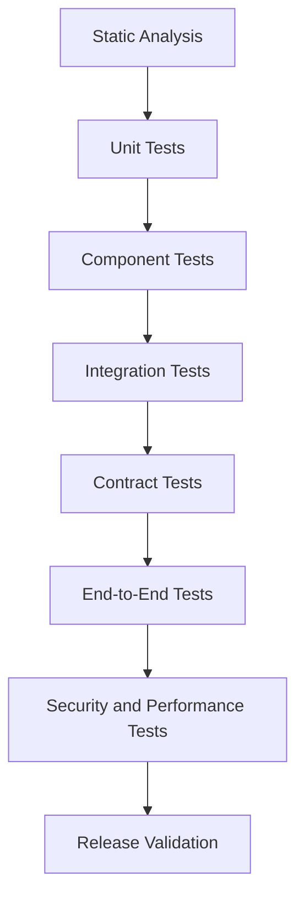
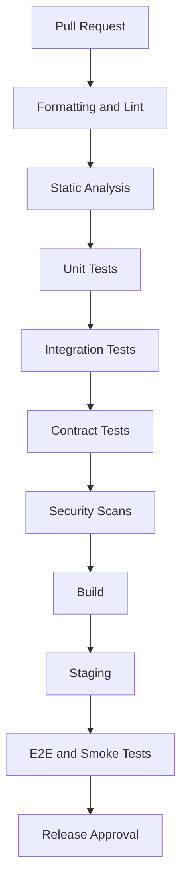

# TESTING_STRATEGY.md

# Yazılım Test Stratejisi ve Kalite Güvence Planı

**Proje:** AI Destekli Fal ve Sosyal Etkileşim Platformu  
**Dosya:** `TESTING_STRATEGY.md`  
**Sürüm:** 1.0.0  
**Durum:** Teknik kalite güvence taslağı  
**Öncelik:** P0 — Temel test altyapısı geliştirmeyle birlikte kurulmalıdır.

---

## 1. Amaç

Bu doküman, platformun geliştirme sürecinde uygulanacak test yöntemlerini, kalite standartlarını ve sürüm yayınlama koşullarını tanımlar.

Platform aşağıdaki sistemleri içermektedir:

- Flutter mobil uygulaması.
- Backend API.
- Authentication ve Authorization.
- AI Fal Merkezi.
- Falcılar Ligi.
- Sosyal ağ.
- Topluluklar.
- Flört ve eşleşme.
- Mesajlaşma ve gerçek zamanlı iletişim.
- Ödeme ve abonelik.
- Bildirim sistemi.
- Moderasyon.
- Analitik altyapısı.

Bu modüller birbirleriyle etkileşim halinde olduğundan yalnızca bağımsız fonksiyon testleri yeterli değildir.

### 1.1. Hedefler

1. Hataları mümkün olduğunca erken tespit etmek.
2. Kritik iş kurallarının doğruluğunu sağlamak.
3. Modüller arası entegrasyonları doğrulamak.
4. Güvenlik açıklarını azaltmak.
5. Performans sorunlarını tespit etmek.
6. Yeni sürümlerin mevcut özellikleri bozmamasını sağlamak.
7. Otomatik testlerle geliştirme hızını artırmak.
8. Yayına çıkış için ölçülebilir kalite kriterleri oluşturmak.

**Temel ilke:** Testler geliştirme tamamlandıktan sonra eklenen bir işlem değil, geliştirme sürecinin sürekli parçası olmalıdır.

---

## 2. Test Yaklaşımı

Platformda çok katmanlı test stratejisi kullanılacaktır.



### 2.1. Test piramidi

Testlerin büyük bölümü hızlı çalışan unit testlerden oluşmalıdır.

Daha az sayıda entegrasyon testi ve kritik kullanıcı akışlarını doğrulayan E2E testleri bulunmalıdır.

| Test seviyesi | Amaç | Çalışma sıklığı |
|---|---|---|
| Static Analysis | Kod kalitesi | Her PR |
| Unit | İş kuralları | Her PR |
| Component/Widget | Bileşen davranışı | Her PR |
| Integration | Servis ve veritabanı uyumu | Her PR |
| Contract | API uyumluluğu | Her PR |
| E2E | Kritik kullanıcı akışları | Merge ve release |
| Security | Güvenlik kontrolleri | Sürekli ve release |
| Performance | Yük ve gecikme | Planlı ve release öncesi |

---

## 3. Test Ortamları

Dört temel ortam önerilmektedir.

| Ortam | Amaç |
|---|---|
| Local | Geliştirici testleri |
| CI | Otomatik doğrulama |
| Staging | Üretim benzeri test |
| Production | İzleme ve sınırlı doğrulama |

### 3.1. Local

Geliştiriciler kendi bilgisayarlarında:

- Unit test.
- Widget test.
- API test.
- Yerel veritabanı testleri.
- Mock servis testleri.

çalıştırabilmelidir.

### 3.2. CI

Her pull request için otomatik test süreci çalışmalıdır.

### 3.3. Staging

Production ortamına mümkün olduğunca yakın yapılandırılmalıdır.

Ancak gerçek müşteri ödemeleri, gerçek kullanıcı verileri veya gerçek bildirim gönderimleri kontrolsüz şekilde kullanılmamalıdır.

### 3.4. Production

Production ortamında:

- Health checks.
- Monitoring.
- Error tracking.
- Kontrollü smoke tests.

uygulanmalıdır.

Yıkıcı veya maliyetli testler production üzerinde çalıştırılmamalıdır.

---

## 4. Flutter Test Stratejisi

Flutter uygulamasında üç temel test seviyesi kullanılacaktır.

### 4.1. Unit Tests

Test edilecek alanlar:

- Veri modelleri.
- Form doğrulama.
- Repository mantığı.
- State management.
- Hesaplama fonksiyonları.
- Yetki ve görünürlük kuralları.
- API response mapping.

Önerilen araç:

`flutter_test`

### 4.2. Widget Tests

Test edilecek bileşenler:

- Giriş formu.
- Kayıt ekranı.
- Fal oluşturma ekranı.
- Fal sonucu kartları.
- Sosyal gönderi bileşenleri.
- Mesaj balonları.
- Profil kartları.
- Ödeme özet ekranı.
- Hata ve boş durum ekranları.

### 4.3. Integration Tests

Önerilen araç:

`integration_test`

Kritik senaryolar:

- Kayıt ve giriş.
- Fal oluşturma.
- Fal sonucu görüntüleme.
- Sosyal gönderi paylaşma.
- Mesaj gönderme.
- Profil güncelleme.
- Ödeme akışı.
- Bildirime tıklayarak yönlendirme.

---

## 5. Flutter Unit Test Örneği

```dart
import 'package:flutter_test/flutter_test.dart';

double calculateTotal({
  required double price,
  required double discount,
}) {
  if (price < 0 || discount < 0 || discount > price) {
    throw ArgumentError('Invalid amount');
  }

  return price - discount;
}

void main() {
  group('calculateTotal', () {
    test('calculates valid total', () {
      expect(
        calculateTotal(price: 100, discount: 20),
        80,
      );
    });

    test('rejects invalid discount', () {
      expect(
        () => calculateTotal(price: 100, discount: 120),
        throwsArgumentError,
      );
    });
  });
}
```

Gerçek ödeme hesaplamalarında kayan noktalı sayı yerine uygun decimal veya en küçük para birimi temsili kullanılmalıdır.

---

## 6. Flutter Widget Test Örneği

```dart
import 'package:flutter/material.dart';
import 'package:flutter_test/flutter_test.dart';

void main() {
  testWidgets('Login button is visible', (tester) async {
    await tester.pumpWidget(
      const MaterialApp(
        home: Scaffold(
          body: ElevatedButton(
            onPressed: null,
            child: Text('Giriş Yap'),
          ),
        ),
      ),
    );

    expect(find.text('Giriş Yap'), findsOneWidget);
  });
}
```

Gerçek widget testlerinde yalnızca bileşenin görünmesi değil, kullanıcı etkileşimleri ve durum değişiklikleri de doğrulanmalıdır.

---

## 7. Backend Test Stratejisi

Önerilen backend teknolojileri:

- Python.
- FastAPI.
- PostgreSQL.
- Redis.
- SQLAlchemy.
- Alembic.
- Celery veya alternatif worker altyapısı.

Önerilen test araçları:

- pytest.
- pytest-asyncio.
- httpx.
- coverage.py.
- Testcontainers veya Docker tabanlı test servisleri.

### 7.1. Unit Tests

- İş kuralları.
- Hesaplama fonksiyonları.
- Servis mantığı.
- Yetkilendirme kararları.
- Veri doğrulama.
- Durum geçişleri.

### 7.2. Integration Tests

- PostgreSQL.
- Redis.
- API endpointleri.
- Worker görevleri.
- Dosya depolama adapterları.
- Ödeme sağlayıcısı adapterları.

### 7.3. Contract Tests

Flutter ve backend arasındaki API sözleşmeleri doğrulanmalıdır.

Kontroller:

- Endpoint varlığı.
- Request şeması.
- Response şeması.
- HTTP status kodları.
- Hata formatı.
- Pagination.
- Yetkilendirme davranışı.

---

## 8. Backend Test Örneği

```python
import pytest


def calculate_commission(
    amount_minor: int,
    commission_bps: int,
) -> int:
    if amount_minor < 0:
        raise ValueError("Amount cannot be negative")

    if not 0 <= commission_bps <= 10000:
        raise ValueError("Invalid commission rate")

    return amount_minor * commission_bps // 10000


def test_commission_calculation():
    result = calculate_commission(
        amount_minor=20000,
        commission_bps=2000,
    )

    assert result == 4000


def test_negative_amount_rejected():
    with pytest.raises(ValueError):
        calculate_commission(
            amount_minor=-100,
            commission_bps=2000,
        )
```

Bu örnekte para tutarı en küçük para biriminde, komisyon oranı basis point cinsinden temsil edilir.

Üretim sisteminde yuvarlama politikası ayrıca tanımlanmalıdır.

---

## 9. Authentication Testleri

Kimlik doğrulama sistemi yüksek öncelikli test alanıdır.

### 9.1. Fonksiyonel testler

- Kayıt.
- Giriş.
- Çıkış.
- E-posta doğrulama.
- Parola sıfırlama.
- Token yenileme.
- Oturum iptali.
- Çoklu cihaz yönetimi.

### 9.2. Güvenlik testleri

- Yanlış parola denemeleri.
- Brute-force koruması.
- Geçersiz token.
- Süresi dolmuş token.
- Başka kullanıcıya ait token.
- Yetkisiz endpoint erişimi.
- Hesap numaralandırma riskleri.
- Refresh token tekrar kullanımı.

### 9.3. Kabul kriteri

Kimlik doğrulama ve yetkilendirme testlerinde kritik başarısızlık bulunurken sürüm yayınlanmamalıdır.

---

## 10. Authorization Testleri

Her modülde kaynak sahipliği kontrol edilmelidir.

Örnekler:

- Kullanıcı başka kullanıcının özel falını okuyamaz.
- Kullanıcı başka kullanıcının mesajlarını göremez.
- Müşteri başka müşterinin siparişine erişemez.
- Yorumcu başka yorumcunun kazançlarını göremez.
- Topluluk moderatörü platform genelinde yaptırım uygulayamaz.
- Normal kullanıcı yönetici endpointlerine erişemez.

### 10.1. IDOR testleri

Kaynak kimliği değiştirilerek yetkisiz erişim denenmelidir.

Örnek:

```text
GET /api/v1/marketplace/orders/{another_user_order_id}
```

Beklenen sonuç:

Yetkisiz erişim engellenmelidir.

Kaynağın varlığını gereksiz yere açıklamayan hata davranışı tercih edilebilir.

---

## 11. AI Fal Sistemi Testleri

AI sistemi deterministik olmayan çıktılar üretebildiğinden klasik unit testler tek başına yeterli değildir.

### 11.1. Test kategorileri

- Prompt oluşturma.
- Girdi doğrulama.
- Model adapterı.
- Response parsing.
- JSON schema validation.
- Timeout.
- Retry.
- Fallback.
- İçerik güvenliği.
- Maliyet ölçümü.

### 11.2. AI çıktı doğrulama

Kontrol edilecek özellikler:

- Beklenen format.
- Zorunlu alanlar.
- Maksimum metin uzunluğu.
- Yasaklı içerik kategorileri.
- Uygunsuz kesinlik iddiaları.
- Kullanıcı girdisine uygunluk.

### 11.3. Golden Dataset

AI sisteminin kalitesini ölçmek için sabit bir test veri kümesi oluşturulabilir.

Örnek kategoriler:

- Normal kahve falı.
- Eksik görsel.
- Bulanık görsel.
- Birden fazla görsel.
- Boş metin.
- Prompt injection girişimi.
- Hassas sağlık sorusu.
- Finansal sonuç beklentisi.
- Kendine zarar verme riski içeren girdi.

### 11.4. Değerlendirme yöntemi

AI yanıtları birebir metin eşitliğiyle değerlendirilmemelidir.

Bunun yerine:

- Yapısal doğruluk.
- Güvenlik.
- Talimat uyumu.
- Dil kalitesi.
- Yanıt bütünlüğü.
- Gereksiz tekrar oranı.

gibi kriterler kullanılmalıdır.

### 11.5. Prompt versiyonlama

Her prompt sürümü test sonuçlarıyla ilişkilendirilmelidir.

Örnek:

`fortune_coffee_prompt_v1.2`

Prompt değişiklikleri AI değerlendirme setinden geçirilmelidir.

---

## 12. AI Maliyet ve Dayanıklılık Testleri

### 12.1. Test senaryoları

- Sağlayıcı timeout.
- Sağlayıcı rate limit.
- Bozuk JSON response.
- Eksik model çıktısı.
- Çok uzun girdi.
- Çok büyük görsel.
- Beklenmedik token kullanımı.
- Aynı görevin tekrar çalışması.
- Worker yeniden başlatılması.

### 12.2. Kritik kurallar

- Başarısız işlem kullanıcıdan haksız yere kredi tüketmemelidir.
- Retry mekanizması aynı işlemi iki kez ücretlendirmemelidir.
- AI maliyeti izlenebilmelidir.
- İşlem başarısızlığı kullanıcıya uygun biçimde bildirilmelidir.

---

## 13. Ödeme Sistemi Testleri

Ödeme sistemi en kritik test alanlarından biridir.

### 13.1. Temel senaryolar

- Başarılı ödeme.
- Başarısız ödeme.
- Kullanıcı tarafından iptal edilen ödeme.
- Timeout.
- Tekrarlanan ödeme isteği.
- Tekrarlanan webhook.
- Gecikmiş webhook.
- İade.
- Kısmi iade.
- Abonelik yenileme.
- Abonelik iptali.

### 13.2. Finansal doğruluk

Kontrol edilmesi gerekenler:

- Tutar doğruluğu.
- Para birimi.
- Komisyon hesaplama.
- Vergi ve kesinti alanları.
- Kredi bakiyesi.
- Ledger tutarlılığı.
- İade sonrası bakiye.
- Payout hesaplama.

### 13.3. Webhook güvenliği

- İmza doğrulama.
- Geçersiz imza.
- Tekrarlanan event.
- Yanlış sipariş referansı.
- Beklenmedik durum geçişi.
- Replay attack koruması.

### 13.4. Kritik kabul kriteri

Aynı ödeme olayı birden fazla kez işlense bile finansal sonuç yalnızca bir kez uygulanmalıdır.

---

## 14. Falcılar Ligi Testleri

### 14.1. Yorumcu işlemleri

- Başvuru.
- Onay.
- Red.
- Hizmet oluşturma.
- Hizmet düzenleme.
- Hizmet arşivleme.

### 14.2. Sipariş işlemleri

- Sipariş oluşturma.
- Ödeme doğrulama.
- Sipariş kabul.
- Hizmet başlangıcı.
- Teslim.
- Tamamlama.
- İptal.
- İade.
- İtiraz.

### 14.3. Eşzamanlılık testleri

Örnek:

Bir yorumcunun kapasitesi 5 sipariş.

Aynı anda 10 kullanıcı sipariş oluşturmayı dener.

Beklenen sonuç:

Sistem kapasite sınırını aşmadan işlemleri yönetmelidir.

### 14.4. Yetki testleri

- Müşteri yorumcu adına teslim yapamaz.
- Yorumcu başka yorumcunun siparişini yönetemez.
- Yetkisiz kullanıcı finansal verilere erişemez.
- Aynı sipariş için yinelenen değerlendirme oluşturulamaz.

---

## 15. Sosyal Ağ Testleri

### 15.1. Fonksiyonel testler

- Gönderi oluşturma.
- Gönderi düzenleme.
- Gönderi silme.
- Beğeni.
- Beğeniyi kaldırma.
- Yorum.
- Yanıt.
- Takip.
- Takipten çıkma.
- İçerik raporlama.

### 15.2. Veri tutarlılığı

- Aynı kullanıcı aynı gönderiyi iki kez beğenemez.
- Silinen gönderiler akıştan kaldırılır.
- Yetkisiz kullanıcı özel içerikleri göremez.
- Sayaçlar gerçek kayıtlarla tutarlı olmalıdır.

### 15.3. Feed testleri

- Pagination.
- Sıralama.
- Cache.
- Silinen içerikler.
- Engellenen kullanıcılar.
- Moderasyon kısıtlamaları.

---

## 16. Topluluk Testleri

- Topluluk oluşturma.
- Topluluğa katılma.
- Topluluktan ayrılma.
- Konu oluşturma.
- Yanıt oluşturma.
- Moderatör yetkileri.
- Konu kilitleme.
- İçerik kaldırma.
- Üyelik kısıtlamaları.

Topluluk moderatörlerinin yetkileri yalnızca ilgili toplulukta geçerli olmalıdır.

---

## 17. Flört ve Eşleşme Testleri

### 17.1. Fonksiyonel testler

- Flört modülüne katılım.
- Flört modülünden ayrılma.
- Profil oluşturma.
- Tercih güncelleme.
- Aday filtreleme.
- Öneri sıralama.
- Beğenme.
- Geçme.
- Karşılıklı eşleşme.
- Eşleşme kaldırma.

### 17.2. Algoritma testleri

- Puan hesaplama.
- Zorunlu filtreler.
- İlgi alanı benzerliği.
- Fal sinyali kullanımı.
- Fal izni bulunmadığında hesaplama.
- Algoritma versiyonlama.

### 17.3. Gizlilik testleri

- Katılmayan kullanıcı önerilmez.
- Engellenen kullanıcı önerilmez.
- Fal verisi izinsiz kullanılmaz.
- Gizli profil keşfedilmez.
- Yaş uygunluğu kontrolleri uygulanır.

### 17.4. Eşleşme tutarlılığı

Aynı kullanıcı çifti için birden fazla aktif eşleşme oluşturulmamalıdır.

---

## 18. Chat ve Realtime Testleri

### 18.1. WebSocket testleri

- Bağlantı kurma.
- Kimlik doğrulama.
- Mesaj gönderme.
- Mesaj alma.
- Bağlantı kopması.
- Yeniden bağlanma.
- Token süresi dolması.
- Yetkisiz konuşma erişimi.

### 18.2. Mesaj durumu testleri

- PENDING.
- SENT.
- DELIVERED.
- READ.
- FAILED.

### 18.3. Çevrimdışı senaryolar

- Alıcı çevrimdışı.
- Gönderen çevrimdışı.
- Mesaj gönderimi sırasında bağlantı kopması.
- Tekrar gönderim.
- Eksik mesaj senkronizasyonu.

### 18.4. İdempotency

Aynı `client_message_id` ile yapılan tekrar gönderim ikinci mesaj oluşturmamalıdır.

### 18.5. Çoklu cihaz

Aynı kullanıcının iki cihazında:

- Mesaj geçmişi.
- Okundu bilgisi.
- Konuşma durumu.

tutarlı olmalıdır.

---

## 19. Bildirim Sistemi Testleri

### 19.1. Push testleri

- Android push.
- iOS push.
- Uygulama ön planda.
- Uygulama arka planda.
- Uygulama kapalı.
- Bildirime tıklama.
- Deep link yönlendirme.

### 19.2. Tercih testleri

- Push kapalı.
- Sosyal bildirimler kapalı.
- Sessiz saatler aktif.
- Konuşma sessize alınmış.
- Cihaz tokenı değişmiş.
- Kullanıcı çıkış yapmış.

### 19.3. Retry testleri

- Geçici sağlayıcı hatası.
- Kalıcı token hatası.
- Rate limit.
- Queue gecikmesi.
- Yinelenen bildirim.

---

## 20. Moderasyon Testleri

### 20.1. Fonksiyonel testler

- İçerik raporlama.
- Moderasyon vakası oluşturma.
- Vaka atama.
- Karar verme.
- İçerik kaldırma.
- Kullanıcı kısıtlama.
- İtiraz.
- İtiraz sonuçlandırma.

### 20.2. Güvenlik testleri

- Yetkisiz moderatör erişimi.
- Özel mesajlara erişim sınırları.
- Audit log.
- Sahte rapor spam'i.
- Toplu kötü niyetli raporlama.
- Yaptırım atlatma girişimleri.

---

## 21. Veritabanı Testleri

### 21.1. Migration testleri

Her Alembic migration:

- Temiz veritabanında uygulanabilmelidir.
- Mevcut şema üzerinde uygulanabilmelidir.
- Veri bütünlüğünü korumalıdır.
- Beklenen constraintleri oluşturmalıdır.

### 21.2. Constraint testleri

- Foreign key.
- Unique constraint.
- Check constraint.
- Not null.
- Transaction rollback.

### 21.3. Veri bütünlüğü

Özellikle:

- Ödeme kayıtları.
- Kredi bakiyesi.
- Sipariş durumları.
- Eşleşmeler.
- Mesajlar.
- Kullanıcı izinleri.

için transaction testleri uygulanmalıdır.

---

## 22. Güvenlik Testleri

Güvenlik testleri OWASP Mobile Application Security ve OWASP API Security yaklaşımlarıyla uyumlu planlanmalıdır.

### 22.1. Test alanları

- Authentication.
- Authorization.
- Input validation.
- Injection.
- Rate limiting.
- Secret management.
- Token storage.
- File upload.
- API exposure.
- WebSocket security.
- Dependency vulnerabilities.

### 22.2. SAST

Kod üzerinde statik güvenlik analizi uygulanmalıdır.

Önerilen araçlar:

- Bandit.
- Semgrep.
- Dependency scanning.

### 22.3. DAST

Staging ortamında dinamik güvenlik testleri yapılabilir.

### 22.4. Secret scanning

Repository içerisinde:

- API key.
- Private key.
- Database password.
- Access token.

bulunmadığı otomatik olarak kontrol edilmelidir.

---

## 23. Performans Testleri

### 23.1. Load Testing

Normal ve beklenen yoğun trafik altında sistem davranışı ölçülmelidir.

### 23.2. Stress Testing

Sistemin kapasite sınırları belirlenmelidir.

### 23.3. Spike Testing

Ani trafik artışlarında davranış ölçülmelidir.

### 23.4. Soak Testing

Uzun süreli yük altında bellek sızıntısı ve kaynak tüketimi incelenmelidir.

### 23.5. Önerilen araçlar

- k6.
- Locust.
- Flutter DevTools.
- PostgreSQL EXPLAIN ANALYZE.

---

## 24. Başlangıç Performans Hedefleri

Aşağıdaki değerler kesin SLA değil, başlangıç test hedefleridir.

| Alan | Başlangıç hedefi |
|---|---|
| Basit API sorguları | p95 ≤ 500 ms |
| Listeleme endpointleri | p95 ≤ 800 ms |
| WebSocket mesaj ACK | p95 ≤ 500 ms |
| Flutter kritik ekran açılışı | Hedef cihazlarda ≤ 2 sn |
| AI fal işlemi | Model ve fal türüne göre ayrı hedef |
| Ödeme işlemi | Sağlayıcı davranışına göre ölçüm |

Bu hedefler gerçek cihazlar, ağ koşulları ve yük profilleriyle doğrulanmalıdır.

### 24.1. Test yük profilleri

Başlangıçta örnek senaryolar:

- 100 eşzamanlı aktif kullanıcı.
- 500 eşzamanlı aktif kullanıcı.
- 1.000 eşzamanlı aktif kullanıcı.

Bu sayılar kapasite garantisi değil, test basamaklarıdır.

---

## 25. Test Verisi Yönetimi

### 25.1. Temel kurallar

- Testler mümkün olduğunca deterministik olmalıdır.
- Testler birbirinden bağımsız çalışmalıdır.
- Test sonrası veriler temizlenmelidir.
- Gerçek kullanıcı verileri test ortamına kontrolsüz aktarılmamalıdır.
- Ödeme testlerinde sandbox kullanılmalıdır.
- AI testlerinde mock ve sabit veri setleri tercih edilmelidir.

### 25.2. Test kullanıcıları

Örnek roller:

- Normal kullanıcı.
- Premium kullanıcı.
- Fal yorumcusu.
- Topluluk moderatörü.
- Platform moderatörü.
- Administrator.
- Kısıtlanmış kullanıcı.

### 25.3. Test fixture yapısı

```text
tests/
├── fixtures/
│   ├── users.py
│   ├── fortunes.py
│   ├── orders.py
│   ├── payments.py
│   ├── conversations.py
│   └── moderation.py
```

---

## 26. Mock ve Fake Servisler

Harici servisler her testte gerçek çağrılarla kullanılmamalıdır.

### 26.1. Mock kullanılabilecek servisler

- AI sağlayıcısı.
- Ödeme sağlayıcısı.
- Push notification.
- E-posta.
- Object storage.
- Harici kimlik doğrulama sağlayıcısı.

### 26.2. Gerçek entegrasyon testleri

Mock testlere ek olarak sağlayıcı sandbox ortamlarında sınırlı gerçek entegrasyon testleri yapılmalıdır.

Böylece yalnızca mock davranışına güvenilmez.

---

## 27. CI/CD Test Pipeline

Önerilen süreç:



### 27.1. Pull request kontrolleri

- Format kontrolü.
- Lint.
- Type checking.
- Unit test.
- Integration test.
- Contract test.
- Dependency scan.
- Secret scan.

### 27.2. Release kontrolleri

- Kritik E2E testleri.
- Staging doğrulaması.
- Migration testi.
- Performans kontrolü.
- Güvenlik kontrolü.
- Rollback hazırlığı.

---

## 28. Test Coverage

Coverage, test kalitesinin tek ölçüsü değildir.

Bununla birlikte kritik kodların test edilmesini takip etmek için kullanılmalıdır.

### 28.1. Başlangıç hedefleri

| Alan | Hedef |
|---|---:|
| Backend genel | ≥ %80 |
| Kritik iş kuralları | ≥ %90 |
| Flutter domain/data katmanı | ≥ %80 |
| Finansal hesaplamalar | ≥ %95 |
| UI widget katmanı | Risk bazlı |
| E2E akışları | Kritik senaryoların tamamı |

Bu oranlar başlangıç hedefleridir.

### 28.2. Coverage sınırları

%100 coverage bulunması sistemin hatasız olduğunu göstermez.

Özellikle güvenlik, eşzamanlılık ve entegrasyon davranışları ayrıca test edilmelidir.

---

## 29. Hata Önceliklendirme

| Seviye | Açıklama | Örnek |
|---|---|---|
| P0 | Kritik, yayın engelleyici | Çift ücretlendirme |
| P1 | Yüksek etki | Kullanıcı başka hesabın verisine erişiyor |
| P2 | Orta etki | Belirli ekranda işlem başarısız |
| P3 | Düşük etki | Görsel hizalama hatası |

### 29.1. Release engelleyiciler

Aşağıdaki durumlarda yayın durdurulmalıdır:

- Kritik güvenlik açığı.
- Finansal veri tutarsızlığı.
- Kullanıcı verisi kaybı.
- Yetkisiz veri erişimi.
- Temel kullanıcı akışının çalışmaması.
- Geri alınamayan migration hatası.
- Yaygın uygulama çökmesi.

---

## 30. Regression Testing

Yeni özellikler mevcut işlevleri bozmamalıdır.

### 30.1. Regression paketi

- Authentication.
- Fal oluşturma.
- Kredi tüketimi.
- Ödeme.
- Sipariş.
- Mesajlaşma.
- Bildirim.
- Profil.
- Yetkilendirme.

### 30.2. Regression tetikleyicileri

- Yeni release.
- Kritik backend değişikliği.
- Database migration.
- Payment adapter değişikliği.
- AI prompt veya model değişikliği.
- Authentication değişikliği.

---

## 31. Release Smoke Tests

Yeni sürüm staging veya production ortamına alındıktan sonra kısa doğrulama testleri yapılmalıdır.

Örnek kontrol listesi:

- [ ] API health endpoint çalışıyor.
- [ ] Authentication servisi erişilebilir.
- [ ] Veritabanı bağlantısı sağlıklı.
- [ ] Redis bağlantısı sağlıklı.
- [ ] Worker süreçleri çalışıyor.
- [ ] Temel kullanıcı akışı açılıyor.
- [ ] AI servis bağlantısı uygun.
- [ ] Ödeme sağlayıcısı bağlantısı uygun.
- [ ] WebSocket bağlantısı kurulabiliyor.
- [ ] Kritik hata alarmı bulunmuyor.

Production smoke testleri gerçek kullanıcıları veya finansal kayıtları etkilemeyecek şekilde tasarlanmalıdır.

---

## 32. Rollback Testleri

Her önemli release için geri dönüş planı bulunmalıdır.

### 32.1. Kontroller

- Önceki uygulama sürümüne dönüş.
- Backend sürümüne dönüş.
- Feature flag kapatma.
- Veritabanı uyumluluğu.
- Queue görevlerinin güvenli devamı.

### 32.2. Migration riski

Her migration otomatik olarak geri alınabilir olmayabilir.

Bu nedenle kritik şema değişikliklerinde expand-contract yaklaşımı değerlendirilmeli ve geri dönüş planı önceden hazırlanmalıdır.

---

## 33. Test Organizasyonu

### 33.1. Geliştirici sorumlulukları

Her geliştirici:

- Kendi kodunun unit testlerini yazmalıdır.
- Değiştirdiği API sözleşmesini doğrulamalıdır.
- Kritik hata senaryolarını test etmelidir.
- Testleri geçmeyen kodu merge etmemelidir.

### 33.2. Kod inceleme

Pull request incelemelerinde:

- İş kuralı doğruluğu.
- Test kapsamı.
- Güvenlik.
- Performans.
- Hata yönetimi.
- Kod okunabilirliği.

değerlendirilmelidir.

### 33.3. Test sahipliği

Her modül için test sorumlusu veya sorumlu ekip belirlenmelidir.

Ayrı QA ekibi bulunmaması, test sorumluluğunun olmadığı anlamına gelmez.

---

## 34. Test Raporlama

Her CI çalışması aşağıdaki bilgileri üretmelidir:

- Çalıştırılan test sayısı.
- Başarılı testler.
- Başarısız testler.
- Atlanan testler.
- Coverage.
- Test süresi.
- Hata logları.
- Build sonucu.

### 34.1. Test metrikleri

| Metrik | Açıklama |
|---|---|
| Test Pass Rate | Başarılı test oranı |
| Test Duration | Test süresi |
| Flaky Test Rate | Kararsız test oranı |
| Defect Escape Rate | Yayına kaçan hata oranı |
| Mean Time to Fix | Ortalama düzeltme süresi |
| Coverage | Kod kapsamı |
| Release Failure Rate | Başarısız sürüm oranı |

---

## 35. Flaky Test Yönetimi

Kararsız testler CI güvenilirliğini azaltır.

### 35.1. Olası nedenler

- Zamanlamaya bağımlı testler.
- Paylaşılan test verisi.
- Harici servis bağımlılığı.
- Eşzamanlılık.
- Kontrolsüz rastgelelik.
- Ağ gecikmesi.

### 35.2. Çözüm yaklaşımı

- Deterministik fixture.
- Fake clock.
- İzole test ortamı.
- Kontrollü retry.
- Test verisi temizliği.

Kararsız testleri sürekli atlamak kalıcı çözüm değildir.

---

## 36. MVP Test Öncelikleri

### P0 — Zorunlu

- Authentication.
- Authorization.
- Kullanıcı veri güvenliği.
- Fal oluşturma.
- AI işlem başarısızlığı.
- Kredi tüketimi.
- Ödeme idempotency.
- Veritabanı transaction testleri.
- Kritik API testleri.

### P1 — Yüksek öncelik

- Flutter widget testleri.
- Bildirimler.
- Sosyal etkileşimler.
- Mesajlaşma.
- Moderasyon.
- Temel performans.
- CI otomasyonu.

### P2 — Genişleme

- Gelişmiş yük testleri.
- Geniş kapsamlı E2E.
- Chaos testing.
- Gelişmiş AI değerlendirmeleri.
- Çoklu cihaz testleri.
- Uzun süreli dayanıklılık testleri.

P1 olarak listelenen bir özellik MVP'de yayına çıkıyorsa o özelliğin kritik güvenlik ve iş akışı testleri yayın öncesinde zorunlu hale gelir.

---

## 37. Açık Teknik Kararlar

| Konu | Durum |
|---|---|
| Flutter test framework | flutter_test |
| Flutter E2E | integration_test |
| Backend test framework | pytest |
| API test aracı | httpx |
| Test veritabanı | PostgreSQL |
| Mock altyapısı | Python mocks / fake adapters |
| Performance testing | k6 veya Locust |
| SAST | TBD |
| DAST | TBD |
| Error tracking | TBD |
| CI platformu | GitHub Actions önerildi |
| Coverage hedefleri | Başlangıç değerleri tanımlandı |
| Test veri yönetimi | Fixture + izolasyon |
| Release onay süreci | TBD |

---

## 38. Kabul Kriterleri

- [ ] Flutter unit test altyapısı kuruldu.
- [ ] Flutter widget test altyapısı kuruldu.
- [ ] Backend pytest altyapısı kuruldu.
- [ ] Test veritabanı izole çalışıyor.
- [ ] API contract testleri bulunuyor.
- [ ] Authentication testleri tamamlandı.
- [ ] Authorization testleri tamamlandı.
- [ ] AI hata senaryoları test ediliyor.
- [ ] Ödeme idempotency testleri bulunuyor.
- [ ] Finansal hesaplamalar test ediliyor.
- [ ] Mesajlaşma yeniden bağlantı senaryoları test ediliyor.
- [ ] Bildirim tercihleri test ediliyor.
- [ ] Moderasyon yetkileri test ediliyor.
- [ ] CI üzerinde otomatik testler çalışıyor.
- [ ] Kritik güvenlik taramaları çalışıyor.
- [ ] Release smoke testleri tanımlandı.
- [ ] Rollback planı test edildi.
- [ ] Kritik testler başarısızken release engelleniyor.

---

## 39. İlişkili Dokümanlar

- `PROJECT_OVERVIEW.md`
- `PRD.md`
- `API_SPECIFICATION.md`
- `DATABASE_SCHEMA.md`
- `SYSTEM_ARCHITECTURE.md`
- `FLUTTER_ARCHITECTURE.md`
- `BACKEND_ARCHITECTURE.md`
- `AI_SYSTEM_DESIGN.md`
- `PAYMENT_AND_MONETIZATION.md`
- `SECURITY_AND_PRIVACY.md`
- `NOTIFICATION_SYSTEM.md`
- `CHAT_AND_REALTIME.md`
- `MATCHING_ALGORITHM.md`
- `FORTUNE_TELLER_MARKETPLACE.md`
- `CONTENT_MODERATION.md`
- `ANALYTICS_AND_METRICS.md`
- `DEPLOYMENT_AND_DEVOPS.md`

---

## 40. Sonuç

Test stratejisi, platformun güvenilirliğini ve geliştirme sürdürülebilirliğini sağlayan temel süreçlerden biridir.

Özellikle ödeme, kullanıcı verileri, AI işlem maliyetleri, mesajlaşma ve yetkilendirme alanlarında test eksiklikleri ciddi sonuçlar doğurabilir.

Bu nedenle testler geliştirme sürecinin sonuna bırakılmamalıdır.

**Temel mimari kararı:** Unit, integration, contract ve kritik E2E testleri otomatik CI süreçlerine entegre edilecek; güvenlik ve finansal doğruluk testleri release engelleyici kalite kapıları olarak kullanılacaktır.

**Doküman durumu:** Teknik kalite güvence taslağı.

**Not:** Test araçları, performans hedefleri ve coverage eşikleri geliştirme ortamı kesinleştirildikten sonra proje ihtiyaçlarına göre güncellenmelidir.