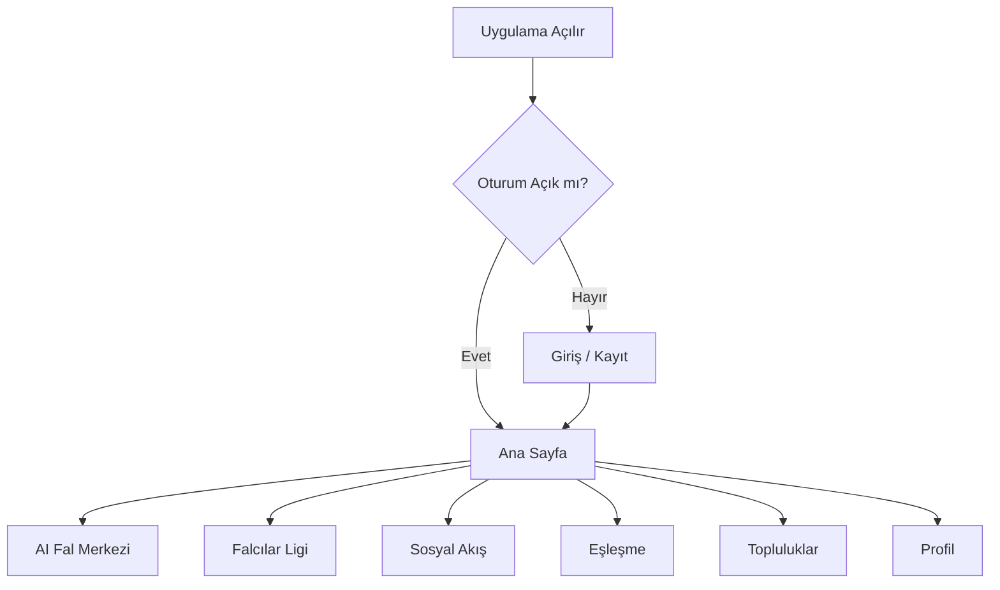
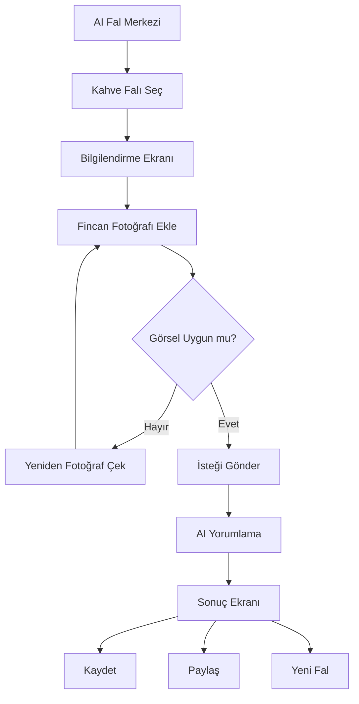
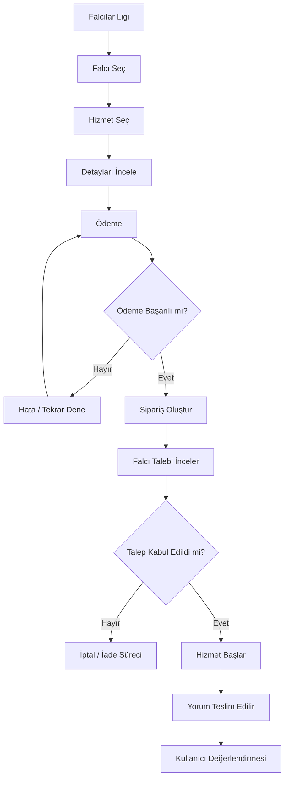
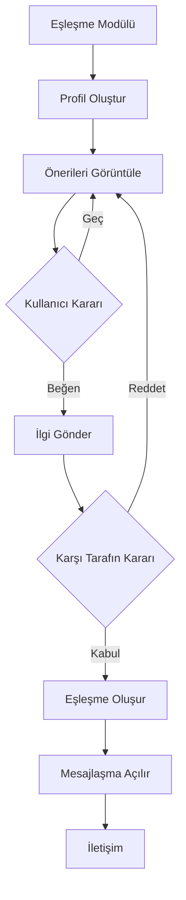

# USER_FLOWS.md
# Kullanıcı Akışları ve İş Süreçleri

**Proje:** Fal ve Sosyal Etkileşim Platformu  
**Dosya:** USER_FLOWS.md  
**Sürüm:** 1.0  
**Durum:** İlk Taslak  
**Uygulama Adı:** Henüz belirlenmedi

---

## 1. Amaç

Bu doküman, platformdaki kullanıcıların uygulama içerisinde gerçekleştirebileceği temel işlemleri ve bu işlemlerin adım adım nasıl ilerleyeceğini tanımlar.

Amaç yalnızca ekranlar arasında geçişleri belirlemek değil, aynı zamanda her özelliğin iş mantığını ve kullanıcı deneyimini ortaya koymaktır.

Platformun temel kullanım alanları:

1. Hesap oluşturma ve profil yönetimi.
2. Yapay zekâ destekli fal deneyimi.
3. Falcılar Ligi üzerinden profesyonel fal hizmeti alma.
4. Sosyal akışta paylaşım ve etkileşim.
5. Arkadaşlık ve eşleşme.
6. Topluluklara katılma ve tartışmalara dahil olma.
7. Bildirim ve mesajlaşma.
8. Falcı başvurusu ve hizmet sunma.
9. İçerik moderasyonu ve yönetim.

## 2. Genel Uygulama Akışı

Kullanıcı uygulamayı açtığında temel modüllere erişebileceği bir ana deneyimle karşılaşır.

Kullanıcı bu modülleri birbirinden bağımsız olarak kullanabilmelidir.

Örneğin:
- Sadece fal baktırmak isteyen bir kullanıcı eşleşme özelliğine girmek zorunda değildir.
- Sadece topluluklarda vakit geçirmek isteyen bir kullanıcı fal hizmeti satın almak zorunda değildir.
- Sadece falcı hizmeti almak isteyen bir kullanıcı sosyal paylaşım yapmak zorunda değildir.

## 3. Kayıt ve Giriş Akışı

### 3.1. Yeni kullanıcı kaydı

**Aktör:** Ziyaretçi

**Amaç:** Platformda yeni hesap oluşturmak.

Akış:

1. Kullanıcı uygulamayı açar.
2. Karşılama ekranını görür.
3. Kayıt ol seçeneğine basar.
4. E-posta veya desteklenen başka bir kayıt yöntemini seçer.
5. Gerekli hesap bilgilerini girer.
6. Kullanım şartlarını ve gizlilik bilgilendirmesini inceler.
7. Gerekli onayları verir.
8. Hesap doğrulama işlemini tamamlar.
9. Profil oluşturma ekranına yönlendirilir.
10. İsteğe bağlı profil bilgilerini tamamlar.
11. Ana sayfaya ulaşır.

**Alternatif durumlar:**
- E-posta zaten kullanılıyorsa hata gösterilir.
- Doğrulama başarısızsa tekrar deneme imkânı sunulur.
- Kullanıcı profilini tamamlamak istemezse bu adımı daha sonra yapabilir.

### 3.2. Mevcut kullanıcı girişi

1. Kullanıcı giriş ekranını açar.
2. Kayıt yöntemiyle hesabına giriş yapar.
3. Kimlik doğrulaması tamamlanır.
4. Oturum oluşturulur.
5. Ana sayfa açılır.

**Alternatif durumlar:**
- Hatalı parola durumunda uygun uyarı gösterilir.
- Hesap askıya alınmışsa kullanıcı bilgilendirilir.
- Ek doğrulama gerekiyorsa güvenlik adımı tamamlanır.

## 4. Profil Oluşturma ve Yönetme Akışı

**Aktör:** USER

**Amaç:** Kullanıcının platformdaki kimliğini oluşturması.

Akış:

1. Kullanıcı profil sayfasına girer.
2. Profil fotoğrafı ekler.
3. Kullanıcı adı belirler.
4. Kısa biyografi oluşturur.
5. İsteğe bağlı ilgi alanlarını seçer.
6. Profil görünürlüğünü ayarlar.
7. Değişiklikleri kaydeder.

**Profilde bulunabilecek bilgiler:**
- Profil fotoğrafı.
- Kullanıcı adı.
- Biyografi.
- İlgi alanları.
- Paylaşımlar.
- Takipçiler ve takip edilenler.
- Topluluk üyelikleri.
- Kullanıcı değerlendirmeleri (varsa).

Doğum tarihi, cinsiyet ve benzeri bilgiler yalnızca ilgili özellik için gerçekten gerekli olduğunda ve uygun bilgilendirme ile alınmalıdır.

## 5. Yapay Zekâ Fal Akışı

**Aktör:** USER

**Amaç:** Kullanıcının bir fal türü seçerek yapay zekâdan yorum alması.

### 5.1. Genel fal süreci

1. Kullanıcı ana sayfadan AI Fal Merkezi'ne girer.
2. Fal türlerini görüntüler.
3. İstediği fal türünü seçer.
4. Fal türüne ait açıklamayı ve gerekli girdileri görür.
5. Gerekli görseli veya metni ekler.
6. Fal yorumlama isteğini gönderir.
7. Sistem girdilerin uygunluğunu kontrol eder.
8. AI yorumlama servisine istek gönderilir.
9. Yorum oluşturulur.
10. Kullanıcı sonuç ekranına yönlendirilir.
11. Kullanıcı yorumunu okuyabilir.
12. İsterse kaydedebilir, paylaşabilir veya yeni fal oluşturabilir.

### 5.2. Kahve falı örnek akışı

### 5.3. Fal sonuç ekranı

Fal sonucunda gösterilebilecek bölümler:

- Genel yorum.
- Aşk ve ilişkiler.
- İş ve kariyer.
- Sosyal yaşam.
- Yakın dönem temaları.
- Kullanıcının sorduğu soruya yanıt.
- Yorumun oluşturulma tarihi.

Bunlar fal türüne ve ürün tasarımına göre değişebilir.

**Önemli:** Fal yorumları eğlence ve kişisel keşif amacı taşır. Bilimsel olarak doğrulanmış gelecek tahminleri gibi sunulmamalıdır. Sağlık, finans veya hukuk gibi kritik konularda kesin yönlendirme yapılmamalıdır.

### 5.4. Fal paylaşımı

1. Kullanıcı fal sonucunda paylaş butonuna basar.
2. Paylaşım biçimini seçer.
3. Görünürlük ayarını belirler.
4. Paylaşılacak metni veya görseli kontrol eder.
5. Paylaşımı onaylar.
6. İçerik sosyal akışta yayınlanır.

Kullanıcı paylaşım yapmadan önce özel bilgilerini ve istemediği bölümleri kaldırabilmelidir.

## 6. Falcılar Ligi Akışı

**Aktör:** USER

**Amaç:** Kullanıcının profesyonel falcıları incelemesi ve hizmet satın alması.

### 6.1. Falcı keşfetme

1. Kullanıcı Falcılar Ligi'ne girer.
2. Falcı listelerini görüntüler.
3. Falcıları uzmanlık alanına göre filtreler.
4. Fiyat, değerlendirme ve müsaitlik bilgilerini inceler.
5. İlgilendiği falcının profilini açar.
6. Hizmetlerini görüntüler.
7. İstediği hizmeti seçer.

### 6.2. Hizmet satın alma

1. Kullanıcı hizmet detayını açar.
2. Hizmet kapsamını ve fiyatını inceler.
3. Gerekli fal girdilerini ekler.
4. Sipariş özetini görüntüler.
5. Ödeme adımına geçer.
6. Ödeme sağlayıcısı üzerinden işlemi tamamlar.
7. Sipariş oluşturulur.
8. Falcıya bildirim gönderilir.
9. Falcı talebi kabul eder veya uygun bir durum seçer.
10. Hizmet süreci başlar.
11. Falcı yorumunu teslim eder.
12. Kullanıcı sonucu görüntüler.
13. Kullanıcı değerlendirme bırakabilir.

**Alternatif durumlar:**
- Falcı talebi kabul etmezse iptal ve iade politikası uygulanır.
- Falcı belirlenen süre içerisinde yanıt vermezse sipariş zaman aşımına uğrayabilir.
- Kullanıcı hizmet başlamadan önce iptal talep edebilir.
- Teslimat sonrası itiraz veya destek süreci açılabilir.

İptal, iade, teslim süresi ve komisyon kuralları ürün kararlarıyla kesinleştirilmelidir.

## 7. Falcı Başvuru ve Hizmet Sunma Akışı

**Aktör:** USER → FORTUNE_TELLER

**Amaç:** Kullanıcının profesyonel falcı olarak platformda hizmet vermeye başlaması.

Akış:

1. Kullanıcı profilinden falcı ol seçeneğine girer.
2. Başvuru koşullarını inceler.
3. Uzmanlık alanlarını seçer.
4. Profil açıklamasını oluşturur.
5. İstenen doğrulama bilgilerini gönderir.
6. Başvuru tamamlanır.
7. Yetkili ekip başvuruyu inceler.
8. Başvuru onaylanır veya reddedilir.
9. Onaylanırsa falcı özellikleri etkinleşir.
10. Kullanıcı hizmetlerini oluşturur.
11. Hizmet fiyatlarını ve açıklamalarını belirler.
12. Hizmetlerini yayınlar.
13. Gelen siparişleri yönetmeye başlar.

### Falcı sipariş yönetimi

Falcı panelinde şu bölümler bulunmalıdır:

- Yeni talepler.
- Kabul edilen talepler.
- Devam eden hizmetler.
- Teslim edilen hizmetler.
- İptal edilen siparişler.
- Kazançlar.
- Değerlendirmeler.
- Profil ve hizmet ayarları.

## 8. Sosyal Akış Kullanım Akışı

**Aktör:** USER

**Amaç:** Kullanıcıların içerik paylaşması ve birbirleriyle etkileşim kurması.

### 8.1. Gönderi oluşturma

1. Kullanıcı sosyal akışa girer.
2. Gönderi oluştur butonuna basar.
3. Metin, fotoğraf veya fal sonucu ekler.
4. İçerik açıklamasını yazar.
5. Görünürlük ayarını seçer.
6. Gönderiyi yayınlar.
7. Gönderi akışta görüntülenir.

### 8.2. Gönderi etkileşimi

Kullanıcı:
- Gönderiyi beğenebilir.
- Yorum yapabilir.
- Başka bir kullanıcıya gönderebilir.
- Kaydedebilir.
- Şikâyet edebilir.
- İçerik sahibini takip edebilir.

### 8.3. İçerik yönetimi

Kullanıcı kendi gönderisini düzenleyebilir veya silebilir.

Başka kullanıcıların gönderilerini ise yalnızca yetkili moderatörler, ilgili topluluk yöneticileri veya sistem yöneticileri belirlenmiş kurallar çerçevesinde yönetebilir.

## 9. Arkadaşlık ve Eşleşme Akışı

**Aktör:** USER

**Amaç:** Kullanıcıların fal sonuçları ve ortak ilgi alanları üzerinden yeni insanlarla tanışması.

Eşleşme modülü platformun zorunlu bir parçası değildir. Kullanıcı bu özelliği istediği zaman etkinleştirebilir veya kapatabilir.

### 9.1. Eşleşmeye katılım

1. Kullanıcı eşleşme sayfasına girer.
2. Özelliğin nasıl çalıştığını inceler.
3. Katılım şartlarını ve görünürlük ayarlarını görür.
4. Eşleşme profilini etkinleştirir.
5. Paylaşmak istediği bilgileri belirler.
6. Eşleşme önerileri görüntülenir.

### 9.2. Eşleşme önerileri

Sistem, kullanıcının izin verdiği veriler üzerinden öneriler oluşturabilir.

Değerlendirilebilecek bilgiler:
- Ortak ilgi alanları.
- Kullanıcının açıkça belirttiği tercihleri.
- Paylaşılmasına izin verilen fal temaları.
- Uygunluk ve etkileşim tercihleri.

Kullanıcının özel fal geçmişi veya hassas bilgileri açık rızası olmadan eşleşme amacıyla kullanılmamalıdır.

### 9.3. Eşleşme süreci

### 9.4. Güvenlik ve kontrol

- Kullanıcıları engelleme.
- Kullanıcıları şikâyet etme.
- Eşleşmeyi kaldırma.
- Profil görünürlüğünü kapatma.
- Mesajlaşmayı sınırlandırma.

Eşleşme özelliğinin yaş sınırı ve kimlerin birbirine önerilebileceği ayrıca ürün kararı olarak belirlenmelidir.

## 10. Topluluklar ve Forum Akışı

**Aktör:** USER

**Amaç:** Kullanıcıların ortak ilgi alanları etrafında topluluklar oluşturması ve tartışmalara katılması.

### 10.1. Topluluğa katılma

1. Kullanıcı topluluklar sayfasını açar.
2. Popüler veya önerilen toplulukları görüntüler.
3. Bir topluluğun detayına girer.
4. Açıklamayı ve kuralları inceler.
5. Katıl seçeneğine basar.
6. Topluluk akışını görüntüler.

### 10.2. Konu oluşturma

1. Kullanıcı topluluk içerisinde yeni konu oluşturur.
2. Başlık girer.
3. İçerik metnini yazar.
4. Gerekirse görsel veya fal sonucu ekler.
5. Konuyu yayınlar.
6. Diğer üyeler yorum yapabilir.

### 10.3. Yorum ve tartışma

Kullanıcı:
- Konuya yorum yapabilir.
- Başka yorumlara yanıt verebilir.
- İçeriği beğenebilir.
- Konuyu kaydedebilir.
- İçeriği şikâyet edebilir.

### 10.4. Topluluk oluşturma

1. Kullanıcı topluluk oluştur seçeneğine girer.
2. Topluluk adını belirler.
3. Açıklamasını yazar.
4. Kategorisini seçer.
5. Kuralları belirler.
6. Görsel ekler.
7. Topluluğu yayınlar.

Topluluk oluşturma ve yönetim yetkileri `USER_ROLES.md` kapsamında tanımlanmıştır.

## 11. Mesajlaşma Akışı

**Aktör:** USER

**Amaç:** Kullanıcıların platform içerisinde iletişim kurması.

Mesajlaşma şu alanlarda kullanılabilir:
- Eşleşme sonrası iletişim.
- Falcı ve müşteri arasındaki hizmet iletişimi.
- Kullanıcılar arasındaki sosyal iletişim.

Genel akış:

1. Kullanıcı mesajlaşma ekranını açar.
2. Konuşma listesini görüntüler.
3. Bir konuşmayı seçer veya yeni konuşma başlatır.
4. Mesajını yazar.
5. Mesajı gönderir.
6. Karşı taraf bildirimi alır.
7. Konuşma geçmişi görüntülenebilir.

Mesajlaşmada engelleme, şikâyet etme, spam önleme ve gizlilik kontrolleri bulunmalıdır.

Mesajlaşmanın kimler arasında hangi koşullarda açılacağı ürün kararıyla netleştirilmelidir.

## 12. Bildirim Akışı

**Amaç:** Kullanıcının platformdaki önemli gelişmelerden haberdar edilmesi.

Bildirim oluşturabilecek olaylar:

- Yeni takipçi.
- Yeni beğeni veya yorum.
- Eşleşme isteği.
- Yeni eşleşme.
- Yeni mesaj.
- Falcı sipariş durumu değişikliği.
- Falcı hizmet teslimatı.
- Topluluk etkileşimleri.
- Moderasyon uyarısı.
- Ödeme veya iade durumu.

Kullanıcı bildirim tercihlerini ayarlayabilmelidir.

Bildirim kanalları:
- Uygulama içi bildirim.
- Push notification.
- E-posta (isteğe bağlı).

## 13. Şikâyet ve Moderasyon Akışı

**Aktör:** USER → MODERATOR

**Amaç:** Uygunsuz içeriklerin ve davranışların raporlanması.

Akış:

1. Kullanıcı bir içerikte şikâyet et seçeneğine basar.
2. Şikâyet kategorisini seçer.
3. İsteğe bağlı açıklama girer.
4. Şikâyeti gönderir.
5. Sistem moderasyon kaydı oluşturur.
6. Yetkili moderatör bildirimi inceler.
7. Gerekirse içerik hakkında işlem yapar.
8. İşlem sonucu kaydedilir.
9. Uygun olduğu durumlarda ilgili kullanıcı bilgilendirilir.

Şikâyet kategorileri:
- Taciz veya zorbalık.
- Spam.
- Dolandırıcılık şüphesi.
- Uygunsuz içerik.
- Sahte hesap.
- Gizlilik ihlali.
- Topluluk kuralı ihlali.
- Diğer.

## 14. Hesap Kapatma ve Veri Yönetimi Akışı

**Aktör:** USER

**Amaç:** Kullanıcının hesabını devre dışı bırakması veya silme talebi oluşturması.

Akış:

1. Kullanıcı ayarlara girer.
2. Hesap yönetimini açar.
3. Hesabı devre dışı bırakma veya silme seçeneğini seçer.
4. Sonuçları ve koşulları görüntüler.
5. Kimlik doğrulamasını tamamlar.
6. Talebini onaylar.
7. Sistem talebi işler.
8. Kullanıcı bilgilendirilir.

Hesap silme, yasal saklama yükümlülükleri ve devam eden ödeme/hizmet işlemleri dikkate alınarak yürütülmelidir.

## 15. Temel Ekran Geçişleri

| Başlangıç | İşlem | Hedef |
|---|---|---|
| Karşılama | Giriş | Ana Sayfa |
| Ana Sayfa | AI Fal Merkezi | Fal Türleri |
| Fal Türleri | Fal seçimi | Fal Girdi Ekranı |
| Fal Girdi | Gönder | Fal Sonucu |
| Ana Sayfa | Falcılar Ligi | Falcı Listesi |
| Falcı Listesi | Falcı seçimi | Falcı Profili |
| Falcı Profili | Hizmet seçimi | Sipariş / Ödeme |
| Ana Sayfa | Sosyal | Sosyal Akış |
| Sosyal Akış | Gönderi oluştur | Gönderi Editörü |
| Ana Sayfa | Eşleşme | Eşleşme Akışı |
| Ana Sayfa | Topluluklar | Topluluk Listesi |
| Topluluk | Konu oluştur | Konu Editörü |
| Profil | Ayarlar | Hesap Ayarları |

## 16. Genel Hata ve Alternatif Akışlar

Her modülde aşağıdaki durumlar ele alınmalıdır:

- İnternet bağlantısının kesilmesi.
- Sunucu hatası.
- İstek zaman aşımı.
- Kullanıcının yetkisiz olması.
- Eksik veya hatalı veri gönderilmesi.
- Ödeme işleminin başarısız olması.
- Görsel yüklemenin başarısız olması.
- AI servisinin yanıt vermemesi.
- İçeriğin moderasyon nedeniyle kaldırılması.
- Kullanıcının hesabının askıya alınması.

Hatalar kullanıcıya anlaşılır biçimde gösterilmeli, mümkün olan durumlarda tekrar deneme imkânı sunulmalıdır.

## 17. Kabul Kriterleri

- [ ] Kullanıcı kayıt ve giriş akışını tamamlayabilmeli.
- [ ] Profil oluşturma ve düzenleme çalışmalı.
- [ ] Kullanıcı bir fal türü seçerek AI yorumlama talebi gönderebilmeli.
- [ ] Fal sonuçları kullanıcı tarafından yönetilebilmeli.
- [ ] Fal sonuçları isteğe bağlı paylaşılabilmeli.
- [ ] Falcılar Ligi üzerinden falcı keşfi yapılabilmeli.
- [ ] Hizmet satın alma ve sipariş takibi desteklenmeli.
- [ ] Falcı başvuru ve hizmet sunma akışı bulunmalı.
- [ ] Sosyal gönderi ve yorum akışı çalışmalı.
- [ ] Eşleşme modülü isteğe bağlı etkinleştirilebilmeli.
- [ ] Topluluk oluşturma, katılma ve konu açma akışları çalışmalı.
- [ ] Mesajlaşma ve bildirim süreçleri tanımlanmalı.
- [ ] Şikâyet ve moderasyon süreci bulunmalı.
- [ ] Hesap silme ve veri yönetimi akışı desteklenmeli.
- [ ] Yetkisiz işlemler sunucu tarafında engellenmeli.

---

**Doküman durumu:** İlk taslak tamamlandı.

**Bağlantılı dokümanlar:** `PROJECT_OVERVIEW.md`, `APP_FEATURES.md`, `USER_ROLES.md`, `PRD.md`, `UI_UX_GUIDELINES.md`.

**Geliştirme notu:** Bu akışlar ürünün iş mantığını tanımlar. Ekran tasarımları, teknik servisler ve veri modelleri sonraki dokümanlarda bu akışlarla tutarlı biçimde oluşturulmalıdır.
## 18. Tüm ürün için ekran envanteri — inceleme taslağı

- Tarih: 2026-11-08
- Dayanak: [ADR-0001](../project/decisions/ADR-0001-once-urun-tasarimi.md)
- Takip: [TASK-0002](../project/tasks/TASK-0002-ekran-envanteri.md)
- Durum: Kullanıcı incelemesini bekleyen taslak; ekran çizimi ve navigasyon onayı değildir.

Bu bölüm mevcut gereksinimleri ekranlara eşler. Yeni ürün gereksinimi veya tüm ekranların MVP'ye alınması kararı değildir. Ekranlar bağımsız sayfa, sekme, panel ya da iletişim kutusu olarak uygulanabilir; biçim yerleşim aşamasında seçilir. Kaynak sütunundaki § işaretleri aksi belirtilmedikçe bu belgenin bölümleridir. PRD ve USER_ROLES aynı klasördedir.

### 18.1. Ortak kayıt ve erişim kuralları

Her satırın kimliği kalıcı referanstır. Ad/amaç sütunu ekranın işini, veri/işlem sütunu ana ve ikincil eylemleri, geçiş sütunu giriş ve çıkışlarını tanımlar. Geri dönüş varsayılan olarak kaynak ekrana yapılır; kaydedilmemiş veri varsa çıkış davranışı akış detaylandırmada belirlenir. Bildirim veya bağlantıdan girişte de aynı erişim kontrolü uygulanır.

- **Z:** Oturumsuz ziyaretçi. Misafirin ürün içeriğine erişimi K1 kararıyla netleşecek.
- **U:** Oturum açmış kullanıcı; özel kayıtlarda sahiplik kontrolü zorunlu.
- **F:** Onaylı falcı, yalnızca kendi hizmeti veya atanmış siparişi.
- **T:** Topluluk sahibi/moderatörü, yalnızca ilgili topluluk ve izin sınırında.
- **O:** Operasyon personeli; USER_ROLES kapsamındaki destek/moderasyon/yönetici izinleri ayrı denetlenir. Bu etiket tüm personele tüm yetkileri vermez.
- **E:** Yaş/uygunluk kuralları netleşmiş, katılımı kendi açmış kullanıcı. Eşleşme verisi için ayrıca görünürlük ve izin kontrolü yapılır.

**Her satıra uygulanan durumlar:** İlk yükleme, boş veri, başarı, çevrimdışı/sunucu hatası ve tekrar deneme; korumalı ekranda oturum bitmesi/yetki reddi; formda doğrulama ve gönderim sırasında tekrar basma; silme/ödeme/rol değişiminde onay ve sonuç. Bu durumlar ayrı ekran sayılmaz. Satırdaki özel durumlar bunlara eklenir. Ayrıntılı metin ve geri dönüşler 3. adımda yazılacak.

**Veri görünürlüğü:** Hesap, fal, kullanım hakkı, ödeme, ayar ve başvuru kayıtları sahibine özeldir. Paylaşım kullanıcı onayından önce yayınlanmaz. Sosyal içerik ve profiller görünürlük kurallarına, topluluklar üyelik kurallarına tabidir. Mesajlar katılımcılara; falcı girdileri yalnızca hizmet kapsamında yetkili falcıya; operasyon verileri görev ve izne göre gösterilir. Aşağıdaki her satır bu varsayımları devralır.

**Tüm satırların inceleme durumu:** Taslak. **Tüm satırların MVP etiketi:** Açık, ilerleme haritası adım 8'de belirlenecek. K numaraları §18.3'teki açık kararlardır.

### 18.2. Ekran listesi

#### Hesap, profil ve ortak girişler

| Kimlik | Ad / amaç | Aktör | Veri ve ana / ikincil işlemler | Giriş → çıkış | Kaynak; özel durum / açık karar |
|---|---|---|---|---|---|
| H01 | Karşılama ve onboarding | Z | Ürün açıklaması; başla / giriş | Açılış → H02/H03 | §3; K1 |
| H02 | Giriş | Z | Kimlik bilgisi; giriş / kurtarma | H01 → A01/H05 | §3.2; askıda hesap; K2 |
| H03 | Kayıt | Z | Gerekli hesap verisi; şartları incele ve kayıt / vazgeç | H01 → H04 | §3.1; çakışan hesap; K2 |
| H04 | Hesap doğrulama | Z/U | Doğrulama durumu; doğrula / yeniden gönder | H03/H02 → P02/A01 | §3; süresi dolan doğrulama; K2 |
| H05 | Parola kurtarma ve yenileme | Z | Kurtarma isteği ve yeni parola; gönder / girişe dön | H02 → H02 | UI_UX_GUIDELINES §13; yöntem desteğine bağlı; K2 |
| H06 | Şartlar ve gizlilik bilgilendirmesi | Z/U | Metin ve sürüm; oku / kaynak akışa dön | H03/P03 → kaynak | §3, §14; K2 |
| A01 | Ana sayfa | U | Modül girişleri; deneyim seç / devam eden işe dön | Giriş/ana gezinme → modül başlangıçları | §2; içerik sırası ve misafir erişimi K1 |
| A02 | Keşif girişi | U | Falcı, topluluk ve içerik keşfi; kategori seç / filtrele | A01 → M01/T01/S01 | UI_UX_GUIDELINES §6; birleşik ekran gerekliliği K1 |
| P01 | Kendi profilim | U | Profil ve görünür içerikler; düzenle / ayarlar | A01 → P02/P03/S02/F06 | §4; falcı girişi L01; topluluk yönetimi T06 |
| P02 | Profil oluşturma/düzenleme | U | Fotoğraf, ad ve isteğe bağlı alanlar; kaydet / vazgeç | H04/P01 → P01/A01 | §4; görsel yükleme hatası; K2 |
| P03 | Ayarlar | U | Hesap ve tercih girişleri; bölüm seç / çıkış yap | P01 → P04/P05/P06/B02 | §4, §14; K2 |
| P04 | Gizlilik ve engellenenler | U | Görünürlük ve engel listesi; değiştir / engeli kaldır | P03 → P03 | §9.4, §11; K4 |
| P05 | Hesap güvenliği | U | Desteklenen kimlik yöntemi/oturum işlemleri; güncelle / dön | P03 → P03/H02 | PRD FR-002, §3; sunulacak işlemler K2 |
| P06 | Hesap kapatma/silme | U | Sonuçlar ve talep durumu; doğrula ve onayla / vazgeç | P03 → H01/P03 | §14; devam eden sipariş; K8 |

#### AI Fal Merkezi ve kullanım hakkı

| Kimlik | Ad / amaç | Aktör | Veri ve ana / ikincil işlemler | Giriş → çıkış | Kaynak; özel durum / açık karar |
|---|---|---|---|---|---|
| F01 | Fal türleri | U | Desteklenen türler; tür seç / geçmişe git | A01 → F02/F06 | §5; tür listesi K3 |
| F02 | Fal açıklaması ve girdi | U | Girdi kuralları, fotoğraf/metin; gönder / düzenle | F01 → F03/C01 | §5.1–5.2; izin reddi, uygunsuz görsel, limit; K3 |
| F03 | Fal işlem durumu | U | Kullanıcının talep durumu; sonucu aç / beklerken ayrıl | F02/F06/B01 → F04/F06 | §5; timeout/başarısızlık, yeniden denemenin hak etkisi K3 |
| F04 | Fal sonucu | U | Özel yorum ve eğlence açıklaması; oku / paylaş veya sil | F03/F06 → F05/F06 | §5.3; PRD FR-010–013; K3 |
| F05 | Paylaşım önizlemesi | U | Seçili sonuç bölümleri ve hedef görünürlük; onayla / vazgeç | F04 → S02/F04 | §5.4; özel alan çıkarma; K4 |
| F06 | Fal geçmişi | U | Kendi kayıtları, tarih/tür; aç / filtrele veya sil | P01/F01/F03 → F03/F04 | PRD FR-014–017; kayıt yok/silinmiş |
| C01 | Kullanım hakkı ve limit | U | Kalan hak ve yenilenme bilgisi; uygun fal akışına dön / paketleri aç | F02/P03 → F02/C02 | DEVELOPMENT_ROADMAP §12; K3/K5 |
| C02 | Paket/abonelik seçenekleri | U | Onaylanacak teklifler; seç / vazgeç | C01 → C03 | DEVELOPMENT_ROADMAP §17; model varsa; K5 |
| C03 | Satın alma ve sonuç | U | Seçim ve işlem durumu; tamamla / iptal | C02 → C01/C04 | DEVELOPMENT_ROADMAP §17; bekleyen/başarısız işlem; K5 |
| C04 | İşlem geçmişi | U | Kendi işlemleri; detay incele / destek | C01/C03/P03 → D01 | DEVELOPMENT_ROADMAP §17; K5 |

#### Sosyal ve topluluklar

| Kimlik | Ad / amaç | Aktör | Veri ve ana / ikincil işlemler | Giriş → çıkış | Kaynak; özel durum / açık karar |
|---|---|---|---|---|---|
| S01 | Sosyal akış | U | Görünür gönderiler; aç / oluştur veya takip | A01/A02 → S02/S03/S04 | §8; kaldırılmış içerik; K4 |
| S02 | Gönderi oluştur/düzenle | U | Kendi metin/medya/fal alıntısı; yayınla / vazgeç | S01/F05/S03 → S03 | §8.1, §8.3; yükleme ve moderasyon; K4 |
| S03 | Gönderi ve yorumlar | U | İzinli gönderi/yanıtlar; yorumla / beğen, kaydet, şikâyet | S01/P01/S05/B01 → S04/D02 | §8.2; silme/düzenleme sahibine; K4 |
| S04 | Başkasının profili ve takip listeleri | U | Görünür profil/içerik; takip / engelle veya şikâyet | S01/S03/T03 → S03/D02 | §4, §8; takipçi listesi görünürlüğü K4 |
| S05 | Kaydedilen içerikler | U | Kendi kayıt listesi; içeriği aç / kaydı kaldır | P01 → S03/T03 | PRD FR-032, USER_FLOWS §10.3; erişimi kalkmış kayıt |
| T01 | Topluluk keşfi ve üyeliklerim | U | Görünür topluluklar; aç / oluştur | A01/A02/P01 → T02/T05 | §10; K6 |
| T02 | Topluluk detay ve konu listesi | U | Kurallar, üyelik, konular; katıl / konu aç veya ayrıl | T01/B01 → T03/T04/T06 | §10.1; özel topluluk/üyelik reddi K6 |
| T03 | Konu ve yanıtlar | U | İzinli konu/yanıtlar; yanıtla / kaydet veya şikâyet | T02/S05/B01 → D02/S04 | §10.3; üye olmayanın işlemleri K6 |
| T04 | Konu oluştur/düzenle | U | Kendi konu içeriği; yayınla / vazgeç | T02/T03 → T03 | §10.2; düzenleme yetkisi K6 |
| T05 | Topluluk oluştur | U | Ad, açıklama, kurallar, görsel; oluştur / vazgeç | T01 → T02 | §10.4; oluşturma koşulları K6 |
| T06 | Topluluk yönetimi | T | Kural/içerik/üye işlemleri; yönet / yetkili işlem seç | T02/P01 → T07/T03 | USER_ROLES §3.3–3.4; K6 |
| T07 | Üye, moderatör ve devir yönetimi | T/U | Yetki sınırında üyeler/davetler; davet veya yanıt / kaldır veya devret | T06/B01 → T06/T02 | USER_ROLES §7.2, §3.3; davet kabulü, sahipsiz kalma; K6 |

#### Falcılar Ligi — müşteri ve falcı

| Kimlik | Ad / amaç | Aktör | Veri ve ana / ikincil işlemler | Giriş → çıkış | Kaynak; özel durum / açık karar |
|---|---|---|---|---|---|
| M01 | Falcı listesi | U | Onaylı falcılar, filtreler; profil aç / filtrele | A01/A02 → M02 | §6.1; K7 |
| M02 | Falcı profili ve hizmetleri | U | Yayınlı hizmet ve değerlendirme; hizmet seç / geri dön | M01 → M03 | §6.1; hizmet kullanılamıyor |
| M03 | Hizmet detayı | U | Kapsam, fiyat, süre; sipariş başlat / dön | M02 → M04 | §6.2; K7 |
| M04 | Sipariş girdisi ve özet | U | Hizmete özel girdiler; özet onayı / düzenle | M03 → M05 | §6.2; gerekli bilgi/görsel; K7 |
| M05 | Sipariş ödemesi ve sonuç | U | Tutar ve ödeme durumu; tamamla / iptal | M04 → M06 | §6.2; bekleyen/başarısız ödeme; K5/K7 |
| M06 | Siparişlerim ve takip | U | Kendi siparişleri ve durumları; detay aç / destek | P01/M05/B01 → M07/M08/D01 | §6.2; ret/zaman aşımı; K7 |
| M07 | Teslim ve değerlendirme | U | Kendi teslimi; oku ve değerlendir / itiraz | M06/B01 → M08 | §6.2; teslim yok; K7 |
| M08 | İptal, iade ve itiraz | U | Kendi siparişi ve talep durumu; talep gönder / destek | M06/M07 → M06/D01 | §6 alternatifleri; uygunluk ve süre K7 |
| L01 | Falcı başvurusu ve durum | U | Koşullar, başvuru bilgisi; başvur / durum incele | P01 → L02/P01 | §7; ret/eksik belge; K7 |
| L02 | Falcı paneli | F | Kendi sipariş/hizmet özeti; yönet / kazanç aç | P01/L01 → L03/L04/L06 | §7; rol kaldırılmış |
| L03 | Hizmetlerim ve hizmet editörü | F | Kendi hizmetleri; oluştur/düzenle / yayından al | L02 → L02 | §7; moderasyon ve fiyat K7 |
| L04 | Falcı sipariş listesi ve detayı | F | Atanmış sipariş girdileri; kabul / reddet veya iletişim | L02/B01 → L05/N02 | §7; kapasite ve süre K7 |
| L05 | Teslim hazırlama | F | Siparişe özel yorum; teslim et / düzenlemeye dön | L04 → L04 | §7; yükleme hatası/çift teslim; K7 |
| L06 | Kazançlar ve değerlendirmeler | F | Kendi kazanç/değerlendirmeleri; detay aç / destek | L02 → D01/L04 | §7; komisyon/ödeme durumu K7 |

#### Eşleşme, iletişim ve operasyon

| Kimlik | Ad / amaç | Aktör | Veri ve ana / ikincil işlemler | Giriş → çıkış | Kaynak; özel durum / açık karar |
|---|---|---|---|---|---|
| E01 | Eşleşme bilgilendirme ve katılım | U | Koşullar, veri izinleri; uygunlukla etkinleştir / vazgeç | A01/A02 → E02 | §9.1; uygun değil/izin reddi; K8 |
| E02 | Eşleşme profili ve tercihler | E | İzin verilen profil/tercihler; kaydet / kapat | E01/E03/P04 → E03/E01 | §9.1–9.4; K8 |
| E03 | Öneriler ve aday detayı | E | İzinli aday verisi; ilgi gönder / geç veya şikâyet | E02 → E04/D02 | §9.2–9.3; aday yok; K8 |
| E04 | Eşleşmeler | E | Karşılıklı eşleşmeler; konuş / kaldır | E03/B01 → N02 | §9.3–9.4; kaldırılmış eşleşme; K8 |
| N01 | Konuşmalar | U | Katılımcısı olduğu konuşmalar; aç / izinli konuşma başlat | A01/P01 → N02 | §11; başlatma koşulu K4/K8 |
| N02 | Sohbet | U/F/E | Katılımcı mesajları; gönder / engelle veya şikâyet | N01/L04/E04/B01 → D02/N01 | §11; bağlantı koptu/gönderilemedi, engellenmiş; K4/K8 |
| B01 | Bildirim merkezi | U | Kendi olay bildirimleri; hedefi aç / okundu işaretle | A01 → ilgili ekran | §12; hedef silinmiş/yetki kalkmış |
| B02 | Bildirim ve cihaz izinleri | U | Kendi kanal/olay tercihleri; kaydet / dön | P03/B01 → kaynak | §12; sistem izni reddi; K2 |
| D01 | Destek talebi ve takip | U | Kendi talebi; oluştur/yanıtla / kapat | P03/M06/C04 → kaynak | USER_ROLES §3.6; destek kanalı açık |
| D02 | Şikâyet ve engelleme | U | Seçilen içerik/hesap, gerekçe; gönder / vazgeç | S03/S04/T03/E03/N02 → kaynak | §13; tekrarlı rapor; K4/K8 |
| O01 | Operasyon girişi ve doğrulama | O | Personel kimliği; doğrula / çık | Yetkili giriş → O02 | USER_ROLES §3.7; MFA, yüzey seçimi açık |
| O02 | Operasyon çalışma alanı | O | Yalnızca izinli iş kuyrukları; iş seç / çık | O01 → O03–O08 | USER_ROLES §3.5–3.7; erişim reddi |
| O03 | Şikâyet inceleme ve yaptırım | O | Görevle ilgili rapor/kanıt; izinli işlem / üst yetkiye aktar | O02 → O02 | §13, USER_ROLES §3.5; özel veriye sınırsız erişim yok |
| O04 | Falcı başvuru/hizmet inceleme | O | Başvuru ve ilgili yayın; onay/ret / gerekçe gir | O02 → O02 | §7, USER_ROLES §3.7; K7 |
| O05 | Kullanıcı, rol ve topluluk yönetimi | O | Göreve gerekli kayıt; izinli güncelle / incele | O02 → O08 | USER_ROLES §3.7; yetki değişimi ve devir K6 |
| O06 | Destek ve sipariş uyuşmazlığı | O | Yetki kapsamındaki talep/sipariş; yanıtla / aktar | O02 → O02 | USER_ROLES §3.6; destek personeli doğrudan iade yapamaz; K7 |
| O07 | Operasyon ölçümleri ve yapılandırma | O | Yetkili istatistik/ayarlar; incele / izinli güncelle | O02 → O08 | USER_ROLES §3.7; hassas ayar teyidi, araç yüzeyi açık |
| O08 | Denetim kayıtları | O | İzinli işlem geçmişi; filtrele / incele | O02/O05/O07 → kaynak | USER_ROLES §9; salt okunur, veri kapsamı açık |

### 18.3. İnceleme sırasında netleştirilecek kararlar

| Kod | Açık konu | Etkilenen tasarım | Karar zamanı |
|---|---|---|---|
| K1 | Ana sayfa odağı, sekmeler, keşif gruplaması, misafir erişimi ve arama ihtiyacı | A01–A02 ve tüm modül girişleri | Navigasyon, adım 2 |
| K2 | Giriş yöntemleri, zorunlu profil alanları, izin isteme zamanı ve güvenlik işlemleri | H01–H06, P02/P05, B02 | Akış detayları, adım 3 |
| K3 | Fal türleri, girdi biçimleri, hak tüketimi, limit yenilenmesi ve başarısız işlem telafisi | F01–F06, C01 | Akış detayları; yayın türleri adım 8 |
| K4 | İçerik/profil görünürlüğü, paylaşım hedefleri, takip ve sosyal mesaj erişimi | S01–S05, P04, N01–N02 | Akış detayları, adım 3 |
| K5 | Ücretsiz/ücretli model, paket/abonelik ihtiyacı ve satın alma kanalı | C02–C04, M05 | Tasarım için senaryolar adım 3; nihai model geliştirme öncesi |
| K6 | Açık/özel topluluk, oluşturma koşulları, üyelik, moderatör yetkisi ve sahiplik devri | T01–T07, O05 | Akış detayları, adım 3 |
| K7 | Falcı doğrulama, teslim/ret süreleri, iptal/iade/itiraz, komisyon ve kazanç kuralları | M01–M08, L01–L06, O04/O06 | Akış detayları, adım 3 |
| K8 | Yaş uygunluğu, eşleşme veri izinleri, konuşma açma/kapama ve hesap silmenin etkileri | E01–E04, N02, P06 | Akış detayları, adım 3 |

Operasyon ekranlarının mobil uygulamadan mı ayrı yönetim arayüzünden mi sunulacağı açık kalır. Karar verilene kadar işlevsel ekran kapsamı korunur; araç veya servis kurulmaz.

### 18.4. Kapsama ve sonraki inceleme

§3–14'teki tüm ana akış alanları listede temsil edilir. Tekrar kullanılan ekranlar tek kimlik taşır; örneğin bir sipariş bildirimi M06'ya, fal tamamlanma bildirimi F04'e, mesaj bildirimi N02'ye gider. Başlangıçta oturum yoksa girişten sonra hedefin yetkisi tekrar değerlendirilir. Kaynak silinmişse anlaşılır durum gösterilir ve ilgili listeye dönülür.

Envanter ekran ailelerini kapsar; her fal türünün farklı girdi alt adımları, ödeme kanalının zorunlu ara ekranları ve operasyonun detay formları ilgili açık karar çözülünce ayrıştırılabilir. Ayrı ekran sayısı tasarım sonucu değişebilir.

İlk inceleme sorusu: Ana gezinme fal deneyimi etrafında mı, sosyal akış etrafında mı kurulmalı? Mevcut UX belgesindeki beş sekme önerisi onaylanmış değildir. Navigasyon kararıyla bu envanterdeki giriş noktaları kesinleştirilecek; ardından ayrıntılı akış ve yerleşim taslaklarına geçilecek.
