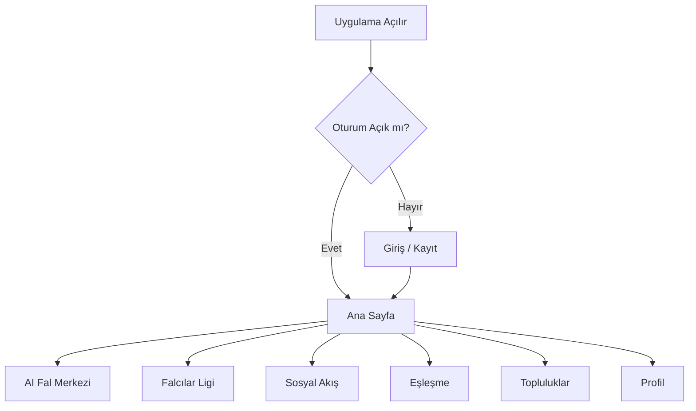
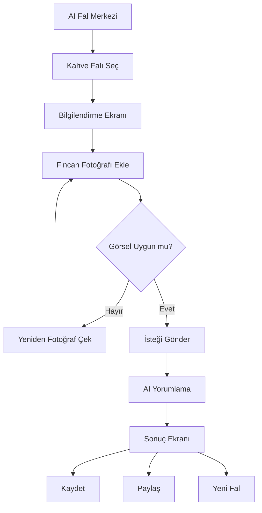
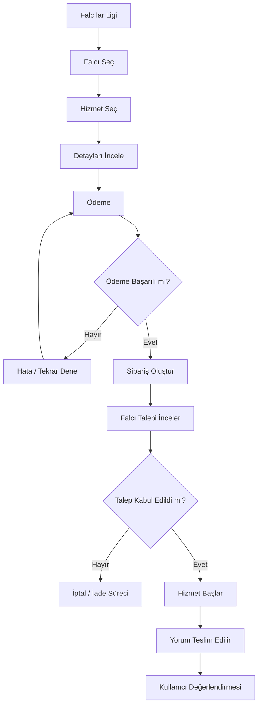
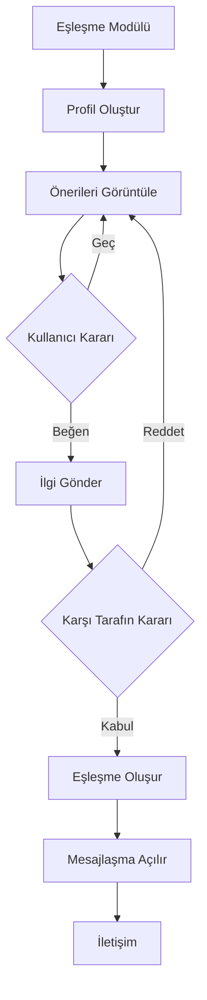

# USER_FLOWS.md
# Kullanıcı Akışları ve İş Süreçleri

**Proje:** Fal ve Sosyal Etkileşim Platformu  
**Dosya:** USER_FLOWS.md  
**Sürüm:** 1.0  
**Durum:** İlk Taslak  
**Uygulama Adı:** Henüz belirlenmedi

---

## 1. Amaç

Bu doküman, platformdaki kullanıcıların uygulama içerisinde gerçekleştirebileceği temel işlemleri ve bu işlemlerin adım adım nasıl ilerleyeceğini tanımlar.

Amaç yalnızca ekranlar arasında geçişleri belirlemek değil, aynı zamanda her özelliğin iş mantığını ve kullanıcı deneyimini ortaya koymaktır.

Platformun temel kullanım alanları:

1. Hesap oluşturma ve profil yönetimi.
2. Yapay zekâ destekli fal deneyimi.
3. Falcılar Ligi üzerinden profesyonel fal hizmeti alma.
4. Sosyal akışta paylaşım ve etkileşim.
5. Arkadaşlık ve eşleşme.
6. Topluluklara katılma ve tartışmalara dahil olma.
7. Bildirim ve mesajlaşma.
8. Falcı başvurusu ve hizmet sunma.
9. İçerik moderasyonu ve yönetim.

## 2. Genel Uygulama Akışı

Kullanıcı uygulamayı açtığında temel modüllere erişebileceği bir ana deneyimle karşılaşır.

Kullanıcı bu modülleri birbirinden bağımsız olarak kullanabilmelidir.

Örneğin:
- Sadece fal baktırmak isteyen bir kullanıcı eşleşme özelliğine girmek zorunda değildir.
- Sadece topluluklarda vakit geçirmek isteyen bir kullanıcı fal hizmeti satın almak zorunda değildir.
- Sadece falcı hizmeti almak isteyen bir kullanıcı sosyal paylaşım yapmak zorunda değildir.

## 3. Kayıt ve Giriş Akışı

### 3.1. Yeni kullanıcı kaydı

**Aktör:** Ziyaretçi

**Amaç:** Platformda yeni hesap oluşturmak.

Akış:

1. Kullanıcı uygulamayı açar.
2. Karşılama ekranını görür.
3. Kayıt ol seçeneğine basar.
4. E-posta veya desteklenen başka bir kayıt yöntemini seçer.
5. Gerekli hesap bilgilerini girer.
6. Kullanım şartlarını ve gizlilik bilgilendirmesini inceler.
7. Gerekli onayları verir.
8. Hesap doğrulama işlemini tamamlar.
9. Profil oluşturma ekranına yönlendirilir.
10. İsteğe bağlı profil bilgilerini tamamlar.
11. Ana sayfaya ulaşır.

**Alternatif durumlar:**
- E-posta zaten kullanılıyorsa hata gösterilir.
- Doğrulama başarısızsa tekrar deneme imkânı sunulur.
- Kullanıcı profilini tamamlamak istemezse bu adımı daha sonra yapabilir.

### 3.2. Mevcut kullanıcı girişi

1. Kullanıcı giriş ekranını açar.
2. Kayıt yöntemiyle hesabına giriş yapar.
3. Kimlik doğrulaması tamamlanır.
4. Oturum oluşturulur.
5. Ana sayfa açılır.

**Alternatif durumlar:**
- Hatalı parola durumunda uygun uyarı gösterilir.
- Hesap askıya alınmışsa kullanıcı bilgilendirilir.
- Ek doğrulama gerekiyorsa güvenlik adımı tamamlanır.

## 4. Profil Oluşturma ve Yönetme Akışı

**Aktör:** USER

**Amaç:** Kullanıcının platformdaki kimliğini oluşturması.

Akış:

1. Kullanıcı profil sayfasına girer.
2. Profil fotoğrafı ekler.
3. Kullanıcı adı belirler.
4. Kısa biyografi oluşturur.
5. İsteğe bağlı ilgi alanlarını seçer.
6. Profil görünürlüğünü ayarlar.
7. Değişiklikleri kaydeder.

**Profilde bulunabilecek bilgiler:**
- Profil fotoğrafı.
- Kullanıcı adı.
- Biyografi.
- İlgi alanları.
- Paylaşımlar.
- Takipçiler ve takip edilenler.
- Topluluk üyelikleri.
- Kullanıcı değerlendirmeleri (varsa).

Doğum tarihi, cinsiyet ve benzeri bilgiler yalnızca ilgili özellik için gerçekten gerekli olduğunda ve uygun bilgilendirme ile alınmalıdır.

## 5. Yapay Zekâ Fal Akışı

**Aktör:** USER

**Amaç:** Kullanıcının bir fal türü seçerek yapay zekâdan yorum alması.

### 5.1. Genel fal süreci

1. Kullanıcı ana sayfadan AI Fal Merkezi'ne girer.
2. Fal türlerini görüntüler.
3. İstediği fal türünü seçer.
4. Fal türüne ait açıklamayı ve gerekli girdileri görür.
5. Gerekli görseli veya metni ekler.
6. Fal yorumlama isteğini gönderir.
7. Sistem girdilerin uygunluğunu kontrol eder.
8. AI yorumlama servisine istek gönderilir.
9. Yorum oluşturulur.
10. Kullanıcı sonuç ekranına yönlendirilir.
11. Kullanıcı yorumunu okuyabilir.
12. İsterse kaydedebilir, paylaşabilir veya yeni fal oluşturabilir.

### 5.2. Kahve falı örnek akışı

### 5.3. Fal sonuç ekranı

Fal sonucunda gösterilebilecek bölümler:

- Genel yorum.
- Aşk ve ilişkiler.
- İş ve kariyer.
- Sosyal yaşam.
- Yakın dönem temaları.
- Kullanıcının sorduğu soruya yanıt.
- Yorumun oluşturulma tarihi.

Bunlar fal türüne ve ürün tasarımına göre değişebilir.

**Önemli:** Fal yorumları eğlence ve kişisel keşif amacı taşır. Bilimsel olarak doğrulanmış gelecek tahminleri gibi sunulmamalıdır. Sağlık, finans veya hukuk gibi kritik konularda kesin yönlendirme yapılmamalıdır.

### 5.4. Fal paylaşımı

1. Kullanıcı fal sonucunda paylaş butonuna basar.
2. Paylaşım biçimini seçer.
3. Görünürlük ayarını belirler.
4. Paylaşılacak metni veya görseli kontrol eder.
5. Paylaşımı onaylar.
6. İçerik sosyal akışta yayınlanır.

Kullanıcı paylaşım yapmadan önce özel bilgilerini ve istemediği bölümleri kaldırabilmelidir.

## 6. Falcılar Ligi Akışı

**Aktör:** USER

**Amaç:** Kullanıcının profesyonel falcıları incelemesi ve hizmet satın alması.

### 6.1. Falcı keşfetme

1. Kullanıcı Falcılar Ligi'ne girer.
2. Falcı listelerini görüntüler.
3. Falcıları uzmanlık alanına göre filtreler.
4. Fiyat, değerlendirme ve müsaitlik bilgilerini inceler.
5. İlgilendiği falcının profilini açar.
6. Hizmetlerini görüntüler.
7. İstediği hizmeti seçer.

### 6.2. Hizmet satın alma

1. Kullanıcı hizmet detayını açar.
2. Hizmet kapsamını ve fiyatını inceler.
3. Gerekli fal girdilerini ekler.
4. Sipariş özetini görüntüler.
5. Ödeme adımına geçer.
6. Ödeme sağlayıcısı üzerinden işlemi tamamlar.
7. Sipariş oluşturulur.
8. Falcıya bildirim gönderilir.
9. Falcı talebi kabul eder veya uygun bir durum seçer.
10. Hizmet süreci başlar.
11. Falcı yorumunu teslim eder.
12. Kullanıcı sonucu görüntüler.
13. Kullanıcı değerlendirme bırakabilir.

**Alternatif durumlar:**
- Falcı talebi kabul etmezse iptal ve iade politikası uygulanır.
- Falcı belirlenen süre içerisinde yanıt vermezse sipariş zaman aşımına uğrayabilir.
- Kullanıcı hizmet başlamadan önce iptal talep edebilir.
- Teslimat sonrası itiraz veya destek süreci açılabilir.

İptal, iade, teslim süresi ve komisyon kuralları ürün kararlarıyla kesinleştirilmelidir.

## 7. Falcı Başvuru ve Hizmet Sunma Akışı

**Aktör:** USER → FORTUNE_TELLER

**Amaç:** Kullanıcının profesyonel falcı olarak platformda hizmet vermeye başlaması.

Akış:

1. Kullanıcı profilinden falcı ol seçeneğine girer.
2. Başvuru koşullarını inceler.
3. Uzmanlık alanlarını seçer.
4. Profil açıklamasını oluşturur.
5. İstenen doğrulama bilgilerini gönderir.
6. Başvuru tamamlanır.
7. Yetkili ekip başvuruyu inceler.
8. Başvuru onaylanır veya reddedilir.
9. Onaylanırsa falcı özellikleri etkinleşir.
10. Kullanıcı hizmetlerini oluşturur.
11. Hizmet fiyatlarını ve açıklamalarını belirler.
12. Hizmetlerini yayınlar.
13. Gelen siparişleri yönetmeye başlar.

### Falcı sipariş yönetimi

Falcı panelinde şu bölümler bulunmalıdır:

- Yeni talepler.
- Kabul edilen talepler.
- Devam eden hizmetler.
- Teslim edilen hizmetler.
- İptal edilen siparişler.
- Kazançlar.
- Değerlendirmeler.
- Profil ve hizmet ayarları.

## 8. Sosyal Akış Kullanım Akışı

**Aktör:** USER

**Amaç:** Kullanıcıların içerik paylaşması ve birbirleriyle etkileşim kurması.

### 8.1. Gönderi oluşturma

1. Kullanıcı sosyal akışa girer.
2. Gönderi oluştur butonuna basar.
3. Metin, fotoğraf veya fal sonucu ekler.
4. İçerik açıklamasını yazar.
5. Görünürlük ayarını seçer.
6. Gönderiyi yayınlar.
7. Gönderi akışta görüntülenir.

### 8.2. Gönderi etkileşimi

Kullanıcı:
- Gönderiyi beğenebilir.
- Yorum yapabilir.
- Başka bir kullanıcıya gönderebilir.
- Kaydedebilir.
- Şikâyet edebilir.
- İçerik sahibini takip edebilir.

### 8.3. İçerik yönetimi

Kullanıcı kendi gönderisini düzenleyebilir veya silebilir.

Başka kullanıcıların gönderilerini ise yalnızca yetkili moderatörler, ilgili topluluk yöneticileri veya sistem yöneticileri belirlenmiş kurallar çerçevesinde yönetebilir.

## 9. Arkadaşlık ve Eşleşme Akışı

**Aktör:** USER

**Amaç:** Kullanıcıların fal sonuçları ve ortak ilgi alanları üzerinden yeni insanlarla tanışması.

Eşleşme modülü platformun zorunlu bir parçası değildir. Kullanıcı bu özelliği istediği zaman etkinleştirebilir veya kapatabilir.

### 9.1. Eşleşmeye katılım

1. Kullanıcı eşleşme sayfasına girer.
2. Özelliğin nasıl çalıştığını inceler.
3. Katılım şartlarını ve görünürlük ayarlarını görür.
4. Eşleşme profilini etkinleştirir.
5. Paylaşmak istediği bilgileri belirler.
6. Eşleşme önerileri görüntülenir.

### 9.2. Eşleşme önerileri

Sistem, kullanıcının izin verdiği veriler üzerinden öneriler oluşturabilir.

Değerlendirilebilecek bilgiler:
- Ortak ilgi alanları.
- Kullanıcının açıkça belirttiği tercihleri.
- Paylaşılmasına izin verilen fal temaları.
- Uygunluk ve etkileşim tercihleri.

Kullanıcının özel fal geçmişi veya hassas bilgileri açık rızası olmadan eşleşme amacıyla kullanılmamalıdır.

### 9.3. Eşleşme süreci

### 9.4. Güvenlik ve kontrol

- Kullanıcıları engelleme.
- Kullanıcıları şikâyet etme.
- Eşleşmeyi kaldırma.
- Profil görünürlüğünü kapatma.
- Mesajlaşmayı sınırlandırma.

Eşleşme özelliğinin yaş sınırı ve kimlerin birbirine önerilebileceği ayrıca ürün kararı olarak belirlenmelidir.

## 10. Topluluklar ve Forum Akışı

**Aktör:** USER

**Amaç:** Kullanıcıların ortak ilgi alanları etrafında topluluklar oluşturması ve tartışmalara katılması.

### 10.1. Topluluğa katılma

1. Kullanıcı topluluklar sayfasını açar.
2. Popüler veya önerilen toplulukları görüntüler.
3. Bir topluluğun detayına girer.
4. Açıklamayı ve kuralları inceler.
5. Katıl seçeneğine basar.
6. Topluluk akışını görüntüler.

### 10.2. Konu oluşturma

1. Kullanıcı topluluk içerisinde yeni konu oluşturur.
2. Başlık girer.
3. İçerik metnini yazar.
4. Gerekirse görsel veya fal sonucu ekler.
5. Konuyu yayınlar.
6. Diğer üyeler yorum yapabilir.

### 10.3. Yorum ve tartışma

Kullanıcı:
- Konuya yorum yapabilir.
- Başka yorumlara yanıt verebilir.
- İçeriği beğenebilir.
- Konuyu kaydedebilir.
- İçeriği şikâyet edebilir.

### 10.4. Topluluk oluşturma

1. Kullanıcı topluluk oluştur seçeneğine girer.
2. Topluluk adını belirler.
3. Açıklamasını yazar.
4. Kategorisini seçer.
5. Kuralları belirler.
6. Görsel ekler.
7. Topluluğu yayınlar.

Topluluk oluşturma ve yönetim yetkileri `USER_ROLES.md` kapsamında tanımlanmıştır.

## 11. Mesajlaşma Akışı

**Aktör:** USER

**Amaç:** Kullanıcıların platform içerisinde iletişim kurması.

Mesajlaşma şu alanlarda kullanılabilir:
- Eşleşme sonrası iletişim.
- Falcı ve müşteri arasındaki hizmet iletişimi.
- Kullanıcılar arasındaki sosyal iletişim.

Genel akış:

1. Kullanıcı mesajlaşma ekranını açar.
2. Konuşma listesini görüntüler.
3. Bir konuşmayı seçer veya yeni konuşma başlatır.
4. Mesajını yazar.
5. Mesajı gönderir.
6. Karşı taraf bildirimi alır.
7. Konuşma geçmişi görüntülenebilir.

Mesajlaşmada engelleme, şikâyet etme, spam önleme ve gizlilik kontrolleri bulunmalıdır.

Mesajlaşmanın kimler arasında hangi koşullarda açılacağı ürün kararıyla netleştirilmelidir.

## 12. Bildirim Akışı

**Amaç:** Kullanıcının platformdaki önemli gelişmelerden haberdar edilmesi.

Bildirim oluşturabilecek olaylar:

- Yeni takipçi.
- Yeni beğeni veya yorum.
- Eşleşme isteği.
- Yeni eşleşme.
- Yeni mesaj.
- Falcı sipariş durumu değişikliği.
- Falcı hizmet teslimatı.
- Topluluk etkileşimleri.
- Moderasyon uyarısı.
- Ödeme veya iade durumu.

Kullanıcı bildirim tercihlerini ayarlayabilmelidir.

Bildirim kanalları:
- Uygulama içi bildirim.
- Push notification.
- E-posta (isteğe bağlı).

## 13. Şikâyet ve Moderasyon Akışı

**Aktör:** USER → MODERATOR

**Amaç:** Uygunsuz içeriklerin ve davranışların raporlanması.

Akış:

1. Kullanıcı bir içerikte şikâyet et seçeneğine basar.
2. Şikâyet kategorisini seçer.
3. İsteğe bağlı açıklama girer.
4. Şikâyeti gönderir.
5. Sistem moderasyon kaydı oluşturur.
6. Yetkili moderatör bildirimi inceler.
7. Gerekirse içerik hakkında işlem yapar.
8. İşlem sonucu kaydedilir.
9. Uygun olduğu durumlarda ilgili kullanıcı bilgilendirilir.

Şikâyet kategorileri:
- Taciz veya zorbalık.
- Spam.
- Dolandırıcılık şüphesi.
- Uygunsuz içerik.
- Sahte hesap.
- Gizlilik ihlali.
- Topluluk kuralı ihlali.
- Diğer.

## 14. Hesap Kapatma ve Veri Yönetimi Akışı

**Aktör:** USER

**Amaç:** Kullanıcının hesabını devre dışı bırakması veya silme talebi oluşturması.

Akış:

1. Kullanıcı ayarlara girer.
2. Hesap yönetimini açar.
3. Hesabı devre dışı bırakma veya silme seçeneğini seçer.
4. Sonuçları ve koşulları görüntüler.
5. Kimlik doğrulamasını tamamlar.
6. Talebini onaylar.
7. Sistem talebi işler.
8. Kullanıcı bilgilendirilir.

Hesap silme, yasal saklama yükümlülükleri ve devam eden ödeme/hizmet işlemleri dikkate alınarak yürütülmelidir.

## 15. Temel Ekran Geçişleri

| Başlangıç | İşlem | Hedef |
|---|---|---|
| Karşılama | Giriş | Ana Sayfa |
| Ana Sayfa | AI Fal Merkezi | Fal Türleri |
| Fal Türleri | Fal seçimi | Fal Girdi Ekranı |
| Fal Girdi | Gönder | Fal Sonucu |
| Ana Sayfa | Falcılar Ligi | Falcı Listesi |
| Falcı Listesi | Falcı seçimi | Falcı Profili |
| Falcı Profili | Hizmet seçimi | Sipariş / Ödeme |
| Ana Sayfa | Sosyal | Sosyal Akış |
| Sosyal Akış | Gönderi oluştur | Gönderi Editörü |
| Ana Sayfa | Eşleşme | Eşleşme Akışı |
| Ana Sayfa | Topluluklar | Topluluk Listesi |
| Topluluk | Konu oluştur | Konu Editörü |
| Profil | Ayarlar | Hesap Ayarları |

## 16. Genel Hata ve Alternatif Akışlar

Her modülde aşağıdaki durumlar ele alınmalıdır:

- İnternet bağlantısının kesilmesi.
- Sunucu hatası.
- İstek zaman aşımı.
- Kullanıcının yetkisiz olması.
- Eksik veya hatalı veri gönderilmesi.
- Ödeme işleminin başarısız olması.
- Görsel yüklemenin başarısız olması.
- AI servisinin yanıt vermemesi.
- İçeriğin moderasyon nedeniyle kaldırılması.
- Kullanıcının hesabının askıya alınması.

Hatalar kullanıcıya anlaşılır biçimde gösterilmeli, mümkün olan durumlarda tekrar deneme imkânı sunulmalıdır.

## 17. Kabul Kriterleri

- [ ] Kullanıcı kayıt ve giriş akışını tamamlayabilmeli.
- [ ] Profil oluşturma ve düzenleme çalışmalı.
- [ ] Kullanıcı bir fal türü seçerek AI yorumlama talebi gönderebilmeli.
- [ ] Fal sonuçları kullanıcı tarafından yönetilebilmeli.
- [ ] Fal sonuçları isteğe bağlı paylaşılabilmeli.
- [ ] Falcılar Ligi üzerinden falcı keşfi yapılabilmeli.
- [ ] Hizmet satın alma ve sipariş takibi desteklenmeli.
- [ ] Falcı başvuru ve hizmet sunma akışı bulunmalı.
- [ ] Sosyal gönderi ve yorum akışı çalışmalı.
- [ ] Eşleşme modülü isteğe bağlı etkinleştirilebilmeli.
- [ ] Topluluk oluşturma, katılma ve konu açma akışları çalışmalı.
- [ ] Mesajlaşma ve bildirim süreçleri tanımlanmalı.
- [ ] Şikâyet ve moderasyon süreci bulunmalı.
- [ ] Hesap silme ve veri yönetimi akışı desteklenmeli.
- [ ] Yetkisiz işlemler sunucu tarafında engellenmeli.

---

**Doküman durumu:** İlk taslak tamamlandı.

**Bağlantılı dokümanlar:** `PROJECT_OVERVIEW.md`, `APP_FEATURES.md`, `USER_ROLES.md`, `PRD.md`, `UI_UX_GUIDELINES.md`.

**Geliştirme notu:** Bu akışlar ürünün iş mantığını tanımlar. Ekran tasarımları, teknik servisler ve veri modelleri sonraki dokümanlarda bu akışlarla tutarlı biçimde oluşturulmalıdır.